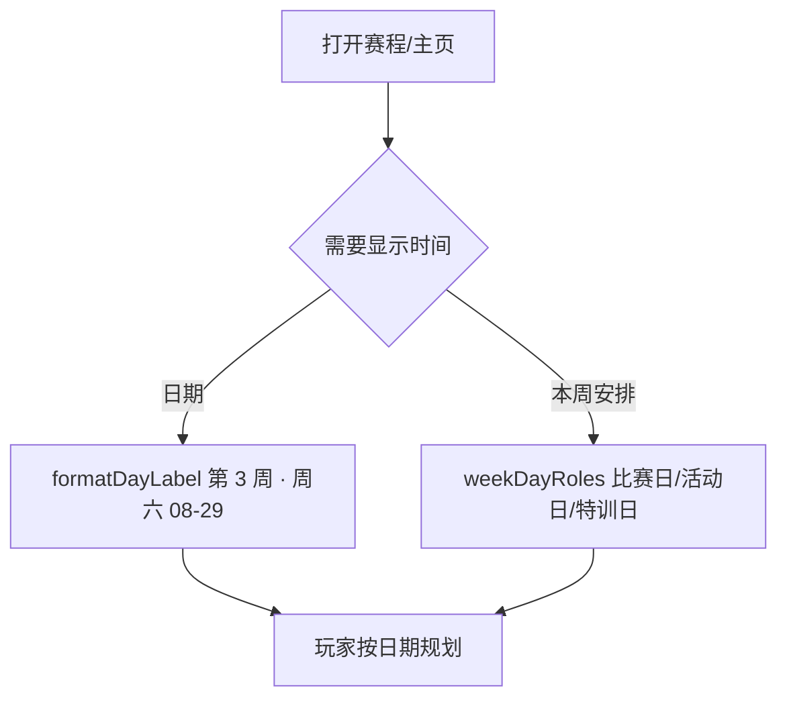
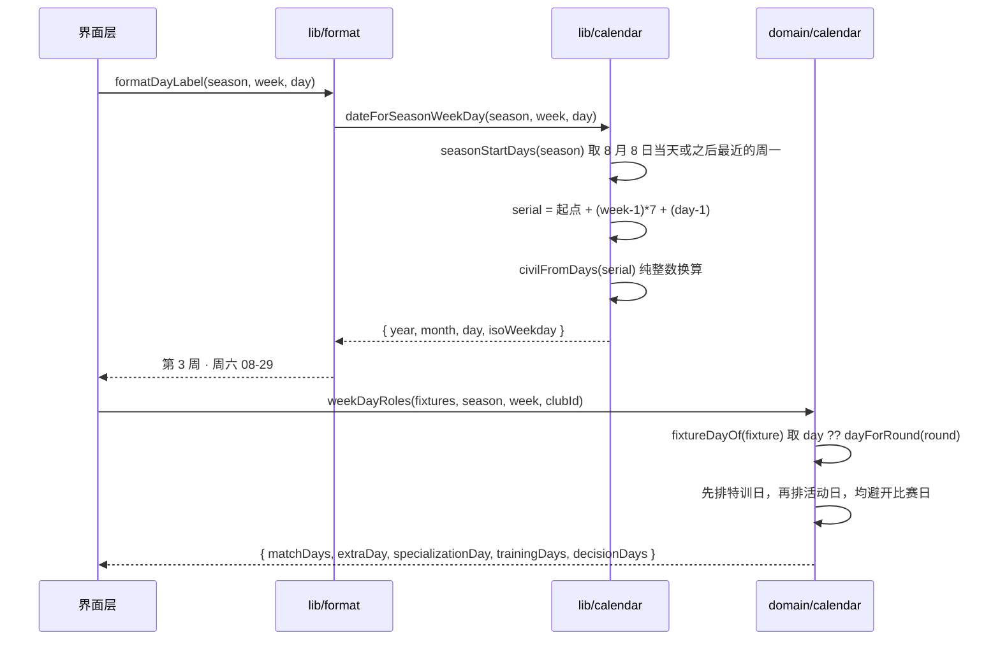

# 赛历与日期

## 业务目标

让玩家看得见时间。此前赛程只有「第 N 周」，玩家无法知道比赛落在哪一天、一周里哪天训练、哪天可以做额外活动，也就没有「这周还剩几天」的生活感。

本功能提供两件事：

1. **公历日期**：由赛季 + 周次 + 周内日序号推导出真实日期与中文星期，且完全不依赖设备时钟。
2. **周内角色**：由本周赛程推导出比赛日、额外活动日、特训日与训练日，为后续逐日推进提供唯一的排期口径。

本批次**零行为变化**：引擎结算路径、RNG 消耗、存档结构均未改动，赛季回放基准哈希不变。

## 用户流程

1. 玩家在赛程页与主页看到 `第 3 周 · 周六 08-29` 这样带中文星期的日标签，而不是裸的周序号。
2. 一周内哪天有比赛由轮次决定：奇数轮周日、偶数轮周六、每第 5 轮周中。
3. 比赛占用周三时，特训日自动挪到周二；比赛占用周五时，额外活动日按「周五 → 周四 → 周二」避让。
4. 没有比赛的周（未来的冬歇期、国际比赛周），训练日仍是周一到周五五个训练槽。

## 关键时序

## 规则与边界

| 规则 | 口径 |
|---|---|
| 赛季锚点 | `8 月 8 日` 当天或之后**最近的周一**为第 1 周周一；因此锚点日期随年份浮动（2026 年 8/10、2027 年 8/9） |
| 周内日序号 | `day ∈ [1,7]`，周一 = 1，周日 = 7；`dateForSeasonWeekDay(s,w,d).isoWeekday === d` 对整季 266 天恒成立 |
| 绝对日序 | `absoluteDay(week, day) = (week-1)*7 + day`，不落盘，避免与 `week/day` 不一致 |
| 比赛日推导 | `round % 5 === 0 → 3`（周中）；否则偶数轮 `6`（周六）、奇数轮 `7`（周日） |
| 赛程的日 | `fixtureDayOf` 优先用已落盘的 `fixture.day`，缺失时按轮次推导，所以本批次不迁移存档也能得到正确排期 |
| 特训日 | 首选周三，被比赛占用则按 `周三 → 周二 → 周四` 取第一个空闲日 |
| 活动日 | 首选周五，被比赛或特训占用则按 `周五 → 周四 → 周二` 避让 |
| 训练日 | 周一到周五减去比赛日；活动日与特训日落在训练日之内，是「叠加」而非「替换」 |
| 决策日 | `比赛日 ∪ 活动日 ∪ 特训日` 升序，供快进停止判定使用 |
| 俱乐部过滤 | 传入 `clubId` 时只看该队主客场场次，用户排期不受其他队比赛影响 |
| 跨赛季隔离 | 只匹配 `season` 与 `week` 都相同的赛程，不会串周也不会串赛季 |
| 无墙钟 | `src/lib` 与 `src/engine`/`src/world` 一样禁止 `new Date(`；`tests/engine/determinism.test.ts` 的正则已从 `new Date\(\s*\)` 收紧为 `new Date\(` |

## 数据与接口

`src/lib/calendar.ts`（纯整数公历，Hinnant `daysFromCivil`/`civilFromDays` 公式，无浮点、无 Date）：

| 导出 | 作用 |
|---|---|
| `daysFromCivil(year, month, day)` | 公历日期 → 相对 1970-01-01 的日序，可为负 |
| `civilFromDays(serial)` | 日序 → `{year, month, day}`，与上者互为逆运算 |
| `isoWeekdayFromDays(serial)` | 日序 → ISO 星期几（1=周一 … 7=周日） |
| `seasonStartDays(season)` | 赛季起点日序 |
| `dateForSeasonWeekDay(season, week, day)` | 赛季坐标 → `SeasonDate` |
| `WEEKDAY_LABELS` | `['周一' … '周日']` |

`src/lib/format.ts`：`formatDateLabel(season, week, day = 1)`（第三参可选，旧调用点不破）、`formatDateShort`、`formatDayLabel`。

`src/domain/calendar.ts`：`DAYS_PER_WEEK / MATCH_DAY / MATCH_DAY_ALT / MIDWEEK_DAY / TRAINING_DAYS / absoluteDay / dayForRound / fixtureDayOf / weekDayRoles` 与 `WeekDayRoles` 类型。

`Fixture`（`src/domain/matchTypes.ts`）新增**可选** `day?: number`。可选是刻意的：本批次没有任何生成与持久化点，若现在就必填会制造无意义的存档迁移。`fixtureSchema` 是 `passthrough`，因此后续 M1.2 落盘时无需为它单独升版本。

## 失败与降级

- 历法函数是纯数学，不存在外部失败；输入越界（`week ≤ 0`、`day ∉ [1,7]`）不抛错，只产出对应偏移的日期，由调用方的赛季坐标合法性兜底。
- `weekDayRoles` 收到空赛程时退化为「五个训练日 + 周三特训 + 周五活动」，这正是冬歇期与国际比赛周期望的行为，不需要特殊分支。
- 若未来 `fixture.day` 与 `round` 推导冲突（例如杯赛抽签），`day` 优先，`round` 只用于展示轮次，两者不再互相校验。

## 平台差异

界面与引擎共用同一份日历，Android 与桌面表现完全一致；不读设备时区，因此跨时区、修改系统时间都不会改变赛季日期或结算结果。日期文本为中文，仅在 `src/ui` 渲染，不进入存档。

## 验收与测试映射

| 测试 | 验收点 |
|---|---|
| `tests/lib/calendar.test.ts` 日期与日序可以互相往返，覆盖闰日 | `daysFromCivil`/`civilFromDays` 互逆，含 2000/2028 闰日 |
| 同上 1970 元旦是周四，日序每加 7 星期几不变 | `isoWeekdayFromDays` 的基准与周期性 |
| 同上 赛季起点落在 8 月 8 日当天或之后最近的周一 | 锚点定义，2026 → 8/10、2027 → 8/9 |
| 同上 赛季内 266 天的星期几恒等于它的日位序号 | `day` 同时是周内序号与真实星期，三个赛季全量覆盖 |
| 同上 赛季跨自然年仍连续，末周落在次年 5 月初 | 跨 1 月不出错、周与日连续 |
| 同上 日期标签按周日到周六排布并带中文星期 | `formatDateLabel/formatDateShort/formatDayLabel` 文案 |
| `tests/domain/calendar.test.ts` 轮次与日序 | 比赛日推导、`absoluteDay` 1..266、`fixtureDayOf` 回落 |
| 同上 一周内的角色日 | 周日赛/周中赛/双赛三种排期与避让顺序 |
| 同上 赛程过滤与空周 | 比赛日去重升序、按俱乐部过滤、跨赛季跨周隔离、无比赛周 |
| `tests/engine/determinism.test.ts` | `engine/world/lib` 不得出现 `new Date(`（本批次收紧） |

`npm run quality:golden` 双跑一致，证明本批次未改变任何结算哈希。

## 变更记录

| 日期 | 变更 |
|---|---|
| 2026-11-01 | 首版：新增纯整数公历 `src/lib/calendar.ts`、周内角色规则 `src/domain/calendar.ts`；`formatDateLabel` 增可选 `day` 并新增 `formatDateShort`/`formatDayLabel`；`Fixture` 增可选 `day`；确定性守卫收紧为 `new Date(`。零行为变化。 |
| 2026-11-02 | AI 周快照的【时间】行也切到 `formatDayLabel`，界面与 GM 提示词共用同一套日期口径。 |
