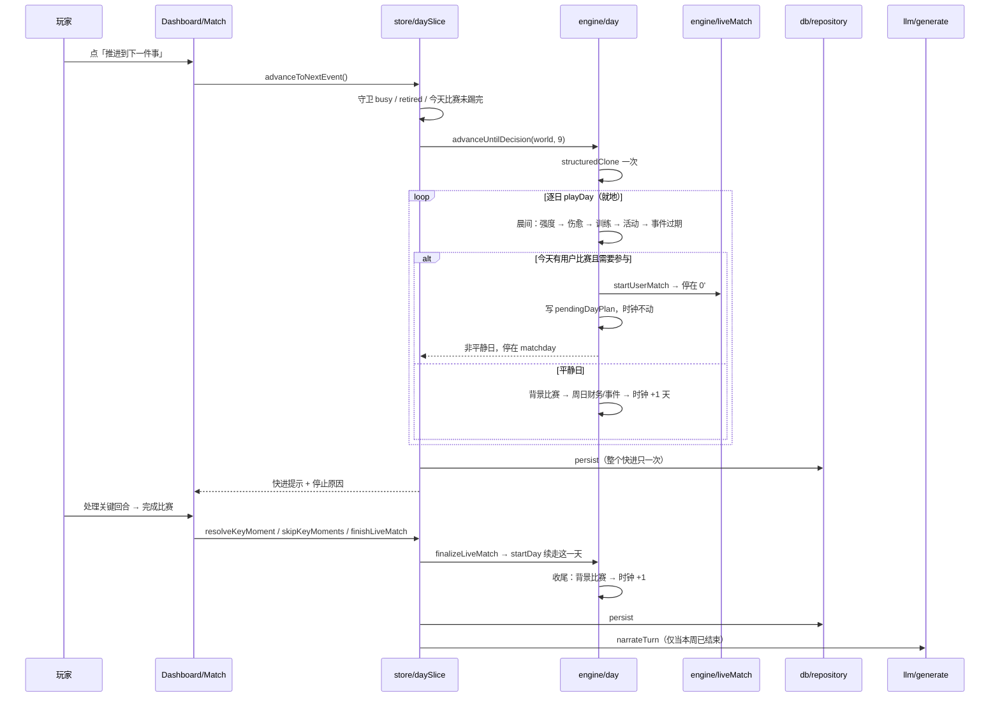

# 每日回合

## 业务目标

时间粒度从「一次点一下 = 模拟一周」改成「一天一步」：职业生涯按周一到周日推进，训练落在训练日、额外安排落在活动日、比赛落在有真实日期的比赛日。一周仍只排一次「周模板」，但每天真的执行属于那一天那一步，于是成长、体能、伤病、财务与新闻都能按天被感知。

推进有两种手感：「推进一天」逐日手动；「推进到下一件事」快进并**自动跳过平静日**，只在真正有得选的日子停下——需要参与的开球、新事件、里程碑。比赛日需要玩家参与时日步进停在开球，实时直播与关键回合照旧可中途存档、可续踢。

## 用户流程

1. 玩家在 `/game` 点「安排本周」，在 `WeekPlannerModal` 选训练重点（身体/技术/战术/恢复）与额外安排（媒体/经纪人/社交/休息/家庭/无），可选「只保存本周安排」或「保存并推进到下一件事」。
2. 主页推进区两个按钮各做一件事：
   - 主按钮「推进到下一件事」→ `store.advanceToNextEvent()`：连续结算日子，跳过平静日，停在第一件需要处理的事。
   - 次按钮「推进一天」→ `store.advanceDay()`：只走一格日时钟。
   - 按钮下方小字预告「距上场 3 天」，本周没有比赛时显示「本周没有比赛」。
3. 单日结算按固定顺序执行（晨间 → 比赛 → 收尾）。平静日不写新闻、不产生停止原因，只累加 `quietDays`。
4. 停下时提示交代这一天：手动推进如 `周三 · 训练日：技术打磨`，快进如 `推进 7 天 · 6 个平静日 · 周日 08-30 有比赛 vs 利兹竞技`（本周无比赛时末段换成 `本周没有比赛`）。
5. 停在开球时进入 `/match`：直播从 0' 播到关键回合，玩家逐条处理，播满 90' 后「完成比赛」才结算这一天并继续走时钟。
6. 第 38 周第 7 天推进后 `week = 39`，触发 `endSeason`，展示赛季总结、奖项、升降级与退役提示。

## 关键时序

## 规则与边界

### 日时钟

- `WorldState.day` 是 1–7 的**周内日序**（周一 = 1），与 `week` 一起构成时钟；绝对日不落盘。
- `absoluteDay(week, day) = (week - 1) * 7 + day`（`src/domain/calendar.ts`）用于跨周比较、「距上场几天」与 21 天节拍。
- 时钟只能前进：`day < 7 ⇒ day + 1`；`day === 7 ⇒ day = 1, week + 1`；`week > totalWeeks ⇒ endSeason`。
- 比赛日/活动日/特训日由该周真实赛程推导（`weekDayRoles`）：`dayForRound(round)` 为「每第 5 轮打周三，偶数轮周六，奇数轮周日」；比赛当天不排训练与活动，活动日优先级 `[5, 4, 2]`、特训日 `[3, 2, 4]`。
- 训练日是 `[1,2,3,4,5]` 减去比赛日，因此一周 4–5 次训练；单次量 = 原周量 × `PER_DAY = 1/5`（`src/engine/training.ts:8`）。
- `specializationDay` 已由赛历导出，但引擎尚未消费（周三特训槽属 M1.11）。

### 一天之内的顺序（不可交换）

`playDay` 是引擎唯一的日结算体，顺序即引擎语义，改序要升 `ENGINE_VERSION` 并重算 golden：

1. **晨间** `runMorning`：`day === 1` 时刷新用户俱乐部 `strength`（其余 39 队不再每天重算）→ `advanceInjuries`（`daysLeft - 1`，归零则伤愈、体能 +10、写「伤愈复出」新闻并返回 `true` 计为里程碑）→ `accrueDailyFinance`（刷新周薪与开销口径 → 收入与开销各按 1/7 挂进待入账 → 欠款按日罚士气；**不动余额**，见 [资金运用](05-资金运用.md)）→ 训练日 `applyDailyTraining` → 活动日 `applyDailyAction` → 特训日 `applySpecialization` → `applyStaffDailyEffects`（教练席的晨间三件事：心理咨询师把士气托到下限并按日积累自信、队医在伤停期间每天补 1 点体能；没雇人时一步不动，见 [个人团队](11-个人团队与员工.md)）→ `expireEvents`。
2. **比赛**：`getUserFixtureOnDay` 命中今天则 `kickoff` —— `startUserMatch` 建 live 报告；若仍有待处理关键回合，写 `pendingDayPlan = { ...weekPlan, fixtureId }` 并**冻结时钟**返回 `live: true`；否则 `finalizeMatchday` 当场踢完。
3. **收尾** `closeDay`：`simulateDayFixtures`（当天其余场次）→ `day === 7` 时 `postWeeklyLedger`（待入账折成现金、只写一条周账流水）紧接 `settleInvestmentsWeekly`（先结利息再做一次价值漫步）→ `generateDailyEvents(world, 今天这场)`（见 [每日事件](03-每日事件.md)）→ `absoluteDay % 21 === 0` 时 `updatePlayerValue` → `advanceClock` → 清空 `pendingDayPlan`。

### 停止条件与优先级

`DayStopReason = 'matchday' | 'event' | 'milestone'`，判定顺序即优先级：

| 原因 | 触发 | 为什么必须停 |
|---|---|---|
| `matchday` | 今天有用户比赛且仍有未处理关键回合 | 三重不可跳过：引擎 `playDay` 直接返回 live、快进见非平静日即停、store 的 `hasUnfinishedMatch` 拒绝继续推进 |
| `event` | 当天 `generateDailyEvents` 产出 `blocking` 事件 | 事件带选项，替玩家选等于改事实；非拦截事件只计数不打断 |
| `milestone` | 伤愈（`advanceInjuries` 返回 `true`） | 可用性、体能与合同判断依赖这条信息 |

`quiet === (stopReason === null)`；平静日不写新闻、不产生停止原因，只累加 `quietDays` 供快进提示使用。

### 幂等与不可变

- `startDay` / `advanceDay` / `advanceUntilDecision` / `startWeek` / `completeWeek` 不得修改入参：入口各 `structuredClone` 一次。
- `playDay(world, { autoResolve })` 是**就地**结算，只允许已被授予可写克隆的调用方使用（周适配器与快进靠它把七天走在同一次克隆上；每天一次深拷贝会让整季推进慢一个量级）。
- 时钟仍钉在这天时（`isPendingDay`：存在 `pendingDayPlan`、live 报告或待处理回合）不得重跑晨间步骤；重复 `startDay` 原样返回 live 状态。
- 随机数只走 `createRng`，日维度域统一由 `dayRng(world, tag)`（`seed, tag, season, week, day`）与 `dailyId(world, prefix)` 提供。日执行步骤（训练、伤病、每日新闻、每日事件）的 id 必须带日，否则同周七天写同一键会互相覆盖；仍按周拍的步骤（余额告急新闻）继续用 `season:week` 作键，因为它们设计上每周只出一次。
- 退役后不得再推进。

### 周适配器

`startWeek` / `completeWeek` / `advanceWeek` / `advanceWeeks` **保留同名同签名**，内部改为在一份克隆上跑 7 次 `playDay`：

- `startWeek(input, plan)`：写 `world.weekPlan = plan` 后逐日推进；停在开球时返回 `live: true` 且 `week` 不变；事件与里程碑不拦周推进，交给日步进。
- `completeWeek(input)`：仅当存在 `pendingDayPlan` 才结算（缺它的旧档一步不走，免得把周次多推一格）；仍有待处理回合时拒绝替玩家踢。
- `advanceWeek` = `startWeek` → live 时 `autoResolveKeyMoments` + `finalizeMatchday` → `completeWeek`，守住「一次推进一整周」的旧语义与 golden 入口。
- 日/周等价性由 M1.6 在 `tests/engine/determinism.test.ts` 补用例锁定（同种子 266 次 `advanceDay` 与 38 次 `advanceWeek` 同哈希），当前尚未落地。

### 周节奏：财务、事件、身价、叙事

- 财务仍按周拍（落在 `day === 7`）：一周一条流水，避免 `ledger` 上限 120 条被日粒度压成 120 天。事件已从周拍改为日拍，见[每日事件](03-每日事件.md)。
- 身价评估改为绝对日序每 21 天一拍，与旧「每 3 周」对齐。
- LLM 周叙事仍每周一行：`commitDay` 只在**非 live 且周次跨过去**时调 `narrateTurn`，不随 ×7 膨胀。
- 周收入 = 周薪 + 未到期赞助；周支出 = 周薪 × 18% + 15,000；余额为负时士气 −1，周期性生成余额告急新闻。

### 训练与伤病

- 受伤当天只回体能 +3×PER_DAY、锐度 −1×PER_DAY，不再成长。
- 主教练打法对成长的作用只有「协同 ×1.12」这一处，另一处在出场判定（见 [比赛日](08-比赛日与关键回合.md) 的 `selectionScore`）；两者都由 `src/domain/coachStyle.ts` 的纯函数驱动，玩家侧可读口径写在队伍页教练卡。
- `potential - overall <= 0` 时不加属性；年龄系数 ≤20 1.25 / ≤24 1 / ≤28 0.72 / 其余 0.35；设施 `0.78 + facilities/40`；教练 `0.88 + coach.quality/60`；恢复强度 0.35；体能 <40 时 ×0.6；每个属性再乘 0.6–1.4 随机系数。
- 基础成长：`(0.014 + headroom × 0.0022) × 年龄 × 设施 × 教练 × 强度 × 体能 × 风格协同 × PER_DAY`；风格协同 = 本周训练重点正好是主教练打法偏好（`STYLE_TRAINING_BONUS`）时 1.12，否则 1。
- 体能变化：身体 −9、技术 −6、战术 −5、恢复 +15，再统一 +3；锐度：身体 +3、技术 +4、战术 +4、恢复 −2；士气：恢复 +1、战术 +0.5。以上变化量同样乘 `PER_DAY`。
- 受伤概率 `0.012 × PER_DAY × (1 + (100 - fitness)/100 × 1.2) × 训练风险 × 年龄风险`（身体 1.5、技术 0.8、战术 0.7、恢复 0.25；30 岁及以上 ×1.3）；伤停 **7–35 天**，引擎与 UI 一律按「天」表述（`预计缺阵 14 天`）。

### 额外安排

| 行动 | 效果 | 新闻 |
|---|---|---|
| `media` | 媒体声望 +1.5，球迷声望 +1 | 接受本地媒体采访 |
| `agent` | 经纪人信任 +2，金钱 +200 | 商业活动 |
| `social` | 队友信任 +2，士气 +2，体能 −2 | 队友聚餐 |
| `rest` | 体能 +8，锐度 −2，士气 +1 | 恢复 |
| `family` | 家人信任 +3，士气 +3，体能 +2 | 回家 |
| `none` | 无 | 无 |

额外安排每周一次，落在活动日（默认周五；被比赛或特训日占用时按优先级顺延）。

### 事件

- 每天最多一条：`generateDailyEvents(world, 今天这场)` 先查「今天有没有已生成的事件」，有则直接返回；没有才评估候选。
- 触发口径从「周日 + if/else 阶梯」换成数据包条件：模板住在 `data/events/*.json`，条件在 27 字段白名单投影 `EventScope` 上求合取（`src/engine/eventCondition.ts`）。
- 保证型（`guaranteed`）模板不掷骰，因此赛后表扬/板凳不满/伤病关注一定落在**比赛当天**；其余候选按 `dayRng(world, 'event').chance(0.13)` 掷骰，命中后按 `weight` 加权抽取。
- 冷却由 `world.eventMemory[templateId] = 季内绝对日序` 管（`cooldownDays`），`once` / `maxPerSeason` / `weekdays` 各自另有一道闸；赛季切换时 `prepareNextSeason` 清空冷却表。
- 有效期按天：`expiresDay < absoluteDay(world)` 时 `expireEvents` 标记 `expired`；事件选项效果仍由 `applyEffects` 统一结算，伤病与消费类事件有额外逻辑。
- 新闻上限：事件生成时截断到 80 条。
- 完整的条件语法、内容校验与频率验收见[每日事件](03-每日事件.md)。

### 赛季切换

- 第 38 周第 7 天推进后 `week = 39`，触发 `endSeason`。
- 赛季最后一轮必须先完成比赛与终场结算，再触发赛季结算；`lastMatch` 不会因完成比赛而丢失。
- 结算联赛排名、冠军、金靴、最佳年轻球员、奖金、声望。
- 奖项比的是同联赛的真实对手：金靴取该联赛 `seasonStats.goals` 最多者（背景比赛的进球也按 `engine/backgroundStats` 记到两队首发球员头上，只有主角一人在攒数据的情况不再存在）；赛季最佳年轻球员要求主角在**同联赛 21 岁以下、出场 ≥15** 的球员里按「进球+助攻 → 平均评分」排第一，`seasonAwards.bestUnder21` 与主角不是同一人时不发。
- 顶级联赛后 3 名降级，次级联赛前 3 名升级；俱乐部 `leagueId` / `tier` 同步调整。
- 所有球员年龄 +1；30 岁后属性下降，22 岁及以下 AI 球员按潜力成长。
- 合同到期自动续约；用户周薪 ×1.14，33 岁及以上只续 1 年。
- 满足条件时退役：`retired = true`，写入生涯记录与新闻。
- 重置赛季统计、生成新赛季赛程、关闭所有开放事件、写入赛季新闻。
- 新赛季 `week = 1`、`day = 1`、`lastMatch = null`。

## 数据与接口

读写：

- `world.season` / `week` / `day` / `players` / `clubs` / `fixtures` / `events` / `news` / `finance` / `lastMatch` / `seasonSummaries`
- `world.weekPlan`：`{ training, extra }`，每周排一次，日步进自动执行。
- `world.pendingDayPlan`：`WeeklyPlan & { fixtureId: Id | null }`，只在停在开球那天存在，`closeDay` 清空。
- `Fixture.day?: number`：缺省由 `fixtureDayOf(fixture) = day ?? dayForRound(round)` 推导；`Fixture.id` 结构不变（它同时是比赛 RNG 域盐）。
- `Injury = { kind, daysLeft, severity }`：v4 的 `weeksLeft` 迁移为 `daysLeft = weeksLeft * 7`。
- `NewsItem.day?: number`。
- `world.eventMemory: Record<模板 id, 季内绝对日序>`：v7 新增的事件冷却表，存档 schema 里可选、由迁移与 `generateWorld` 补齐。
- `DayResult`：`{ world, dayPlayed, live, quiet, stopReason, match, event, seasonTransition }`
- `FastForwardResult`：`{ days: DayResult[], stopReason, quietDays }`——一次克隆，`days[*].world` 指向同一对象，只有末项是最新状态。
- `TurnResult`：`{ world, match, event, seasonTransition, weekPlayed, seasonPlayed, live }`

引擎调用：

- `startDay(world)` → 单日步进，需玩家参与时停在开球
- `advanceDay(world)` → 单日步进，自动踢完停住的比赛
- `advanceUntilDecision(world, limit)` → 快进到下一件需要处理的事
- `playDay(world, { autoResolve })` → 就地结算一天（内部原语，只给周适配器与快进用）
- `isPendingDay(world)` / `dayRng(world, tag)` / `dailyId(world, prefix)`
- `startWeek` / `completeWeek` / `advanceWeek` / `advanceWeeks` → 周适配器（同名同签名）
- `getUserFixtureOnDay(world, day?)` / `opponentOf(world, fixture)` 经 `src/engine/index.ts` 对外暴露

store 调用：

- `store.advanceDay()` / `store.advanceToNextEvent()` → `daySlice` → 引擎日步进 → 单次 `persist`
- `store.setWeekPlan(plan)` → 只写 `world.weekPlan` 并落盘，返回 `saved.ok`，不推时钟
- `store.resolveKeyMoment` / `skipKeyMoments` → `engine.resolveKeyMoment` / `autoResolveKeyMoments` → `engine.finalizeLiveMatch` → `engine.startDay` 续走这一天
- `store.narrateTurn` → `llm.narrateWeek`（每周一次）

持久化：

- 手动推进一天：一次 `persist`；快进：整个快进一次 `persist`（末态）。
- live 开始、每个关键回合处理完、终场各保存一次；叙事生成后再次持久化。
- `updatedAt` 由 store 写，引擎永不读墙钟。

## 失败与降级

| 场景 | 行为 |
|---|---|
| 无世界 / 忙碌 / 已退役 | 直接返回 `null`，不推进 |
| 今天的比赛还没踢完 | 拒绝 `advanceDay` / `advanceToNextEvent`，提示「请先完成今天的比赛。」 |
| 重复 `startDay`（时钟仍钉在开球） | 原样返回 live 状态，不重复晨间步骤 |
| `completeWeek` 无 `pendingDayPlan` 的旧档 | no-op，不多推一天也不多推一周 |
| 快进触到上限（9 天） | 返回已累计天数；上限只为「引擎卡住时空转」兜底，宁可停下 |
| 快进中途退役或赛季切换 | 立即停止并返回已走的日子 |
| 存档写入失败 | 内存状态保留，提示「保存失败：<原因>」；不会重复结算或推进 |
| LLM 未配置/失败 | 保留本地模板叙事，显示错误提示 |
| LLM 返回时周次已变化 | 通过 `saveId + season + week` 校验丢弃过期结果 |
| 叙事校验失败 | 重试 2 次后降级；比赛结果不受影响 |

## 平台差异

| 平台 | 差异 |
|---|---|
| Web/PWA | 无差异 |
| Android | 无差异；LLM 可走原生 HTTP |
| iOS | 无差异（未实现） |
| 微信小程序 | 无差异（未实现） |

核心日回合完全本地计算，不依赖网络。

宽屏与触控：

- 主页推进区仍是**一个** `data-dashboard-block="advance"` 容器，内部两个按钮；容器未被拆分，`tests/ui/dashboardLayout.test.tsx` 的区块顺序断言逐项不变。
- 推进按钮 `min-h-[44px]`，360–390px 单列不横向滚动；主页**每个** `data-dashboard-block` 区块里的可点目标都不得低于 44px——「安排本周」「完整赛程」「全部消息」原先是 17px 高的行内文字按钮，已补 `inline-flex min-h-[44px] items-center`。
- 主页 `≥1024px` 为主次两栏：左列最近比赛/本周状态/今天/下一场/推进，右列球员状态/迷你积分表/新闻；`<640px` 顺序不变。
- 「今天」卡是日时钟的唯一界面落点：`data-dashboard-block="today"`，比赛日只给对手与主客，训练日给本周训练重点，额外安排只在活动日出现；原侧栏收件箱预览已删除，事件处理入口改由这张卡的按钮进入 `/inbox`。
- 「今天」卡右上角的 chip 只描述**有没有要玩家处理的事**：有待处理事件时写 `N 个待处理`，没有时写「无待处理」，比赛日整个 chip 不渲染。这里旧文案是「平静日」——它是对一天生活的评价，会在连败或欠薪时跟下面的结果互相打脸，所以这张卡改用中性判词。快进结果提示里的「推进 N 天 · M 个平静日」照旧保留：那里数的确实是「什么都没发生的日子」，引擎的 `quiet`/`quietDays` 口径不变。
- 生涯时间线页只报已经发生的事实，不写「转会与更多奖项会在后续版本加入」这类路线图承诺——玩家读到的应该是这个赛季发生了什么，而不是产品的排期。由 `tests/ui/timelineRoadmap.test.tsx` 守。
- 底部导航第 3 槽由收件箱改为队伍（`/team`），槽数仍是 5；未读事件徽标改挂主页槽。
- 赛程页 `≥1024px` 隐藏 tab，赛程与积分榜并排常驻；积分表外层 `overflow-x-auto`。移动端 tab（赛程/积分榜、收件箱的事件/对话/新闻）由 `min-h-9`（36px）提到 `min-h-11`（44px）。
- 触控尺寸按 class 口径成对判定（`tests/ui/layoutHarness.ts` 的 `minHeightPx` / `minWidthPx`）：只写 `py-3` 这类内边距不算达标，必须显式声明 `min-h-[44px]`；只写 `px-2` 的图标按钮必须补 `min-w-11`，否则 flex 行里一压缩就掉到 33px 以下。这一轮补的是：建号页出身/俱乐部选项行与「随机」、设置页 AI 模式两选一与三条数据按钮、「显示 Key」、主页头部的设置图标。
- `.app-shell` 统一 `overflow-x-hidden`：真机 360px 下标题页可以被横向拖出 42px，页面壳自己截断比逐页排查装饰层更可靠。

## 验收与测试映射

| 规则/场景 | 测试 |
|---|---|
| 一次 `startDay` 只让日序加一，周次不变 | `tests/engine/day.test.ts` |
| 第 7 天结束后进入下一周并回到周一 | `tests/engine/day.test.ts` |
| 停在比赛日时时钟不动并写入 `pendingDayPlan` | `tests/engine/day.test.ts` |
| 重复 `startDay` 不会重复训练或生成回合 | `tests/engine/day.test.ts` |
| 快进在有比赛的一周停在比赛日并统计平静日 | `tests/engine/day.test.ts` |
| 每日事件一天最多一条、保证型落在比赛当天、冷却与过期按天 | `tests/engine/eventDaily.test.ts`、[每日事件](03-每日事件.md) |
| 全季事件总数锁在 40–80 且存在空白日 | `tests/engine/eventCadence.test.ts` |
| 有未完成关键回合时 `startDay` 直接返回 live 且不动时钟 | `tests/engine/stopConditions.test.ts` |
| `advanceDay` 自动处理关键回合并踢完这一天 | `tests/engine/stopConditions.test.ts` |
| 快进遇到 live 比赛立即停止而不是自动踢完 | `tests/engine/stopConditions.test.ts` |
| 伤愈当天作为里程碑停下并播报复出 | `tests/engine/stopConditions.test.ts` |
| 伤停按天递减，三天伤停三天后复出 | `tests/engine/stopConditions.test.ts` |
| 同一周内七天生成的 id 互不相同；同一标签在七天走出不同的随机数 | `tests/engine/dayIds.test.ts` |
| 五天训练累积出可见成长，且每日成长量不是一串重复 | `tests/engine/dayIds.test.ts` |
| startWeek 停在开球 0 分钟，周次不变且比赛进入 live | `tests/engine/turn.test.ts` |
| 重复 startWeek 不会重复训练、恢复或生成回合 | `tests/engine/turn.test.ts` |
| 关键回合未完成时 completeWeek 拒绝结算 | `tests/engine/turn.test.ts` |
| completeWeek 结算背景比赛/财务/事件/week+1 | `tests/engine/turn.test.ts` |
| 金靴与最佳年轻球员要有同联赛竞争者、背景进球可追账 | `tests/engine/seasonAwards.test.ts`、`tests/engine/backgroundStats.test.ts` |
| advanceWeek 保持一次推进一周的兼容语义 | `tests/engine/turn.test.ts` |
| 赛季最后一周先完成比赛再结算 | `tests/engine/turn.test.ts` |
| 回合顺序与周次推进、训练成长、体能、伤病 | `tests/engine/season.test.ts` |
| 同 seed 回放一致、引擎禁读墙钟 | `tests/engine/determinism.test.ts` |
| v4→v5：day/weekPlan/pendingDayPlan/daysLeft/赛程 day 换算、live 续赛与导出导入往返 | `tests/db/migrationV5.test.ts` |
| store 守卫、持久化、叙事降级 | `tests/store/store.test.ts` |
| 推进一天 / 快进 / 周计划落盘与未完成比赛守卫 | `tests/store/dayStore.test.ts` |
| live/完成的单次保存与失败恢复 | `tests/store/matchdayStore.test.ts` |
| 推进区单容器双按钮 + 距上场天数 + 安排本周入口 | `tests/ui/dashboardAdvance.test.tsx` |
| 主页每个区块的可点目标 ≥44px、页面不被固定宽度撑爆 | `tests/ui/layoutContract.test.tsx` |
| `.app-shell` 必须声明 `overflow-x-hidden`（横向溢出契约） | `tests/ui/layoutContract.test.tsx` |
| 建号页与设置页每个可点行 ≥44px 高、纯图标按钮 ≥44px 宽 | `tests/ui/touchSizeContract.test.tsx` |
| 主页区块顺序与两栏归属（含 `today`，侧栏无 `inbox`） | `tests/ui/dashboardLayout.test.tsx` |
| 今天卡的训练日/比赛日/「无待处理」与 `N 个待处理` chip（比赛日不渲染 chip）/事件跳转 | `tests/ui/todaySection.test.tsx` |
| 时间线页不出现「后续版本加入」这类路线图承诺 | `tests/ui/timelineRoadmap.test.tsx` |
| 队伍页名单、伤停天数、教练卡与导航第 3 槽 | `tests/ui/teamScreen.test.tsx` |
| 存档摘要带日时钟且旧行缺 day 落回周一 | `tests/db/repository.test.ts`、`tests/db/save.test.ts` |
| 赛程行给出星期几与日期、今天命中 | `tests/ui/schedule.test.tsx` |
| 赛程双面板常驻与表格溢出容器 | `tests/ui/schedule.test.tsx` |

手动验收：

1. 连续「推进一天」7 次，确认训练逐日累计、体能逐日变化、流水只在周日出现一条。
2. 点「推进到下一件事」，确认平静日被跳过、提示天数与 `quietDays` 对得上、最终停在比赛日或事件。
3. 停在开球时刷新，确认 `day/week` 不变且回到同一回合，可继续踢完这场。
4. 制造伤病，确认 `daysLeft` 逐日递减、UI 写作「预计缺阵 N 天」、伤愈当天产生里程碑新闻。
5. 推进到第 38 周周日，确认比赛完成后才触发赛季总结、升降级与合同变化，新赛季 `week = 1`、`day = 1`。
6. 360 与 390px 确认推进区两个按钮不横滚、触控高度 ≥44px；1024px 确认两栏归属不变。

## 变更记录

| 日期 | 变更 | 关联 |
|---|---|---|
| 2026-10-26 | 初版：回合顺序、训练/事件/财务规则、赛季切换与失败降级 | ADR 0001 |
| 2026-10-28 | createRng 下沉 `src/lib/rng.ts`，engine（match/turn/events/training/keyMoments）import 路径调整，回合行为与 golden 哈希不变 | 全量重构 P1 |
| 2026-10-28 | engine/match、engine/turn 改从 `src/domain/strength`、`src/domain/fixtures` 引入 computeClubStrength/generateFixtures，消除 engine→world 违规；回合与赛季切换行为不变 | 全量重构 P1 |
| 2026-10-28 | engine/turn 改从 `src/domain/leagueTable` 引入 computeLeagueTable；赛季结算排名逻辑与 golden 哈希不变 | 全量重构 P1 |
| 2026-10-29 | 事件模板与结果文案外迁 `src/engine/data/eventTemplates.ts`，events.ts 降为插值与编排，golden 哈希不变 | 全量重构提交 6 |
| 2026-10-29 | 赛季结算拆为 `season.ts`（评价 + 转季步骤）与 `seasonAwards.ts`（奖项/历史/新闻），turn.ts 只保留编排；赛季切换行为与 golden 哈希不变 | 全量重构提交 8 |
| 2026-10-30 | 主页与赛程页落地宽屏布局（`lg:` 两栏/并排、表格溢出容器）；回合规则不变 | 响应式改造 |
| 2026-10-29 | gameStore 拆为 career/match/ai/ui 四个切片 + helpers，动作体抽为独立 handler 压复杂度；状态与行为保持不变 | 全量重构提交 10 |
| 2026-10-29 | 主页拆为 `ui/screens/dashboard/*`，派生状态集中到 `dashboardData.ts`，AI 叙事/待处理回合/联赛迷你表/新闻各自独立，主组件只编排 | 全量重构提交 11 |
| 2026-10-29 | 收件箱拆为 `ui/screens/inbox/*`，待处理事件卡片与已处理列表独立，事件展示与选择行为保持不变 | 全量重构提交 12 |
| 2026-10-31 | 周推进拆为 `startWeek` / `completeWeek`：关键回合在比赛进程中暂停，`pendingWeekPlan` 支持中途存档；`advanceWeek` 保留兼容语义；engine 0.2.0，golden 哈希更新 | 缺陷修复：比赛日比分穿越 |
| 2026-10-31 | `startWeek` 改为停在开球 0'，由实时播放推进到关键回合/90'；完成周仍需显式 `finishLiveMatch`（或自动处理）；engine 0.3.0，golden 哈希更新 | 比赛日实时化改造 |
| 2026-11-01 | 时间粒度改为「天」：新增 `engine/day.ts` 日步进与 `advanceUntilDecision` 快进、`dayContext.ts` 日维度 RNG/id，`Fixture.day` 与 `Injury.daysLeft` 落盘，存档 v4→v5，`startWeek/completeWeek/advanceWeek` 降级为周适配器（同名同签名）；本文档由 `weekly-turn.md` 改写；engine 0.5.0，golden 哈希重算 | 绿茵人生 M1.1 |
| 2026-11-01 | store 新增 `daySlice`（`advanceDay` / `advanceToNextEvent` / `setWeekPlan`，快进单次落盘），主页推进区改双按钮 + 距上场天数预览，周计划弹窗改为「保存并推进到下一件事 / 只保存本周安排」 | 绿茵人生 M1.1 |
| 2026-11-02 | `summarizeWorld` 写入 `SaveSummary.day`（旧行缺字段落回周一），存档类型抽到 `src/domain/saveTypes.ts`；日投影不占存档版本，因为 `listSaves` 每次都从 `record.world` 重算 | 绿茵人生 M1.3 |
| 2026-11-02 | 赛程行改按 `fixtureDayOf` 显示星期几 + 日期，命当日且未赛的一场标「今天」；标题页存档行改用 `formatDayLabel` | 绿茵人生 M1.3 |
| 2026-11-02 | 主页新增「今天」卡（`data-dashboard-block="today"`）承接当日安排与事件入口，侧栏收件箱预览删除；主列抽为 `DashboardMainColumn` 压函数行数 | 绿茵人生 M1.3 |
| 2026-11-02 | 底部导航第 3 槽 `/inbox` → `/team`，新增队伍页（教练卡 + 按 `computeOverall` 排序的一线队名单，伤停统一「预计缺阵 N 天」），详见 [队伍与一线队名单](13-队伍与球员详情.md) | 绿茵人生 M1.3 |
| 2026-11-02 | 训练成长接入教练打法协同（命中打法偏好的训练重点 ×1.12，`dailyGrowth` 导出为纯函数）；队伍页新增球员详情页与教练打法说明，见 [队伍与一线队名单](13-队伍与球员详情.md)；engine 升 0.5.2 并重算回放基准 | 绿茵人生 M1.5 |
| 2026-11-02 | 360/390px 视口用手同源 iframe 量到真实布局（两档均无横向溢出）：主页「安排本周/完整赛程/全部消息」17px、赛程与收件箱 tab 36px 低于 44px，已提到 44px，并由 `tests/ui/layoutContract.test.tsx` 结构断言守住（无 CDP 仿真、`window.resizeTo` 对标签页无效） | 绿茵人生 M1.6 验收兜底 |
| 2026-11-02 | 事件从「周日 72% 一条」改为「每天最多一条 + 条件白名单 + 冷却表」：`generateWeeklyEvent` 退役，`closeDay` 改调 `generateDailyEvents(world, 今天这场)`，`stopReason = 'event'` 只在拦截性事件时产生；新增 `world.eventMemory`（存档 v7）；主页「今天」与收件箱改按日口径。详见 [每日事件](03-每日事件.md)；engine 0.6.0，golden 重算 | 绿茵人生 M1.7 |
| 2026-11-02 | 日步进接入资金运用：晨间补 `accrueDailyFinance`（收入/开销按 1/7 挂待入账、欠款按日罚士气，不动余额），周日收尾把 `settleWeekFinance` 换成 `postWeeklyLedger` + `settleInvestmentsWeekly`（一条周账流水 + 结利息后一次价值漫步）；比赛进行中（`pendingDayPlan` 或 live 战报）开仓与赎回整笔拒绝 |
| 2026-11-02 | 晨间补 `applySpecialization` 与 `applyStaffDailyEffects` 两拍（特训日进度与经验受私教系数、教练席的士气托底/自信积累/伤停体能维护每天一次），`accrueDailyFinance` 的待支出同时挂上团队周薪；名册为空时这些步骤全部取恒等值，日步进的老读数不变 |
| 2026-11-06 | 奖项改吃同联赛对手数据：背景比赛补记首发 11 人的出场/分钟/评分/进球/助攻（`engine/backgroundStats`），赛季最佳年轻球员要先在同联赛 U21 里排到第一才发；实测一季下来联赛进球的可追账比例从 11.5% 升到 100%（1066/1066），20 队全有射手。`ENGINE_VERSION` 0.15.0 → 0.16.0、golden `32a82bd55cacb2e5`，日步进顺序不变，存档版本保持 12 | CHG-20261106-002 |
| 2026-11-07 | 读感修正落在日循环界面上：主页「今天」卡 chip 从「平静日」改为「无待处理」（比赛日不渲染），生涯时间线页删掉「转会与更多奖项会在后续版本加入时间线」这句未兑现的承诺，收件箱新闻 chip 改用 `NEWS_KIND_LABEL` 一份表并补 `teammate / family / finance` 三个档位。事件新闻的 `kind` 与选项文案插值都在日步进产物里，故 `ENGINE_VERSION` 0.16.0 → 0.17.0、golden `32a82bd55cacb2e5` → `35c59a5321c44ac3`；步进顺序与存档版本（12）不变 | CHG-20261107-001 |
| 2026-11-07 | 触控与溢出契约补齐：建号页选项行与「随机」、设置页模式按钮与三条数据按钮、「显示 Key」、主页头部图标全部显式声明 `min-h-[44px]` / `min-w-11`；`.app-shell` 加 `overflow-x-hidden`（真机 360px 可横向拖出 42px）。设置页「导入存档」的副标从「覆盖为新存档」改成「同名覆盖，否则新建」，与新行为一致。纯 UI class 与文案变化，引擎与存档不动 | CHG-20261107-002 |
