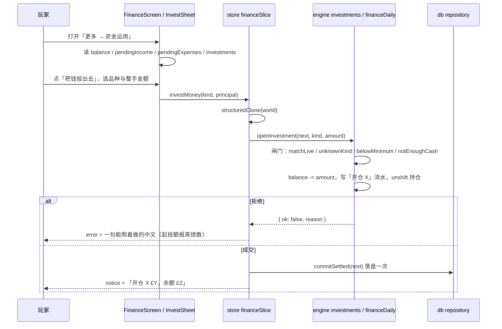
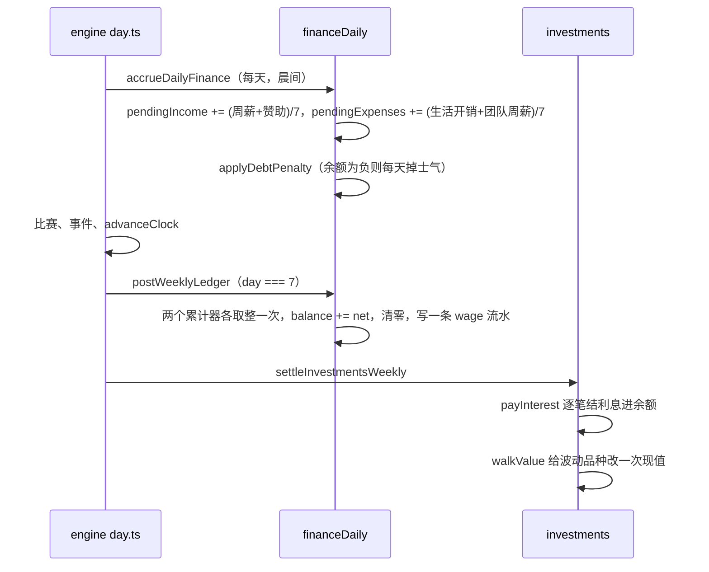

# 资金运用：按日累计的钱与真能投出去的持仓

## 业务目标

周粒度时代的钱只有一个动作：周日把「周薪减开销」写进余额，玩家除了看数字什么都做不了。本版把财务拆成两件事：

1. **钱按天流动，但账只按周记**。每天把周薪、赞助、开销按 1/7 挂进待入账累计器，主页与资金页在周一到周六就能看见「本周已挣/已花」；周日一次折成现金并只写一条流水。
2. **投出去的钱是真离开余额的**。开仓当场扣现金、进流水、生成持仓；之后的涨跌只算浮盈，不进余额也不进流水；赎回才把钱带回来，锁定期内还要从现值里扣罚息。存款利息每周结一次，直接进余额。

四种资金去处（`INVESTMENT_KINDS`）拉开成需要取舍的阶梯：活期随取随用但不波动；俱乐部债券、城市公寓、球迷文创小店的起投额、年化、周波动、锁定期与罚息逐档加重。

## 用户流程

周日结算由日步进自动完成，玩家不需要操作：

## 关键时序

日步进里的固定位置（`src/engine/day.ts`）：

| 步骤 | 时机 | 财务动作 |
|---|---|---|
| `accrueDailyFinance` | 每天晨间，紧跟 `advanceInjuries` | 刷新周薪/开销口径 → 累加两个待入账 → 欠款惩罚 |
| `postWeeklyLedger` | 仅 `day === 7`，在 `simulateDayFixtures` 之后 | 折现 + 清零 + 一条流水 |
| `settleInvestmentsWeekly` | 紧接 `postWeeklyLedger` | 先结利息，再漫步现值 |
| `openInvestment` / `closeInvestment` | 玩家随时点，比赛进行中拒绝 | 即时现金转移 + 一条 `investment` 流水 |
| `updatePlayerValue` | 每 21 个绝对日 | 只重算`Player.value`，不动余额 |

口径顺序有讲究：`refreshWeeklyRates` 必须在累加之前跑，这样换合同的当天就按新周薪累计，不必等下周；`payInterest` 必须在 `walkValue` 之前，利息按本周期初现值结算，同种子重放才会得到同一本账。

## 规则与边界

- **单位是英镑便士（分）**。`balance`、`principal`、`amount`、`weeklyWage` 全部按分存储，只有 `formatMoney` 除以 100 显示。界面不提供任何自由数字输入：开仓金额一律由 `minPrincipal × {1,2,5}` 加「全部可投」整手上限生成，避免单位换算出错。
- **四档起投额是一台取舍器**：活期 £1,000、债券 £4,000、小店 £8,000、公寓 £30,000（最贵与最便宜差 30 倍）。新手开局余额约 £12,660，一次只买得起最便宜的两档，想置产就得先攒。
- **待入账不是现金**。`pendingIncome/pendingExpenses` 是浮点累计器，只有 `postWeeklyLedger` 各取整一次，七天份额加起来正好等于周口径金额；周日之前 `balance` 一分不动。
- **`balance ↔ ledger` 不变式只认已实现的现金**。开仓、赎回、利息、周账都成对写流水；未卖出的涨跌既不进余额也不进流水，所以它只以浮盈的形式出现在持仓列表里。
- **锁定期与罚息**：`heldDays = absoluteDay(week, day) - openedDay`，小于 `termDaysOf(investment)` 时按现值收 `exitFeeOf` 比例。活期（`termDays = 0`）永远不收罚息，条款表也保证只有会波动的品种才带罚金。
- **不波动的品种不写 `value`**。读持仓时 `value ?? principal` 就是本金，界面不需要区分两条路径；`unrealizedGain` 同样只统计带现值的持仓。
- **比赛进行中不动钱**。`matchInProgress(world)`（`pendingDayPlan` 存在或 `lastMatch.status === 'live'`）时开仓与赎回都整笔拒绝，保护已经预抽进选项的关键回合 `roll`。
- **欠款惩罚按日**：余额为负时每天 −0.15 士气（一周约 1 点，与旧的周日一次扣 1 点同量级），并用 `clamp(..., 0, 100)` 兜底；告急新闻按每 28 个绝对日一条，id 带日段，不与周账新闻挤在一起。
- **上限**：流水保留 120 条（一周一条，够写两个赛季）；财务侧新闻截到 80 条（全局上限 120 条，见 [数据模型](../../04-接口与数据/03-数据模型与存储设计.md)）。
- **`assets: string[]` 与 `investments` 是两回事**：前者是消费型资产（事件买来的车与表，只挂名字不产生收益），后者才是有收益、有现值的一层。

## 数据与接口

`Finance`（`src/domain/finance.ts`）本版新增三个字段：

| 字段 | 类型 | 说明 |
|---|---|---|
| `pendingIncome` | number | 本周已挣未入账（分），周日清零 |
| `pendingExpenses` | number | 本周已花未入账（分），周日清零；v12 起含个人团队周薪（`staffWeeklyTotal / 7`） |
| `investments` | `Investment[]` | 持仓账本，新开的排在最前 |

`Investment = { id, kind, name, principal, rateBps, openedDay, termDays?, earlyExitFee?, value?, risk }`。id 走 `dailyId(world, 'inv', kind)`，因此带赛季/周/日三段，同日同品种也不会撞车。`termDays` 与 `earlyExitFee` 是可选的：v10 及更早的存档没这两个字段，读取一律经 `termDaysOf` / `exitFeeOf` 兜底为 0，绝不在调用点各写一套 `?? 0`。

`FinanceLedgerEntry.type` 新增 `'investment'`，用于开仓（负）、赎回与利息（正）三类行。`save.schema.ts` 里 `ledger` 本就是 `z.array(z.unknown())`，所以这条只改 domain 的联合类型；`finance` 对象则把两个累计器与 `investments` 声明成可选，让 v10 文件在校验阶段不被拒。

domain 层的纯估值口：`holdingsValue`（现值合计）、`unrealizedGain`（未实现盈亏）、`termDaysOf`、`exitFeeOf`、`INVESTMENT_KIND_ORDER`、`INVESTMENT_KINDS`。条款表是代码而非数据包，因此不参与 `hashState`；调整利率不改回放基准。

引擎返回值统一是 `InvestResult = { ok, reason, investment, proceeds }`，`InvestmentReject` 五码：`matchLive / unknownKind / belowMinimum / notEnoughCash / unknownInvestment`。`src/engine/index.ts` 只透出 `openInvestment` / `closeInvestment` 给 store，日累计与周日结算在引擎内部由 `day.ts` 调用，不经公共入口。store 把每个拒绝码配成一句中文，`belowMinimum` 额外把这道门槛的英镑数报出来。

存档：`MIGRATION_STEPS` 新增 `{ from: 11, run: migrateFinance }`，实现只有三行 `??=`（缺才补、有则不动），不折现、不重开仓、不清仓、不产生流水。`CURRENT_SAVE_VERSION` 当时是 11，v12 起为 12（个人团队名册），见 [个人团队](11-个人团队与员工.md)。

## 失败与降级

| 情况 | 表现 | 依据 |
|---|---|---|
| 停在开球那天点开仓/赎回 | 整笔拒绝，世界不被克隆改动，报「比赛进行中不能动钱，先把今天踢完。」 | `matchLive` |
| 余额不足起投额 | 该档在抽屉里直接置灰并显示「还差 £X」；引擎侧同样返回 `belowMinimum` | `InvestSheet` `KindOption` |
| 金额按钮超出现金 | 「全部可投」按 `floor(balance / minPrincipal)` 截断，最多一份 | `lotOptions` |
| 赎回一笔已不存在的持仓 | 报「这笔持仓已经不存在了，刷新一下再试」，不编造现金 | `unknownInvestment` |
| 保本赎回 | 只写流水，不播新闻（`gain === 0` 直接 return） | `announceExit` |
| 落袋亏损 | 新闻文案明确「卖在了本金之下，落袋的是折价」 | `announceExit` |
| 没有存档时动钱 | store 直接返回 `null`，不新建世界 | `commitMoney` |
| 持久化抛错 | 捕获为 `开仓失败：…` / `赎回失败：…` 进 `error`，不吞掉 | `financeSlice` catch |
| 空仓 | 持仓区显示「还没有投出去的钱」，合计与浮盈都是 0，界面不另判空数组 | `holdingsValue` / `unrealizedGain` |

## 平台差异

- 无平台 API 调用；持久化只走 `src/db` 与 store 的 `commitSettled`，落盘一次。
- 移动端：`/finance` 用 `page-pad pb-6 sm:mx-auto sm:max-w-[760px]`，360–390px 单列不横滚；开仓是底部抽屉（`Modal`），品种两列网格、金额按钮整行；页内与抽屉里的每个按钮都是 44px 触控目标。
- 桌面端：入口在「更多」页的菜单行（钱包图标 + 「资金运用」），路由 `/finance` 挂在 `GameLayout` 下。

## 验收与测试映射

| 验收点 | 测试 |
|---|---|
| 七天每天只累加待入账、周日入账前余额一分不动 | tests/engine/financeDaily.test.ts |
| 周日一次入账折成现金且只写一条流水；赞助过期后标签改回「周薪与开销」 | tests/engine/financeDaily.test.ts |
| 换合同当天按新周薪累计 | tests/engine/financeDaily.test.ts |
| 欠款每天掉士气、28 日一条告急、士气不转负、回正后停止 | tests/engine/financeDaily.test.ts |
| 日步进闭环：整周推进后待入账归零且只留一条流水；推到周中一条流水都没写；同种子两周同账本 | tests/engine/financeDaily.test.ts |
| 开仓余额与流水成对变化；不波动品种不写现值 | tests/engine/investments.test.ts |
| 三种整笔拒绝都不改世界；新手真实余额只够开最便宜一档 | tests/engine/investments.test.ts |
| 锁定期内收罚息、到点不收、查不到整笔拒绝 | tests/engine/investments.test.ts |
| 落袋盈亏播报与保本不播 | tests/engine/investments.test.ts |
| 停在开球的那天不能开仓也不能赎回 | tests/engine/investments.test.ts、tests/store/financeStore.test.ts |
| 活期每周结利息、未卖出的涨跌不进余额、整周推进自动带上结算与漫步 | tests/engine/investments.test.ts |
| 同种子重放十周同一现值；周中另存的档接着结算与一路跑下来完全一致 | tests/engine/investments.test.ts |
| 条款表自洽（利率/波动/起投额/锁定期/罚金）、四档拉开成阶梯、只有波动品种收罚金、估值口径 | tests/domain/investments.test.ts |
| 开仓扣现金并只落盘一次；拒绝不写存档不留流水；起投额门槛报英镑数 | tests/store/financeStore.test.ts |
| v10 老档补零待入账与空持仓、余额不动、不折现不重复入账；脏档原样保留 | tests/db/migrationV11.test.ts |
| 导出/导入往返等值、重复迁移幂等、v10 文件导入即迁移、停着开球的旧档迁移后能接着踢完、新世界自带字段 | tests/db/migrationV11.test.ts |
| 资金页数字（余额/本周已挣已花/待入账净额/流水符号/现值与浮盈）与空仓文案 | tests/ui/financeScreen.test.tsx |
| 抽屉列出四档、余额不足置灰、未选金额前确认禁用、选中后条款摘要、开仓与赎回调用 store 动作、「更多」页入口 | tests/ui/financeActions.test.tsx |
| 页内与抽屉 44px 触控、抽屉网格不超过 2 列、无超手机安全宽度的固定像素 | tests/ui/financeLayout.test.tsx |
| 赛季估值与奖金不进日粒度账 | tests/engine/finance.test.ts |
| 同种子整季回放哈希稳定 | golden（`quality/golden/season-seed-42.json`，engine 0.14.0 / `0977f1c7baccb177`；本批交付时是 0.13.0 / `3b40c1fbe0ca642b`，v12 起随个人团队重算） |

## 变更记录

| 日期 | 变更 |
|---|---|
| 2026-11-02 | 新增 `/finance` 资金运用页与 `InvestSheet` 开仓抽屉：四档品种、整手金额、锁定期剩余天数与罚息提示、持仓浮盈与现值合计、「本周已挣/已花/待入账」摘要；「更多」页加入口 |
| 2026-11-02 | store 新增 `financeSlice` 的 `investMoney` / `redeemInvestment`：克隆→跑引擎→拒绝配文案→成交才落盘，五个拒绝码各有一句中文，起投额拒绝带英镑数 |
| 2026-11-02 | 新增 `src/engine/investments.ts`：开仓即刻扣现金进流水、赎回按现值结算并在锁定期内扣罚息、周日结利息与一次价值漫步（`createRng(seed, 'market', id, season, week)`，可重放）；新增 `docs/00-项目文档/03-功能设计/01-功能规则与流程/05-资金运用.md` |
| 2026-11-02 | 存档升 v11：`Finance.pendingIncome / pendingExpenses / investments` 进入结构，`migrateFinance` 只做 `??=` 补齐；`ENGINE_VERSION` 升 0.13.0、回放基准 `a53d784da26c391d` → `3b40c1fbe0ca642b` |
| 2026-11-02 | 新增 `src/engine/financeDaily.ts`：周薪/赞助/开销按 1/7 日累计、周日一次折现并只写一条流水、欠款惩罚改为 −0.15 士气/天 + 每 28 日一条告急；`src/engine/finance.ts` 只留估值、奖金与赛季声望 |
| 2026-11-02 | `src/domain/finance.ts` 从 `types.ts` 拆出，承载 `InvestmentKind` 条款表（起投额、年化、周波动、锁定期、罚息）与 `holdingsValue` / `unrealizedGain` / `termDaysOf` / `exitFeeOf` 四个纯口 |
| 2026-11-02 | 个人团队接入日累计：`accrueDailyFinance` 的待支出同时挂上团队周薪（`staffWeeklyTotal(world.staff) / 7`），周日那条周账流水的标签在有团队开销时带上「团队薪酬」；存档升 v12 只补 `staff: []`，财务结构本身不变；`ENGINE_VERSION` 随 v12 升 0.14.0，回放基准 `3b40c1fbe0ca642b` → `0515c620b8b5f310` → `0977f1c7baccb177` |
