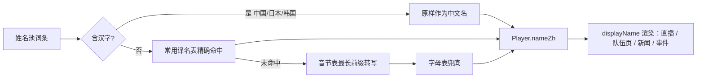
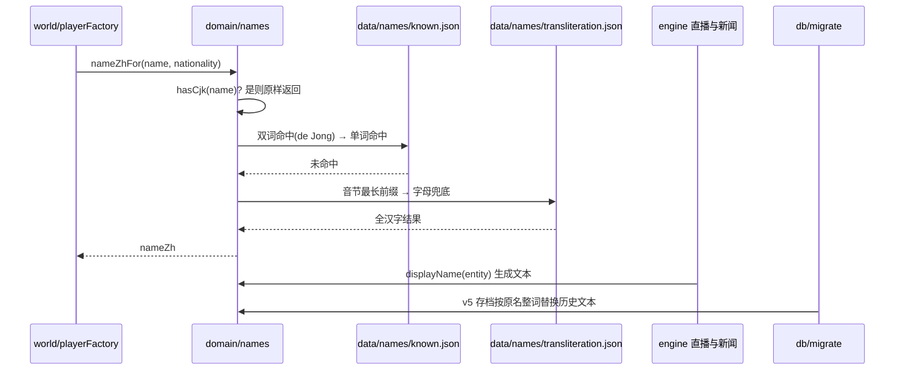

# 中文人名与显示名口径

## 业务目标

玩家玩的是中文足球生涯，比赛直播、教练讲话、队友名字不能是 `Thomas Carter` 这种拉丁占位符。本功能给每个「有人名」的实体补一个中文显示名，并把界面与引擎文本的取值口径收敛到一个函数上。

三件事：

1. **生成即中文**：建号、生成 AI 球员、生成教练与关系人物时立刻算出 `nameZh`，`name` 保留原名（存档 id、合同、导出文件名仍用 `name`）。
2. **单一取值口**：`displayName(entity)` 是所有界面、直播文本、新闻、LLM 提示词的唯一名字来源，缺字段时回落 `name`，绝不显示空串。
3. **旧存档汉化**：v5→v6 迁移补齐实体中文名，并把历史文本（战报、新闻、事件、关系摘要）里的拉丁原名整词替换成中文名。

## 用户流程

## 关键时序

## 规则与边界

- `name` 语义不变：存档 id、合同、导出文件名继续用 `name`；只有展示走 `nameZh`。
- 中国/日本/韩国姓名池直接 `nameZh === name`，不做反向拼音。
- 转写不消耗 RNG、不读时钟，纯字符串运算；同一输入永远同一输出。
- 拉丁名一律用 `·` 分隔（`詹姆斯·史密斯`），CJK 姓名池保持原样不加 `·`。
- 逐词替换用整词边界（`(?<![A-Za-z])…(?![A-Za-z])`），不会把 `Smithsonian` 改成`史密斯sonian`。
- 迁移只在 `sourceVersion < 6` 时执行；已有 `nameZh` 的实体不覆盖（幂等）。
- 单档报告里的 `scorerName/assistName/motmName` 走 id 之外的名字映射表，阵容条目按 `playerId` 回查，避免同名不同人串行。
- 生成端与迁移端共用 `nameZhFor`，因此同一个原名在新档与旧档里得到同一个中文名。
- **同一支球队的 20 人名单里中文名不重复**：`world/playerFactory.reserveClubName` 在建队时按顺序查重，撞名就用 `createRng(seed, 'player-name', clubId, index, attempt)` 重抽原名，最多 14 次（姓名池组合数远大于 20 人，实测足以全部分开）；改名发生在世界生成阶段，因此同一 seed 重放仍然同名。跨俱乐部同名（如两支不同球队都有一名诺亚·特纳）不在本轮范围内，登记在技术债。

## 数据与接口

| 接口 | 位置 | 说明 |
| --- | --- | --- |
| `displayName(entity)` | src/domain/names.ts | 唯一显示名取值口，空实体返回空串 |
| `nameZhFor(name, nationality)` | src/domain/names.ts | 原名 → 中文名，保证输出含汉字 |
| `hasCjk(value)` | src/domain/names.ts | 是否已含汉字，CJK 姓名池走原样分支 |
| `data/names/known.json` | `tokens: Record<string,string>` | 常用真实译名表，228 词条，覆盖全部拉丁姓名池 |
| `data/names/transliteration.json` | `syllables` / `letters` | 51 音节 + 26 字母兜底表 |
| `Player.nameZh` / `Coach.nameZh` / `Relationship.nameZh` | src/domain/types.ts | 必填（新档）；schema 里 `.optional()`，由迁移补齐 |
| `MatchLineupPlayer.nameZh` / `PitchPlayer.nameZh` | src/domain/matchTypes.ts、src/domain/pitch.ts | 可选，旧战报缺字段时回落 `name` |
| `CURRENT_SAVE_VERSION = 6` | src/domain/version.ts | 中文名进入存档结构 |

## 失败与降级

- 未收录的拉丁原名：音节表最长前缀 → 字母表逐字母兜底，输出仍是汉字，不会退回英文。
- 名字里没有字母（纯符号或空串）：`nameZhFor` 回落国籍名，界面不会出现空白。
- 旧存档文本里出现 roster 之外的名字：整词替换找不到别名映射就原样保留，不会误伤普通英文词。
- 战报阵容条目 id 查不到球员：回落该条目自身 `name`，比赛页面仍可渲染。
- 数据表写坏（`known.json` 出现拉丁值、字母表缺字母、姓名池词条无译名）：`npm run validate:data` 直接失败，进不了 `check:fast`。

## 平台差异

- 名字转换是纯 CPU 字符串运算，Web 与 Capacitor 一致，无平台端口依赖。
- 拉丁原名以次要小字保留在详情页，安卓与桌面同样只多一行文字，不改变断点布局。
- 存档迁移在 Dexie 读取路径上执行，移动端老存档首次载入会多一次全量遍历（约数百实体，毫秒级）。

## 验收与测试映射

| 验收点 | 测试 |
| --- | --- |
| CJK 姓名池原样保留 | tests/domain/names.test.ts |
| 常用译名命中（James Smith / de Jong / Muller） | tests/domain/names.test.ts |
| 未收录怪词仍转写为全汉字 | tests/domain/names.test.ts |
| 全部姓名池词条可转写且结果无拉丁字母 | scripts/validate-data.ts（npm run validate:data） |
| 世界生成后每个球员/教练/关系人物都有中文名 | tests/world/nameZh.test.ts |
| 同种子两次生成得到同一批中文名 | tests/world/nameZh.test.ts |
| 同一支球队队内不出现重名 | tests/world/squadNames.test.ts |
| v5 存档迁移补齐中文名并汉化历史文本 | tests/db/migrationV6.test.ts |
| v4 存档沿链迁移同样得到中文名 | tests/db/migrationV6.test.ts |
| 迁移后停在关键回合的存档能接着踢完 | tests/db/migrationV6.test.ts |
| 导出/导入往返等值、重复迁移不改动状态 | tests/db/migrationV6.test.ts |
| 球场/队伍页/直播渲染中文名 | tests/ui/pitchMap.test.tsx、tests/ui/teamScreen.test.tsx |

## 变更记录

| 日期 | 变更 |
| --- | --- |
| 2026-11-02 | 界面（标题页、主页头、时间线、2D 球场、队伍页、个人概览）、存档摘要、导入提示与 AI 提示词一律取中文名；GM 快照时间行改用日标签 |
| 2026-11-02 | 引擎侧逐分钟直播、战报、关键回合与训练文案改走 `displayName`，`ENGINE_VERSION` 升 `0.5.1` 并重算赛季回放基准 |
| 2026-11-02 | 新增 v5→v6 迁移：实体补 `nameZh`，战报/新闻/事件/关系摘要整词汉化，并验证导出导入往返与 live 续赛 |
| 2026-11-02 | `validate:data` 增加人名表校验：姓名池词条必须命中常用译名表，字母表缺项即失败 |
| 2026-11-02 | 世界生成端全覆盖：`makeAiPlayer`/`makeUserPlayer`/`makeCoach`/关系人物与新闻正文一律写入或取用中文名 |
| 2026-11-02 | 新增 `src/domain/names.ts`（`nameZhFor`/`displayName`/`hasCjk`）与 `data/names` 译名表、音节兜底表 |
| 2026-11-06 | 建队时按顺序查重并用 `'player-name'` 随机域重抽原名，杜绝同一支球队两名球员同名（实测伯明翰铁厂两名诺亚·特纳）；中文名仍是展示唯一口径，跨俱乐部同名暂未处理 |
