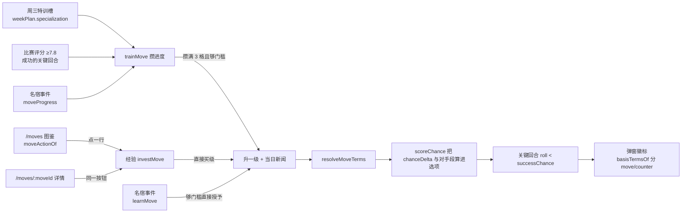
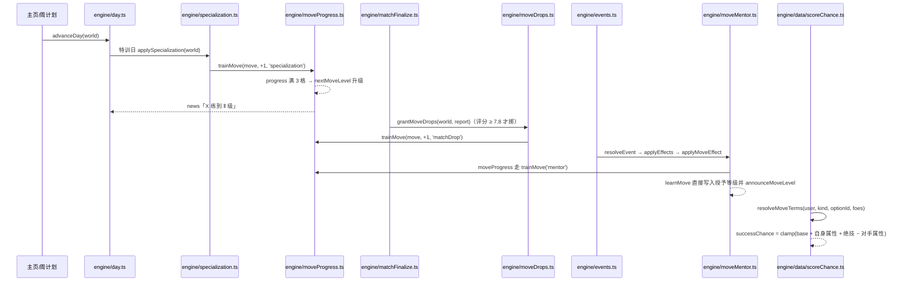

# 绝技（Player Moves）

## 业务目标

关键回合的选项以前是「所有人都能选、概率写死」，玩家看不出自己练的东西有什么差别。绝技层要解决三件事：

1. **招牌动作成为可拥有的东西**：64 条绝技分四档稀有度、三个级数（Ⅰ/Ⅱ/Ⅲ），每条都写清「谁能用、在哪个关键时刻生效、加多少成功率、凭什么加」。
2. **四条获取路径都要真的通**：经验解锁升级、名宿通过事件传授、周三特训槽攒进度、高评分比赛掉落进度。玩家练什么由自己的日程与机遇决定。
3. **概率变化必须可解释**：绝技加成写进选项的 `successBasisZh`（例：`彩虹过人 Ⅲ +10%`），并且和对手属性一起在同一公式里算完，开球时锁进战报，结算时不重算。

## 用户流程

## 关键时序

## 规则与边界

| 规则 | 口径 | 出处 |
|---|---|---|
| 级数上限 | `MOVE_MAX_LEVEL = 3`，每条模板固定 3 档，缺档在加载期就报错 | `src/domain/moves.ts` |
| 进度格 | `MOVE_PROGRESS_PER_LEVEL = 3`：特训/掉落/点拨每次 +1，攒满才允许升级 | `src/domain/moves.ts` |
| 0 级语义 | `level: 0` 的记录是「还没学会但在练」；攒满 3 格且够 Ⅰ 级门槛才第一次入门 | `nextMoveLevel` |
| 门槛 | 每级 `minOverall` 单调递增，综合分不够就不升级，进度继续攒着 | `src/domain/moveQueries.ts` |
| 位置闸门 | `moveFitsPosition`：`positions` 与 `positionGroup(position)` 对不上则不涨进度、不给学 | 三条获取路径共用 |
| 位置可达性 | 绝技的 `positions` 只能声明**真能触发它目标类型**的位置组：`mv_nape_flick` 打后卫不能挂中场（中场不生成 `headerDuel`），挂了就是骗经验 | `tests/engine/movesBalance.test.ts` 的 `unusableGroups()` |
| 目标存在性 | `targets` 的每条 `关键回合:选项` 必须在 `optionsFor` 的概率表里查得到，写错一个字母即红 | 同上 `deadTargets()` |
| 整季成功率带宽 | 固定种子跑满一季（38 场 / 52 个关键回合）：上桌均值 0.50–0.70、自动推进选的最稳一路 0.72–0.92、满仓库绝技最多抬高 10%、单场不出现必然成功或必然失败 | `tests/engine/movesBalance.test.ts` |
| 稀有度净收益 | 传奇绝技在最硬对抗下的平均净收益 > 常见，且任何一条的实战净收益不越过本稀有度预算；常量选项（`low === high`）不给绝技让路，挂满级仍是那个固定值 | 同上 |
| 获取路径 | `unlock.via` 声明 `exp / mentor / specialization / matchDrop`；没开门的路径走不进去 | 内容门禁 + 引擎闸门 |
| 成功率预算 | `RARITY_CHANCE_BUDGET`：常见 4.5%、罕见 6.5%、招牌 8.5%、传奇 11%（取满级 `chanceDelta`），超预算在 `npm run validate:data` 阶段拒绝 | `src/domain/moves.ts` |
| 概率冻结 | 选项 `roll` 生成时预抽、`successChance` 生成时算死；结算只做 `roll < successChance`，绝技与对手段都必须在生成时就位 | `src/engine/keyMomentGen.ts` |
| 比赛中禁止改 | `investMove` 与属性投资共用 `matchInProgress` 刹车（`pendingDayPlan` 或 live 报告） | `src/engine/growth.ts` |
| 经验价 | `investMoveCost` 取下一级 `costExp`，满级返回 `null`，界面据此换成「已练到尽头」 | `src/domain/moveQueries.ts` |
| 拒绝码 | `noUser / unknownMove / maxed / matchLive / wrongPosition / overLevel / notEnoughExp`，整笔拒绝不部分成交 | `src/engine/growth.ts` |
| 掉落候选 | `movesTargeting(kind, optionId)` ∩ `unlock.via` 含 `matchDrop` ∩ 位置对得上，`createRng(seed,'moveDrop',fixtureId,momentId).pick` | `src/engine/moveDrops.ts` |
| 名宿授予上限 | `grantedLevel` 逐级回退到综合分够得到的那一级，且 `target ≤ current` 时只补进度、不降级 | `src/engine/moveMentor.ts` |
| 播报口径 | 三条路径共用 `announceMoveLevel`，标题只有 `学会X` 或 `X 练到 Ⅱ 级`，界面按标题认级数 | `src/engine/moveProgress.ts` |
| 老存档 | v9 补 `player.moves = []` 与 `weekPlan.specialization = null`；v10 补名宿关系，否则 `learnMove / legendTrust` 在老档上静默失效 | `src/db/migrateSteps.ts` |
| 默认属性的自然产量 | 不改属性、不注入 `moves`，只按 `DEFAULT_WEEK_PLAN` 连踢 38 周：实测 6 个种子分别攒出 0–6 条记录、最多 4 条入门；产量为 0 的种子都是「整季没被派上场」，不是掉落路径失效 | `tests/engine/movesNatural.test.ts` |
| 出场是掉落的前置 | 一整季没进过名单 → `moves` 必为空；`userPlayed` 与 ≥7.8 两道闸门少一道都不发进度 | 同上 |

## 数据与接口

- 内容：`data/moves/{dribbling,shooting,passing,tempo,aerial,defending,goalkeeping,setpiece}.json`，每个家族 8 条、共 64 条；稀有度分布 common 17 / rare 27 / signature 13 / legendary 7；开了名宿路径的 12 条、开了特训槽的 48 条。
- 结构：`MoveDefinition = { id, nameZh, family, rarity, positions, targets, levels[3], counter?, unlock:{via,...}, textZh }`，`level = { level, minOverall, costExp, chanceDelta, riskDelta, basisZh }`。
- 球员侧：`Player.moves: PlayerMove[]`，`PlayerMove = { moveId, level, progress }`；周计划侧：`world.weekPlan.specialization: string | null`。
- 事件侧：`EffectOp` 的 `learnMove / moveProgress` 带可选 `moveId`，加载期由 `moveEffectIssues`（`src/domain/eventSchema.ts`）校验：必须点名绝技、绝技必须存在且把 `mentor` 列为获取路径、`learnMove` 的 `delta` 落在 `1..levels.length`、`moveProgress` 的 `delta ≥ 1`。
- 引擎写入口（除 `trainMove` 外都不允许直接改 `player.moves`）：`investMove`（经验）、`applySpecialization`（特训日，附带 `SPECIALIZATION_EXP = 1` 经验）、`grantMoveDrops`（比赛结算）、`applyMoveEffect`（事件结算，转 `teachMoveByMentor` / `advanceMoveByMentor`）。
- 只读口：`moveById` / `allMoves` / `MOVES` / `moveLevelOf` / `movesTargeting` / `resolveMoveTerms` / `MOVE_LEVEL_MARKS`。
- store 写入口：`growthSlice.investMoveExp(moveId)`（`src/store/growthSlice.ts`）克隆世界 → `investMove` → 拒绝只写 `error`，成交才换世界、清错误、落盘并回填 `saveId`；播报文案由 `moveNoticeOf` 用 `moveById` + `MOVE_LEVEL_MARKS` 拼，界面与 store 都不再自己算第二套价格。属性投资与绝技投资共用 `commitSettled`。
- 路由：`/moves`（图鉴，`MovesScreen`）与 `/moves/:moveId`（详情，`MoveDetailScreen`），入口挂在「更多」页主列；周计划的特训槽由 `src/ui/screens/moves/MoveSlotPicker.tsx` 渲染。
- 界面派生（`src/ui/screens/moves/moveView.ts`，全部纯函数）：`chanceText` 带符号一位小数、`moveActionOf` 把「已练到尽头 / 要综合分 N / 要 N 经验 / 升到 Ⅱ N 经验」四种状态收成一个按钮描述、`moveStatusText` 把 0 级读成「修炼进度 x/3」而不是「已学会」、`specializationCandidates` 只列位置对得上且 `unlock.via` 含 `specialization` 的招式、`moveSlotHint` 一行说清流派与练到哪。
- 关键回合弹窗：`KeyMomentCard` 用 `basisTermsOf`（`src/ui/labels.ts`）把 `successBasisZh` 切成 `move / counter / term` 三类词条——绝技单独成青色徽标，对位压制单起一行标注「压制」，其余属性项仍留在依据行；没有词条就不给徽标，不吃属性的常量选项两行都空。

## 失败与降级

| 情况 | 行为 |
|---|---|
| 绝技 JSON 少一档、`chanceDelta` 越预算、`targets` 指向未知关键时刻 | `npm run validate:data` 直接失败并给中文原因（`check:fast` 的一环），坏内容进不了运行时 |
| 事件点名了不存在的绝技 / 那条绝技没开名宿路径 | 加载期 `moveEffectIssues` 抛中文原因，整包拒绝加载 |
| 玩家在比赛进行中点「解锁绝技」 | `investMove` 回 `matchLive`，不改世界、不扣经验 |
| 名宿教的位置不符（门将学彩虹过人） | 闸门返回 `false`，档案与新闻都不动 |
| 综合分够不到 Ⅰ 级门槛 | 退化成攒 1 格进度，等身体追上那天由 `nextMoveLevel` 自动入门 |
| 绝技已满级还被特训/点拨 | `trainMove` 返回 `false`，调用方据此不再发经验 |
| 存档缺 `moves`（v8 及更早） | 迁移补空账本，界面按「一条不会」渲染，不报错 |
| 详情页点了不存在的绝技 id | 渲染「找不到这门绝技」空态并留返回列表入口，不白屏 |
| 图鉴里买不起的那一行 | 按钮把价格直接写出来（`要 210 经验`），不是灰着不说；综合分没到先报门槛 `要综合分 84` |
| 比赛进行中的那天点解锁 | 按钮锁住并写明原因，store 侧仍由 `investMove` 回 `matchLive` 兜底，两处口径一致 |
| 位置不符的绝技 | 图鉴根本不列（门将看不见彩虹过人），特训槽候选同样过滤，避免「看得见买不到」 |
| LLM 想虚构绝技 | LLM 只能改写事件标题/正文，`Effect` 与 `moveId` 全部来自数据包，无法注入 |

## 平台差异

纯计算与数据，不触碰平台能力：Web 与 Capacitor 走同一条 `advanceDay` 路径，绝技进度、掉落与传授全部落在存档里。

界面契约（`tests/ui/layoutContract.test.tsx` 的「绝技页手机契约」锁住）：

- `/moves` 与 `/moves/:moveId` 用 `page-pad pb-6 sm:mx-auto sm:max-w-[760px]`，手机端占满宽度、桌面收到 760px，样式串只追加不重排。
- 图鉴行、「我在练的」行与详情页按钮都是 ≥44px 触控目标；360px 与 390px 下单列不横滚，页内没有超过手机安全宽度的固定像素。
- 关键回合弹窗的绝技徽标与压制片是 `flex-wrap`，窄屏换行而不是挤压概率数字；徽标只挂短文本（名字 + 级数 + `+7.3%`）。
- LLM 与平台无关：绝技名与效果只来自数据包，模型不参与概率与账本。

## 验收与测试映射

| 验收点 | 测试 |
|---|---|
| 64 条绝技、四档稀有度、八大家族的结构与唯一 id | `tests/domain/moves.test.ts` |
| 内容门禁：缺档、越预算、`targets` 指向未知关键时刻、中文文本为空 | `tests/domain/movesContentGate.test.ts` |
| 事件效果必须点名绝技且绝技必须开名宿路径 | `tests/domain/eventMoveEffects.test.ts` |
| 经验解锁：门槛、位置、满级、买不起四种拒绝码 | `tests/engine/growthMoves.test.ts` |
| 周三特训槽：进度累积、没排槽不发生、受伤当天不练、位置不符不涨、只有特训日推进、满级与未知 id 不给进度 | `tests/engine/specialization.test.ts` |
| 比赛掉落：评分门槛、只发给成功回合、同种子重放同一掉落 | `tests/engine/moveDrops.test.ts` |
| 名宿传授：授予等级、不降级、点拨攒进度、`legendTrust` 落进关系、resolveEvent 全链路 | `tests/engine/moveMentor.test.ts`（挂事件用共用夹具 `tests/fixtures/mentorLesson.ts`） |
| 默认属性下的自然累积：整季比赛掉落自己攒出等级、没上场就一条不掉、12 周特训练到 Ⅱ 级、攒满格但综合分不够不越门槛、整季经验买得起最低门槛绝技、名宿课够不到门槛只给进度 | `tests/engine/movesNatural.test.ts` |
| 绝技加成进入关键回合概率与 `successBasisZh` | `tests/engine/keyMomentMoves.test.ts` |
| 整季平衡：成功率带宽、两种子差 ≤6%、实际胜率与冻结概率对齐、位置可达性与死目标、稀有度净收益与硬上限 | `tests/engine/movesBalance.test.ts` |
| store 经验买绝技：成交扣经验写 Ⅰ 级并落盘、按下一级收费、四种拒绝一条经验不扣、比赛中拒绝、满级只报尽头 | `tests/store/movesStore.test.ts` |
| 图鉴：已学会列级数、0 级读成修炼进度、空态说明进度来源、位置过滤、点行扣经验落盘、买不起报价格、够不到门槛报门槛 | `tests/ui/movesScreen.test.tsx` |
| 详情：三档门槛/花费/加成摊开、被什么压住 + 用在哪类回合 + 从哪几路拿到、成败文案、按钮走同一条投资通道、满级报尽头、未知 id 空态、比赛中锁住 | `tests/ui/moveDetailScreen.test.tsx` |
| 界面派生纯函数：带符号百分数、四种按钮状态、0 级只读进度 | `tests/ui/moveView.test.ts` |
| 「更多」页给出绝技入口 | `tests/ui/movesEntry.test.tsx` |
| 弹窗徽标：绝技带级数与加成立一块、压制写明谁的哪一项、没学会不给徽标但对手照样压人、常量选项两块都空、属性项留在依据行 | `tests/ui/keyMomentMoveBadges.test.tsx` |
| 周计划特训槽：只列本位置能攒进度的招式、换位置换候选、选中保存写进 `weekPlan.specialization`、默认与清空都是空槽 | `tests/ui/weekPlannerSpecialization.test.tsx` |
| 手机契约：44px 触控目标与 760px 桌面收口 | `tests/ui/layoutContract.test.tsx` |
| `src/ui` 公共入口导出绝技两页 | `tests/ui/exports.test.tsx` |
| v8→v9 补绝技账本与特训槽、live 档迁移后踢完 | `tests/db/migrationV9.test.ts` |
| v9→v10 补名宿关系，`learnMove / legendTrust` 在老档不再静默失效 | `tests/db/migrationV10.test.ts` |
| 绝技效果在界面上读成中文（`学会 彩虹过人` / `彩虹过人 进度 +2`） | `tests/ui/effectLabels.test.tsx` |

## 变更记录

| 日期 | 变化 | 来源 |
|---|---|---|
| 2026-11-02 | 绝技层落地：`data/moves/*.json` 64 条 + 加载期门禁 + `resolveMoveTerms` 进 `scoreChance`，`Player.moves` 与 `weekPlan.specialization` 进存档（v9） | M1.10b |
| 2026-11-02 | 路径一：`investMove` 用经验解锁/升级，七类拒绝码整笔拒绝；比赛中禁止改 | M1.10b |
| 2026-11-02 | 路径二：`applySpecialization` 落在周三特训日，`day.ts` 的晨间步骤调用；`trainMove` 统一攒进度与升级 | M1.11 |
| 2026-11-02 | 路径三：`grantMoveDrops` 让评分 ≥7.8 的成功关键回合掉修炼进度，抽签域 `(fixtureId, momentId)` 保证可重放 | M1.11 |
| 2026-11-02 | 路径四：名宿事件包 `data/events/mentor.json`（9 条模板、覆盖 12 条绝技）+ `applyMoveEffect` 的 `learnMove / moveProgress` 闸门；`RelationshipRole` 加 `legend`，存档升 v10（`ENGINE_VERSION` 0.12.0，回放基准 `82fe56a7e245ea77` → `a53d784da26c391d`） | M1.11 |
| 2026-11-02 | 界面收口：`/moves` 图鉴与 `/moves/:moveId` 详情两页（`src/ui/screens/moves/*` 拆出 6 个小件，`moveView.ts` 承担全部派生文案）、「更多」页入口、`src/ui/index.ts` 导出；`investMoveExp` 走 store 的 `commitSettled` 与属性投资同一条落盘通道 | M1.11 |
| 2026-11-02 | 关键回合弹窗亮出绝技徽标与对位压制：`basisTermsOf` 把依据切成 move/counter/term 三类，界面不再自己解析概率文本 | M1.11 |
| 2026-11-02 | 周计划补周三特训槽：`MoveSlotPicker` 按位置与 `unlock.via` 过滤候选，选中写进 `weekPlan.specialization`，清空回 `null` | M1.11 |
| 2026-11-02 | 平衡门禁 `tests/engine/movesBalance.test.ts`：固定种子跑满一季锁住三条成功率带宽、两种子一致性、实际胜率与冻结概率对齐、稀有度实战净收益与 0.92 硬上限 | M1.11 |
| 2026-11-02 | 修 5 条绝技的假位置组（倚人护球 FWD、打穿肋部与一脚出球 DEF、脑后摆渡 MID、逼抢号角 FWD 都是本位置抽不到目标类型的组）：只改 `positions`，不动目标与数值，整季回放哈希不变；同时把「位置可达性」与「目标选项存在性」变成数据门禁 | M1.11 |
| 2026-11-02 | 勘误：提交 `b6973d9` 的 `修改范围` 写了 `tests/engine/moves.test.ts`，该文件不存在，实际改动的是 `tests/engine/growthMoves.test.ts`（已在本文档的测试映射里登记）；已推送历史不回改，此处留档 | 文档收口 |
| 2026-11-02 | 未完成：AI 球员掌握绝技（要重做背景比赛泊松模型，见 roadmap M4）、绝技在战报/媒体文案里的复述（当前只在关键回合弹窗与图鉴出现） | 下一步 |
| 2026-11-03 | 补 `tests/engine/movesNatural.test.ts`：用生成时的默认属性（不改属性、不注入 `moves`）跑真实整季，把四条获取路径的自然产量钉下来——比赛掉落会自己攒出等级、整季没上场就一条不掉、12 周特训练到 Ⅱ 级、攒满格仍受综合分门槛、整季经验够买最低门槛绝技、名宿课够不到门槛只给进度；「规则与边界」新增默认属性自然产量与出场前置两条口径 | 交付报告项 2 |
