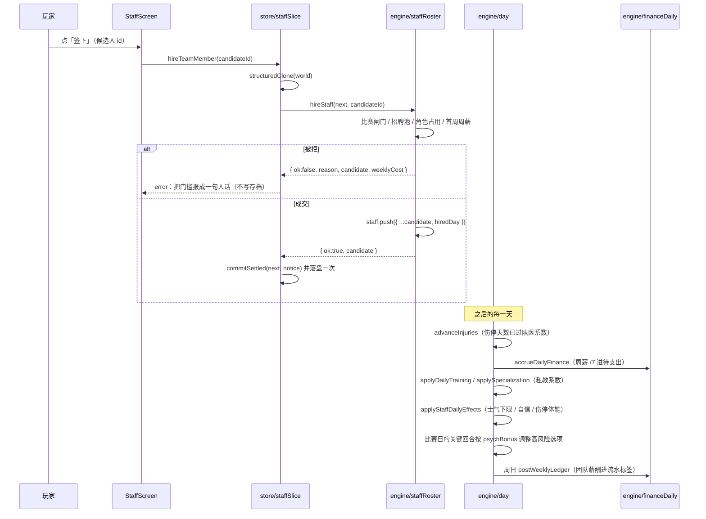

# 个人团队：队医、心理咨询师与私人教练

## 业务目标

在这批改动之前，队医和心理咨询师只活在事件文案里——「队医建议你休息一周」，但游戏里既没有这个人，也没有他的价格。玩家想花钱买一份确定性，却没有任何地方可以买。

个人团队把这件事做实：主角可以自掏腰包雇三类人，每人每周收一笔固定薪水，每天真的改变结算数字。

| 角色 | 解决的问题 | 付费换来的东西 |
|---|---|---|
| 队医 | 一次大伤能把两个月废掉，玩家只能干等 | 受伤概率更低、伤停天数更短，养伤期间体能不再每天往下掉 |
| 心理咨询师 | 连续低迷时士气一路砸到个位数，表现越差越打不回来 | 士气有下限，自信每天积累一点，高风险选择更敢也更能成 |
| 私人教练 | 经验和特训进度来得太慢，攒了一身经验花不动 | 训练给的经验更多、属性投资更省、特训课进度更快 |

设计取向只有一条：**雇佣不是开关，是买卖**。效果按人的水平折算、按周付钱、比赛进行中不许改人事，所以「请不请、请谁、请多久」是真正的资源决策，而不是必点按钮。

## 用户流程

1. 玩家在「更多」页点「个人团队」进入 `/staff`，页头显示当天日期标签、可用余额与团队每周开销合计。
2. 未雇人时，在职区把三个位置各自管什么、多少钱说清楚；招聘区按角色分组列出本赛季的 3 个候选（中文名 + 拉丁原名 + 水平 + 周薪）。
3. 点「签下」→ 引擎先查四道闸门（比赛进行中 / 人不在池里 / 该角色已有现任 / 余额付不起第一周周薪）。成功则播报「已签下 玛格丽特·海斯（队医），周薪 £99」，失败则把被拒的那道门槛说成一句照着能做的话。
4. 雇进来的人从当天起进入每日结算：晨间阶段做士气托底与自信积累，伤停期间补体能；训练日多给经验，周三特训课进度更快；属性投资按水平打折；受伤时概率与天数都过队医系数。
5. 每周日的财务流水里，团队周薪与生活开销合并入账，标签带上「团队薪酬」。
6. 在职区每行有「解雇」，成交后名册与每周开销同时降下来，效果立刻退回恒等值。

## 关键时序

## 规则与边界

- **一个角色只认一个人**。名册是数组，但同一角色里只有水平最高的那位生效（`bestOfRole`），雇第二个队医不会叠加。理由：「囤三个队医」没有画面意义，只是把系数表刷成数字游戏。
- **效果强度按水平折算，不是雇了就满配**：`staffPotency(quality) = clamp(quality / 90, 0.4, 1)`。水平 90 及以上拿满配，55 分的队医只兑现约六成，且最低也有四成——便宜货不是废柴，但别指望他顶用。
- **没在岗的角色折算成 0，所有公式自动退回恒等值**，所以效果表里不需要任何「如果没人」的分支。一个人都没雇时，士气/自信/体能/经验/概率一步不动。
- 九条系数固定（`StaffFactors`）：受伤概率 ×(1−0.3·队医)、恢复天数 ×(1−0.2·队医)、伤停期间体能 +1/天、士气下限 45、自信 +0.2/天·心理咨询师、高风险选项 +1.2%·心理咨询师、训练经验 ×(1+0.5·私教)、属性投资 −10%·私教、特训进度 ×(1+0.5·私教)。**任何一侧要加新挂钩，必须先在 `StaffFactors` 里给一个默认值**，否则读写两边会各算各的。
- **周薪 = 角色基线 ×(0.5 + 水平/100)**（队医 7000、心理咨询师 5500、私教 9000 分）。同一角色里最贵约为最便宜的 1.5 倍，新人周薪也付得起一个人，不会出现「永远雇不起」的死局。
- **雇佣要当场付得起第一周周薪**，之后按 1/7 挂进待支出、周日入账。付不起就整笔拒绝，不产生半截名册。
- **比赛进行中不做人事变动**：`matchInProgress(world)` 为真时雇佣与解雇都返回拒绝，时钟停在开球那天，先把这场踢完。
- **招聘池是推导出来的，不落盘**：`buildStaffPool(seed, season)` 每个角色从内容池抽 3 个，同种子同赛季反复打开是同一批，换季换人。存档只记「雇了谁」——周薪与水平随人一起进档，所以换季换了市场也不会影响已经请进来的人。
- **伤停最短 1 天**：`staffInjuryDays` 用 `Math.max(1, round(days × recoveryDays))`，不把一次真伤压成没伤。
- **私教只管「练」这条链路**：`grantExp` 只对训练类来源乘 `expFactor`，比赛与事件给的经验不打折也不加成；特训进度与属性投资折扣同样走私教系数。
- **心理咨询师的加成只进高风险选项**：低风险与常量选项不吃 `psychBonus`，避免「请了心理医生就全绿」。这条依据会写进成功率说明文本，玩家看得见是谁在帮忙。
- 内容池由 Zod 在加载时硬校验（id 前缀 `staff:<role>:`、角色枚举、`quality` 40–95、中文名非空、每角色 ≥4 条），`npm run validate:data` 再查一遍 id 前缀与角色一致性。

## 数据与接口

**存档 v12**：`WorldState.staff: StaffMember[]`（顶层数组，空名册是 `[]` 而不是缺字段），`CURRENT_SAVE_VERSION` 11 → 12，`MIGRATION_STEPS` 表尾新增一行 `{ from: 12, run: migrateStaff }`。`StaffMember = StaffCandidate & { hiredDay: number }`，`hiredDay` 是雇佣那天的绝对日序。`worldSchema` 里 `staff` 是 `.optional()` 的宽松数组：v11 旧档缺字段时校验放行，由迁移补齐，不能在这里卡住导入。

**数据**：`data/staff/candidates.json` 18 条（每角色 6 人，水平 55–92），字段 `{ id, role, name, nameZh, quality }`——**价格不在数据里**，周薪由 `staffWeeklyCostOf(role, quality)` 现算，改基线不会让旧档里的人变成另一个价。

**domain**（`src/domain/staff.ts`）：`STAFF_ROLE_ORDER`、`STAFF_ROLE_SPECS`、`STAFF_POOL_SIZE`、`STAFF_CANDIDATES`、`staffWeeklyCostOf`、`buildStaffPool`、`findStaffCandidate`、`staffWeeklyTotal`、`hasStaffRole`、`staffPotency`、`staffFactors`。这些全是纯函数，所以 UI 可以直接从 `src/domain` 取读数而不必绕引擎。

**engine**（`src/engine/staff.ts` + `staffRoster.ts`，经 `src/engine/index.ts` 透出）：

| 接口 | 职责 |
|---|---|
| `staffFactorsOf(world)` | 名册 → `StaffFactors`，引擎侧唯一读数口 |
| `staffInjuryDays(world, days)` / `staffInjuryChance(world, chance)` | 训练与比赛两处受伤共用的折算口 |
| `applyStaffDailyEffects(world)` | 日步进晨间阶段的落地点（`day.ts` 固定顺序） |
| `staffCandidatesOf(world)` | 本赛季招聘池，纯推导 |
| `hireStaff(world, candidateId)` | 返回 `StaffHireOutcome`：`ok / reason / candidate / weeklyCost` |
| `releaseStaff(world, staffId)` | 成功 `true`；比赛进行中或查不到人 `false` |

`StaffHireReject` 四值：`matchLive` / `unknownCandidate` / `roleTaken` / `notEnoughBalance`。被拒时 outcome 仍带 `candidate`，所以 store 报得出「差多少钱、是哪个位置」。

**store**（`src/store/staffSlice.ts`）：`hireTeamMember(candidateId)` / `releaseTeamMember(staffId)`，各自 `structuredClone` 一份世界、只调一次引擎、成交才 `commitSettled` 落盘一次；被拒只写 `error`，不碰存档、不留半截名册。没有存档或已退役时返回空。

**UI**：`/staff`（`StaffScreen` + `staff/StaffSections` + `staff/StaffRows`），「更多」页入口「个人团队」。

## 失败与降级

- 拒绝码到文案的翻译只在 store 做：比赛进行中「先把今天踢完」；角色被占「这个位置已经有了人，先解雇现任再换」；余额不足把具体金额报出来「余额不够付 £99 的第一周周薪」；查不到 id「这个人已经不在本赛季的招聘池里，换季会换人」——**不凭空造一个人**。
- 解雇一个没雇过的人返回 `false` 并报「已经不在团队里了」，不会把别人送走。
- 招聘池里查不到的候选在 UI 上不给死按钮：该角色已有现任时其余候选人的按钮直接不出现，余额不够时按钮位置改成门槛提示。
- 迁移 v11→v12 只做一条 `world.staff ??= []`：不折现、不清空已经带着成员的脏档、不产生流水。新生成的世界自带空名册，不需要迁移介入。
- LLM 完全不参与团队：雇佣是确定性事实，只走引擎与 store，模型既不能读也不能改。

## 平台差异

纯 domain/engine/store 计算与一页 DOM，不调用任何平台能力：Android 与桌面行为一致，同一份种子在同一天雇同一个人，系数、伤停天数、待入账金额完全相同。

页面沿用 `page-pad pb-6 sm:mx-auto sm:max-w-[760px]`：360–390px 单列不横滚，雇佣与解雇按钮 ≥44px；桌面（≥1024px）由左侧栏替代底部导航，入口在「更多」页里同样可达。中文名为主、拉丁原名做次要小字，外籍成员在手机上也读得懂。

## 验收与测试映射

| 验收点 | 用例 |
|---|---|
| 招聘池同种子同赛季稳定、换季换人、每角色 3 人 | `tests/domain/staff.test.ts`（14 例） |
| 周薪公式与团队合计开销 | `tests/domain/staff.test.ts` |
| 空名册时九条系数全为恒等值 | `tests/domain/staff.test.ts`、`tests/engine/staffEffects.test.ts` |
| 队医压伤停（20 天→16 天）与受伤概率（七成），45 分只压到 18 天，不压成 0 天 | `tests/engine/staffEffects.test.ts`（10 例） |
| 士气托回 45、自信 +0.2/天、伤停期间体能 +1 且健康日不补 | `tests/engine/staffEffects.test.ts` |
| 私教的经验倍率、投资九折、特训 1→1.5，且比赛/事件经验不吃倍率 | `tests/engine/staffGrowth.test.ts`（6 例） |
| 高风险选项 +1.2%、低/常量选项不参与、依据文本点名心理咨询师 | `tests/engine/staffGrowth.test.ts` |
| 四道雇佣闸门、角色唯一、解雇后名册与周薪同降、周日流水标签带团队薪酬 | `tests/engine/staffHire.test.ts`（9 例） |
| 成功与四类拒绝各走一遍 store 通道，拒绝不落盘 | `tests/store/staffStore.test.ts`（8 例） |
| v11→v12 迁移、脏档保留、导出/导入往返等值、重复迁移幂等、停在开球的旧档能接着踢完、迁移表登记（`{ from: 12, run: migrateStaff }`） | `tests/db/migrationV12.test.ts`（8 例） |
| 空团队说明、在职行信息量、系数人话、不给死按钮 | `tests/ui/staffScreen.test.tsx`（9 例） |
| 同种子整季回放哈希稳定 | golden（`quality/golden/season-seed-42.json`，engine 0.15.0 / `a5df29729457cf02`） |

## 变更记录

| 日期 | 变更 | 来源 |
|---|---|---|
| 2026-11-02 | 新增个人团队：内容池 `data/staff/candidates.json` 与 domain 系数表（`src/domain/staff.ts`） | 绿茵人生 M1.13（需求 8） |
| 2026-11-02 | 存档升 v12：`WorldState.staff` 进结构，`migrateStaff` 只做一条 `??=`，`staffSchema` 放行旧档缺字段 | `feat(saves): 存档升 v12 补个人团队名册` |
| 2026-11-02 | 引擎挂钩落地：队医进训练与比赛两处受伤、每日效果进日步进晨间、私教进经验/投资/特训、心理咨询师进关键回合 | `feat(engine)` × 3 |
| 2026-11-02 | 名册读写口 `hireStaff` / `releaseStaff` 与周薪进账；雇佣被拒时也把周薪门槛报出来 | `feat(engine)` / `fix(engine)` |
| 2026-11-02 | store 通道 `hireTeamMember` / `releaseTeamMember`，拒绝不写存档 | `feat(store): 团队雇佣与解雇走 store 通道` |
| 2026-11-02 | `/staff` 页与「更多」页入口，360–390px 单列 | `feat(ui)` × 2 |
| 2026-11-02 | `ENGINE_VERSION` 0.13.0 → 0.14.0，回放基准 `3b40c1fbe0ca642b` → `0515c620b8b5f310`（v12 的 `staff` 键）→ `0977f1c7baccb177`（版本串本身） | `test(engine): 重算赛季回放基准到 0.14.0` |
