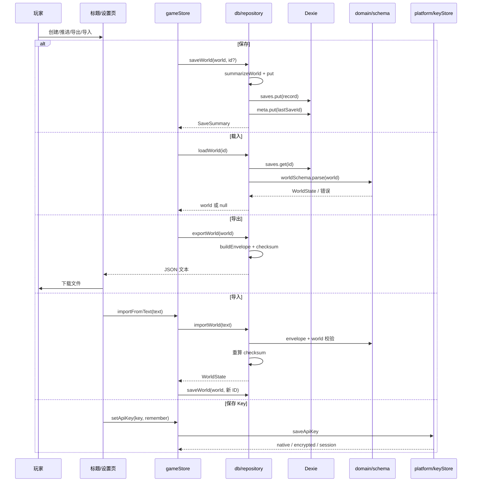

# 存档、导入与导出

## 业务目标

玩家的生涯必须在本地可靠保存：刷新、关闭浏览器、切换设备（通过导出文件）都不能无故丢失进度。导入必须拒绝损坏、被篡改或来自更高版本的文件；API Key 必须与存档分离，避免随导出文件泄露。

## 用户流程

1. 创建生涯后自动保存；每次推进、处理关键回合、生成叙事、修改设置、发送 AI 对话后自动保存。
2. 打开游戏时读取 `lastSaveId`，自动载入上次存档；失败则回到标题页。
3. 玩家在标题页/设置页查看存档列表，可载入或删除。
4. 玩家可导出当前生涯为 JSON 文件；文件名包含球员名、赛季、周次与周内日序。
5. 玩家可导入 JSON 文件；校验通过后作为新存档写入，不覆盖现有存档。
6. API Key 单独保存在平台安全存储；清除 Key 不影响存档。

## 关键时序

## 规则与边界

### 自动保存时机

- 创建生涯成功。
- 每次 `advance` 完成。
- 每处理一条关键回合。
- 自动处理关键回合。
- 完成比赛（终场 + 推进周次）。

比赛播放中的每分钟只在内存推进，不落盘；报告的 `liveState` 随“开局 / 关键回合结算 / 完赛”落盘，刷新后从最近 checkpoint 读取球权/球位/持球人并按确定性随机流继续播放。播放速度、当前 phase、轨迹与结果弹窗属于瞬态状态，不进入存档。
- 每周 AI 叙事写入后。
- 处理事件选项。
- 修改设置。
- 发送 AI 对话并收到回复。
- 手动“保存”。

保存是“整世界覆盖”，没有增量 patch。写入失败不阻塞内存推进，但会通过顶部错误提示明确告知“保存失败：<原因>”，不再显示“已保存”；`saveNow` 返回布尔值，返回键退出等调用方必须据此决定后续动作（失败时不退出）。

### 存档 ID 与摘要

- ID：`save:<seed>:<Date.now 的 base36>:<4 位随机>`。
- 摘要：球员名、俱乐部名、赛季、周次、**日（1–7，周一=1）**、年龄、综合能力、更新时间。
- 摘要是只写不读的派生投影：`listSaves` 每次都从 `record.world` 重算，没有任何调用方消费落盘的 `summary`，所以给摘要加字段（如 `day`）**不占存档版本号**；旧行缺 `world.day` 时摘要落回周一。
- 列表按 `updatedAt` 倒序；时间相同时按 ID 字典序。
- 列表逐条生成摘要：单条记录损坏时跳过该条并 `console.warn`，其余存档正常显示，不会清空整个列表。
- `meta.lastSaveId` 指向最近保存的存档；删除该存档时清除。

### 导出

- 文件名：`pitch-life-<球员名>-<season>-W<week>D<day>.json`，非法字符替换为下划线。
- Envelope 字段：`format`、`saveVersion`、`engineVersion`、`exportedAt`、`checksum`、`world`。
- `checksum = hashString(canonicalStringify(world))`。
- 导出不包含 API Key、`secrets` 表或任何平台密钥材料。
- 原生（Android/iOS）：先 `Filesystem.writeFile` 到 `Directory.Cache`，再 `Share.share({ files: [uri] })` 交给系统分享面板；不申请存储权限、不写公共目录。缓存目录可能被系统回收，因此成功提示只承诺「在分享面板里保存或发送」，不承诺文件长期存在。
- Web：DOM anchor 下载。
- 提示必须跟随端口返回的判别式结论：`ok` → `notice = locationZh`；`reason: 'canceled'` → 只给轻提示（文件已在缓存）且不记错误；`unavailable` / `failed` → `error = messageZh` 且不写 `notice`。任何分支都不得无条件报「已导出」。

### 夹具存档

- 文件：`tests/fixtures/career-with-moves.v12.json`，由 `npm run fixture:moves-career`（`scripts/build-moves-career.ts`）产出并进 git。
- 造法：固定种子 `2026` 生成默认属性的球员 → 按 `DEFAULT_WEEK_PLAN` 把特训槽对准门槛最低的一条绝技跑完整季 → 用整季自然攒下的经验走 `investMove` → 用 `data/events/mentor.json` 里够得到门槛的那一课走 `resolveEvent`。全程不调属性、不直接写 `player.moves`。
- 用途：界面与真机验收只需要「导入这一份」，不必手工点够十二周；它同时是四条绝技获取路径在同一份存档里留痕的证据。
- 可复现：重跑脚本后 `world` 负载与 `checksum` 逐字节一致，只有 envelope 的 `exportedAt` 会变（引擎侧禁 `Date.now`，随机只走 `createRng`）。
- 守卫：`tests/db/fixtureCareerMoves.test.ts` 断言版本、引擎版本、checksum 自洽、导出→导入→导出等值，以及四条路径各自留痕。

### 导入

顺序：

1. `JSON.parse`，失败 → “不是有效的 JSON 文件”。
2. `saveEnvelopeSchema.safeParse`，失败 → 带字段路径的中文错误。
3. `saveVersion > CURRENT_SAVE_VERSION` → 拒绝“来自更新版本”。
4. `worldSchema.parse`，检查玩家、俱乐部、周次等不变量（schema 兼容 v1 结构，迁移在 checksum 之后）。
5. **用迁移前的原始 world** 重新计算 checksum 并比对，失败 → “存档校验失败，文件可能已损坏”。
6. 迁移到当前版本并生成新存档 ID 写入，不覆盖原存档。

当前 `CURRENT_SAVE_VERSION = 12`，迁移步骤表在 `src/db/migrateSteps.ts`（`MIGRATION_STEPS`，数组顺序即执行顺序），`src/db/migrate.ts` 只负责克隆存档、补 live 报告、按表跑步骤并 `assertWorld` 收尾，提供 v1 → … → v12 连续迁移：

- v1 → v2：所有已有比赛报告补 `status: 'final'`、`currentMinute: 90`、`goals: []`；`pendingWeekPlan = null`。
- v2 → v3：live 报告补 `stats`（控球按 `currentMinute` 均分、射门/射正=进球、角球 0）与 `lineups`（主客各 11 人）；**保留** `pendingWeekPlan`，旧 live 存档可继续播放到终场。
- v3 → v4：live 报告补 `liveState = { possession: 'home', ballX: 0.5 }`（中圈开球），之后刷新/播放直接读取该状态；终场报告不补 `liveState`；`stats` 与 `lineups` 原样保留。
- v4 → v5：周时钟换成日时钟。`fixtures[*].day` 由 `dayForRound(round)` 补齐（纯推导，不消耗 RNG）；`injury.weeksLeft` 换算成 `daysLeft = max(1, round(weeksLeft × 7))` 并删除旧字段；`pendingWeekPlan` 改名 `pendingDayPlan`；`weekPlan` 缺省补 `DEFAULT_WEEK_PLAN`；仍有 live 报告时把 `day` 摆回该场比赛所在的那一天，读档后可以接着踢完这场；迁移末尾用 `assertWorld` 把关。
- v5 → v6：补中文人名。`Player.nameZh`、`Club.coach.nameZh`、`Relationship.nameZh` 由 `nameZhFor(name, nationality)` 生成（已有值不覆盖，所以重复执行是恒等变换）；战报里 `scorerName / assistName / motmName / events[].text / mediaReaction / 关键回合文案`、新闻与事件的标题正文与选项、关系摘要按「原名 → 中文名」整词替换；首发名单条目按 `playerId` 回查补 `nameZh`。只改文案，不动 `roll`、时钟与 `fixture.id`，停在关键回合的存档迁移后仍能踢完。
- v6 → v7：事件从周拍改日拍。每条 `events[*]` 补 `day`（回灌为 `DAYS_PER_WEEK`，因为旧事件本来就是周日生成的）、`createdAtDay = absoluteDay(createdAtWeek, day)`、`expiresDay = absoluteDay(expiresWeek, DAYS_PER_WEEK)`、`sender` 与 `blocking`（优先取 `data/events/*.json` 的模板，未知模板落回「俱乐部」/ `true`）；`world.eventMemory` 由现存事件按模板取最大绝对日序重建，否则旧档读进来第一周会被同一模板刷屏。不消耗 RNG，不触碰时钟、`pendingDayPlan` 与任何 `roll`。
- v7 → v8：成长账本登场。每个 `players[*]` 补 `exp = 0`、`lifetimeExp = 0`、`attrInvestment`（十字段全 0，好让投资曲线第一点价格稳定在 6）；已有值一律不覆盖，脏档只抹一半时其余字段各补各的。
- v8 → v9：绝技层登场。每个 `players[*]` 补 `moves = []`（「一条不会」），`weekPlan.specialization` 补 `null`（「本周不练」），让持有判断只有一条取值路径。schema 侧靠 `playerSchema` 的 `.passthrough()` 放行，`attributesSchema` 的精确十字段不受影响。
- v9 → v10：名宿登场。`RelationshipRole` 加 `'legend'`，关系表里没有名宿时由 `makeLegendRelationship(world.playerId)` 补一条（id `rel:legend:${playerId}`、`nameZh` 与 `name` 同为「俱乐部名宿」、信任 40）；已经有名宿的存档原样保留，绝不覆盖玩家刷出来的信任。不补这一步，老档读到 `data/events/mentor.json` 时 `learnMove` / `legendTrust` 会查不到关系而静默失效。
- v10 → v11：资金运用登场。`finance` 补 `pendingIncome = 0`、`pendingExpenses = 0`、`investments = []`，三条都是 `??=`——缺才补、有则不动，所以已经带持仓与待入账的脏档原样保留，迁移**不折现、不重开仓、不清仓、也不写流水**，老档余额一分不变。schema 把三个新键声明成可选，v10 文件在校验阶段不被拒；停在开球的旧档迁移后仍能接着踢完那场，踢完当天就能开仓。
- v11 → v12：个人团队登场。`MIGRATION_STEPS` 表尾加一行 `{ from: 12, run: migrateStaff }`，世界顶层补 `staff = []`（唯一一条 `??=`）：v11 档连这个键都没有，所以雇过谁、每周付多少都没地方记；补成空名册后九条系数全是恒等值，老档读出来的每一个数字与迁移前一致。招聘池 `buildStaffPool(seed, season)` 是纯推导、**不进存档**，所以旧档不需要重建市场、也不代人雇人；`staffSchema` 把 `staff` 声明成可选，v11 文件在校验阶段不被拒。迁移不消耗 RNG、不触碰时钟 / `pendingDayPlan` / 任何 `roll`：停在开球的旧档迁移后既能接着踢完这场，踢完当天就能进 `/staff` 雇人。
- 终场旧报告不伪造统计与首发，UI 遇到缺失时隐藏对应面板。
- 迁移幂等；只前进不后退；`saveVersion > 12` 直接拒绝。
- `loadWorld` 在 schema 校验后迁移，发生迁移时回写数据库并同步摘要。
- 导入顺序固定为“解析 → 版本检查 → checksum（原始数据）→ 迁移”，禁止先迁移后校验。

### IndexedDB

- 数据库 `pitch-life-db`，表 `saves`、`meta`、`secrets`。
- 版本 1 建 `saves`、`meta`；版本 2 增加 `secrets`。
- `saves` 存整世界；`meta` 存 `lastSaveId`；`secrets` 仅 Web 密钥方案使用。

### API Key

- Android：Capacitor SecureStorage。
- Web：AES-GCM 加密后存 `secrets`，包装密钥为不可导出 `CryptoKey`。
- 无法加密时只保留会话内存，并提示“刷新后需要重新填写”。
- Key 不写入 `WorldState`，不进入导出文件，不出现在日志/错误中。
- `world.settings.rememberKey` 只记录玩家选择，不代表 Key 本身。

### 不可变条件

- 持久化前必须通过 `worldSchema`；不得写入未校验的导入数据。
- **升 `CURRENT_SAVE_VERSION` 的判据是「结构或字段语义变了」，不是「domain 的 TS 类型变宽了」**。`news` 在 schema 里一直是 `z.array(z.unknown())`，条目形状由 `NewsItem` 的 TypeScript 类型约束；因此 2026-11-07 给 `kind` 增加 `teammate / family / finance` 三个档位属于纯放宽——旧档里的 `'media'` 等值照旧合法、读回照常，不升版本也不写迁移。反过来，新增字段、改字段单位、改必填性都必须升版本并配迁移。
- checksum 必须覆盖完整 world；导入必须重算。
- 导入不得覆盖已有存档。
- 删除存档不可恢复；UI 应提供确认。确认走应用内 `ConfirmDialog`（渲染 `role="dialog"`），不用 `window.confirm`：原生系统弹框的按钮写着英文 CANCEL/OK，且不受返回键栈管，手机上等于「要么误删要么退出」。
- 标题页存档行同时给出「保存于 月-日 时:分」的本地时间戳，两份同名存档要能分辨。
- Key 与存档必须分离。

## 数据与接口

读取/写入：

- `SaveRecord`：`{ id, summary, world }`
- `SaveSummary`（定义在 `src/domain/saveTypes.ts`，与 `WorldState` 分文件，避免 `types.ts` 继续变大）
- `SaveEnvelope`
- `CURRENT_SAVE_VERSION`、`SAVE_FORMAT`
- `WorldState`

调用：

- `saveWorld`、`loadWorld`、`listSaves`、`deleteSave`
- `getLastSaveId`、`setLastSaveId`、`clearLastSaveId`
- `buildEnvelope`、`exportWorld`、`importWorld`（`db/repository`）
- `downloadWorld`（`store/exportSave`，异步返回 `FileExportResult`，经 `platform/fileExport.exportTextFile` 分派原生分享或浏览器下载）
- `loadApiKey`、`saveApiKey`、`clearApiKey`、`getLoadedApiKey`（`platform/keyStore`，持久化经注入的 `SecretStore` 端口）

## 失败与降级

| 场景 | 行为 |
|---|---|
| IndexedDB 不可用/配额满 | 保存失败；内存继续，顶部错误提示“保存失败：<原因>”；`saveNow` 返回 `false` |
| 读取上次存档失败 | 记录错误，回到标题页，不覆盖存档 |
| 列表中有损坏记录 | 跳过该条并告警，其余存档照常列出 |
| JSON 损坏 | 拒绝导入，不写入，保留当前生涯且不跳转 |
| 字段缺失/非法 | 拒绝导入，提示字段路径，保留当前生涯且不跳转 |
| checksum 不匹配 | 拒绝导入，提示文件损坏，保留当前生涯且不跳转 |
| 存档版本更高 | 拒绝导入，提示更新游戏，保留当前生涯且不跳转 |
| 载入存档失败 | 提示读取失败，停留在当前页面，不跳转 |
| 删除存档失败 | 提示删除失败，停留在当前页面；仅成功后返回标题页 |
| 删除当前存档 | 清空内存世界与 `lastSaveId`，回到标题页 |
| Android 安全存储失败 | Key 只保留会话，提示用户 |
| Web 无法加密 | Key 只保留会话，提示用户 |
| 导出时无世界 | 不调用导出端口，提示先创建/载入生涯 |
| 原生写缓存失败 | `error`「写入缓存文件失败：<原因>」，不打开分享面板，不报成功 |
| 用户在分享面板取消 | 轻提示「已取消分享，文件仍留在 App 缓存里。」，不记 `error` |
| 设备无分享目标 | `error`「这台设备没有可接收文件的应用，无法分享存档。」 |

## 平台差异

| 平台 | 存档 | 导出 | Key |
|---|---|---|---|
| Web/PWA | IndexedDB | DOM 下载 | AES-GCM + IndexedDB，失败则会话 |
| Android | IndexedDB（WebView） | `Directory.Cache` 写盘 + 系统分享面板 | SecureStorage |
| iOS | IndexedDB（规划） | 分享面板（规划） | Keychain（规划） |
| 微信小程序 | 需适配 storage（规划） | 文件/剪贴板（规划） | 小程序 storage（需评估） |

核心存档格式跨平台一致；差异只在存储与导出适配器。

## 验收与测试映射

| 规则/场景 | 测试 |
|---|---|
| 保存/读取/列表/删除 | `tests/db/save.test.ts` |
| 夹具存档 `career-with-moves.v12.json`：版本与引擎版本、checksum 自洽、导出→导入→导出等值、四条绝技路径留痕、每条绝技过位置与综合分闸门 | `tests/db/fixtureCareerMoves.test.ts` |
| 导出/导入 round-trip | `tests/db/save.test.ts` |
| checksum 篡改 | `tests/db/save.test.ts` |
| 更高版本拒绝 | `tests/db/save.test.ts` |
| v1 存档迁移、幂等与 checksum 顺序 | `tests/db/save.test.ts`、`tests/store/import-failure.test.ts` |
| v2 → v3 补齐统计/首发、保留待办回合、可继续完赛、终场不伪造 | `tests/db/migrationV3.test.ts` |
| v3 → v4 补齐 `liveState`、可继续/完赛、导出导入往返、终场不补 | `tests/db/migrationV4.test.ts` |
| v4 → v5 日时钟：`dayForRound` 反推赛程日序、`weeksLeft → daysLeft`、`pendingWeekPlan → pendingDayPlan`、live 比赛把时钟摆回开球日、默认 `weekPlan`、导出导入往返等值 | `tests/db/migrationV5.test.ts`、`tests/fixtures/saveV4.ts` |
| v5 → v6 中文人名：实体补 `nameZh`、战报/新闻/事件/关系摘要整词汉化、阵容按 id 回查、live 档迁移后踢完、导出导入往返等值、重复迁移恒等、v4 沿链同样汉化 | `tests/db/migrationV6.test.ts`、`tests/fixtures/saveV5.ts` |
| v6 → v7 每日事件：日序/过期日/发件人/拦截性回灌、冷却表按模板重建、未知模板落回兜底发件人、迁移后推进不重复生成、导出导入往返等值、重复迁移恒等、v6 文件直接导入即完成迁移 | `tests/db/migrationV7.test.ts`、`tests/fixtures/saveV6.ts` |
| v7 → v8 成长账本：`exp / lifetimeExp / attrInvestment` 补齐、脏档已有值不覆盖、导出导入往返等值、重复迁移恒等 | `tests/db/migrationV8.test.ts` |
| v8 → v9 绝技账本与特训槽：全员空 `moves`、已有绝技记录不清、v8 文件导入即迁移、live 档迁移后踢完、迁移后绝技立刻进关键回合概率 | `tests/db/migrationV9.test.ts` |
| v10 → v11 财务结构：老档补零待入账与空持仓且余额不动、不折现不重复入账、已带投资的脏档原样保留、导出导入往返等值、重复迁移幂等、v10 文件导入即迁移、live 档迁移后踢完、新世界自带三字段 | `tests/db/migrationV11.test.ts` |
| v11 → v12 个人团队：老档补出空名册且余额与球员一分不动、已带在职成员的脏档原样保留、导出导入往返等值且重复迁移幂等、v11 文件导入即迁移、停在开球的旧档迁移后踢完且名册仍空、新世界自带空名册、名册成员与候选池同形、`MIGRATION_STEPS` 表里确实登记了 `{ from: 12, run: migrateStaff }` | `tests/db/migrationV12.test.ts` |
| v9 → v10 名宿关系：老档补 `rel:legend:${playerId}`、有名宿的脏档保留信任与文案、`legendTrust` 迁移后真的写得进关系、导出导入往返等值、重复迁移恒等、live 档迁移后踢完、新档自带名宿 | `tests/db/migrationV10.test.ts`、`tests/fixtures/saveV9.ts` |
| Zod 校验失败 | `tests/db/save.test.ts` |
| store 自动保存与载入 | `tests/store/store.test.ts` |
| 逐日推进与只存周计划的落盘（不推进时钟） | `tests/store/dayStore.test.ts` |
| 保存失败反馈（返回 false + 提示原因） | `tests/store/persist-failure.test.ts` |
| 单条损坏存档跳过 | `tests/db/save.test.ts` |
| 载入/导入/删除返回值与失败不跳转 | `tests/store/import-failure.test.ts`、`tests/ui/settings.test.tsx` |
| 标题页存档行渲染（俱乐部/周几/能力/当前标记/删除入口） | `tests/ui/titleSaveRow.test.tsx` |
| 删档确认走应用内弹窗、取消不删、删除只删选中的那一份、同名档靠时间戳分辨 | `tests/ui/titleSaveDelete.test.tsx`、`tests/ui/saveStamp.test.ts` |
| 设置页「删除当前存档」同样不用系统 confirm | `tests/ui/settingsDangerZone.test.tsx` |
| 「存档存在哪」的文案跟随真实平台 | `tests/ui/storageLocationCopy.test.tsx` |
| 导出端口分派：原生写缓存再分享、写盘失败不打开面板、取消与无分享目标可分辨、Web 走 anchor 且不碰插件 | `tests/platform/fileExport.test.ts` |
| 导出提示跟随真实结论：失败不报成功、取消只轻提示、成功说清在哪拿文件、无当前存档不调端口 | `tests/store/exportNotice.test.ts` |
| 文件名组装与结论透传 | `tests/store/exportSave.test.ts` |
| Key 不进入存档 | `tests/db/save.test.ts`、`tests/store/store.test.ts` |

手动验收：

1. 创建生涯 → 刷新 → 自动恢复。
2. 推进数周 → 导出 → 删除存档 → 导入 → 状态一致。
3. 手动改 JSON 的一个比分 → 导入必须失败。
4. 清除 Key → 存档仍可载入，AI 功能提示重新配置。
5. Android 上确认 Key 保存在安全存储，导出文件不含 Key。
6. Android 真机点「导出存档」：分享面板必须真的弹出且带 `pitch-life-*.json` 附件，保存到本地后能重新导入；断开一个分享目标（无可用应用）时提示为错误而不是成功。

## 变更记录

| 日期 | 变更 | 关联 |
|---|---|---|
| 2026-10-26 | 初版：自动保存、envelope、导入校验、IndexedDB 与 Key 分离 | ADR 0001 |
| 2026-10-28 | hashString 下沉 `src/lib/rng.ts`，repository 校验和 import 路径调整，checksum 输出与导入校验行为不变 | 全量重构 P1 |
| 2026-10-29 | 生涯生命周期动作迁入 `careerSlice.ts`，持久化 helper 抽到 `store/helpers.ts`；存档结构与导入导出行为不变 | 全量重构提交 10 |
| 2026-10-29 | 设置页本地数据与删除存档拆为 `settings/LocalDataSection.tsx`、`settings/DangerZone.tsx`，导入/导出/删除行为不变 | 全量重构提交 12 |
| 2026-10-29 | `persist` 改为结构化结果，保存失败显式提示原因；`saveNow` 返回布尔值 | 缺陷修复 P1 |
| 2026-10-29 | `listSaves` 逐条摘要，损坏存档只跳过自身，不再拖垮整个列表 | 缺陷修复 P2 |
| 2026-10-29 | `loadGame` / `importFromText` / `removeSave` 返回布尔值，UI 仅在成功后跳转 | 缺陷修复 P3 |
| 2026-10-31 | 存档升 v2：fixture `live`、报告实时字段、`pendingWeekPlan`；新增 v1→v2 幂等迁移，checksum 在迁移前校验；载入后自动回写迁移结果 | 缺陷修复：比赛日比分穿越 |
| 2026-10-31 | 存档升 v3：报告可选 `stats / lineups`；新增 v2→v3 迁移补齐 live 统计与首发并保留待办回合；播放状态不持久化 | 比赛日实时化改造 |
| 2026-10-31 | 存档升 v4：报告 `liveState` 随 checkpoint 落盘；新增 v3→v4 迁移补中圈状态；播放速度/轨迹/弹窗仍不持久化 | 缺陷修复：比赛日 2D 画面不可读 |
| 2026-11-01 | 存档升 v5：`WorldState.day / weekPlan / pendingDayPlan`、`Fixture.day`、`Injury.daysLeft`；`save.schema.ts` 把三个新字段设为可选，因为 `loadWorld` / `importWorld` 先校验后迁移；v4→v5 迁移末尾 `assertWorld` 把关，导出文件名追加 `D<day>` | 绿茵人生 M1.1（日回合） |
| 2026-11-02 | `summarizeWorld` 摘要补 `day`（旧行缺字段落回周一），`SaveSummary` / `SaveRecord` 抽到 `src/domain/saveTypes.ts`；摘要为只写派生投影，不升存档版本 | 绿茵人生 M1.3 |
| 2026-11-02 | 存档升 v6：`Player / Club.coach / Relationship / MatchLineupPlayer` 补 `nameZh`，v5→v6 迁移把战报、新闻、事件、关系摘要里的拉丁原名整词换成中文名；`playerSchema.nameZh` 可选（校验先于迁移），迁移后 `assertWorld` 把关；live 档迁移后仍可踢完 | 绿茵人生 M1.4（中文人名） |
| 2026-11-02 | 存档升 v7：`WorldState.eventMemory` 与事件 `day / createdAtDay / expiresDay / sender / blocking`；`eventMemory` 在 schema 里可选（校验先于迁移），v6→v7 用现存事件重建冷却表；日/过期字段靠 `events` 的 `.passthrough()` 放行，事件 id 加日段 | 绿茵人生 M1.7（每日事件） |
| 2026-11-02 | 存档升 v8：`Player.exp / lifetimeExp / attrInvestment` 进入结构，v7→v8 `migrateGrowth` 缺才补、有则不动（`ENGINE_VERSION` 0.9.0） | 绿茵人生 M1.10a（经验成长） |
| 2026-11-02 | 存档升 v9：`Player.moves` 与 `weekPlan.specialization` 进入结构，v8→v9 `migrateMoves` 补空账本与空槽；停在开球的旧档迁移后仍可踢完，踢完允许掉进度但不会凭空升到高阶（`ENGINE_VERSION` 0.10.0 → 0.11.0） | 绿茵人生 M1.10b / M1.11（绝技与获取路径） |
| 2026-11-02 | 存档升 v10：`RelationshipRole` 加 `'legend'`，名宿关系的 id/文案/起始信任集中到 `src/domain/relationships.ts`，世界生成与 v9→v10 迁移共用同一工厂；迁移步骤整体抽到 `src/db/migrateSteps.ts` 的 `MIGRATION_STEPS` 表（`ENGINE_VERSION` 0.12.0，回放基准 `82fe56a7e245ea77` → `a53d784da26c391d`） | 绿茵人生 M1.11（名宿传授） |
| 2026-11-02 | 存档升 v11：`Finance.pendingIncome / pendingExpenses / investments` 进入结构，`migrateFinance` 只做三条 `??=`（不折现、不重开仓、不产生流水）；`CURRENT_SAVE_VERSION` 升到 11，`ENGINE_VERSION` 0.13.0，回放基准 `a53d784da26c391d` → `3b40c1fbe0ca642b` | 绿茵人生 M1.12（资金运用） |
| 2026-11-02 | 存档升 v12：`WorldState.staff: StaffMember[]` 进入结构，`migrateStaff` 只做一条 `??=`（补空名册，不代人雇人、不重建市场）；`staffSchema` 可选以放行 v11 文件；招聘池 `buildStaffPool(seed, season)` 纯推导不落盘，在职成员的周薪与水平随人进档；`CURRENT_SAVE_VERSION` 升到 12，`ENGINE_VERSION` 0.14.0，回放基准 `3b40c1fbe0ca642b` → `0515c620b8b5f310`（`staff` 键）→ `0977f1c7baccb177`（版本串） | 绿茵人生 M1.13（个人团队） |
| 2026-11-03 | 新增可导入的夹具存档 `tests/fixtures/career-with-moves.v12.json`（`npm run fixture:moves-career` 用默认属性跑真实整季产出，四条绝技获取路径在同一份存档里留痕），并补 `tests/db/fixtureCareerMoves.test.ts` 守住版本、checksum、导出导入等值与闸门自洽；「规则与边界」新增「夹具存档」小节 | 交付报告项 2 |
| 2026-11-05 | 删档确认从 `window.confirm` 换成应用内 `ConfirmDialog`（标题页存档行与设置页危险区各一处），存档行补「保存于 月-日 时:分」时间戳以分辨同名档；不改存档结构，`CURRENT_SAVE_VERSION` 仍为 12 | 真机试玩反馈批次 1（CHG-20261105-002） |
| 2026-11-05 | 导出端口 `downloadTextFile` → 异步 `exportTextFile`：原生分支写 `Directory.Cache` 后交给系统分享面板，返回判别式 `FileExportResult`；`exportCurrent` 按结论分别给 `notice` / `error`，取消不算失败、失败不再假报成功；不申请存储权限、不改 manifest、不动 `save.schema.ts` | 真机试玩反馈批次 2（CHG-20261105-003） |
| 2026-11-07 | 无存档结构变化：`CURRENT_SAVE_VERSION` 保持 12。`NewsItem.kind` 的 TS 联合从 6 个放宽到 9 个（新增 `teammate / family / finance`），`news` 在 `save.schema.ts` 里本就是 `z.array(z.unknown())`，旧档的 `'media'` 等值全部继续合法，因此不升版本、不写迁移；「不可变条件」补上这条判据。夹具存档 `career-with-moves.v12.json` 因为内部 `engineVersion` 与 checksum 被 pin 住而随 `ENGINE_VERSION` 0.17.0 重新生成（`npm run fixture:moves-career`），四条绝技路径照旧留痕 | CHG-20261107-001 |
