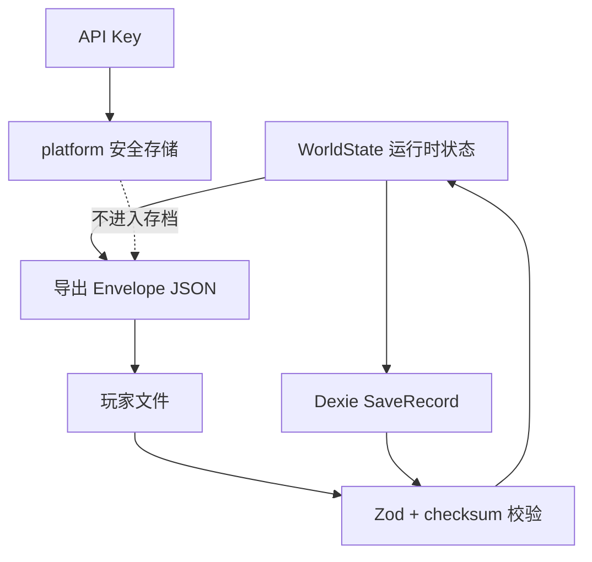

# 数据模型与持久化

本文记录运行时世界状态、存档格式、IndexedDB 表结构、版本与迁移规则。类型定义以 `src/domain/types.ts` 为准，校验以 `src/domain/schema/save.schema.ts` 为准。

## 分层



- `WorldState` 是游戏事实的唯一载体。
- `SaveRecord` 是 Dexie 中的持久化包装：`{ id, summary, world }`。
- 导出文件使用 `SaveEnvelope`，额外带格式、版本与 checksum。
- API Key 不属于世界状态，不写入存档，也不进入导出文件。

## WorldState 主要字段

| 字段 | 类型 | 说明 |
|---|---|---|
| `version` | number | 世界结构版本，当前 `12` |
| `seed` | number | 世界种子，决定生成、赛程、比赛与事件 |
| `engineVersion` | string | 生成世界的引擎版本，当前 `0.16.0` |
| `createdAt` / `updatedAt` | ISO string | 创建与最近更新时间 |
| `playerId` | Id | 用户球员 ID |
| `clubId` | Id | 用户当前俱乐部 ID |
| `players` | `Record<Id, Player>` | 全部球员，含用户与 AI |
| `clubs` | `Record<Id, Club>` | 全部俱乐部，含教练、阵容、强度 |
| `leagues` | `Record<Id, League>` | 联赛与升降级名额 |
| `fixtures` | `Record<Id, Fixture>` | 赛季赛程与比赛报告引用 |
| `relationships` | `Record<Id, Relationship>` | 教练、队友、经纪人、家人、媒体、球迷、名宿 |
| `staff` | `StaffMember[]` | 个人团队名册（队医 / 心理咨询师 / 私人教练），v12 新增；空名册是 `[]` 而不是缺字段，招聘池不落盘 |
| `events` | `Record<Id, GameEvent>` | 开放/已处理/过期事件，每天最多新增一条 |
| `eventMemory` | `Record<模板 id, 季内绝对日序>` | 事件冷却表；v7 新增，赛季切换时清空 |
| `finance` | `Finance` | 余额、周薪、支出、本周待入账、投资持仓、流水、赞助 |
| `news` | `NewsItem[]` | 新闻，保留最近 120 条 |
| `season` / `week` / `day` / `totalWeeks` | number | 当前赛季、周次（1–38）、周内日序（1–7，周一 = 1）、总周数 |
| `lastMatch` | `MatchReport \| null` | 最近一场用户比赛，含实时状态、进球与关键回合 |
| `weekPlan` | `WeeklyPlan` | 本周模板 `{ training, extra, specialization }`，每周排一次，日步进自动执行 |
| `pendingDayPlan` | `PendingDayPlan?` | `WeeklyPlan & { fixtureId: Id \| null }`；停在开球那天时存在，当日结算完清空 |
| `seasonSummaries` | `SeasonSummary[]` | 赛季总结 |
| `retired` | boolean? | 是否已退役 |
| `settings` | object | LLM Provider、模型、叙事密度、网络模式等 |
| `aiNarrative` | `AiNarrative?` | 当前周 AI 叙事 |
| `aiChat` | `AiChatMessage[]?` | AI 对话，保留最近 40 条 |
| `aiUsage` | `AiUsage?` | Token 与成本累计 |
| `aiAction` | `{ season, week, actionId }?` | 本周已使用的 AI 主动行动 |

### 关键子类型

| 类型 | 关键字段 | 不变量 |
|---|---|---|
| `Player` | 中文名 `nameZh`、属性、潜力、成长账本（`exp / lifetimeExp / attrInvestment`）、绝技账本（`moves: PlayerMove[]`）、状态、合同、声望、伤病、赛季/生涯统计 | 属性 10–96；年龄 14–60；用户球员必须存在于 `players`；`name` 保留原名（存档 id、合同、导出文件名），`nameZh` 是展示名，取值只走 `displayName`；成长三字段的写入约定见 `docs/00-项目文档/03-功能设计/01-功能规则与流程/07-经验成长与属性投资.md`：`exp` 只经引擎 `grantExp` 增加、`lifetimeExp` 只增不减、`attrInvestment` 由 v8 迁移补成十字段全 0，`computeOverall ≤ potential` 由 `investAttribute` 与建号 `checkAllocation` 分别把关；`moves` 的写入约定见 `docs/00-项目文档/03-功能设计/01-功能规则与流程/10-绝技与球员动作.md`：只有 `trainMove` / `investMove` / `teachMoveByMentor` 三个口能改，`level` 上限 3、攒满 3 格进度才升级（`playerSchema` 是 `.passthrough()`，不把这些列为必填键，旧文件仍能读取） |
| `Club` | 联赛、层级、声望、预算、设施、阵容、教练、强度 | `squadIds` 指向真实球员；`leagueId` 指向真实联赛 |
| `League` | 俱乐部列表、升降级名额 | `clubIds` 与俱乐部 `leagueId` 一致 |
| `Fixture` | 赛季、周次、轮次、周内日、主客、状态、比分 | 状态为 `scheduled / live / played`；live 比分随分钟实时写入；已结束必须有比分；同一赛季每队 38 场；`day` 是 1–7 的周内日序，缺省时由 `fixtureDayOf = day ?? dayForRound(round)` 推导（v4→v5 迁移按轮次补齐，不改 `id`） |
| `MatchReport` | 状态、当前分钟、比分、进球列表、用户出场、评分、事件、关键回合、媒体反应、`stats?`、`lineups?`、`liveState?` | `status` 为 `live / final`；live 阶段评分/MOTM/媒体为空；live 阶段 `liveState` 记录画面状态，终场删除；进球只通过统一写入函数追加；新字段可选，旧档可缺省；替补登场分钟由 `userPlayed / userStarted / userMinutes` 派生，**不额外存字段**，schema 对 `report` 未做详细声明、走 `.passthrough()`，因此新增 `sub` 事件与快进后的 `currentMinute` 都不升 `CURRENT_SAVE_VERSION` |
| `MatchLiveState` | `possession / ballX / carrierId? / pendingKickoff?` | `ballX` 0–1（0 主队球门、1 客队球门）；`pendingKickoff` 存在时下一分钟由该方中圈开球；终场不保留 |
| `LiveTrackStep` | `kind / side / ballX / carrierId?` | `kind` 为 `pass / carry / shot / turnover`；仅用于 2D 轨迹，不进入 `events` |
| `MatchEventLine` | `minute / type / text / isUser? / side?` | 进球与攻防事件必须带 `side`；关键回合结算事件按用户方写 `side`，供 2D 球场定位 `GOAL` 徽标；`type: 'sub'` 表示替补登场，`minute` 恰为登场分钟且整场至多一条（幂等追加），只由 `appendSubAppearance` 在时钟跨过登场分钟时写入 |
| `MatchGoal` | `minute / side / scorerId / scorerName / assistId? / assistName? / isUser? / isUserAssist? / fromKeyMoment?` | 一条进球只出现一次；比分缓存必须等于进球列表按主客统计 |
| `MatchStats` | `home / away: { possession, shots, shotsOnTarget, corners }` | 双方控球分钟之和 = 已模拟分钟数；射正 ≤ 射门；关键回合进球同步补记射门/射正 |
| `MatchLineups` | `home / away: MatchLineupPlayer[]` | 每侧 11 人，1 门将 4 后卫 4 中场 2 前锋；同俱乐部落点稳定 |
| `MatchLineupPlayer` | `id / name / nameZh? / number / position / isUser` | `id` 指向真实球员；用户出场时必须在首发中 |
| `KeyMoment` | `minute / kind / roll / triggerZh? / options / outcome? / defaultOptionId` | 12 类；每场 5–7 次；每回合恰好 5 个选项；`roll` 生成后固定 |
| `KeyMomentOption` | `labelZh / successChance / successBasisZh? / 效果字段` | `defaultOptionId` 指向成功率最高项；`successChance` 由 `scoreChance` 公式（基线 + 我方属性 + 绝技 − 对手门将/后卫/前锋）在开场算定，`successBasisZh` 逐项写「名称 值 ±百分比」，结算只比 `roll < successChance` |
| `Injury` | `kind / daysLeft / severity` | `daysLeft` 是**剩余天数**（1–7 天内可跨周），每天由 `advanceInjuries` 减 1；归零即伤愈并清空 |
| `WeeklyPlan` | `training / extra / specialization` | 每周模板；`world.day` 决定当天是否执行训练、额外安排或特训；`specialization` 是绝技 id（v9 起存在，缺省 `null` 表示本周不练） |
| `PendingDayPlan` | `training / extra / fixtureId` | 只在停在开球那天存在；当日收尾时清空；v4→v5 迁移由 `pendingWeekPlan` 改名并把时钟摆回比赛日 |
| `NewsItem` | `id / season / week / day? / title / body / kind` | 日步骤产生的新闻带 `day`；`id` 由 `dailyId` 生成，同周七天不撞键 |
| `GameEvent` | 模板、发件人 `sender?`、正文、`day / createdAtDay / expiresDay`、`blocking?`、选项、状态 | 一天最多一条（id 带日段）；`expiresDay` 早于当前绝对日必须过期；旧档缺 `expiresDay` 时回落 `expiresWeek` 那一周的最后一天；LLM 只能改标题与正文，不能改选项、效果与有效期。类型定义与数据包 Zod 模式同在 `src/domain/eventContent.ts` |
| `EventTemplateContent` | `id / title / body / sender / weight / expiresDays / cooldownDays / blocking / guaranteed / once? / maxPerSeason? / weekdays? / when[] / choices / resultTexts?` | 来自 `data/events/*.json`（9 个类别包共 96 条，`EVENT_PACK_NAMES` 注册、`eventTemplatesOfPack` 按类取）；条件字段 ∈ `EVENT_SCOPE_FIELDS`（27 项白名单）、正文占位符 ∈ `EVENT_BODY_TOKENS`（5 项）；`weight > 0`、`1 ≤ expiresDays ≤ 21`、`0 ≤ cooldownDays ≤ 120`、`choices ≥ 2` 且选项 id 唯一、`blocking` 事件不许有空效果选项 |
| `Effect` | `op / delta / moveId?` | `op` 共 16 个：4 项状态（士气/体能/锐度/自信）与 7 项关系（教练/队友/经纪人/家人/名宿/媒体/球迷）走 `clamp(±15)`；`money` 的 `delta` 是**英镑整数**（引擎 `×100` 写进按分记价的 `balance` 与账本）；`injuryDays` 的 `delta` 是**天**，只作用在已有伤病上、最低 1 天，不能凭空造伤；`exp` 的 `delta` 是**经验点**，负值截 0（坏事件不得扣走已攒经验）；`learnMove` / `moveProgress` 是绝技获取的名宿路径，必须带 `moveId`，`delta` 分别是「授予几级」与「攒几格进度」，位置不符或综合分够不到门槛时由引擎闸门降级成攒进度、不写等级（加载期 `moveEffectIssues` 还要求该绝技确实开了 `mentor` 路径） |
| `Relationship` | 角色、中文名 `nameZh`、信任、紧张、摘要 | 信任/紧张 0–100；`role ∈ coach / teammate / agent / family / media / fan / legend`，其中 `legend`（俱乐部名宿）的 id、名称、起始信任与摘要由 `src/domain/relationships.ts` 的 `makeLegendRelationship(userId)` 单点定义，世界生成与 v9→v10 迁移共用，绝技传授路径靠它落地 `legendTrust` |
| `Finance` | 余额、周薪、支出、本周待入账（`pendingIncome / pendingExpenses`）、持仓 `investments`、流水、赞助 | 全部金额按**英镑便士（分）**存储，只有 `formatMoney` 除以 100 显示；流水金额带符号；已实现的现金变动（周账、开仓、赎回、利息）与流水一一对应，未卖出的浮盈只挂在持仓上，既不进余额也不进流水；`pendingIncome / pendingExpenses` 是浮点累计器，只在周日各取整一次后清零 |
| `Investment` | `id / kind / name / principal / rateBps / openedDay / termDays? / earlyExitFee? / value? / risk` | `kind ∈ deposit / bond / property / business`，条款只从 `INVESTMENT_KINDS` 取；`id` 由 `dailyId(world, 'inv', kind)` 生成（带日段）；`value` 只有会波动的品种才写，读现值一律 `value ?? principal`；`termDays / earlyExitFee` 可选，v10 及更早存档没有，读取走 `termDaysOf` / `exitFeeOf` 兜底为 0；`risk` 是每周标准差（小数） |
| `InvestmentKindSpec` | `kind / label / blurb / rateBps / weeklyVol / minPrincipal / termDays / earlyExitFee` | 代码里的条款表，不是数据包，因此不参与 `hashState`；调整利率不重算回放基准。`minPrincipal` 按 `INVESTMENT_KIND_ORDER`（活期/债券/房产/生意）是 £1,000 / £4,000 / £30,000 / £8,000（分记 100000 / 400000 / 3000000 / 800000），最贵与最便宜相差 30 倍，只有 `weeklyVol > 0` 的品种才收罚息 |
| `StaffMember` | `id / role / name / nameZh / quality / weeklyCost / hiredDay` | `role ∈ doctor / psychologist / trainer`，同一角色只有水平最高的那位生效（`bestOfRole`）；`weeklyCost = round(角色基线 × (0.5 + quality/100))`，基线 7000 / 5500 / 9000 分；`hiredDay` 是雇佣那天的绝对日序；随人一起进存档，所以换季换了招聘池不影响在职者；招聘池 `buildStaffPool(seed, season)` 纯推导、不落盘 |
| `StaffFactors` | `injuryRisk / recoveryDays / dailyFitness / moraleFloor / confidencePerDay / psychBonus / expFactor / investDiscount / specializationFactor` | 九条系数由 `staffFactors(members)` 一次算清，未在岗的角色折算成 0 后每条公式自动退回恒等值，因此不需要任何「如果没人」的分支；效果强度 `staffPotency(quality) = clamp(round2(quality/90), 0.4, 1)`；团队周薪合计 `staffWeeklyTotal` 由 `accrueDailyFinance` 按 1/7 挂进 `pendingExpenses` |

### 常用枚举

- 位置：`GK / CB / LB / RB / DM / CM / AM / LW / RW / ST`
- 属性：`pace / shooting / passing / dribbling / defending / physical / mental / technique / stamina / goalkeeping`
- 训练：`physical / technical / tactical / recovery`
- 额外行动：`media / agent / social / rest / family / none`
- 事件状态：`open / resolved / expired`
- 比赛状态：`scheduled / live / played`
- 比赛报告状态：`live / final`
- 关键回合：`bigChance / penalty / throughBall / duel / save / clearance`

## ID 约定

| 对象 | 形态 | 示例 |
|---|---|---|
| 球员 | `player:<clubId>:<序号>` 或 `player:user:<seed>` | `player:club:ENG:2:04:01` |
| 俱乐部 | `club:<国家>:<层级>:<序号>` | `club:ENG:1:01` |
| 联赛 | `league:<国家>:<层级>` | `league:ENG:1` |
| 赛程 | `fixture:<leagueId>:<season>:<week>:<index>` | `fixture:league:ENG:1:2026:01:0`（比赛日在 `day` 字段，不改 id 结构：它同时是比赛随机盐） |
| 关系 | `rel:<role>:<playerId>` | `rel:coach:player:user:42` |
| 个人团队 | `staff:<role>:<slug>` | `staff:doctor:hayes`（内容池里的固定 id，来自 `data/staff/candidates.json`；在职成员直接沿用同一个 id，Zod 在加载时校验前缀与角色一致） |
| 日步骤新闻/事件 | `dailyId` → `<prefix>:<season>:<week>:<day>[:<suffix>]` | `news:injury:2026:3:5` |
| 日事件 | `event:<season>:<week>:<day>:<templateId>` | `event:2026:3:6:coach_praise`（带日段：同周不同天可以出现同一模板，冷却由 `eventMemory` 管） |
| 新闻 | `news:<kind>:<key>` | `news:season:end:2026` |
| 存档 | `save:<seed>:<base36 time>:<random>` | 由 `db.createSaveId` 生成 |
| AI 对话 | `chat:<season>:<week>:<index>:<u\|a>` | `chat:2026:3:0:u` |

除存档 ID 外，其它 ID 都应在同一世界内稳定；LLM 不得生成或修改 ID。

## 存档 Envelope

`src/db/repository.ts` 的 `buildEnvelope`：

```json
{
  "format": "pitch-life-save",
  "saveVersion": 12,
  "engineVersion": "0.15.0",
  "exportedAt": "2026-10-26T12:00:00.000Z",
  "checksum": "<hashString(canonicalStringify(world))>",
  "world": { "...": "WorldState" }
}
```

规则：

1. `format` 必须等于 `pitch-life-save`。
2. `saveVersion` 来自 `CURRENT_SAVE_VERSION`，当前为 `12`。
3. `checksum` 按 `lib.canonicalStringify` 规范化后计算；对象键排序、`undefined` 视为 `null`。
4. `importWorld` 依次执行：JSON 解析 → `saveEnvelopeSchema`（含 world 结构）→ 拒绝更高版本 → **用原始 world 重算 checksum 比对** → 迁移到当前版本。
5. 任何一步失败都抛出中文错误，不写入 IndexedDB。

`world.version` 与 envelope `saveVersion` 是两个维度：

- `world.version` 描述世界结构本身，当前为 `11`。
- `saveVersion` 描述存档封装与迁移契约，当前为 `12`。
- 结构变化时必须同时评估；旧版本 world 在加载/导入时迁移到当前结构。
- `day` / `weekPlan` / `pendingDayPlan` 在 `worldSchema` 里是**可选**字段：v5 之前的存档缺少它们，而校验发生在迁移之前，必填会让旧档直接被拒。迁移负责补齐，`assertWorld` 负责在补齐后把关。
- `eventMemory` 同理是**可选**：v6 存档没有冷却表，`events` 记录本身是 `.passthrough()`，所以事件的 `day / createdAtDay / expiresDay / sender / blocking` 与新闻的 `day` 都不需要写进 schema，只由迁移补齐。
- 成长账本（`exp / lifetimeExp / attrInvestment`）同样不写进 `playerSchema` 必填键：`.passthrough()` 让 v7 文件继续可读，`migrateGrowth` 负责「缺才补、有则不动」。
- 绝技账本 `Player.moves`、`WeekPlan.specialization` 与名宿关系也不进 schema 必填键：`migrateMoves` / `migrateLegend` 负责补齐，`assertWorld` 在补齐后把关。

## IndexedDB

数据库名：`pitch-life-db`（`src/db/db.ts`）。

| 版本 | 表 | 主键 | 内容 |
|---|---|---|---|
| 1 | `saves` | `id` | `SaveRecord`：`{ id, summary, world }` |
| 1 | `meta` | `key` | 元数据，当前只有 `lastSaveId` |
| 2 | `secrets` | `id` | 本机密钥材料（仅 Web 加密方案） |

`secrets` 记录形态：

| id | value | 说明 |
|---|---|---|
| `llm-api-key` | `{ iv: number[], data: number[] }` | AES-GCM 密文 |
| `llm-api-key-wrap` | `CryptoKey` | 不可导出的 AES-GCM 包装密钥 |

Android 使用 Capacitor SecureStorage，不写 `secrets` 表。清除 Key 时同时清空会话内存、原生存储与 Web 密文。

### 存档摘要

`SaveSummary` 从 `WorldState` 派生，用于列表展示：

`{ id, playerName, clubName, season, week, age, overall, updatedAt }`

`listSaves` 当前读取全部记录再排序。存档数量增大后应改为索引分页，但不得改变摘要字段语义。

## 迁移策略

当前 `CURRENT_SAVE_VERSION = 12`：步骤表在 `src/db/migrateSteps.ts` 的 `MIGRATION_STEPS`（数组顺序即执行顺序，`from` 不要求单调），`src/db/migrate.ts` 负责克隆、补 live 报告、按表执行与 `assertWorld` 收尾，提供 v1 → v2 → … → v12 连续迁移。

| 版本 | 变更 | 迁移 |
|---|---|---|
| 1 | 预生成终场比分；`MatchReport` 无状态/分钟/进球列表 | — |
| 2 | 逐分钟实时比赛；`Fixture.status` 增加 `live`；`MatchReport` 增加 `status / currentMinute / goals`；`WorldState.pendingWeekPlan` | 所有已有报告补 `status: 'final'`、`currentMinute: 90`、`goals: []`；`pendingWeekPlan = null`；`world.version = 2`；`engineVersion` 保留历史值 |
| 3 | 比赛日实时化；`MatchReport` 增加可选 `stats / lineups`；`KeyMoment` 增加 `triggerZh`、`KeyMomentOption` 增加 `successBasisZh` | live 报告补 `stats`（控球按 `currentMinute` 均分、射门=射正=进球、角球 0）与 `lineups`（主客各 11 人）；**保留** `pendingWeekPlan`；终场旧报告不伪造统计；`world.version = 3` |
| 4 | 2D 比赛画面状态；`MatchReport` 增加可选 `liveState`（`possession / ballX / carrierId? / pendingKickoff?`） | 仅 live 报告补 `liveState = { possession: 'home', ballX: 0.5 }`；终场报告与 `lineups / stats` 不变；`world.version = 4` |
| 5 | 时间粒度改为天：`WorldState.day` / `weekPlan` / `pendingDayPlan`（取代 `pendingWeekPlan`）、`Fixture.day`、`Injury.daysLeft`（取代 `weeksLeft`）、`NewsItem.day` | `fixtures[*].day = dayForRound(round)`（纯推导，不消耗 RNG）；`injury.daysLeft = max(1, round(weeksLeft × 7))` 并删除 `weeksLeft`；`pendingWeekPlan → pendingDayPlan`；`weekPlan` 缺省补 `DEFAULT_WEEK_PLAN`；停着的 live 比赛把时钟摆回它所在的那一天（`day = fixtureDayOf(liveFixture)`），否则 `day = 1`；末尾 `assertWorld` 把关；`world.version = 5` |
| 6 | 中文人名：`Player.nameZh`、`Club.coach.nameZh`、`Relationship.nameZh`、`MatchLineupPlayer.nameZh`、`PitchPlayer.nameZh`（`name` 语义不变，仍用于存档 id、合同与导出文件名） | 实体按 `nameZhFor(name, nationality)` 补齐中文名，已有值不覆盖（幂等）；历史文本按「原名 → 中文名」整词替换：战报 `events[].text` / `mediaReaction` / 关键回合文案与结算文案、`scorerName` / `assistName` / `motmName`、新闻与事件的标题正文选项与结果文案、关系摘要；首发名单条目按 `playerId` 回查补 `nameZh`。不改动时钟与 `fixture.id`，停在关键回合的 live 档迁移后仍能踢完；`world.version = 6` |
| 7 | 每日事件：`WorldState.eventMemory`（模板 id → 季内绝对日序）、`GameEvent.day / createdAtDay / expiresDay / sender / blocking`、事件 id 加日段 | `events[*]` 的 `day` 回灌为 `DAYS_PER_WEEK`（旧事件本来就是周日拍的），`createdAtDay = absoluteDay(createdAtWeek, day)`，`expiresDay = absoluteDay(expiresWeek, DAYS_PER_WEEK)`；`sender`/`blocking` 优先取数据包、未知模板落回「俱乐部」/`true`；`eventMemory` 由现存事件按模板取最大日序重建（不清会让旧档第一周被同一模板刷屏）；`migrateEventDays` 不消耗 RNG、不触碰时钟与 `pendingDayPlan`；末尾 `assertWorld` 把关；`world.version = 7` |
| 8 | 成长账本：`Player.exp / lifetimeExp / attrInvestment`（`AttrInvestment = Record<AttrKey, number>`，定义在 `src/domain/primitiveTypes.ts`），以及新档建号可选入参 `CareerCreateOptions.allocation`（不落盘，只影响生成的属性） | `migrateGrowth()` 遍历 `Object.values(world.players)`，用 `??=` 三段补齐：`exp ??= 0`、`lifetimeExp ??= 0`、`attrInvestment ??= emptyAttrInvestment()`（十字段全 0，保证投资曲线第一点价格稳定在 6 经验）。已有值一律不覆盖，脏档里玩家已攒的经验不会被清零；不新建球员对象，避免丢掉 v7 的其它字段；不消耗 RNG、不触碰时钟与 `pendingDayPlan`；`playerSchema` 未加必填键，v7 文件的兼容性不变；末尾 `assertWorld` 把关；`world.version = 8` |
| 9 | 绝技账本：`Player.moves: PlayerMove[]`（`{ moveId, level, progress }`）、`WeekPlan.specialization: string \| null`；绝技内容 64 条进 `data/moves/*.json` | `migrateMoves()`：每个 `players[*]` 用 `??=` 补 `moves = []`，`weekPlan.specialization ??= null`；已有绝技记录不清；不消耗 RNG、不动时钟 |
| 10 | 名宿：`RelationshipRole` 加 `'legend'`，`Effect` 加可选 `moveId`，`EffectOp` 增至 16（`legendTrust / learnMove / moveProgress`），事件包增至 9 个 | `migrateLegend()`：关系表里没有任何 `role === 'legend'` 时补 `makeLegendRelationship(world.playerId)`，已有则原样保留（信任与文案都不覆盖）；`MIGRATION_STEPS` 表新增 `{ from: 10 }` 一行 |
| 11 | 资金运用：`Finance.pendingIncome / pendingExpenses / investments` 进入结构，`FinanceLedgerEntry.type` 加 `'investment'`；`Investment.termDays / earlyExitFee` 为可选字段 | `migrateFinance()` 只有三条 `??=`（`pendingIncome ??= 0`、`pendingExpenses ??= 0`、`investments ??= []`）：缺才补、有则不动，因此**不折现、不重开仓、不清仓、不产生流水**，老档的余额一分不变；已带投资与待入账的脏档原样保留；不消耗 RNG、不触碰时钟与 `pendingDayPlan`；末尾 `assertWorld` 把关；`world.version = 11` |
| 12 | 个人团队：`WorldState.staff: StaffMember[]` 进入结构（`src/domain/staff.ts`），招聘池由 `buildStaffPool(seed, season)` 推导、**不进存档** | `migrateStaff()` 只有一条 `world.staff ??= []`（补空名册）：不重建市场、不代人雇佣、不产生流水，老档的余额与名册一分不动；已经带着在职成员的脏档原样保留；`staffSchema` 把 `staff` 声明成可选，v11 文件在校验阶段不被拒；不消耗 RNG、不触碰时钟、`pendingDayPlan` 与任何 `roll`，停在开球的旧档迁移后仍能接着踢完那场；末尾 `assertWorld` 把关；`world.version = 12` |

迁移规则：

- 迁移幂等，可重复执行；只前进不后退。
- 旧档中未完成的关键回合保留：v1 报告走旧版 `final` 结算路径；v2 live 报告迁移后保留待处理回合（v5 起键名为 `pendingDayPlan`），可继续实时播放到终场；v3 live 报告补 `liveState` 后可继续播放；v4→v5 把时钟摆回 live 比赛那一天，读档后仍能踢完这场；v5→v6 只改名字与文案，不触碰 `roll`、时钟与首发 id，迁移后关键回合仍能按原判定结算；v6→v7 只补事件字段与冷却表，不触碰时钟、`pendingDayPlan` 与任何 `roll`；v7→v8 只补成长账本，同样不触碰时钟、`pendingDayPlan` 与 `roll`，迁移后既能接着踢完停在开球的那场，也能立刻 `investAttribute`。
- `loadWorld` 在 schema 校验后迁移；发生迁移时回写数据库并同步摘要。
- `importWorld` 必须先校验 checksum，再做迁移；拒绝 `saveVersion > 12`。
- 旧客户端遇到 v12 存档会按现有版本检查拒绝读取；不提供降级迁移。
- v10→v11 只在 `finance` 上补三个累计器与一张持仓表，同样不触碰时钟、`pendingDayPlan` 与任何 `roll`：停在开球的旧档迁移后既能接着踢完这场，踢完当天就能开仓。
- v11→v12 只在世界顶层补一张空名册 `staff: []`，不触碰时钟、`pendingDayPlan` 与任何 `roll`：迁移完当天就能雇人，效果从下一次晨间结算开始生效；名册为空时九条系数全是恒等值，所以旧档读出来的每一个数字与迁移前一致。

任何存档结构变化必须满足：

1. 升 `CURRENT_SAVE_VERSION`（必要时同时升 `world.version`）。
2. 提供从旧版本到新版本的迁移函数，迁移必须幂等、可重复执行。
3. 在 `tests/fixtures/` 放旧版本存档 fixture，并加入导入测试。
4. 增加导出 → 导入 → 深度相等测试。
5. 在提交信息中说明兼容范围与回滚策略。
6. `check-anti-regression` 检测到 `save.schema.ts` 或 `CURRENT_SAVE_VERSION` 变化但版本未升时失败。

迁移原则：

- 只增字段、给默认值优先；避免重命名和删除。
- 迁移只读旧结构，不依赖当前引擎运行结果。
- 迁移失败必须拒绝导入，不能写入半成品。
- 不修改玩家已有存档的语义，只做结构转换。

## 容量与保留

| 数据 | 当前策略 | 位置 |
|---|---|---|
| 新闻 | 保留最近 120 条；事件生成时先截到 80 条 | `endSeason` / `generateDailyEvents` 截断 |
| 事件 | 不按条数截断，靠 `expiresDay` 过期与 `eventMemory` 冷却 | `expireEvents` / `eventsDaily`（一天最多一条，全季总量由 `tests/engine/eventCadence.test.ts` 锁在 40–80） |
| AI 对话 | 保留最近 40 条 | `sendChat` 截断 |
| 财务流水 | 保留最近 120 条 | `pushFinanceLedger`（周账、开仓、赎回、利息）/ `applyEffects` / `paySeasonBonuses` 截断——一周一条，日步骤只挂待入账不写流水 |
| 赛季总结 | 不截断 | `seasonSummaries` |
| 比赛报告 | 只保留 `lastMatch` 与 fixture 引用 | `fixtures[].report` |
| 日期与星期 | 不落盘，由 `season/week(/day)` 即时推导 | `src/lib/calendar.ts` |
| 绝对日序 | 不落盘，`(week-1)*7+day` | `src/domain/calendar.ts` |

长期需要评估：完整比赛历史是否单独存储、财务流水是否按月归档、IndexedDB 配额与清理策略。本轮不做。

## 数据安全

- 存档与导出文件包含玩家昵称、俱乐部与比赛数据，不包含真实个人信息。
- API Key 不进入 `WorldState`、导出文件、日志或错误信息。
- LLM 输出只作为文本渲染，不写入事实字段；事件文案改写必须匹配 `templateId`。
- 导入文件必须先校验再落库，禁止直接 `JSON.parse` 后使用。

## 变更记录

| 日期 | 变更 | 关联 |
|---|---|---|
| 2026-10-26 | 初版：世界状态、envelope、IndexedDB 与迁移规则 | ADR 0001 |
| 2026-10-31 | 存档升 v2：fixture `live`、报告 `status/currentMinute/goals`、`pendingWeekPlan`；v1 迁移保留未完成回合；engine 0.2.0 | 缺陷修复：比赛日比分穿越 |
| 2026-10-31 | 存档升 v3：报告可选 `stats / lineups`、关键回合 `triggerZh` 与选项 `successBasisZh`；v2 live 迁移保留待处理回合并补齐首发/统计；engine 0.3.0 | 比赛日实时化改造 |
| 2026-10-31 | 存档升 v4：`MatchReport.liveState` 持久化控球/球位/持球人/开球方；v3 live 迁移补中圈状态；终场删除 `liveState`；engine 0.4.0 | 缺陷修复：比赛日 2D 画面不可读 |
| 2026-11-01 | 关键回合结算事件补写 `side`；存档结构不变，engine 0.4.1 | 缺陷修复：2D 画面细节 |
| 2026-11-02 | 存档升 v5：日时钟 `day`、`weekPlan`、`pendingDayPlan`、`Fixture.day`、`Injury.daysLeft`、`NewsItem.day`；v4 迁移按轮次推导日并把 live 档摆回比赛日；engine 0.5.0 | M1.1/M1.2 日回合与快进 |
| 2026-11-02 | 存档升 v6：实体 `nameZh` 与战报阵容 `nameZh`，历史文本按原名→中文名整词替换；`CURRENT_SAVE_VERSION`/`world.version` = 6；engine 0.5.1 | M1.4 中文人名 |
| 2026-11-02 | 无存档结构变化：`Club.style` 从死字段变成选型与训练的输入（`domain/coachStyle.ts`），引擎语义变更令 `ENGINE_VERSION` 升 0.5.2 并重算回放基准（`91cb67aad3f2e45a`），世界里的 `engineVersion` 字符串随新世界写入 | M1.5 教练打法生效 |
| 2026-11-02 | 存档升 v7：`eventMemory` 冷却表与事件 `day / createdAtDay / expiresDay / sender / blocking`，事件 id 加日段；v6 迁移回灌日字段并按模板重建冷却表；`ENGINE_VERSION` 升 0.6.0 并重算回放基准 | M1.7 每日事件 |
| 2026-11-02 | 无存档结构变化：事件内容池从 11 条扩到 87 条（新增 7 个类别包），`EffectOp` 增加 `injuryDays`（单位＝天，只作用于已有伤病）并把 `money` 钉成整英镑；`ENGINE_VERSION` 升 0.7.0、回放基准 `c11f736b834051db` → `5fdf2872b99372c2` | M1.8 事件内容扩容 |
| 2026-11-02 | 无存档结构变化：`KeyMomentOption.successChance / successBasisZh` 改由 `scoreChance` 公式表产出并读对面首发的门将/后卫/前锋属性（`resolveOpponents` 回查 `world.players`），`data/optionUtils.ts` 删除；这些字段嵌在 `MatchReport.keyMoments` 里参与 `hashState`，故 `ENGINE_VERSION` 升 0.8.0、回放基准 `5fdf2872b99372c2` → `43de8568604868f8`；`CURRENT_SAVE_VERSION` 仍为 7，旧档字段形状不变，只是同一场重放会得到新概率 | M1.9 对手对抗概率 |
| 2026-11-02 | 存档升 v8：`Player.exp / lifetimeExp / attrInvestment` 进入结构（schema 仍 `.passthrough()`，靠 `migrateGrowth` 缺才补、有则不动）；建号新增可选入参 `CareerCreateOptions.allocation`（不落盘，点买不消耗 RNG，种子流位置不变）；`EffectOp` 增至 13 个（新增 `exp`，负值截 0）；训练与比赛结算开始产经验，引擎语义变化令 `ENGINE_VERSION` 升 0.9.0、回放基准 `43de8568604868f8` → `c43d95700e96f860` | M1.10a 经验成长与属性投资 |
| 2026-11-02 | 存档升 v9：`Player.moves: PlayerMove[]`（`{ moveId, level, progress }`，0 级＝还没学会但在攒进度）与 `WeekPlan.specialization: string \| null` 进入结构，靠 `playerSchema` / `weekPlan` 的 `.passthrough()` 放行、由 `migrateMoves` 补齐；绝技内容 64 条落 `data/moves/*.json`（八大家族 ×8，四档稀有度，`RARITY_CHANCE_BUDGET` 上限 4.5%/6.5%/8.5%/11%），`MOVE_MAX_LEVEL = 3`、`MOVE_PROGRESS_PER_LEVEL = 3`；特训槽与比赛掉落（评分 ≥7.8）开始写进度，`ENGINE_VERSION` 升 0.10.0 再升 0.11.0、回放基准 `c43d95700e96f860` → `82fe56a7e245ea77` | M1.10b / M1.11 绝技与获取路径 |
| 2026-11-02 | 存档升 v10：`RelationshipRole` 加 `'legend'`（俱乐部名宿），名宿关系由 `src/domain/relationships.ts` 的 `makeLegendRelationship(userId)` 单点定义，世界生成与 `migrateLegend` 共用；`EffectOp` 增至 16 个（`legendTrust / learnMove / moveProgress`）并给 `Effect` 加可选 `moveId`，Zod 模式与绝技效果闸门从 `eventContent.ts` 拆到 `src/domain/eventSchema.ts`；事件包增至 9 个（`mentor` 9 条）共 96 条模板；迁移步骤抽成 `src/db/migrateSteps.ts` 的 `MIGRATION_STEPS` 表；`ENGINE_VERSION` 升 0.12.0、回放基准 `82fe56a7e245ea77` → `a53d784da26c391d` | M1.11 名宿传授 |
| 2026-11-02 | 存档升 v11：`Finance.pendingIncome / pendingExpenses / investments` 与 `Investment`（`{ id, kind, name, principal, rateBps, openedDay, termDays?, earlyExitFee?, value?, risk }`）进入结构，`FinanceLedgerEntry.type` 加 `'investment'`；四种资金去处的条款表落 `src/domain/finance.ts`（代码而非数据包，不进 `hashState`）；`migrateFinance` 只做三条 `??=`，不折现不重开仓；日粒度财务改由 `financeDaily.ts`（日累计 + 周日一条流水 + 欠款 −0.15 士气/天）与 `investments.ts`（开仓/赎回/周日利息与一次价值漫步）承载；`ENGINE_VERSION` 升 0.13.0、回放基准 `a53d784da26c391d` → `3b40c1fbe0ca642b` | M1.12 资金运用 |
| 2026-11-02 | 存档升 v12：`WorldState.staff: StaffMember[]`（`{ id, role, name, nameZh, quality, weeklyCost, hiredDay }`）进入结构，靠 `staffSchema` 的 `.optional()` 放行 v11 文件、由 `migrateStaff` 一条 `??=` 补成空名册；招聘池 `buildStaffPool(seed, season)` 与九条系数 `staffFactors` 都在 `src/domain/staff.ts`，内容池 18 人落 `data/staff/candidates.json`；团队周薪经 `staffWeeklyTotal` 进 `accrueDailyFinance` 的待支出，教练席效果进 `day.ts` 晨间、`training.ts`/`matchUser.ts` 的受伤折算、`growth.ts`/`specialization.ts` 的经验与特训、`liveMatch.ts` + `scoreChance.ts` 的高风险选项；`ENGINE_VERSION` 升 0.14.0、回放基准 `3b40c1fbe0ca642b` → `0515c620b8b5f310`（`staff` 键本身）→ `0977f1c7baccb177`（版本串） | M1.13 个人团队 |
| 2026-11-05 | 无存档结构变化：`CURRENT_SAVE_VERSION` 保持 12。建号基准的随机材料从 `(seed, name, age, position)` 改为 `(seed, age, position)`——姓名不再进抽签，同 seed 改名不重抽九项属性与潜力；`Player.name / nameZh` 的写入与读取完全不变，所以旧档不需要迁移。位移的是 `'user'` 域之后的整条世界生成流，回放基准 `a5df29729457cf02` → `5c8603ff2effd2cf`（`ENGINE_VERSION` 沿用同分支已升的 0.15.0） | CHG-20261105-005 |
| 2026-11-05 | 无存档结构变化：`CURRENT_SAVE_VERSION` 保持 12。替补登场分钟改由 `userPlayed / userStarted / userMinutes` 派生（`domain/matchMinutes`，不加字段、不建第二份真相），`report.events` 新增 `sub` 类型、快进后的 `currentMinute` 与主角事件的分钟上钳都落在 `MatchReport` 的 `.passthrough()` 放行路径上；比赛分钟闸门与快进改变引擎输出，故 `ENGINE_VERSION` 升 0.15.0、回放基准 `0977f1c7baccb177` → `a5df29729457cf02`；停在未结束比赛的 v12 旧档迁移后按最新落盘分钟续播，不需要新迁移 | CHG-20261105-004 |
| 2026-11-06 | 无存档结构变化：`CURRENT_SAVE_VERSION` 保持 12，`Player.seasonStats` 与 `MatchReport.events/goals` 的字段一个都没动，改的是**写入内容**——背景比赛开始给两队首发 11 人记出场/分钟/评分/进球/助攻，射正被扑出少一行事件，关键回合进球补一条破门行，建队时队内撞名的球员原名被重抽。这些都会落进 `hashState`，故 `ENGINE_VERSION` 升 0.16.0、回放基准 `5c8603ff2effd2cf` → `32a82bd55cacb2e5`；旧档读入后照常继续跑，只是之后的比赛开始产出完整联赛数据，不需要迁移 | CHG-20261106-002 |
