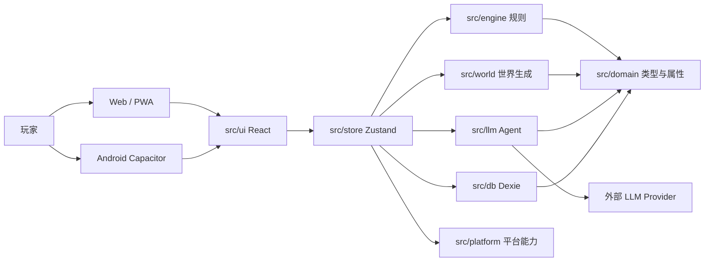
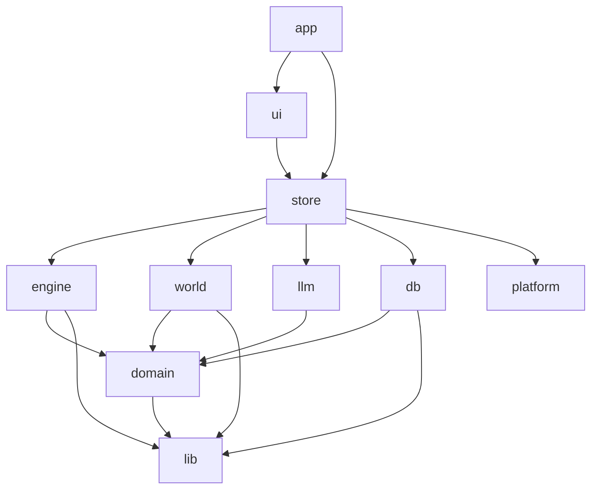
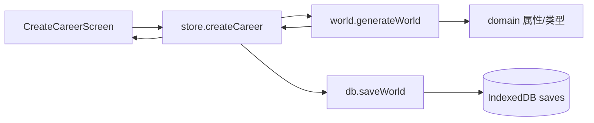
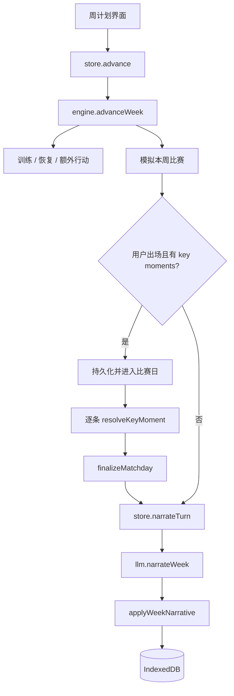

# 架构总览

本文描述“当前代码实际怎么运行”，以及“目标架构允许怎么依赖”。两者不一致的地方列在“已知违规”中，并由 `docs/modules.yaml` 与 `check:boundaries` 共同约束。

## 系统上下文

- 应用是纯前端单页应用，没有自建后端；唯一可选外部依赖是玩家自己配置的 LLM 接口。
- 游戏事实（比分、属性、合同、赛程、财务、关系）全部由本地确定性引擎计算。
- 运行时状态只存在两处：Zustand 内存状态，以及 IndexedDB 中的存档；导出文件是 JSON。

## 运行形态

| 形态 | 入口 | 说明 |
|---|---|---|
| Web | `index.html` → `src/main.tsx` | Vite 构建，生产环境注册 PWA Service Worker |
| Android | Capacitor `android/` 壳 | 复用同一套 Web 产物，原生 HTTP / 安全存储 / 文件能力通过平台分支接入 |
| iOS | 未实现 | 规划为 Capacitor 壳，复用核心域 |
| 微信小程序 | 未实现 | 先评估 web-view 外壳，核心逻辑保持纯 TS |

路由（`src/router.tsx`）：

| 路径 | 页面 | 主要职责 |
|---|---|---|
| `/` | TitleScreen | 继续生涯 / 新建 / 导入 |
| `/create` | CreateCareerScreen | 选择国籍、位置、俱乐部、种子 |
| `/game` | DashboardScreen | 周计划、推进、当前事件 |
| `/match` | MatchdayScreen | 比赛报告与关键回合 |
| `/schedule` | ScheduleScreen | 赛程与积分榜 |
| `/inbox` | InboxScreen | 新闻、事件、AI 对话 |
| `/profile` | ProfileScreen | 属性、合同、财务、生涯记录 |
| `/timeline` | TimelineScreen | 赛季与生涯时间线 |
| `/settings` | SettingsScreen | LLM Provider、Key、叙事密度、导入导出 |
| `/more` | MoreScreen | 次级入口 |

## 模块划分

模块与 `docs/modules.yaml` 保持一致；模块清单是唯一事实源，本表只做导读。

| 模块 | 目录 | 职责 | 允许依赖 |
|---|---|---|---|
| app | `src/app` | 组合根、错误边界、全局装配 | ui, store, platform, domain, lib |
| ui | `src/ui` | 页面、组件、纯展示派生 | store, domain, lib, platform |
| store | `src/store` | 会话状态、编排引擎/存档/Agent | engine, world, llm, db, platform, domain, lib |
| engine | `src/engine` | 确定性规则：回合、比赛、事件、财务、关系 | domain, lib |
| world | `src/world` | 世界与赛程生成、俱乐部强度、数据包读取 | domain, lib |
| llm | `src/llm` | Agent 提示词、工具契约、Provider 适配、降级 | domain, lib, platform |
| db | `src/db` | IndexedDB 存档、导入导出、校验和 | domain, lib |
| platform | `src/platform` | 平台能力：安全存储、原生 HTTP 等 | lib |
| domain | `src/domain` | 纯类型、属性公式、存档 schema | lib |
| lib | `src/lib` | 无业务语义工具；确定性随机数与哈希（`rng.ts`：createRng/hashString/hashState）、格式化、稳定序列化 | 无 |

`src/main.tsx` 与 `src/router.tsx` 属于组合根，登记在 `docs/modules.yaml` 的 `rootFiles`，归属 `app`。

## 目标依赖方向

✓ 允许，✗ 禁止。

| from \ to | app | ui | store | engine | world | llm | db | platform | domain | lib |
|---|---|---|---|---|---|---|---|---|---|---|
| app | - | ✓ | ✓ | ✗ | ✗ | ✗ | ✗ | ✓ | ✓ | ✓ |
| ui | ✗ | - | ✓ | ✗ | ✗ | ✗ | ✗ | ✓ | ✓ | ✓ |
| store | ✗ | ✗ | - | ✓ | ✓ | ✓ | ✓ | ✓ | ✓ | ✓ |
| engine | ✗ | ✗ | ✗ | - | ✗ | ✗ | ✗ | ✗ | ✓ | ✓ |
| world | ✗ | ✗ | ✗ | ✗ | - | ✗ | ✗ | ✗ | ✓ | ✓ |
| llm | ✗ | ✗ | ✗ | ✗ | ✗ | - | ✗ | ✓ | ✓ | ✓ |
| db | ✗ | ✗ | ✗ | ✗ | ✗ | ✗ | - | ✗ | ✓ | ✓ |
| platform | ✗ | ✗ | ✗ | ✗ | ✗ | ✗ | ✗ | - | ✗ | ✓ |
| domain | ✗ | ✗ | ✗ | ✗ | ✗ | ✗ | ✗ | ✗ | - | ✓ |
| lib | ✗ | ✗ | ✗ | ✗ | ✗ | ✗ | ✗ | ✗ | ✗ | - |

核心原则：

- `domain` 与 `lib` 不依赖任何业务模块，保证可以跨平台、跨外壳复用。
- `engine` 与 `world` 不依赖 UI、存储、网络；随机数只能通过 `createRng` 获得。`createRng`/`hashString` 等确定性工具定义在 `src/lib/rng.ts`（原 `src/engine/rng.ts`），下沉到 `lib` 后 `world`、`db` 可直接复用，消除了 `world→engine`、`db→engine` 依赖与 `engine↔world` 循环。
- `store` 是唯一允许同时编排 engine、world、llm、db、platform 的模块。
- `ui` 只消费 store 状态与 selector，不直接调用引擎或 LLM。
- `app` 是组合根，任何模块都不得反向依赖 `app`。

## 当前真实依赖与已知违规

目标矩阵尚未完全达成。以下边被显式登记为已知违规，新增同类边会失败，已有违规只能减少。

当前没有登记的跨模块违规：ui 的派生数据统一经 `src/store/selectors.ts`，平台能力经 `src/platform` 端口，`docs/modules.yaml` 的 `knownViolations` / `knownCycles` 为空。
`rng`（`createRng`/`hashString`）已下沉到 `src/lib/rng.ts`，`world→engine`、`db→engine` 违规与 `engine↔world` 循环已消除；`computeClubStrength`/`generateFixtures` 与 `computeLeagueTable` 已下沉到 `src/domain`，`engine→world` 违规与 `ui→engine`（积分榜）、`llm→engine`（prompt）深引随之清除；`llm/actions.ts` 已提案化，`resolveChatAction` 返回 `ChatActionProposal`（`src/domain/chatAction.ts`），效果应用移到 `src/engine/chatAction.ts`，`llm→engine` 违规清零。平台端口化后 `platform→db` 违规与两处内联平台违规（`capacitor-import`、`dom-file-export`）一并消除：`keyStore.ts` 改为注入 `SecretStore` 端口（实现见 `src/store/secretStore.ts`，组合根 `main.tsx` 装配），HTTP 迁到 `src/platform/http.ts`（`llm/transport.ts` 只做 `HttpError→LlmError` 映射），文件下载迁到 `src/platform/fileExport.ts`。`ui→engine/world/llm` 的 7 处深引已改走 `src/store/selectors.ts`，违规清零。

## 关键流程

### 创建生涯

1. UI 校验表单并生成确定性 seed。
2. `generateWorld` 生成两级联赛、俱乐部、23 人阵容、用户球员、38 周双循环赛程、关系、财务与初始新闻。
3. store 立即写入 IndexedDB，并刷新存档列表。

### 推进一周

- 比赛结果在 `advanceWeek` 内一次算完；关键回合只允许在既定 `roll` 与选项上追加结果，不重新模拟比赛。
- 所有状态变更完成后先持久化，再触发可选的 LLM 叙事。
- LLM 失败只影响叙事，不回滚比赛结果。

### 存档、导出与导入

- 运行时：`store.saveNow` → `db.saveWorld` → Dexie `saves` 表。
- 导出：`db.buildEnvelope` 生成带 checksum 的 JSON，`store/exportSave.downloadWorld` 组装文件名并经 `platform/fileExport.downloadTextFile` 触发浏览器下载。
- 导入：`db.importWorld` 先过 Zod envelope + world 校验，再校验 checksum，拒绝更高 `saveVersion`。
- 密钥：`platform/keyStore.ts` 在本机加密保存，不进入 `WorldState`；持久化经注入的 `SecretStore` 端口（`store/secretStore.ts` 用 `db.secrets` 实现）。

### Agent

- `store.narrateTurn` / `store.sendChat` 负责编排。
- `llm/client.ts` 负责 Provider 适配、重试与错误分类。
- `llm/schema.ts` 用 Zod 校验工具输出，`sanitizeText` 去控制字符、标签与 URL。
- `llm/actions.ts` 的 `resolveChatAction` 是纯函数，返回 `ChatActionProposal`；`engine/chatAction.ts` 的 `applyChatActionProposal` 施加效果并记录 `aiAction`，store 编排两步。

## 数据所有权

| 数据 | 所有者 | 读者 | 写入约束 |
|---|---|---|---|
| 比分、属性、合同、赛程、财务、关系 | engine / world | ui、llm 只读 | 只能由 engine 的确定性函数修改 |
| `WorldState` 整体 | engine + store | ui、db、llm | store 负责持久化与编排，LLM 不得直接改事实 |
| `aiNarrative` / `aiChat` / `aiUsage` | llm 产出，store 写入 | ui | 文本经 sanitize，事件改写需 templateId 匹配 |
| 存档 envelope | db | 导入/导出 | 版本、checksum、Zod 校验 |
| LLM API Key | platform | llm / store | 不写入 `WorldState`，不进入导出文件 |

## 平台边界

当前平台差异以内联分支存在，已冻结：

- `src/platform/native.ts`：判断 Capacitor 运行环境。
- `src/platform/keyStore.ts`：Android SecureStorage / Web AES-GCM，持久化经注入的 `SecretStore` 端口。
- `src/platform/http.ts`：浏览器 fetch / CapacitorHttp 两个 `HttpPort` 实现，抛平台中立 `HttpError`。
- `src/platform/fileExport.ts`：`downloadTextFile` 触发浏览器下载。
- `src/llm/transport.ts`：选择 `HttpPort` 并把 `HttpError` 映射为 `LlmError`。
- `src/main.tsx`：组合根，装配 `store/secretStore` 并仅在生产 Web 注册 Service Worker。
- `src/store/exportSave.ts`：`downloadWorld` 组装文件名并调用 `platform/fileExport`。

目标形态是 `src/platform/ports` + `web/capacitor/wechat` 适配器，选择逻辑只放在 `src/platform/index.ts`。详见 [多端策略](platform-strategy.md)。

## 非功能约束

- **确定性**：engine / world 内禁止 `Math.random`、`Date.now`、`new Date()`、`performance.now`；随机数只走 `createRng(seed, ...domain)`。
- **原子回合**：`advanceWeek` 接收旧状态并返回新状态，内部用 `structuredClone`，不修改入参。
- **存档可校验**：任何持久化状态必须通过 `worldSchema`；导出必须带版本与 checksum。
- **技术债棘轮**：新代码按阈值卡，现有超标文件只降不升。
- **文档同步**：改模块代码必须同步对应功能/架构文档，或有书面豁免。

## 架构演进

- 决策背景与取舍见 [ADR 0001](../decisions/0001-governance-and-modular-monolith.md)。
- 已完成拆分：`gameStore.ts`（切片化）→ `generator.ts` → `match.ts` / `keyMoments.ts`；下一步补公共 `index.ts`，把跨模块深引降为 0。
- 平台端口化与 iOS / 微信评估不在本轮实现，规则见 [多端策略](platform-strategy.md)。

## 变更记录

| 日期 | 变更 | 关联 |
|---|---|---|
| 2026-10-26 | 初版：记录运行形态、模块矩阵、已知违规与关键流程 | ADR 0001 |
| 2026-10-28 | rng 下沉 lib、strength/fixtures/leagueTable 下沉 domain，消除 world/db/ui→engine 与 engine→world 违规及 engine↔world 循环 | 全量重构 P1 |
| 2026-10-29 | engine/world/store 大文件完成拆分，store 切片化并以 selectors 承接 UI 派生数据，ui 已知违规清零 | 全量重构 P2 |
| 2026-10-29 | llm 聊天动作提案化（resolveChatAction/applyChatActionProposal），消除 llm→engine 红线 | 全量重构 P1 |
| 2026-10-29 | 平台端口化：keyStore 注入 SecretStore、HTTP 迁 platform/http、文件下载迁 platform/fileExport，消除 platform→db 与两处内联平台违规 | 全量重构 P1 |
| 2026-10-29 | Dashboard 拆为 `ui/screens/dashboard/*`（头部/本周状态/下一场/联赛迷你表/收件箱/新闻等），Matchday 拆为 `ui/screens/matchday/*`（比分卡/关键时刻/回顾/时间线），派生数据集中到 `dashboardData.ts`，页面结构与视觉不变 | 全量重构提交 11 |
