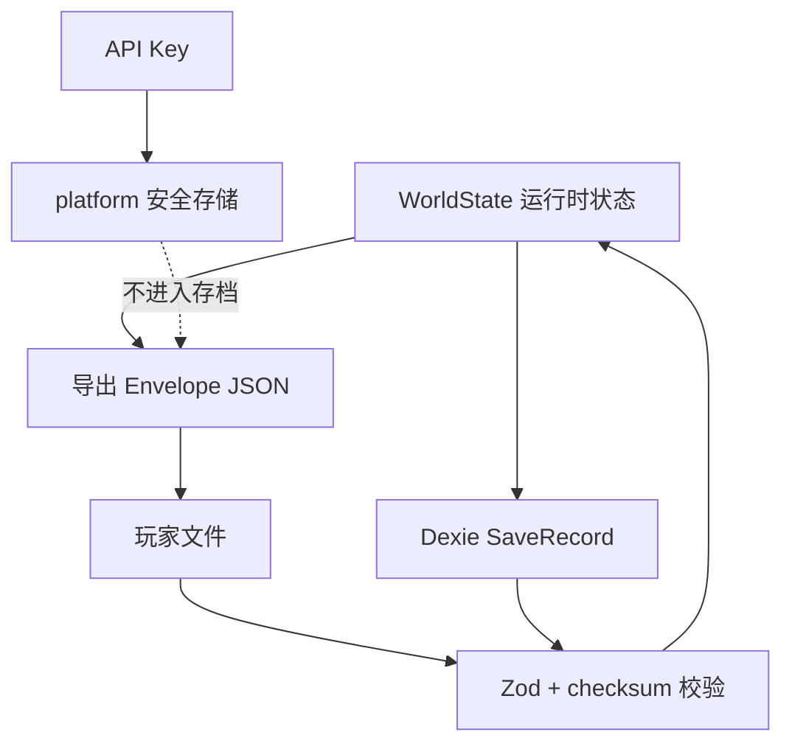

# 数据模型与持久化

本文记录运行时世界状态、存档格式、IndexedDB 表结构、版本与迁移规则。类型定义以 `src/domain/types.ts` 为准，校验以 `src/domain/schema/save.schema.ts` 为准。

## 分层



- `WorldState` 是游戏事实的唯一载体。
- `SaveRecord` 是 Dexie 中的持久化包装：`{ id, summary, world }`。
- 导出文件使用 `SaveEnvelope`，额外带格式、版本与 checksum。
- API Key 不属于世界状态，不写入存档，也不进入导出文件。

## WorldState 主要字段

| 字段 | 类型 | 说明 |
|---|---|---|
| `version` | number | 世界结构版本，当前 `2` |
| `seed` | number | 世界种子，决定生成、赛程、比赛与事件 |
| `engineVersion` | string | 生成世界的引擎版本，当前 `0.2.0` |
| `createdAt` / `updatedAt` | ISO string | 创建与最近更新时间 |
| `playerId` | Id | 用户球员 ID |
| `clubId` | Id | 用户当前俱乐部 ID |
| `players` | `Record<Id, Player>` | 全部球员，含用户与 AI |
| `clubs` | `Record<Id, Club>` | 全部俱乐部，含教练、阵容、强度 |
| `leagues` | `Record<Id, League>` | 联赛与升降级名额 |
| `fixtures` | `Record<Id, Fixture>` | 赛季赛程与比赛报告引用 |
| `relationships` | `Record<Id, Relationship>` | 教练、队友、经纪人、家人、媒体、球迷 |
| `events` | `Record<Id, GameEvent>` | 开放/已处理/过期事件 |
| `finance` | `Finance` | 余额、周薪、支出、流水、赞助 |
| `news` | `NewsItem[]` | 新闻，保留最近 120 条 |
| `season` / `week` / `totalWeeks` | number | 当前赛季、周次（1–38）、总周数 |
| `lastMatch` | `MatchReport \| null` | 最近一场用户比赛，含实时状态、进球与关键回合 |
| `pendingWeekPlan` | `PendingWeekPlan \| null` | live 比赛期间保存的本周计划与 fixture；完成周后清空 |
| `seasonSummaries` | `SeasonSummary[]` | 赛季总结 |
| `retired` | boolean? | 是否已退役 |
| `settings` | object | LLM Provider、模型、叙事密度、网络模式等 |
| `aiNarrative` | `AiNarrative?` | 当前周 AI 叙事 |
| `aiChat` | `AiChatMessage[]?` | AI 对话，保留最近 40 条 |
| `aiUsage` | `AiUsage?` | Token 与成本累计 |
| `aiAction` | `{ season, week, actionId }?` | 本周已使用的 AI 主动行动 |

### 关键子类型

| 类型 | 关键字段 | 不变量 |
|---|---|---|
| `Player` | 属性、潜力、状态、合同、声望、伤病、赛季/生涯统计 | 属性 10–96；年龄 14–60；用户球员必须存在于 `players` |
| `Club` | 联赛、层级、声望、预算、设施、阵容、教练、强度 | `squadIds` 指向真实球员；`leagueId` 指向真实联赛 |
| `League` | 俱乐部列表、升降级名额 | `clubIds` 与俱乐部 `leagueId` 一致 |
| `Fixture` | 赛季、周次、主客、状态、比分 | 状态为 `scheduled / live / played`；live 比分随分钟实时写入；已结束必须有比分；同一赛季每队 38 场 |
| `MatchReport` | 状态、当前分钟、比分、进球列表、用户出场、评分、事件、关键回合、媒体反应 | `status` 为 `live / final`；live 阶段评分/MOTM/媒体为空；进球只通过统一写入函数追加 |
| `MatchGoal` | `minute / side / scorerId / scorerName / assistId? / assistName? / isUser? / isUserAssist? / fromKeyMoment?` | 一条进球只出现一次；比分缓存必须等于进球列表按主客统计 |
| `PendingWeekPlan` | `training / extra / fixtureId` | 只在 live 期间存在；完成后清空，旧档迁移为 `null` |
| `GameEvent` | 模板、正文、有效期、选项、状态 | `expiresWeek` 之后必须过期；LLM 只能改文案 |
| `Relationship` | 角色、信任、紧张、摘要 | 信任/紧张 0–100 |
| `Finance` | 余额、周薪、支出、流水 | 流水金额带符号；结算后余额与流水一致 |

### 常用枚举

- 位置：`GK / CB / LB / RB / DM / CM / AM / LW / RW / ST`
- 属性：`pace / shooting / passing / dribbling / defending / physical / mental / technique / stamina / goalkeeping`
- 训练：`physical / technical / tactical / recovery`
- 额外行动：`media / agent / social / rest / family / none`
- 事件状态：`open / resolved / expired`
- 比赛状态：`scheduled / live / played`
- 比赛报告状态：`live / final`
- 关键回合：`bigChance / penalty / throughBall / duel / save / clearance`

## ID 约定

| 对象 | 形态 | 示例 |
|---|---|---|
| 球员 | `player:<clubId>:<序号>` 或 `player:user:<seed>` | `player:club:ENG:2:04:01` |
| 俱乐部 | `club:<国家>:<层级>:<序号>` | `club:ENG:1:01` |
| 联赛 | `league:<国家>:<层级>` | `league:ENG:1` |
| 赛程 | `fixture:<leagueId>:<season>:<week>:<index>` | `fixture:league:ENG:1:2026:01:0` |
| 关系 | `rel:<role>:<playerId>` | `rel:coach:player:user:42` |
| 新闻 | `news:<kind>:<key>` | `news:season:end:2026` |
| 存档 | `save:<seed>:<base36 time>:<random>` | 由 `db.createSaveId` 生成 |
| AI 对话 | `chat:<season>:<week>:<index>:<u\|a>` | `chat:2026:3:0:u` |

除存档 ID 外，其它 ID 都应在同一世界内稳定；LLM 不得生成或修改 ID。

## 存档 Envelope

`src/db/repository.ts` 的 `buildEnvelope`：

```json
{
  "format": "pitch-life-save",
  "saveVersion": 2,
  "engineVersion": "0.2.0",
  "exportedAt": "2026-10-26T12:00:00.000Z",
  "checksum": "<hashString(canonicalStringify(world))>",
  "world": { "...": "WorldState" }
}
```

规则：

1. `format` 必须等于 `pitch-life-save`。
2. `saveVersion` 来自 `CURRENT_SAVE_VERSION`，当前为 `2`。
3. `checksum` 按 `lib.canonicalStringify` 规范化后计算；对象键排序、`undefined` 视为 `null`。
4. `importWorld` 依次执行：JSON 解析 → `saveEnvelopeSchema`（含 world 结构）→ 拒绝更高版本 → **用原始 world 重算 checksum 比对** → 迁移到当前版本。
5. 任何一步失败都抛出中文错误，不写入 IndexedDB。

`world.version` 与 envelope `saveVersion` 是两个维度：

- `world.version` 描述世界结构本身，当前为 `2`。
- `saveVersion` 描述存档封装与迁移契约，当前为 `2`。
- 结构变化时必须同时评估；旧版本 world 在加载/导入时迁移到当前结构。

## IndexedDB

数据库名：`pitch-life-db`（`src/db/db.ts`）。

| 版本 | 表 | 主键 | 内容 |
|---|---|---|---|
| 1 | `saves` | `id` | `SaveRecord`：`{ id, summary, world }` |
| 1 | `meta` | `key` | 元数据，当前只有 `lastSaveId` |
| 2 | `secrets` | `id` | 本机密钥材料（仅 Web 加密方案） |

`secrets` 记录形态：

| id | value | 说明 |
|---|---|---|
| `llm-api-key` | `{ iv: number[], data: number[] }` | AES-GCM 密文 |
| `llm-api-key-wrap` | `CryptoKey` | 不可导出的 AES-GCM 包装密钥 |

Android 使用 Capacitor SecureStorage，不写 `secrets` 表。清除 Key 时同时清空会话内存、原生存储与 Web 密文。

### 存档摘要

`SaveSummary` 从 `WorldState` 派生，用于列表展示：

`{ id, playerName, clubName, season, week, age, overall, updatedAt }`

`listSaves` 当前读取全部记录再排序。存档数量增大后应改为索引分页，但不得改变摘要字段语义。

## 迁移策略

当前 `CURRENT_SAVE_VERSION = 2`，由 `src/db/migrate.ts` 提供 v1 → v2 迁移。

| 版本 | 变更 | 迁移 |
|---|---|---|
| 1 | 预生成终场比分；`MatchReport` 无状态/分钟/进球列表 | — |
| 2 | 逐分钟实时比赛；`Fixture.status` 增加 `live`；`MatchReport` 增加 `status / currentMinute / goals`；`WorldState.pendingWeekPlan` | 所有已有报告补 `status: 'final'`、`currentMinute: 90`、`goals: []`；`pendingWeekPlan = null`；`world.version = 2`；`engineVersion` 保留历史值 |

迁移规则：

- 迁移幂等，可重复执行；只前进不后退。
- 旧档中未完成的关键回合保留，结算继续走旧版 `final` 路径；由于没有 `pendingWeekPlan`，完成后不会多推一周。
- `loadWorld` 在 schema 校验后迁移；发生迁移时回写数据库并同步摘要。
- `importWorld` 必须先校验 checksum，再做迁移；拒绝 `saveVersion > 2`。
- 旧客户端遇到 v2 存档会按现有版本检查拒绝读取；不提供降级迁移。

任何存档结构变化必须满足：

1. 升 `CURRENT_SAVE_VERSION`（必要时同时升 `world.version`）。
2. 提供从旧版本到新版本的迁移函数，迁移必须幂等、可重复执行。
3. 在 `tests/fixtures/` 放旧版本存档 fixture，并加入导入测试。
4. 增加导出 → 导入 → 深度相等测试。
5. 在提交信息中说明兼容范围与回滚策略。
6. `check-anti-regression` 检测到 `save.schema.ts` 或 `CURRENT_SAVE_VERSION` 变化但版本未升时失败。

迁移原则：

- 只增字段、给默认值优先；避免重命名和删除。
- 迁移只读旧结构，不依赖当前引擎运行结果。
- 迁移失败必须拒绝导入，不能写入半成品。
- 不修改玩家已有存档的语义，只做结构转换。

## 容量与保留

| 数据 | 当前策略 | 位置 |
|---|---|---|
| 新闻 | 保留最近 120 条 | `endSeason` 截断 |
| AI 对话 | 保留最近 40 条 | `sendChat` 截断 |
| 财务流水 | 不截断 | `Finance.ledger` |
| 赛季总结 | 不截断 | `seasonSummaries` |
| 比赛报告 | 只保留 `lastMatch` 与 fixture 引用 | `fixtures[].report` |

长期需要评估：完整比赛历史是否单独存储、财务流水是否按月归档、IndexedDB 配额与清理策略。本轮不做。

## 数据安全

- 存档与导出文件包含玩家昵称、俱乐部与比赛数据，不包含真实个人信息。
- API Key 不进入 `WorldState`、导出文件、日志或错误信息。
- LLM 输出只作为文本渲染，不写入事实字段；事件文案改写必须匹配 `templateId`。
- 导入文件必须先校验再落库，禁止直接 `JSON.parse` 后使用。

## 变更记录

| 日期 | 变更 | 关联 |
|---|---|---|
| 2026-10-26 | 初版：世界状态、envelope、IndexedDB 与迁移规则 | ADR 0001 |
| 2026-10-31 | 存档升 v2：fixture `live`、报告 `status/currentMinute/goals`、`pendingWeekPlan`；v1 迁移保留未完成回合；engine 0.2.0 | 缺陷修复：比赛日比分穿越 |
