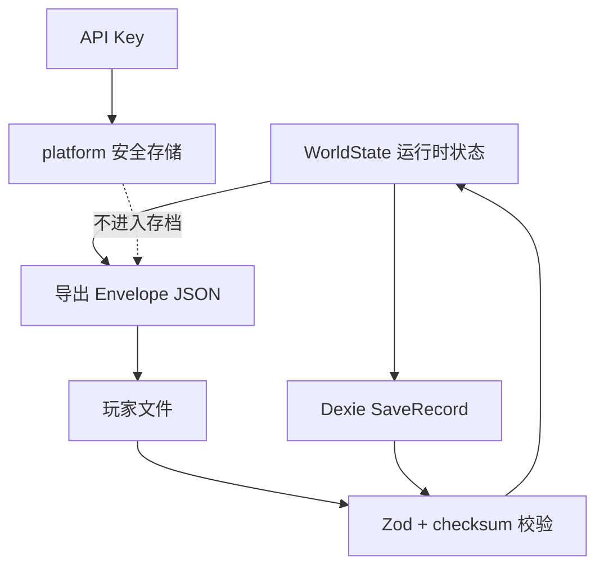

# 数据模型与持久化

本文记录运行时世界状态、存档格式、IndexedDB 表结构、版本与迁移规则。类型定义以 `src/domain/types.ts` 为准，校验以 `src/domain/schema/save.schema.ts` 为准。

## 分层



- `WorldState` 是游戏事实的唯一载体。
- `SaveRecord` 是 Dexie 中的持久化包装：`{ id, summary, world }`。
- 导出文件使用 `SaveEnvelope`，额外带格式、版本与 checksum。
- API Key 不属于世界状态，不写入存档，也不进入导出文件。

## WorldState 主要字段

| 字段 | 类型 | 说明 |
|---|---|---|
| `version` | number | 世界结构版本，当前 `7` |
| `seed` | number | 世界种子，决定生成、赛程、比赛与事件 |
| `engineVersion` | string | 生成世界的引擎版本，当前 `0.7.0` |
| `createdAt` / `updatedAt` | ISO string | 创建与最近更新时间 |
| `playerId` | Id | 用户球员 ID |
| `clubId` | Id | 用户当前俱乐部 ID |
| `players` | `Record<Id, Player>` | 全部球员，含用户与 AI |
| `clubs` | `Record<Id, Club>` | 全部俱乐部，含教练、阵容、强度 |
| `leagues` | `Record<Id, League>` | 联赛与升降级名额 |
| `fixtures` | `Record<Id, Fixture>` | 赛季赛程与比赛报告引用 |
| `relationships` | `Record<Id, Relationship>` | 教练、队友、经纪人、家人、媒体、球迷 |
| `events` | `Record<Id, GameEvent>` | 开放/已处理/过期事件，每天最多新增一条 |
| `eventMemory` | `Record<模板 id, 季内绝对日序>` | 事件冷却表；v7 新增，赛季切换时清空 |
| `finance` | `Finance` | 余额、周薪、支出、流水、赞助 |
| `news` | `NewsItem[]` | 新闻，保留最近 120 条 |
| `season` / `week` / `day` / `totalWeeks` | number | 当前赛季、周次（1–38）、周内日序（1–7，周一 = 1）、总周数 |
| `lastMatch` | `MatchReport \| null` | 最近一场用户比赛，含实时状态、进球与关键回合 |
| `weekPlan` | `WeeklyPlan` | 本周模板 `{ training, extra }`，每周排一次，日步进自动执行 |
| `pendingDayPlan` | `PendingDayPlan?` | `WeeklyPlan & { fixtureId: Id \| null }`；停在开球那天时存在，当日结算完清空 |
| `seasonSummaries` | `SeasonSummary[]` | 赛季总结 |
| `retired` | boolean? | 是否已退役 |
| `settings` | object | LLM Provider、模型、叙事密度、网络模式等 |
| `aiNarrative` | `AiNarrative?` | 当前周 AI 叙事 |
| `aiChat` | `AiChatMessage[]?` | AI 对话，保留最近 40 条 |
| `aiUsage` | `AiUsage?` | Token 与成本累计 |
| `aiAction` | `{ season, week, actionId }?` | 本周已使用的 AI 主动行动 |

### 关键子类型

| 类型 | 关键字段 | 不变量 |
|---|---|---|
| `Player` | 中文名 `nameZh`、属性、潜力、状态、合同、声望、伤病、赛季/生涯统计 | 属性 10–96；年龄 14–60；用户球员必须存在于 `players`；`name` 保留原名（存档 id、合同、导出文件名），`nameZh` 是展示名，取值只走 `displayName` |
| `Club` | 联赛、层级、声望、预算、设施、阵容、教练、强度 | `squadIds` 指向真实球员；`leagueId` 指向真实联赛 |
| `League` | 俱乐部列表、升降级名额 | `clubIds` 与俱乐部 `leagueId` 一致 |
| `Fixture` | 赛季、周次、轮次、周内日、主客、状态、比分 | 状态为 `scheduled / live / played`；live 比分随分钟实时写入；已结束必须有比分；同一赛季每队 38 场；`day` 是 1–7 的周内日序，缺省时由 `fixtureDayOf = day ?? dayForRound(round)` 推导（v4→v5 迁移按轮次补齐，不改 `id`） |
| `MatchReport` | 状态、当前分钟、比分、进球列表、用户出场、评分、事件、关键回合、媒体反应、`stats?`、`lineups?`、`liveState?` | `status` 为 `live / final`；live 阶段评分/MOTM/媒体为空；live 阶段 `liveState` 记录画面状态，终场删除；进球只通过统一写入函数追加；新字段可选，旧档可缺省 |
| `MatchLiveState` | `possession / ballX / carrierId? / pendingKickoff?` | `ballX` 0–1（0 主队球门、1 客队球门）；`pendingKickoff` 存在时下一分钟由该方中圈开球；终场不保留 |
| `LiveTrackStep` | `kind / side / ballX / carrierId?` | `kind` 为 `pass / carry / shot / turnover`；仅用于 2D 轨迹，不进入 `events` |
| `MatchEventLine` | `minute / type / text / isUser? / side?` | 进球与攻防事件必须带 `side`；关键回合结算事件按用户方写 `side`，供 2D 球场定位 `GOAL` 徽标 |
| `MatchGoal` | `minute / side / scorerId / scorerName / assistId? / assistName? / isUser? / isUserAssist? / fromKeyMoment?` | 一条进球只出现一次；比分缓存必须等于进球列表按主客统计 |
| `MatchStats` | `home / away: { possession, shots, shotsOnTarget, corners }` | 双方控球分钟之和 = 已模拟分钟数；射正 ≤ 射门；关键回合进球同步补记射门/射正 |
| `MatchLineups` | `home / away: MatchLineupPlayer[]` | 每侧 11 人，1 门将 4 后卫 4 中场 2 前锋；同俱乐部落点稳定 |
| `MatchLineupPlayer` | `id / name / nameZh? / number / position / isUser` | `id` 指向真实球员；用户出场时必须在首发中 |
| `KeyMoment` | `minute / kind / roll / triggerZh? / options / outcome? / defaultOptionId` | 12 类；每场 5–7 次；每回合恰好 5 个选项；`roll` 生成后固定 |
| `KeyMomentOption` | `labelZh / successChance / successBasisZh? / 效果字段` | `defaultOptionId` 指向成功率最高项；成功率依据必须含属性名与百分比 |
| `Injury` | `kind / daysLeft / severity` | `daysLeft` 是**剩余天数**（1–7 天内可跨周），每天由 `advanceInjuries` 减 1；归零即伤愈并清空 |
| `WeeklyPlan` | `training / extra` | 每周模板；`world.day` 决定当天是否执行训练或额外安排 |
| `PendingDayPlan` | `training / extra / fixtureId` | 只在停在开球那天存在；当日收尾时清空；v4→v5 迁移由 `pendingWeekPlan` 改名并把时钟摆回比赛日 |
| `NewsItem` | `id / season / week / day? / title / body / kind` | 日步骤产生的新闻带 `day`；`id` 由 `dailyId` 生成，同周七天不撞键 |
| `GameEvent` | 模板、发件人 `sender?`、正文、`day / createdAtDay / expiresDay`、`blocking?`、选项、状态 | 一天最多一条（id 带日段）；`expiresDay` 早于当前绝对日必须过期；旧档缺 `expiresDay` 时回落 `expiresWeek` 那一周的最后一天；LLM 只能改标题与正文，不能改选项、效果与有效期。类型定义与数据包 Zod 模式同在 `src/domain/eventContent.ts` |
| `EventTemplateContent` | `id / title / body / sender / weight / expiresDays / cooldownDays / blocking / guaranteed / once? / maxPerSeason? / weekdays? / when[] / choices / resultTexts?` | 来自 `data/events/*.json`（8 个类别包共 87 条，`EVENT_PACK_NAMES` 注册、`eventTemplatesOfPack` 按类取）；条件字段 ∈ `EVENT_SCOPE_FIELDS`（27 项白名单）、正文占位符 ∈ `EVENT_BODY_TOKENS`（5 项）；`weight > 0`、`1 ≤ expiresDays ≤ 21`、`0 ≤ cooldownDays ≤ 120`、`choices ≥ 2` 且选项 id 唯一、`blocking` 事件不许有空效果选项 |
| `Effect` | `op / delta` | `op` 共 12 个：8 项状态与关系走 `clamp(±15)`；`money` 的 `delta` 是**英镑整数**（引擎 `×100` 写进按分记价的 `balance` 与账本）；`injuryDays` 的 `delta` 是**天**，只作用在已有伤病上、最低 1 天，不能凭空造伤 |
| `Relationship` | 角色、中文名 `nameZh`、信任、紧张、摘要 | 信任/紧张 0–100 |
| `Finance` | 余额、周薪、支出、流水 | 流水金额带符号；结算后余额与流水一致 |

### 常用枚举

- 位置：`GK / CB / LB / RB / DM / CM / AM / LW / RW / ST`
- 属性：`pace / shooting / passing / dribbling / defending / physical / mental / technique / stamina / goalkeeping`
- 训练：`physical / technical / tactical / recovery`
- 额外行动：`media / agent / social / rest / family / none`
- 事件状态：`open / resolved / expired`
- 比赛状态：`scheduled / live / played`
- 比赛报告状态：`live / final`
- 关键回合：`bigChance / penalty / throughBall / duel / save / clearance`

## ID 约定

| 对象 | 形态 | 示例 |
|---|---|---|
| 球员 | `player:<clubId>:<序号>` 或 `player:user:<seed>` | `player:club:ENG:2:04:01` |
| 俱乐部 | `club:<国家>:<层级>:<序号>` | `club:ENG:1:01` |
| 联赛 | `league:<国家>:<层级>` | `league:ENG:1` |
| 赛程 | `fixture:<leagueId>:<season>:<week>:<index>` | `fixture:league:ENG:1:2026:01:0`（比赛日在 `day` 字段，不改 id 结构：它同时是比赛随机盐） |
| 关系 | `rel:<role>:<playerId>` | `rel:coach:player:user:42` |
| 日步骤新闻/事件 | `dailyId` → `<prefix>:<season>:<week>:<day>[:<suffix>]` | `news:injury:2026:3:5` |
| 日事件 | `event:<season>:<week>:<day>:<templateId>` | `event:2026:3:6:coach_praise`（带日段：同周不同天可以出现同一模板，冷却由 `eventMemory` 管） |
| 新闻 | `news:<kind>:<key>` | `news:season:end:2026` |
| 存档 | `save:<seed>:<base36 time>:<random>` | 由 `db.createSaveId` 生成 |
| AI 对话 | `chat:<season>:<week>:<index>:<u\|a>` | `chat:2026:3:0:u` |

除存档 ID 外，其它 ID 都应在同一世界内稳定；LLM 不得生成或修改 ID。

## 存档 Envelope

`src/db/repository.ts` 的 `buildEnvelope`：

```json
{
  "format": "pitch-life-save",
  "saveVersion": 7,
  "engineVersion": "0.7.0",
  "exportedAt": "2026-10-26T12:00:00.000Z",
  "checksum": "<hashString(canonicalStringify(world))>",
  "world": { "...": "WorldState" }
}
```

规则：

1. `format` 必须等于 `pitch-life-save`。
2. `saveVersion` 来自 `CURRENT_SAVE_VERSION`，当前为 `7`。
3. `checksum` 按 `lib.canonicalStringify` 规范化后计算；对象键排序、`undefined` 视为 `null`。
4. `importWorld` 依次执行：JSON 解析 → `saveEnvelopeSchema`（含 world 结构）→ 拒绝更高版本 → **用原始 world 重算 checksum 比对** → 迁移到当前版本。
5. 任何一步失败都抛出中文错误，不写入 IndexedDB。

`world.version` 与 envelope `saveVersion` 是两个维度：

- `world.version` 描述世界结构本身，当前为 `7`。
- `saveVersion` 描述存档封装与迁移契约，当前为 `7`。
- 结构变化时必须同时评估；旧版本 world 在加载/导入时迁移到当前结构。
- `day` / `weekPlan` / `pendingDayPlan` 在 `worldSchema` 里是**可选**字段：v5 之前的存档缺少它们，而校验发生在迁移之前，必填会让旧档直接被拒。迁移负责补齐，`assertWorld` 负责在补齐后把关。
- `eventMemory` 同理是**可选**：v6 存档没有冷却表，`events` 记录本身是 `.passthrough()`，所以事件的 `day / createdAtDay / expiresDay / sender / blocking` 与新闻的 `day` 都不需要写进 schema，只由迁移补齐。

## IndexedDB

数据库名：`pitch-life-db`（`src/db/db.ts`）。

| 版本 | 表 | 主键 | 内容 |
|---|---|---|---|
| 1 | `saves` | `id` | `SaveRecord`：`{ id, summary, world }` |
| 1 | `meta` | `key` | 元数据，当前只有 `lastSaveId` |
| 2 | `secrets` | `id` | 本机密钥材料（仅 Web 加密方案） |

`secrets` 记录形态：

| id | value | 说明 |
|---|---|---|
| `llm-api-key` | `{ iv: number[], data: number[] }` | AES-GCM 密文 |
| `llm-api-key-wrap` | `CryptoKey` | 不可导出的 AES-GCM 包装密钥 |

Android 使用 Capacitor SecureStorage，不写 `secrets` 表。清除 Key 时同时清空会话内存、原生存储与 Web 密文。

### 存档摘要

`SaveSummary` 从 `WorldState` 派生，用于列表展示：

`{ id, playerName, clubName, season, week, age, overall, updatedAt }`

`listSaves` 当前读取全部记录再排序。存档数量增大后应改为索引分页，但不得改变摘要字段语义。

## 迁移策略

当前 `CURRENT_SAVE_VERSION = 7`，由 `src/db/migrate.ts` 提供 v1 → v2 → v3 → v4 → v5 → v6 → v7 连续迁移。

| 版本 | 变更 | 迁移 |
|---|---|---|
| 1 | 预生成终场比分；`MatchReport` 无状态/分钟/进球列表 | — |
| 2 | 逐分钟实时比赛；`Fixture.status` 增加 `live`；`MatchReport` 增加 `status / currentMinute / goals`；`WorldState.pendingWeekPlan` | 所有已有报告补 `status: 'final'`、`currentMinute: 90`、`goals: []`；`pendingWeekPlan = null`；`world.version = 2`；`engineVersion` 保留历史值 |
| 3 | 比赛日实时化；`MatchReport` 增加可选 `stats / lineups`；`KeyMoment` 增加 `triggerZh`、`KeyMomentOption` 增加 `successBasisZh` | live 报告补 `stats`（控球按 `currentMinute` 均分、射门=射正=进球、角球 0）与 `lineups`（主客各 11 人）；**保留** `pendingWeekPlan`；终场旧报告不伪造统计；`world.version = 3` |
| 4 | 2D 比赛画面状态；`MatchReport` 增加可选 `liveState`（`possession / ballX / carrierId? / pendingKickoff?`） | 仅 live 报告补 `liveState = { possession: 'home', ballX: 0.5 }`；终场报告与 `lineups / stats` 不变；`world.version = 4` |
| 5 | 时间粒度改为天：`WorldState.day` / `weekPlan` / `pendingDayPlan`（取代 `pendingWeekPlan`）、`Fixture.day`、`Injury.daysLeft`（取代 `weeksLeft`）、`NewsItem.day` | `fixtures[*].day = dayForRound(round)`（纯推导，不消耗 RNG）；`injury.daysLeft = max(1, round(weeksLeft × 7))` 并删除 `weeksLeft`；`pendingWeekPlan → pendingDayPlan`；`weekPlan` 缺省补 `DEFAULT_WEEK_PLAN`；停着的 live 比赛把时钟摆回它所在的那一天（`day = fixtureDayOf(liveFixture)`），否则 `day = 1`；末尾 `assertWorld` 把关；`world.version = 5` |
| 6 | 中文人名：`Player.nameZh`、`Club.coach.nameZh`、`Relationship.nameZh`、`MatchLineupPlayer.nameZh`、`PitchPlayer.nameZh`（`name` 语义不变，仍用于存档 id、合同与导出文件名） | 实体按 `nameZhFor(name, nationality)` 补齐中文名，已有值不覆盖（幂等）；历史文本按「原名 → 中文名」整词替换：战报 `events[].text` / `mediaReaction` / 关键回合文案与结算文案、`scorerName` / `assistName` / `motmName`、新闻与事件的标题正文选项与结果文案、关系摘要；首发名单条目按 `playerId` 回查补 `nameZh`。不改动时钟与 `fixture.id`，停在关键回合的 live 档迁移后仍能踢完；`world.version = 6` |
| 7 | 每日事件：`WorldState.eventMemory`（模板 id → 季内绝对日序）、`GameEvent.day / createdAtDay / expiresDay / sender / blocking`、事件 id 加日段 | `events[*]` 的 `day` 回灌为 `DAYS_PER_WEEK`（旧事件本来就是周日拍的），`createdAtDay = absoluteDay(createdAtWeek, day)`，`expiresDay = absoluteDay(expiresWeek, DAYS_PER_WEEK)`；`sender`/`blocking` 优先取数据包、未知模板落回「俱乐部」/`true`；`eventMemory` 由现存事件按模板取最大日序重建（不清会让旧档第一周被同一模板刷屏）；`migrateEventDays` 不消耗 RNG、不触碰时钟与 `pendingDayPlan`；末尾 `assertWorld` 把关；`world.version = 7` |

迁移规则：

- 迁移幂等，可重复执行；只前进不后退。
- 旧档中未完成的关键回合保留：v1 报告走旧版 `final` 结算路径；v2 live 报告迁移后保留待处理回合（v5 起键名为 `pendingDayPlan`），可继续实时播放到终场；v3 live 报告补 `liveState` 后可继续播放；v4→v5 把时钟摆回 live 比赛那一天，读档后仍能踢完这场；v5→v6 只改名字与文案，不触碰 `roll`、时钟与首发 id，迁移后关键回合仍能按原判定结算；v6→v7 只补事件字段与冷却表，不触碰时钟、`pendingDayPlan` 与任何 `roll`。
- `loadWorld` 在 schema 校验后迁移；发生迁移时回写数据库并同步摘要。
- `importWorld` 必须先校验 checksum，再做迁移；拒绝 `saveVersion > 7`。
- 旧客户端遇到 v7 存档会按现有版本检查拒绝读取；不提供降级迁移。

任何存档结构变化必须满足：

1. 升 `CURRENT_SAVE_VERSION`（必要时同时升 `world.version`）。
2. 提供从旧版本到新版本的迁移函数，迁移必须幂等、可重复执行。
3. 在 `tests/fixtures/` 放旧版本存档 fixture，并加入导入测试。
4. 增加导出 → 导入 → 深度相等测试。
5. 在提交信息中说明兼容范围与回滚策略。
6. `check-anti-regression` 检测到 `save.schema.ts` 或 `CURRENT_SAVE_VERSION` 变化但版本未升时失败。

迁移原则：

- 只增字段、给默认值优先；避免重命名和删除。
- 迁移只读旧结构，不依赖当前引擎运行结果。
- 迁移失败必须拒绝导入，不能写入半成品。
- 不修改玩家已有存档的语义，只做结构转换。

## 容量与保留

| 数据 | 当前策略 | 位置 |
|---|---|---|
| 新闻 | 保留最近 120 条；事件生成时先截到 80 条 | `endSeason` / `generateDailyEvents` 截断 |
| 事件 | 不按条数截断，靠 `expiresDay` 过期与 `eventMemory` 冷却 | `expireEvents` / `eventsDaily`（一天最多一条，全季总量由 `tests/engine/eventCadence.test.ts` 锁在 40–80） |
| AI 对话 | 保留最近 40 条 | `sendChat` 截断 |
| 财务流水 | 保留最近 120 条 | `settleWeekFinance` / `applyEffects` 截断（一周一条，日步骤不写流水） |
| 赛季总结 | 不截断 | `seasonSummaries` |
| 比赛报告 | 只保留 `lastMatch` 与 fixture 引用 | `fixtures[].report` |
| 日期与星期 | 不落盘，由 `season/week(/day)` 即时推导 | `src/lib/calendar.ts` |
| 绝对日序 | 不落盘，`(week-1)*7+day` | `src/domain/calendar.ts` |

长期需要评估：完整比赛历史是否单独存储、财务流水是否按月归档、IndexedDB 配额与清理策略。本轮不做。

## 数据安全

- 存档与导出文件包含玩家昵称、俱乐部与比赛数据，不包含真实个人信息。
- API Key 不进入 `WorldState`、导出文件、日志或错误信息。
- LLM 输出只作为文本渲染，不写入事实字段；事件文案改写必须匹配 `templateId`。
- 导入文件必须先校验再落库，禁止直接 `JSON.parse` 后使用。

## 变更记录

| 日期 | 变更 | 关联 |
|---|---|---|
| 2026-10-26 | 初版：世界状态、envelope、IndexedDB 与迁移规则 | ADR 0001 |
| 2026-10-31 | 存档升 v2：fixture `live`、报告 `status/currentMinute/goals`、`pendingWeekPlan`；v1 迁移保留未完成回合；engine 0.2.0 | 缺陷修复：比赛日比分穿越 |
| 2026-10-31 | 存档升 v3：报告可选 `stats / lineups`、关键回合 `triggerZh` 与选项 `successBasisZh`；v2 live 迁移保留待处理回合并补齐首发/统计；engine 0.3.0 | 比赛日实时化改造 |
| 2026-10-31 | 存档升 v4：`MatchReport.liveState` 持久化控球/球位/持球人/开球方；v3 live 迁移补中圈状态；终场删除 `liveState`；engine 0.4.0 | 缺陷修复：比赛日 2D 画面不可读 |
| 2026-11-01 | 关键回合结算事件补写 `side`；存档结构不变，engine 0.4.1 | 缺陷修复：2D 画面细节 |
| 2026-11-02 | 存档升 v5：日时钟 `day`、`weekPlan`、`pendingDayPlan`、`Fixture.day`、`Injury.daysLeft`、`NewsItem.day`；v4 迁移按轮次推导日并把 live 档摆回比赛日；engine 0.5.0 | M1.1/M1.2 日回合与快进 |
| 2026-11-02 | 存档升 v6：实体 `nameZh` 与战报阵容 `nameZh`，历史文本按原名→中文名整词替换；`CURRENT_SAVE_VERSION`/`world.version` = 6；engine 0.5.1 | M1.4 中文人名 |
| 2026-11-02 | 无存档结构变化：`Club.style` 从死字段变成选型与训练的输入（`domain/coachStyle.ts`），引擎语义变更令 `ENGINE_VERSION` 升 0.5.2 并重算回放基准（`91cb67aad3f2e45a`），世界里的 `engineVersion` 字符串随新世界写入 | M1.5 教练打法生效 |
| 2026-11-02 | 存档升 v7：`eventMemory` 冷却表与事件 `day / createdAtDay / expiresDay / sender / blocking`，事件 id 加日段；v6 迁移回灌日字段并按模板重建冷却表；`ENGINE_VERSION` 升 0.6.0 并重算回放基准 | M1.7 每日事件 |
| 2026-11-02 | 无存档结构变化：事件内容池从 11 条扩到 87 条（新增 7 个类别包），`EffectOp` 增加 `injuryDays`（单位＝天，只作用于已有伤病）并把 `money` 钉成整英镑；`ENGINE_VERSION` 升 0.7.0、回放基准 `c11f736b834051db` → `5fdf2872b99372c2` | M1.8 事件内容扩容 |
