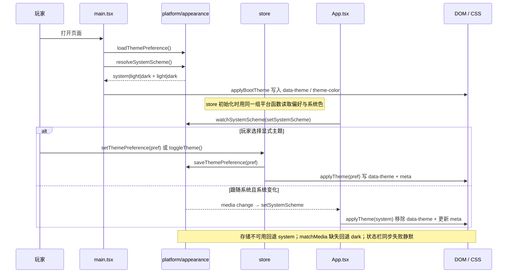

# 浅色 / 深色外观

## 业务目标

手机系统可以在白天自动切到浅色、夜间切回深色。游戏默认跟随系统，同时允许玩家在设置页或首页手动覆盖，并在下次打开时保留选择。外观是应用级偏好，不进入 `WorldState`，避免为了一个显示选项升级存档。

## 用户流程

1. 首次打开：没有保存的偏好时按系统深浅色显示。
2. 系统切换深浅色：应用自动跟随，无需刷新。
3. 设置页「外观」：三选一（跟随系统 / 浅色 / 深色），点击立即生效并持久化。
4. 标题页与主页头部：提供太阳/月亮快捷按钮，按当前生效颜色切到相反值，并写入显式偏好。
5. 下次打开：读取上次偏好；选择「跟随系统」时删除显式标记，重新交给系统决定。
6. 清除站点存储：回到「跟随系统」。

## 关键时序



## 规则与边界

### 偏好模型

| 值 | 含义 | DOM 表现 |
|---|---|---|
| `system`（默认） | 跟随 `prefers-color-scheme` | 移除 `html[data-theme]` |
| `light` | 强制浅色 | `html[data-theme='light']` |
| `dark` | 强制深色 | `html[data-theme='dark']` |

- 存储键：`pitch-life:theme`，只接受上述三个值。
- 缺失、非法值、读取抛错都回退 `system`。
- 写入失败不抛错：偏好仍在本次会话生效，刷新后回到旧值。
- 系统色：`matchMedia('(prefers-color-scheme: dark)')` 命中为 `dark`，否则 `light`；`matchMedia` 不存在时按 `dark`。
- 快捷切换基于“当前生效颜色”：`system` 时先解析系统色，再取反并写成显式偏好。

### 样式与首屏

- `src/styles.css` 的 `@theme` 保留深色值作为静态兜底；`@supports (color: light-dark(#000, #fff))` 内用 `light-dark(浅色, 深色)` 覆盖 22 个语义 token，并设置 `color-scheme: light dark`。
- 组件只引用语义 token（`bg-card`、`text-muted`、`border-line` 等），不需要按主题分支。
- 显式偏好通过 `html[data-theme]` 把 `color-scheme` 锁定为 `light` 或 `dark`；两者也放在 `@supports` 内，避免旧浏览器出现“深色 token + 浅色表单控件”的错配。
- 不支持 `light-dark()` 的浏览器保持整站深色，功能可用但没有浅色视觉。
- `main.tsx` 在 `createRoot` 之前调用 `applyBootTheme()`，缩短显式偏好与系统色不一致时的首帧闪烁；模块执行前的一帧无法由运行时脚本消除。
- `meta[name="theme-color"]` 随生效颜色更新为 `#f2f7f0`（浅）或 `#0a0d0b`（深）；meta 不存在时跳过。

### 调色板

| token | 深色 | 浅色 |
|---|---|---|
| pitch | `#090c0a` | `#f2f7f0` |
| pitch-2 | `#0d120e` | `#e9f0e6` |
| card | `#131a15` | `#ffffff` |
| card-2 | `#18211b` | `#f6faf4` |
| line | `#26352b` | `#cfddca` |
| line-soft | `#1c2820` | `#e2ebe0` |
| text | `#ecf4ed` | `#17231b` |
| muted | `#8c9c90` | `#52645a` |
| dim | `#607065` | `#66756a` |
| accent | `#c9f56b` | `#3f7a12` |
| accent-strong | `#b6f03a` | `#2f5e0b` |
| accent-ink | `#1a2507` | `#f8fdf3` |
| teal | `#5eead4` | `#0f766e` |
| danger | `#ff7f7f` | `#b42318` |
| gold | `#ffd166` | `#8a5a00` |
| violet | `#b8a1ff` | `#6d4fd1` |
| danger-surface | `#2a1010` | `#fdecea` |
| overlay | `rgba(0,0,0,.70)` | `rgba(12,23,16,.35)` |
| glow-accent | `rgba(201,245,107,.08)` | `rgba(74,128,26,.12)` |
| glow-teal | `rgba(94,234,212,.05)` | `rgba(15,118,110,.08)` |
| selection | `rgba(201,245,107,.30)` | `rgba(74,128,26,.25)` |
| shadow | `rgba(0,0,0,.16)` | `rgba(23,46,27,.12)` |

原本硬编码的 `body` 双层渐变、`::selection`、`.card` 阴影、Toast 错误底色、Modal 遮罩和新建生涯滑杆强调色已改为引用上述 token。

### 不可变条件

- 主题偏好不写入 `WorldState`、存档 envelope、导出 JSON；不改 `CURRENT_SAVE_VERSION`，不做迁移。
- `ui` / `store` 不直接使用 `localStorage`、`matchMedia`；只能经 `src/platform` 公共入口。
- 系统监听必须在组件卸载时取消，避免重复注册。
- 主题逻辑不得使用未播种随机数，也不得依赖墙钟。
- 不改变既有深色视觉：深色 token 值与接入前一致。

## 数据与接口

平台端口 `src/platform/appearance.ts`（由 `src/platform/index.ts` 导出）：

```ts
type ThemePreference = 'system' | 'light' | 'dark'
type ColorScheme = 'light' | 'dark'

loadThemePreference(): ThemePreference
saveThemePreference(preference: ThemePreference): void
resolveSystemScheme(): ColorScheme
watchSystemScheme(onChange: (scheme: ColorScheme) => void): () => void
syncStatusBar(scheme: ColorScheme): Promise<void>
```

应用层 `src/app/theme.ts`：

```ts
resolveTheme(preference: ThemePreference, system: ColorScheme): ColorScheme
applyTheme(preference: ThemePreference, system: ColorScheme): void
applyBootTheme(): void
```

store：

- 状态：`themePreference`、`systemScheme`。
- 动作：`setThemePreference`（持久化并更新状态）、`setSystemScheme`、`toggleTheme`。
- 选择器：`selectResolvedTheme(state)`。

UI：`ThemeToggle`（标题页、主页头部）与 `AppearanceSection`（设置页「外观」）。

## 失败与降级

| 场景 | 行为 |
|---|---|
| localStorage 被禁用/配额满 | 读取回退 `system`；写入静默失败；本次会话内切换仍生效 |
| 存储值非法 | 回退 `system`，不抛错 |
| `matchMedia` 缺失 | 系统色按 `dark`，不注册监听 |
| 监听不支持 `addEventListener` 的旧媒体查询 | 不崩溃；无自动跟随，玩家仍可手动选择 |
| `meta[name="theme-color"]` 缺失 | 跳过 meta 更新，主题仍生效 |
| 原生状态栏同步失败 | 静默忽略；不阻塞推进、存档或导航 |
| 浏览器不支持 `light-dark()` | 保持深色 token 与 `color-scheme: dark`；手动选择只影响存储与 meta |
| 启动首帧 | `applyBootTheme` 在 `createRoot` 前执行；较早的一帧无法完全消除 |

## 平台差异

| 平台 | 跟随系统 | 手动覆盖 | 状态栏 |
|---|---|---|---|
| Web / PWA | `prefers-color-scheme` 实时跟随 | localStorage | `meta[theme-color]` 更新浏览器 UI |
| Android | WebView 媒体查询；需 Chromium 123+ 才支持 `light-dark()` | localStorage | Capacitor StatusBar，best-effort |
| iOS | WKWebView 需 Safari 17.5+ 才支持 `light-dark()` | localStorage | 未接入原生状态栏，保持系统默认 |
| 微信小程序 | 规划：系统信息 + 存储适配 | 规划 | 规划 |

要求与限制：

- `light-dark()` 需要 Chrome 123+ / Safari 17.5+ / Firefox 120+；更低版本回退深色。
- PWA manifest 与 Capacitor 启动屏背景仍是深色，无法随偏好变化；首屏之后由运行时接管。
- Android 状态栏同步仅在原生平台执行，失败不影响玩法。
- 不修改平台判断的既有冻结项。

## 验收与测试映射

| 规则/场景 | 测试 |
|---|---|
| 默认 system、合法值往返、非法值回退、存储抛错降级 | `tests/platform/appearance.test.ts` |
| 系统色映射、`matchMedia` 缺失回退深色 | `tests/platform/appearance.test.ts` |
| 系统变化订阅与取消 | `tests/platform/appearance.test.ts` |
| Web 端状态栏同步直接完成 | `tests/platform/appearance.test.ts` |
| store 初始值、持久化、三态切换、快捷取反、选择器 | `tests/store/preference.test.ts` |
| 显式/系统解析、`data-theme`、meta、启动读取、meta 缺失守卫 | `tests/app/theme.test.tsx` |
| 标题页快捷按钮、设置页三选一、点击持久化 | `tests/ui/theme.test.tsx` |
| 平台与 store 导出面 | `tests/platform/exports.test.ts`、`tests/store/exports.test.ts` |

手动验收：

1. 360×800 与 390×844：标题页快捷按钮、设置页三选一、主页头部按钮不挤压布局，触控高度 ≥44px。
2. 1280×800：桌面侧栏与两栏布局不回归。
3. 显式浅色/深色下检查 body、卡片、输入框、Toast、Modal、底部导航与选中态对比度；确认 `html[data-theme]` 与 `meta[theme-color]` 正确。
4. 刷新页面偏好保留；清除 localStorage 后回到跟随系统。
5. DevTools 媒体模拟切换 `prefers-color-scheme`，确认无需刷新自动变化；不支持时以平台单测覆盖映射逻辑。
6. Android：`npm run build:native` 确认动态 import 可打包；状态栏同步按 best-effort 验收。

## 变更记录

| 日期 | 变更 | 关联 |
|---|---|---|
| 2026-10-31 | 初版：三态外观偏好、跟随系统、设置页与首页入口、浅色 token 与原生状态栏 best-effort | 浅色模式需求 |
