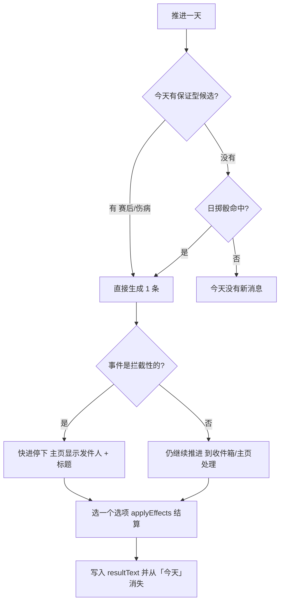
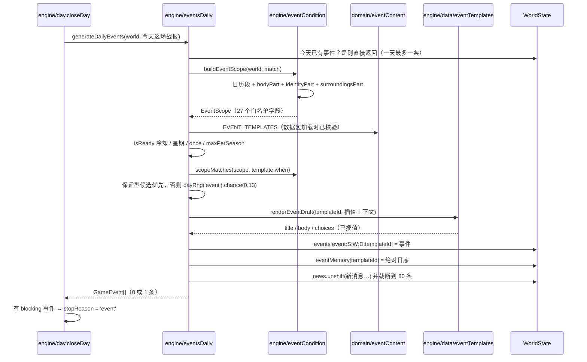

# 每日事件

## 业务目标

把「每周固定一条生活事件」改成「日子往前走，事情随机发生，也可能一天什么都没发生」。玩家在主页的「今天」卡里看到当天是谁找我、要我做什么，而不是攒到周日再翻收件箱。

三件事同时成立才算交付：

1. **内容数据化**：事件模板进 `data/events/*.json`，由 `src/domain/eventContent.ts` 用 Zod 校验并硬白名单；新增一类生活事件只改 JSON，不改引擎。
2. **可验证的触发条件**：条件是一个 27 字段白名单投影上的合取式（`{field, op, value}`），不是表达式语言；内容作者写不出图灵完备的东西，测试也能枚举。
3. **频率重标定**：旧口径「周日 72% 出一条」摊成「每天一小概率 + 赛后/伤病当天必出」，全季总量由测试锁在 `[40, 80]` 区间。

## 用户流程

1. 玩家每天推进后，主页「今天」卡按 `发件人 · 标题` 列出仍开放的事件（按发生日倒序）。
2. 拦截性事件（`blocking`）会让快进停下，必须当场表态；非拦截事件只计数，不打断节奏。
3. 事件有真实有效期（默认 3 天）：卡片上显示「剩 N 天」或「今天过期」，过期后自动转 `expired` 并只留在消息历史。
4. 同一名发件人（队医、经纪人、教练、家人……）短期内不会刷屏：每个模板带 `cooldownDays`。

## 关键时序

## 规则与边界

### 一天最多一条

`generateDailyEvents` 开头就查「今天有没有已经生成的事件」，有则返回空。周粒度时代的「攒到周日集中发」被彻底取消；日事件密度靠概率与冷却调节，不靠多条堆叠。

### 保证型事件落在比赛当天

`guaranteed: true` 的模板（`coach_praise`、`bench_frustration`、`injury_concern`）不参与掷骰：只要条件成立就生成。触发口径是**当天的战报**（`simulateDayFixtures` 的返回值）而不是本周任意一场的回退，所以赛后事件一定出现在比赛那一天。

### 掷骰与冷却

| 项 | 口径 |
|---|---|
| 日基线概率 | `0.13`（旧周概率 `0.72` 摊成七天约 `0.103`，因保证型不掷骰而略高） |
| 冷却 | `world.eventMemory[templateId] = 绝对日序`，`today - last < cooldownDays` 则跳过 |
| 星期限定 | `weekdays?: number[]`（1 = 周一） |
| 一次性 | `once: true` 时整个 `world.events` 里出现过就不再发 |
| 每季上限 | `maxPerSeason` 按 `event.season === world.season` 计数 |
| 抽取方式 | `dayRng(world, 'event').weighted(...)`，保证型内部仍按 `weight` 相对概率 |

### 条件白名单

`EventScope` 是每天构建一次的只读投影，27 个字段分四组：日历（`absoluteDay`/`weekday`/`isMatchDay`/`isDayAfterMatch`/`daysSinceMatch`）、身体（`injuryDaysLeft`/`morale`/`fitness`/`sharpness`/`confidence`）、身份与名气（`age`/`positionGroup`/`squadRole`/`mediaRep`/`fanRep`）、环境与关系（`balance`/`weeklyWage`/`coachTrust`/`teammateTrust`/`agentTrust`/`familyTrust`/`clubTier`/`seasonProgress`/`trainingFocus`/`extraAction`/`lastRating`/`lastPlayed`）。

- 运算符只有 `eq | in | lt | lte | gte | between`。
- 条件之间是合取；空数组表示「每天都可能」。
- 字段名不在 `EVENT_SCOPE_FIELDS` 里：**数据包加载即抛**（`assertWhitelist`），运行期 `matchesOne` 再兜一次。
- `lastRating` 允许为 `null`（没踢过球），数值类比较遇到非数字直接判不成立，不会误命中。
- 距上一场靠赛程表反查比赛日（战报本身不存日期），跨赛季战报返回哨兵值 `900`。

### 内容校验（Zod + validate-data）

`data/events/*.json` 必须满足：`weight > 0`、`1 ≤ expiresDays ≤ 21`、`0 ≤ cooldownDays ≤ 120`、`choices ≥ 2` 且选项 id 唯一、拦截性事件不许有空效果选项、正文占位符只用 5 个白名单 token（`{coach}` `{teammate}` `{userName}` `{ratingSuffix}` `{restSuffix}`）。
`npm run validate:data` 额外查：模板 id 不重复、标题不残留拉丁字母、`guaranteed` 必须带条件、`resultTexts` 的键必须指向真实选项 id。

### 过期与结算

- 过期按天判定：`expiresDay < absoluteDay(world)` → `status = 'expired'`；旧存档缺 `expiresDay` 时回落为「那一周的最后一天过期」。
- 结算仍走 `resolveEvent` → `applyEffects`；`injury_concern` 的 `rush` 选项额外把 `daysLeft − 7`，`lifestyle_purchase` 额外写入 `finance.assets`。
- 事件 id 是 `event:${season}:${week}:${day}:${templateId}`，`day` 段保证同周多天撞同一模板时不会互相覆盖。

### 与 LLM 的边界

LLM 只重写**一条**被选中事件的标题与正文（`highlightEventId`），并继续由 `validateWeek` 拒绝虚构 `templateId`；发件人、选项、效果、冷却一律由数据包决定。没配 key 时走模板文案，不报错也不重复调用。

## 数据与接口

公开入口（`src/engine/index.ts`）：

- `generateDailyEvents(world, match): GameEvent[]`
- `expireEvents(world): void`
- `buildEventScope(world, match): EventScope`
- `scopeMatches(scope, conditions): boolean`
- `resolveEvent(world, eventId, choiceId): string | null`（语义不变）

公开入口（`src/domain/index.ts`）：`EVENT_TEMPLATES`、`eventTemplateById`、`EVENT_SCOPE_FIELDS`、`EVENT_BODY_TOKENS`，类型 `GameEvent`、`EventCondition`、`EventScope`、`EventTemplateContent`、`Effect`、`EffectOp`、`EventChoice`（这四个类型已从 `src/domain/types.ts` 迁到 `src/domain/eventContent.ts`，`types.ts` 只做再导出）。

存档影响（v6 → v7）：

- `WorldState.eventMemory: Record<模板 id, 季内绝对日序>`；schema 里 `.optional()`，因为 `assertWorld` 在迁移末尾跑、导入先校验后迁移。
- `GameEvent` 新增 `day` / `createdAtDay` / `expiresDay` / `sender` / `blocking`。
- 新闻条目新增 `day`（`news` 是 `z.array(z.unknown())`，不需要 schema 改动）。
- 迁移把旧事件的日字段回灌为「那一周的最后一天」，并从现存事件重建 `eventMemory`（同模板取最大日序）；`sender` 优先取数据包，未知模板落回「俱乐部」。
- `prepareNextSeason` 清空 `eventMemory`：它记的是季内绝对日序，新赛季从 1 重新开始，不清会让冷却算成负数而永久屏蔽模板。

## 失败与降级

| 情况 | 行为 |
|---|---|
| 数据包里有未知条件字段 / 未知占位符 | 模块加载即抛错，`npm run validate:data` 在 CI 里先拦住 |
| 模板 id 在数据包里找不到（LLM 虚构） | `renderEventDraft` 回退到内置简化版队友聚餐文案；`validateWeek` 拒绝提案 |
| 主角/教练/队友关系缺失 | `trustOf` 落回 50、发件人落回「主教练 / 队友」，条件仍按白名单字段求值 |
| 同一天被重复结算 | `events[id]` 已存在则返回 `null`，不重复写新闻 |
| 旧存档没有 `eventMemory` | 迁移重建；运行时由 `generator` 与迁移双保，不做 `??=` 兜底 |
| 事件超过有效期 | 自动 `expired`，主页「今天」不再列出，历史页仍可回看已处理项 |

## 平台差异

- 无平台 API 调用；`src/engine` / `src/domain` 继续禁 `Math.random` / `Date.now` / `new Date` / `performance.now`，掷骰只用 `dayRng(world, 'event')`。
- 手机端（360–390px）：主页「今天」卡按 `发件人 · 标题` 单行截断，事件选项按钮 ≥44px（`min-h-11`），有效期副标用 chip 而不是换行。
- 桌面端（≥1024px）：事件仍在主列「今天」卡与收件箱历史页两处；侧栏不再有独立收件箱预览。
- Capacitor 上 LLM 关闭时事件文案完全来自数据包，不产生网络请求。

## 验收与测试映射

| 规则/场景 | 测试 |
|---|---|
| `buildEventScope` 的键集合等于 `EVENT_SCOPE_FIELDS`（白名单不漂移） | `tests/engine/eventConditions.test.ts` |
| 条件运算符逐个（eq/in/lt/lte/gte/between）与 `null` 评分不误命中 | `tests/engine/eventConditions.test.ts` |
| 非白名单字段抛错 | `tests/engine/eventConditions.test.ts` |
| 一天最多一条、同模板重复调用不重复生成 | `tests/engine/eventDaily.test.ts` |
| 保证型事件不掷骰并落在比赛当天 | `tests/engine/eventDaily.test.ts` |
| 冷却 / `once` / `maxPerSeason` / `weekdays` 各自生效 | `tests/engine/eventDaily.test.ts` |
| 过期按 `expiresDay` 判定、旧字段回落 | `tests/engine/eventDaily.test.ts` |
| 全季事件总数落在 `[40,80]`、存在空白日、种子间节奏相近、赛后事件数 > 5 | `tests/engine/eventCadence.test.ts` |
| 11 个 legacy 模板标题/正文/选项/结果文案逐字不变 | `tests/engine/eventTemplates.test.ts` |
| 快进把新事件当合法停止点（停在 `matchday` 或 `event`） | `tests/engine/day.test.ts`、`tests/engine/stopConditions.test.ts` |
| v6→v7 日字段回灌、`eventMemory` 重建、迁移后不重复生成、导出导入往返等值、幂等 | `tests/db/migrationV7.test.ts` |
| store 快进把事件当停止点并汇总平静日 | `tests/store/dayStore.test.ts` |
| 主页「今天」显示 `发件人 · 标题` | `tests/ui/todaySection.test.tsx` |
| 收件箱按日排序、「剩 N 天」副标、空状态文案 | `tests/ui/inbox.test.tsx`、`tests/ui/inboxTab.test.ts` |

手动验收：

1. 连续「推进一天」14 天，确认大多数日子没有事件、赛后当天出现教练/登场类消息、同一名发件人两周内不重复。
2. 生成一条拦截性事件后点「推进到下一件事」，确认立即停下并能在主页直接处理。
3. 让一条事件挂过有效期不处理，确认它变成过期、从「今天」消失、只留在历史页。
4. 关掉 LLM（不配 key）再推进 30 天，确认事件文案全部来自模板且不报错。
5. 导入一个 v6 旧档，确认原有周事件被标成「那一周的最后一天过期」，其余日子照常生成新事件。

## 变更记录

| 日期 | 变更 | 关联 |
|---|---|---|
| 2026-11-02 | 初版：事件模板外迁 `data/events/legacy.json`（11 条逐字保留），新增条件白名单投影 `eventCondition.ts`、日生成器 `eventsDaily.ts`（一天最多一条 + 保证型赛后事件）、`world.eventMemory` 冷却，存档 v6→v7；`generateWeeklyEvent` 退役，主页「今天」与收件箱改按日口径 | 绿茵人生 M1.7 |
