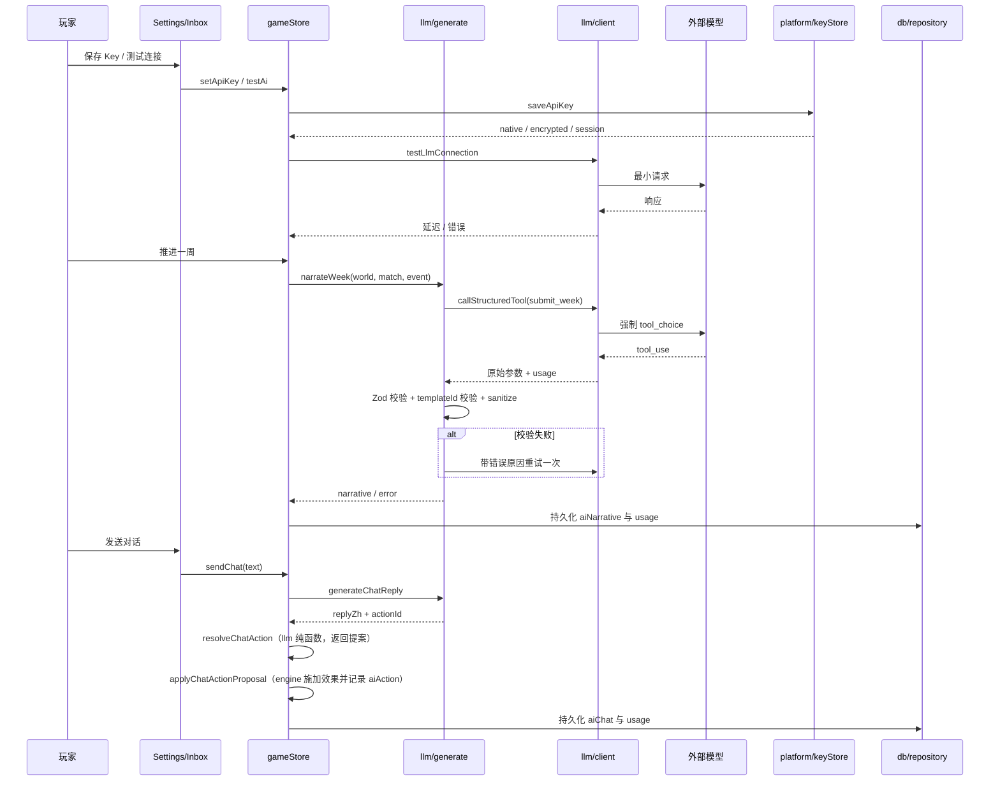

# AI GM / Agent

## 业务目标

在不破坏确定性与公平性的前提下，让 AI 把引擎已经算好的结果写成更有代入感的中文叙事，并让玩家可以用自然语言与 GM 对话、选择受约束的主动行动。AI 是可选增强，不是游戏事实的来源。

## 用户流程

1. 玩家在 `/settings` 选择 Provider（OpenAI/Anthropic/自定义）、模型、Base URL、网络模式、叙事密度与 AI 模式。
2. 玩家保存 API Key（原生安全存储 / Web 加密存储 / 仅会话），并可测试连接。
3. 开启 `aiMode = llm` 后，每周推进并完成比赛日，store 异步请求周叙事。
4. 玩家在 `/inbox` 与 GM 对话；GM 可返回一段叙事，并选择一个固定行动（谈话/休息/加练/采访/无）。主页周叙事的「继续对话」直达 `/inbox?tab=chat`，`InboxScreen` 读取 `tab` 查询参数决定初始页签，非法或缺省时为事件页。
5. 任何 AI 失败都降级到本地模板或错误提示，比赛与存档结果不受影响。

## 关键时序

## 规则与边界

### 模式

- `aiMode = template`：完全不调用模型，使用本地模板叙事。
- `aiMode = llm` 且 `narrativeDensity != off`：周叙事走模型。
- `narrativeDensity = off`：不生成周叙事，即使 `aiMode = llm`。
- 没有 Key 时：周叙事提示“使用本地模板”，聊天提示先配置 Key。
- AI 对话要求 `aiMode = llm` 且存在 Key。

### 周叙事

- 输入：推进后的 `world`、本周 `match`、本周 `event`、`weekPlayed`、`seasonPlayed`、API Key、设置。
- 使用 `submit_week` 工具，强制模型调用。
- 模型只能：
  - 写 `headlineZh`（≤24 字）。
  - 写 `narrativeZh`（≤800 字）。
  - 在引擎有事件时改写标题/正文，且 `templateId` 必须匹配。
  - 写一条 NPC 观察（≤60 字）与下一步建议（≤30 字）。
- 模型不能新增事件、改变选项、比分、属性、合同、赛程、伤病或奖项。
- 通过后写入 `world.aiNarrative`；事件文案改写只在事件仍为 `open` 且模板匹配时生效，`source` 标记为 `llm`。
- 重试：校验失败最多 2 次尝试；传输层对 429/5xx/408/网络/超时最多 3 次。

### 对话与行动

- 输入经 `sanitizeText(message, 400)`；空文本拒绝。
- 回车发送、Shift+回车换行；输入法组字中的回车（`isComposing` 或 keyCode 229）不触发发送。
- 使用 `submit_action` 工具，返回 `replyZh`（≤400 字）与固定 `actionId`。
- 行动效果由 `src/llm/actions.ts` 固定：

| actionId | 效果 |
|---|---|
| `none` | 无 |
| `talk_coach` | 教练信任 +2，士气 +1 |
| `rest` | 体能 +4，锐度 −1 |
| `extra_training` | 锐度 +3，体能 −4，教练信任 +1 |
| `media_interview` | 媒体声望 +2，球迷声望 +1 |

- 每周最多一次主动行动，`world.aiAction` 记录 `season + week + actionId`。
- 行动只在玩家发送对话时的 `season/week` 仍有效时应用；跨周结果丢弃。
- 对话保留最近 40 条。

### 并发与过期

- `store` 用单调递增的 `aiTaskSeq` 忽略旧请求结果。
- 叙事结果写回前校验 `saveId`、`season`、`week` 未变化，否则丢弃。
- `aiBusy` 防止同时发起多次聊天。
- 请求超时 45 秒；测试连接 20 秒。

### 成本

- `aiUsage` 累计 prompt/completion token、调用次数与估算美元。
- 价格表按模型名匹配，匹配不到使用保守默认值（输入 $1 / 百万 token，输出 $3 / 百万 token）。
- 成本只做展示，不阻断调用。

### 契约（提案化）

聊天动作已改为“Agent 只返回提案”：`src/llm/actions.ts` 的 `resolveChatAction` 是纯函数，仅根据当前世界与 `actionId` 返回 `ChatActionProposal`（类型定义在 `src/domain/chatAction.ts`），不修改任何游戏事实；实际的 `applyEffects` 与 `aiAction` 记录由 `src/engine/chatAction.ts` 的 `applyChatActionProposal` 完成，`store` 负责两步编排。llm→engine 违规已消除，`docs/modules.yaml` 中 llm 的 `knownViolations` 清零。（`src/llm/prompt.ts` 原直接读 engine 积分榜的违规已随 `computeLeagueTable` 下沉 domain 而消除。）

## 数据与接口

读写：

- `world.settings`：Provider、模型、Base URL、网络模式、token 参数、温度、叙事密度、AI 模式、`rememberKey`。
- `world.aiNarrative`、`world.aiChat`、`world.aiUsage`、`world.aiAction`。
- `events[].title/body/source`（受约束改写）。

调用：

- `narrateWeek`、`generateChatReply`
- `callStructuredTool`、`testLlmConnection`
- `applyWeekNarrative`、`accumulateUsage`
- `resolveChatAction`、`actionUsedThisWeek`、`applyChatActionProposal`
- `loadApiKey`、`saveApiKey`、`clearApiKey`、`getLoadedApiKey`

工具契约详见 [Agent 工具契约](../interfaces/agent-tools.md)。

## 失败与降级

| 场景 | 行为 |
|---|---|
| 无 Key | 周叙事保留模板；聊天提示配置 Key |
| `aiMode = template` | 不调用模型 |
| `narrativeDensity = off` | 不生成叙事 |
| 未开启 AI 模式就聊天 | 提示先在设置开启 |
| HTTP 401/403 | 提示 Key 无效或无权限 |
| HTTP 429 | 提示请求受限，稍后重试 |
| 5xx/408/网络/超时 | 自动重试；仍失败则提示 |
| 模型返回非 JSON 或无工具调用 | 校验失败，重试一次后降级 |
| 字段超长/缺失 | Zod 拒绝，重试一次后降级 |
| 模型新增事件/改 templateId | 校验失败，不写入 |
| 模型试图改比分 | 协议没有该字段，无法写入 |
| 写作期间玩家推进 | 通过版本校验丢弃过期结果 |
| Web CORS 失败 | 提示改用代理或 Android 原生模式 |
| 费用/额度耗尽 | 显示供应商错误，保留本地结果 |

## 平台差异

| 平台 | 网络 | Key | 说明 |
|---|---|---|---|
| Web/PWA | `fetch` 直连或自建代理 | AES-GCM + IndexedDB，失败则会话 | 浏览器 CORS 可能阻断直连 |
| Android | CapacitorHttp 原生 HTTP | SecureStorage | 可绕过 CORS，设置里可选 `native` |
| iOS | 原生 HTTP（规划） | Keychain（规划） | 复用同一工具契约 |
| 微信小程序 | 小程序 request（规划） | 小程序 storage（需评估） | 需要合法域名与包体评估 |

核心 prompt、工具 schema、校验与降级逻辑与平台无关。

宽屏对话布局：

- `≥768px` 且已启用 GM 时，收件箱锁定 `100svh` 减去 `--bottom-nav-h`（`≥1024` 为整屏高度），消息区 `overflow-y-auto` 独立滚动，Composer 作为 flex 尾部吸底。
- 平板保留底部导航，锁定高度时扣除 `--bottom-nav-h`，避免输入框被底栏遮挡。
- `<768px` 不锁定高度，保持整页滚动与软键盘默认行为。

## 验收与测试映射

| 规则/场景 | 测试 |
|---|---|
| 工具 schema、长度、templateId | `tests/llm/validation.test.ts` |
| 叙事生成、重试、事件改写 | `tests/llm/generate.test.ts` |
| OpenAI/Anthropic 请求与解析 | `tests/llm/providers.test.ts` |
| store 编排、Key、降级、并发 | `tests/store/store.test.ts` |
| 设置页与聊天 UI 烟测 | `tests/ui/smoke.test.tsx`、`tests/ui/settings.test.tsx`、`tests/ui/inbox.test.tsx` |
| 主页「继续对话」直达聊天页 | `tests/ui/inboxTab.test.ts`、`tests/ui/smoke.test.tsx` |

手动验收：

1. 不配置 Key，确认每周仍使用模板叙事。
2. 配置错误 Key，确认显示鉴权错误且比赛结果正常。
3. Web 直连失败，切代理或 Android 原生模式后连接成功。
4. 周叙事生成期间刷新/推进，确认旧结果被丢弃。
5. 连续发送两段聊天，确认第二次被 `aiBusy` 拒绝。
6. 确认导出存档不包含 API Key。
7. 768px 与 1440px 宽度下确认消息区独立滚动、Composer 吸底且不被底栏/侧栏遮挡。

## 变更记录

| 日期 | 变更 | 关联 |
|---|---|---|
| 2026-10-26 | 初版：模式、工具契约、校验、重试、行动、成本与降级 | ADR 0001 |
| 2026-10-28 | `prompt.ts` 改从 `src/domain/leagueTable.ts` 读积分榜，消除 llm→engine 深引 | 全量重构提交 3 |
| 2026-10-29 | 叙事与聊天动作迁入 `store/aiActions.ts`，LLM 默认值与行动文案经 `store/selectors.ts` 暴露给 UI，消除 ui→llm 直接依赖 | 全量重构提交 10 |
| 2026-10-30 | 宽屏对话改为视口锁定 + 消息区内滚 + Composer flex 吸底（`md:` 起），手机保持整页滚动 | 响应式改造 |
| 2026-10-29 | 设置页拆为 `ui/screens/settings/*`（AI 参数、Key、连接测试、用量、隐私、本地数据、危险操作），收件箱拆为 `ui/screens/inbox/*`（事件/对话/新闻），主组件只编排；页面行为与文案不变 | 全量重构提交 12 |
| 2026-10-29 | 对话输入框回车发送前检查输入法组字状态，避免中文上屏误发送 | 缺陷修复 P6 |
| 2026-10-29 | 主页「继续对话」改为直达 `/inbox?tab=chat`，收件箱按查询参数初始化页签，缺省仍为事件页 | 缺陷修复 P8 |
