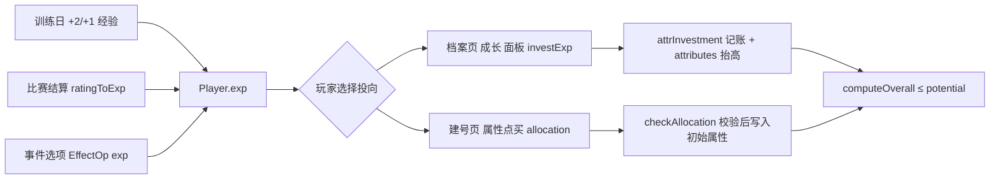
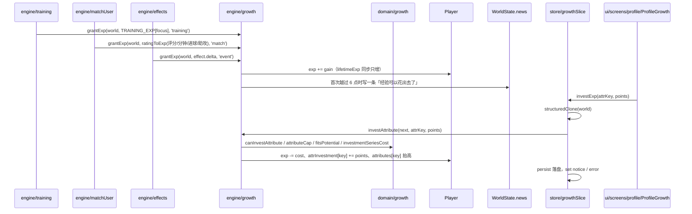

# 经验成长、属性投资与建号点买

## 业务目标

原来的成长是「每周训练自动涨一点点」，玩家既看不到中间货币，也决定不了自己练成什么。本功能把成长变成一条玩家能做主的通道：

1. **经验是唯一可支配的成长货币**：训练、比赛、事件三个来源都会产出，攒够了由玩家决定投给哪项属性。
2. **十项属性都能投**，只有 `goalkeeping` 受位置闸门限制；`potential` 是总刹车，任何路径都不许把综合分抬过潜力。
3. **开局即可点买属性**：建号时按年龄与背景拿到预算，玩家自己分配，界面预览的数字与真正落盘的存档同源。

## 用户流程

## 关键时序

## 规则与边界

- **唯一入口**：只有 `grantExp` 能加 `exp`/`lifetimeExp`；负 `delta` 的事件不会扣走已攒的经验（`Math.max(0, …)`），避免「一次坏选择把成长清零」。
- **`exp` 会随花费减少，`lifetimeExp` 只增不减**：后者用来抬高单属性上限，所以花钱不会让玩家练不到东西。
- **投资成本递增**：第 1 点 6 经验，之后每点贵 2（`cost(k) = 6 + 2k`），无需硬编码等级表就能收敛。
- **单属性上限** `min(96, 40 + floor(lifetimeExp / 20))`：经验刷满也不会出现 96 全属性。
- **潜力是硬校验**：`computeOverall(position, 抬高后的属性) ≤ potential` 由引擎拒绝，不是 UI 提示；整笔拒绝，不做部分成交。
- **位置闸门**：十项属性都可投，仅 `goalkeeping` 需要 `positionGroup(position) === 'GK'`；非门将投门将是烧经验，所以界面直接不渲染该项。
- **比赛中禁止投资**：`pendingDayPlan` 存在或 `lastMatch.status === 'live'` 时一律拒绝。关键回合的成功率在开球时锁进选项、`roll` 已预抽，中途抬属性会让判定与文案对不上。
- **建号点买预算** `(age − 16) × 3 + 4`，青训背景另加 3；单项最多 +4；总和不得超过预算；加完仍不得越过潜力。
- **点买不消耗 RNG**：`draftUserBase` 的随机流顺序保持 `normal → makeAttributes → int(潜力) → pickFoot`，`allocation` 只在 `applyBonuses` 之后做整数加法，所以同种子同基准属性，golden 只因引擎语义（比赛/训练产经验）而变。
- **不合法就整体忽略**：`resolveUserAttributes` 在校验失败时回落到基准属性（`draft.ok ? draft.applied : base.attributes`），世界层不信任 UI 传上来的数字。

## 数据与接口

| 接口 | 位置 | 说明 |
| --- | --- | --- |
| `Player.exp` / `lifetimeExp` / `attrInvestment` | src/domain/types.ts | v8 新增；`attrInvestment` 是十字段全 0 起步的账本 |
| `CareerCreateOptions.allocation?` | src/domain/types.ts | 可选，缺省等价于空对象，旧调用点与旧 fixture 不必改 |
| `INVEST_FIRST_COST=6` / `INVEST_STEP_COST=2` / `INVEST_HARD_CAP=96` / `INVEST_CAP_BASE=40` / `INVEST_CAP_PER_EXP=20` | src/domain/growth.ts | 投资曲线与天花板的唯一常量 |
| `investmentCost` / `investmentSeriesCost` / `attributeCap` / `canInvestAttribute` / `fitsPotential` / `maxInvestable` | src/domain/growth.ts | 纯函数；UI 用它决定步长与置灰，引擎用它做校验 |
| `allocationBudget` / `checkAllocation` / `applyAllocation` | src/domain/allocation.ts | 建号点买的预算、校验与施加 |
| `grantExp(world, amount, reason)` | src/engine/growth.ts | 经验唯一入口，`reason ∈ training\|match\|event\|staff\|specialization` |
| `ratingToExp({rating, minutes, goals, assists})` | src/engine/growth.ts | `(rating−6.5)×8×minutes/90 + goals×6 + assists×4`，评分 ≥7.8 另加 4，负值截 0 |
| `investAttribute(world, attrKey, points)` | src/engine/growth.ts | 返回 `InvestOutcome`，失败带 `InvestReject` 码 |
| `previewUserStart(options)` / `draftUserBase` / `resolveUserAttributes` | src/world/userDraft.ts | 建号预览与真正生成共用的同一份基准 |
| `selectCareerPreview(options)` | src/store/selectors.ts | `ui` 不允许 import `world`，预览经 store 转发 |
| `investExp(attrKey, points)` | src/store/growthSlice.ts | `structuredClone` → 校验 → 落盘 → `notice`/`error` |
| `EffectOp 'exp'` | src/domain/eventContent.ts | 事件选项可以直接发经验，`EffectOp` 现有 16 个 |
| `CURRENT_SAVE_VERSION = 12` / `ENGINE_VERSION = '0.14.0'` | src/domain/version.ts、src/world/constants.ts | 成长账本自 v8 进入存档结构；v9 补绝技账本、v10 补名宿关系、v11 补待入账与投资账本、v12 补个人团队名册。私教在场时训练与特训的经验乘 `expFactor`（最高 1.5）、属性投资乘 `(1 − investDiscount)`（最低仍付 1 点），见 [个人团队](private-staff.md) |

## 失败与降级

- 没有用户球员（`players[playerId]` 缺失）：`grantExp` 返回 0、`investAttribute` 返回 `noUser`，界面提示「先创建一段生涯」。
- 经验不足 / 越过上限 / 越过潜力 / 位置不允许 / 点数非正整数：整笔拒绝并把引擎码翻成一句可照着做的中文（`REJECT_TEXT`），不产生半个属性点，也不写 `notice`。
- 比赛中点投资：拒绝并提示「先把今天踢完」，避免出现「属性变了但已预抽的 `roll` 还按旧概率判」的错位。
- 建号点买越界：`preview.ok === false` 时提交按钮禁用并显示原因；即便绕过 UI，world 层也会忽略整份点买方案，回落到基准属性。
- v7 及更早存档缺成长字段：`migrateGrowth()` 按「缺才补、有则不动」补齐，脏档里已攒的经验不会被清零。
- 落盘失败：store 保留新世界并写 `error: 保存失败：…`，与既有切片同一口径。

## 平台差异

- 全部计算是纯 CPU 整数/浮点运算，Web 与 Capacitor 行为一致，不碰平台端口、不读墙钟。
- 档案页成长面板与建号点买在 360–390px 单列渲染，加减按钮 `min-h-11 min-w-11`（44px 见方）；桌面只多一条侧栏，不改变算式。
- 迁移在 Dexie 读取路径上执行，老档首次载入多一次全球员遍历（约 1000 实体，毫秒级）。

## 验收与测试映射

| 验收点 | 测试 |
| --- | --- |
| 训练按重点产经验（恢复课 1 点）、伤停合练不产经验 | tests/engine/growth.test.ts |
| 首次攒够可投资经验只播报一条、同一天多次发放不重复播报、非正值不改余额 | tests/engine/growth.test.ts |
| 比赛来源 `ratingToExp`：差评与未出场截 0、进球助攻另计、赛后写入主角 | tests/engine/growth.test.ts |
| `EffectOp: 'exp'` 经 `applyEffects` 走同一入口，负值不倒扣 | tests/engine/growth.test.ts |
| 扣费递增（第 1 点 6、第 2 点 8）、账本记账、花费不减 `lifetimeExp`、非法点数拒绝 | tests/engine/investAttribute.test.ts |
| `overall ≤ potential` 硬约束：把能投的 10 项都投满仍不破潜力与单属性上限 | tests/engine/investAttribute.test.ts、tests/domain/growth.test.ts |
| 比赛中拒绝投资（`pendingDayPlan` 存在时引擎与 store 都拒） | tests/engine/investAttribute.test.ts、tests/store/growthStore.test.ts |
| 投资曲线、`attributeCap` 随经验解锁、`maxInvestable` 三条约束、位置闸门 | tests/domain/growth.test.ts |
| 点买预算随年龄/背景、单项封顶、超预算与越过潜力各自报错、门将闸门、原属性不被改写 | tests/domain/allocation.test.ts |
| 同种子整季回放哈希稳定 | golden（scripts/quality/update-golden.ts）与 `npm run quality:golden` 双跑自校验 |
| 建号点买接进球员生成、RNG 流位置不变 | tests/world/allocation.test.ts |
| 预览数字与真正生成的存档深度相等 | tests/world/careerPreview.test.ts、tests/store/selectors.test.ts |
| `investExp` 克隆→落盘→notice，失败走 error | tests/store/growthStore.test.ts |
| v7 档迁移补成长账本、导出/导入往返等值、重复迁移幂等、迁移后可续踢 live 比赛并立刻投资 | tests/db/migrationV8.test.ts |
| 档案页可点、可投、置灰与提示文案 | tests/ui/profileGrowth.test.tsx |
| 建号页 8 例点买交互（预算、加减、封顶、门将项、提交参数） | tests/ui/createCareerPointBuy.test.tsx |
| 44px 触控与 340px 宽度契约 | tests/ui/layoutContract.test.tsx |

## 变更记录

| 日期 | 变更 |
| --- | --- |
| 2026-11-02 | 建号页新增「属性点买」卡：18 个 44px 加减按钮、预算标签、`综合 X · 潜力 Y`、`role="alert"` 原因说明；超预算或越过潜力时禁用签约按钮 |
| 2026-11-02 | 新增 `selectCareerPreview`（store）与 `previewUserStart`（world），使界面预览与真正生成走同一份 `draftUserBase`；点买不消耗 RNG，种子流位置保持不变 |
| 2026-11-02 | 档案页新增经验投资面板，`investExp` 走独立 `growthSlice`：克隆世界 → `investAttribute` → 落盘 → `notice`；七种拒绝码各配一句中文 |
| 2026-11-02 | 存档升 v8：`Player.exp / lifetimeExp / attrInvestment` 进入结构，`migrateGrowth()` 对 v7 及更早存档「缺才补、有则不动」 |
| 2026-11-02 | 引擎语义变更：训练按重点产经验、比赛按 `ratingToExp` 产经验、`EffectOp` 增加 `exp`（共 13 个 op）；`ENGINE_VERSION` 升 0.9.0，回放基准 `43de8568604868f8` → `c43d95700e96f860` |
| 2026-11-02 | 新增 `src/domain/growth.ts`（投资曲线、属性上限、位置闸门、潜力闸门）与 `src/domain/allocation.ts`（建号点买预算与校验），两者都是可枚举的纯函数 |
| 2026-11-02 | 把球员子结构（属性、伤病、合同、声望、赛季统计）下沉到 `src/domain/playerTypes.ts`，为成长字段腾出 `types.ts` 的行数空间 |
