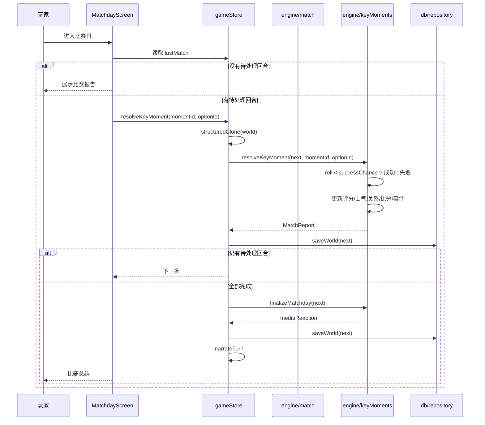

# 比赛日与关键回合

## 业务目标

把一次联赛模拟变成玩家能参与的“比赛日”：引擎先决定比分与球员表现，再在用户出场时间内生成 2–4 个关键回合，让玩家做选择。选择必须影响评分、士气、关系与比分，但不能重抽已经决定的比赛结果。

## 用户流程

1. 玩家推进一周，若本周有用户比赛，引擎模拟整场比赛并生成关键回合。
2. store 检测到 `hasPendingKeyMoments`，阻止继续推进，UI 引导玩家进入 `/match`。
3. 玩家按顺序处理每个关键回合：阅读场景，选择选项，查看结果。
4. 每处理一条立即持久化；全部完成后自动 `finalizeMatchday`，生成媒体反应并刷新新闻/比分时间线。
5. 玩家也可以选择“自动处理”，系统为每个回合选择成功率最高的选项。
6. 完成后触发本周 AI 叙事；失败只影响文案。

## 关键时序

失败分支：

- 回合 ID 不是下一条待处理 → `resolveKeyMoment` 返回 `null`，store 提示“已经结束或选项无效”。
- 存档写入失败 → 内存状态更新，顶部提示“保存失败：<原因>”；关键回合结果可能未落盘。
- AI 叙事失败 → 比赛结果与媒体反应保留，显示错误提示。

## 规则与边界

### 出场判定

`determineUserSelection`：

- 受伤或体能 <26：不出场。
- 综合评分：
  `(能力 - 队友阵容能力) × 2.2 + (教练信任 - 50) × 0.22 + (体能 - 70) × 0.2 + (状态 - 50) × 0.12 + (锐度 - 50) × 0.08`
- 体能 ≥38 且（评分 ≥−3.5，或评分 ≥−9 且 55% 概率）→ 首发 90 分钟。
- 体能 ≥45 且评分 ≥−18 且 45% 概率 → 替补 15–30 分钟。
- 其余不出场。

### 比分与球员表现

- 期望进球：`clamp(1.3 或 1.1 + (进攻 - 防守) × 0.055 + 主场 0.18, 0.15, 4.2)`。
- 俱乐部风格修正：反击 +0.08、高位逼抢 +0.06、控球 +0.03、直接 +0.05。
- 实际进球：`rng.poisson(xG)`。
- 射手/助攻按位置与属性加权；用户出场时权重 ×1.4 / ×1.3。
- 用户评分：`6.35 + 进球 × 0.95 + 助攻 × 0.65 + 赛果修正 + rng.normal(0, 0.35)`：
  - 门将零封 +0.7，否则每失球 −0.15。
  - 后卫零封 +0.35。
  - 替补按出场时间比例缩放。
  - clamp 到 4.3–9.9。
- 全场最佳：用户评分 ≥8.3 归用户；否则归进球最多者。评选为用户时评分直接取用户实际评分，只有非用户人选才随机生成 7.2–8.5，保证姓名与评分一致。
- 上座率：按主队声望派生并 clamp 到 3,200–78,000。
- 黄牌概率 6%；受伤概率 `0.012 × (1 + (100 - 体能)/100) × (门将 ? 0.5 : 1)`，伤停 2–8 周。
- 未进球/助攻时 30% 概率生成一次机会或扑救事件。

### 关键回合生成

- 仅当用户出场且分钟数 >0 时生成。
- 数量：`min(rng.int(2, 4), 出场 ≥70 ? 4 : ≥40 ? 3 : 2)`。
- 位置池：
  - 门将：扑救、扑救、解围
  - 后卫：对抗、解围、对抗、机会
  - 中场：直塞、机会、对抗、点球
  - 前锋：机会、机会、点球、直塞
- 分钟在出场窗口内均匀分布并加 ±3 扰动，保证递增且不重复。
- `roll` 在生成时固定为 0–1 的四位小数；后续只比较 `roll < successChance`。
- 每个选项含成功率、成功/失败评分、士气、教练信任、进球/助攻标记。

### 结算

- `success = moment.roll < option.successChance`。
- 评分增量按成功/失败取值，clamp 后写回 `userRating`，同时调整 `seasonStats.ratingSum` 与状态。
- 进球/助攻：更新 `MatchReport` 比分、半场比分、fixture 比分、用户赛季统计；只追加，不重算。
- 士气、信心、教练关系、媒体/球迷关系按选项变化。
- 每条结果追加到比赛事件并按分钟排序。
- 进球/助攻后刷新比赛新闻与比分时间线。
- 必须按待处理顺序处理；不能跳到后面的回合。
- 全部完成后 `finalizeMatchday` 生成媒体反应，阈值：≥8.3 焦点、≥7.2 称赞、≥6.3 完成任务、否则质疑。

### 自动处理

- 对每个待处理回合选择 `successChance` 最高的选项。
- 仍然逐条走 `resolveKeyMoment`，因此结果与玩家选择同一路径。
- 自动处理后立即 `finalizeMatchday`。

### 交互状态

- 存在待处理回合时隐藏“下一场”入口，避免跳过后面的关键回合。
- 提交回合或自动处理期间按钮锁定；即使动作抛错也会在 `finally` 解锁，不会永久禁用。

### 不可变条件

- 比赛比分在 `simulateUserFixture` 中已确定；关键回合不得重新模拟比赛。
- `roll` 不得重抽、不得在结算时重新计算成功率。
- 关键回合顺序不可交换。
- 未完成全部回合时不得生成媒体反应，也不得推进下一周。

## 数据与接口

读写：

- `world.lastMatch`：`MatchReport`，含 `keyMoments`、`events`、`mediaReaction`。
- `world.fixtures[fixtureId]`：比分与状态。
- 用户球员：`seasonStats`、`form`、`morale`、`confidence`、`reputation`、`injury`。
- `world.relationships`：教练、媒体、球迷。
- `world.news`：比赛新闻与惊险比赛新闻。

调用：

- `engine.simulateWeekFixtures(world)`
- `engine.generateKeyMoments(player, rng, minutes, isHome, startMinute)`
- `engine.resolveKeyMoment(world, momentId, optionId)`
- `engine.autoResolveKeyMoments(world)`
- `engine.finalizeMatchday(world)`
- `domain.computeLeagueTable(world, leagueId, season)`

## 失败与降级

| 场景 | 行为 |
|---|---|
| 用户未出场/无关键回合 | 直接展示比赛报告，不进入回合流程 |
| 无效回合或选项 | 返回 `null`，store 提示，不修改状态 |
| 重复提交同一回合 | 第二次返回 `null` |
| 存档失败 | 内存结果保留，持久化失败不阻塞；刷新可能丢失进度（已知风险） |
| 页面刷新 | 未完成回合仍在 `lastMatch` 中，可继续处理 |
| AI 叙事失败 | 比赛报告、媒体反应与新闻保留 |

## 平台差异

无差异。比赛与关键回合完全本地计算；UI 只负责展示与收集选择。

## 验收与测试映射

| 规则/场景 | 测试 |
|---|---|
| 关键回合生成数量、顺序、选项 | `tests/engine/keyMoments.test.ts` |
| 成功/失败结算、比分、评分、关系 | `tests/engine/keyMoments.test.ts` |
| 自动处理与最终化 | `tests/engine/keyMoments.test.ts` |
| 比赛模拟、出场判定、赛季统计 | `tests/engine/season.test.ts` |
| 积分榜计算（下沉 domain） | `tests/domain/leagueTable.test.ts` |
| 比赛页渲染与交互烟测 | `tests/ui/smoke.test.tsx` |
| 比赛日页面（阶段/回顾/空态/替补）渲染 | `tests/ui/matchday.test.tsx` |
| 未完成回合阻塞下一周 | `tests/store/store.test.ts` |

手动验收：

1. 制造一场有 2–4 个关键回合的比赛，逐条选择并确认比分/评分变化。
2. 刷新页面，确认未完成回合仍可继续。
3. 点击自动处理，确认按稳妥选项结算并生成媒体反应。
4. 在 360–390px 宽度确认选项按钮可点击、不溢出。

## 变更记录

| 日期 | 变更 | 关联 |
|---|---|---|
| 2026-10-26 | 初版：出场、比分、关键回合、结算、最终化与失败降级 | ADR 0001 |
| 2026-10-28 | 积分榜计算 `computeLeagueTable` 下沉至 `src/domain/leagueTable.ts`，斩断 engine→world 与 llm/ui→engine 深引 | 全量重构提交 3 |
| 2026-10-29 | 关键回合选项构建外迁 `src/engine/data/keyMomentOptions.ts`、叙事与媒体反应外迁 `src/engine/keyMomentNarrative.ts`，keyMoments.ts 只保留编排；golden 哈希不变 | 全量重构提交 7 |
| 2026-10-29 | 比赛模拟拆为 `matchGoals.ts`（期望进球/射手/助攻/伤种）与 `matchUser.ts`（选人/评分/赛后结算），match.ts 只保留比赛编排；RNG 顺序不变，golden 哈希一致 | 全量重构提交 8 |
| 2026-10-29 | 比赛日动作迁入 `store/matchSlice.ts`，Dashboard/Schedule 的待处理回合与赛程派生改走 `store/selectors.ts`，消除 ui→engine/world 直接依赖 | 全量重构提交 10 |
| 2026-10-29 | `MatchdayScreen` 拆为 `ui/screens/matchday/*`：比分卡、关键时刻选择、赛后回顾、文字直播与回合工具，主组件只做编排；新增页面状态测试，视觉与交互不变 | 全量重构提交 11 |
| 2026-10-29 | 全场最佳在用户为射手王但评分 <8.3 时改用用户实际评分，消除姓名与评分矛盾；golden 哈希不变 | 缺陷修复 P4 |
| 2026-10-29 | 待处理回合时隐藏“下一场”入口；回合动作用 try/finally 解锁按钮 | 缺陷修复 P5 |
