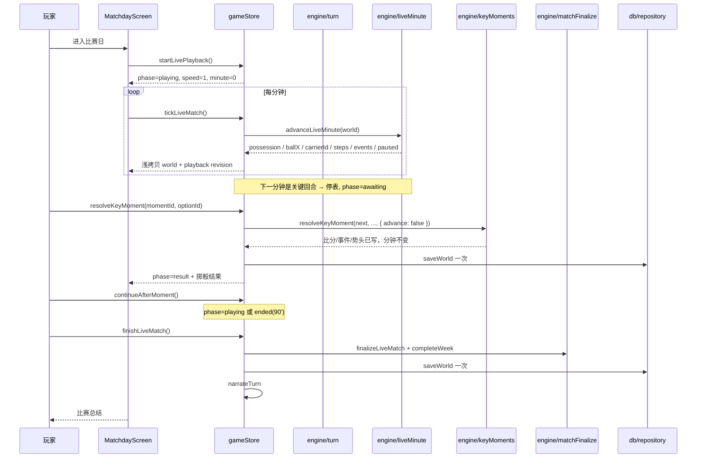
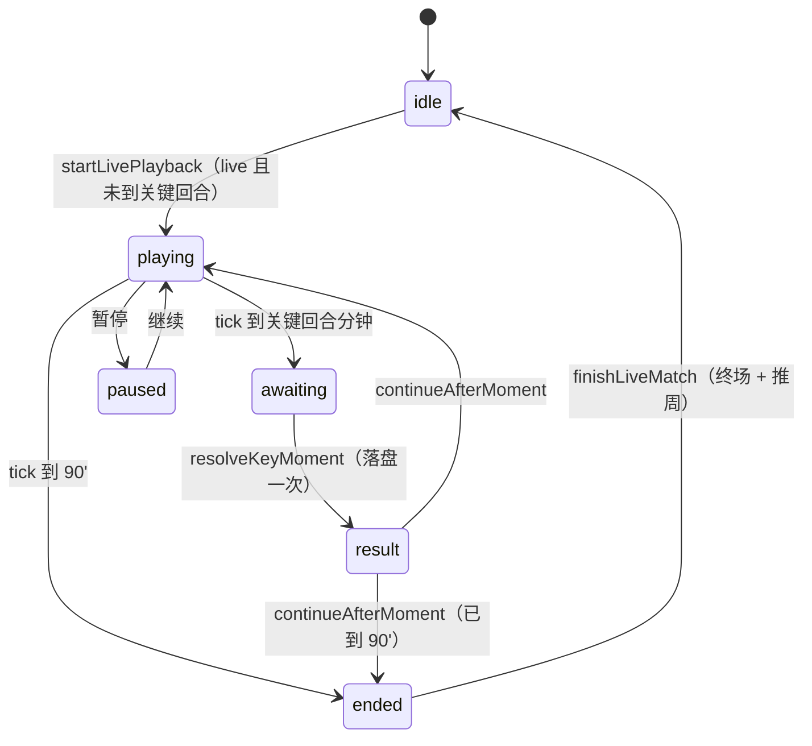
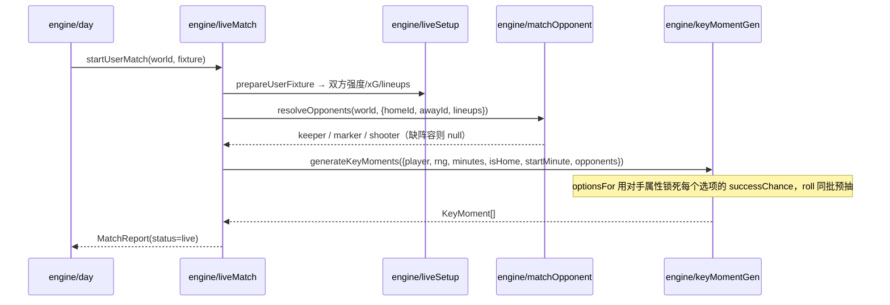

# 比赛日与关键回合

## 业务目标

用户比赛必须像“看直播”一样展开：进入比赛日后从 0' 自动开赛，逐分钟推进到 90'，期间提供俯视球场点阵、双方攻防文字直播、实时数据面板和可调速度。关键时刻在对应分钟自动停表弹出选择，并明确展示触发条件、成功率依据、选项效果与掷骰结果。玩家的选择立即改写比分、时间线与势头，而不是在已预定的终场比分上补充进球。

## 用户流程

1. 玩家推进一周，`startWeek` 完成赛前准备并创建 live 比赛；`startUserMatch` 停在 `0'`，比分 `0-0`，不增加周次，并落盘一次。
2. 进入 `/match` 后页面自动开赛：默认 `1x`，每分钟一次 tick，球场点阵、足球、双方文字直播与数据面板同步刷新。
3. 播放到关键回合分钟时自动停表，弹出关键回合弹窗：场景、触发条件、5 个选项（成功率依据与效果摘要）、当前掷骰阈值。
4. 玩家选择后显示掷骰值、成功/失败与影响，随后落盘一次；点击“继续比赛”恢复播放。
5. 最后一条回合结束后比赛仍为 live，继续播到 90'，出现“完成比赛”入口；点击后终场结算（评分、MOTM、媒体反应、新闻、赛季数据）并推进周次。
6. 玩家可随时暂停/继续、切换 `1x/2x/4x`、点击“跳到下一关键回合”直接推进到下一回合分钟。
7. 玩家也可以“自动处理”，系统为每个回合选择默认（成功率最高）选项、自动播完并完成整周。

## 关键时序

失败分支：

- 非 live 或已结束的 tick 是 no-op，不重复计分。
- 存档写入失败 → 内存状态保留，提示“保存失败：<原因>”；再次操作不会重复结算或推进周次。
- AI 叙事失败 → 比赛结果、媒体反应与新闻保留，只显示错误提示。
- 旧版存档（无 `pendingWeekPlan`）→ 完成回合后只结算比赛，不调用 `completeWeek`，不会多推一周。

## 状态机

- `phase` 是 store 瞬态状态，不写入存档。
- `tickLiveMatch` 只在 `playing` 时推进；`paused / awaiting / result / ended` 下为 no-op，避免重复计分。
- `jumpToNextKeyMoment` 在 `playing` 或 `paused` 时循环推进，直到 `paused`（进入 `awaiting`）、`finished`（`ended`）或无效。

## 规则与边界

### 出场判定

`determineUserSelection`：

- 受伤或体能 <26：不出场。
- 综合评分（`selectionScore`，已导出为纯函数便于回归验证）：
  `(能力 - 队友阵容能力) × 2.2 + (教练信任 - 50) × 0.22 + (体能 - 70) × 0.2 + (状态 - 50) × 0.12 + (锐度 - 50) × 0.08 + (styleFit - 0.5) × 4`
- 最后一项是主教练打法契合度，量级 ±2，与 −3.5 的首发门槛同阶：边缘球员会因打法契合或冲突被推过 / 推离门槛。强度按既定决策取默认 `(styleFit − 0.5) × 4`，调整需重算回放基准。
- 契合度与打法权重来自 `src/domain/coachStyle.ts`（纯函数，不消耗 RNG），玩家侧口径写在 `docs/features/team-squad.md` 的教练卡。
- 体能 ≥38 且（评分 ≥−3.5，或评分 ≥−9 且 55% 概率）→ 首发 90 分钟。
- 体能 ≥45 且评分 ≥−18 且 45% 概率 → 替补 15–30 分钟。
- 其余不出场；不出场时 `startWeek` 在内部完整模拟 90 分钟并直接结算整周。

### 首发阵容

`domain.lineup.selectLineup` 是首发唯一来源，`computeClubStrength` 与比赛首发共用：

- 目标结构为 1 门将、4 后卫、4 中场、2 前锋，共 11 人。
- 同位置按综合能力、状态、体能排序；同一俱乐部、同一阵容输出稳定。
- 用户出场时强制选入首发；用户不出场或替补时不在首发 11 人中。
- `matchReport.lineups` 保存双方首发（`id / name / number / position / isUser`），供球场点阵与射手选择复用。

### 逐分钟实时模拟

- 赛前用 `expectedGoals` + 俱乐部风格修正计算 `homeXg/awayXg`（与旧版一致）。
- `advanceLiveMinute(world)` 每次只推进一步，返回 `{ minute, paused, finished, halfTime, possession, ballX, carrierId?, steps, goalSide?, events }`。
- 控球使用连续 Markov 链（`engine/liveSpell.buildSpell`）：控球方以 `clamp(0.77 + 中场强度差 × 0.5, 0.64, 0.83)` 保持控球，平均 spell 3–4 分钟；丢球时就地转换，不再每分钟独立掷骰。
- 球位连续：同侧控球时朝对方球门推进，单步 0.04–0.18，18% 概率回传 0.03–0.09；丢球时球位不瞬移；进球后球停在门线（主队 0.96 / 客队 0.04）。
- 每控球分钟生成 1–3 段 `steps`（`pass / carry / shot / turnover`），只供 2D 画面使用，不写入 `report.events`。
- 射门与进球同源：每分钟进球概率 `clamp(xG / 90 / 控球份额 × 势头, 0, 0.35)`；非进球分钟射门概率 0.12、射正率 38%；射正未进补 `save` 事件。
- 进球分钟先写同侧 `shot` 文本，再由 `appendGoal` 唯一记录比分与射门/射正统计，避免双计。
- 射门者取自本分钟持球人（`carrierId`，必须在本方首发）；缺失时回退 `pickScorer`，助攻仍由 `pickAssister` 生成。
- 关键回合分钟不模拟自动进球，也不生成攻防事件；该分钟按回合归属方把球放在进攻三区（主队 0.82 / 客队 0.18）并暂停，计 1 分钟控球。
- 关键回合进球由 `liveMatch` 写 `goalState`（门线球位 + `pendingKickoff` 给失球方），下一分钟从失球方中圈开球。
- 第一次跨过第 45 分钟时冻结半场比分并补一条半场事件，之后不再变化。
- 90' 返回 `finished = true`，但不自动终场；终场由 `finalizeLiveMatch` 负责，并删除 `liveState`。
- `advanceLiveMatch(world)` 只是循环调用 `advanceLiveMinute` 的批量路径；逐分钟播放与批量结算必须产生完全相同的终场报告（同一 seed 哈希一致）。
- 替补球员在登场前不会成为进球者或助攻者：用户可选窗口为 `90 - userMinutes` 到 90，未出场权重为 0。
- 随机流固定为 `spell / move / chance / beat-actor / goal / pitch / pitch-lane / pitch-carrier`；`engine` 内不得出现 `Math.random`、`Date.now`。

### 双方攻防事件与统计

`engine.matchBeats.buildBeats` 每分钟调用 `buildSpell` 生成控球、球位、传球轨迹与射门，再映射为事件与统计，纯函数、不修改报告：

| 情况 | 事件 | 归属 | 统计 |
|---|---|---|---|
| 进球分钟 | 同侧 `shot` 文本，随后 `appendGoal` 写进球 | 控球方 | `appendGoal` 记射门 +1、射正 +1 |
| 非进球但射门（12%） | `shot`；射正 38% 时追加 `save` | 控球方 | 射门 +1，射正按是否中框 |
| 无射门，`rng.next() < 0.10` | 进攻推进 | 控球方 | — |
| 无射门，`< 0.14` | 角球 | 控球方 | 角球 +1 |
| 无射门，`< 0.17` | 犯规 | 防守方 | — |
| 无射门，`< 0.19` | 越位 | 控球方 | — |

- 控球统计每分钟累加到 `liveState.possession` 一方，`双方控球分钟之和 = currentMinute`。
- 事件球员用 `createRng(seed, 'beat-actor', fixtureId, minute, side, att|def)` 抽取：进攻取前锋/中场，防守取门将/后卫。
- 统计面板固定四项：控球、射门、射正、角球；时刻保持 `goals ≤ shots`、`shotsOnTarget ≤ shots`。
- 关键回合进球同步补记用户方射门/射正；对手机会只以攻防事件呈现，不产生“对手关键回合”。

### 球场点阵

`domain.pitch.buildPitchFrame` 生成双方各 11 名球员坐标、足球位置、传球路线与最近 4 帧轨迹；阵型基元在 `domain/pitchShape.ts`：

- 坐标语义：`x=0` 是主队球门，`x=1` 是客队球门；主队进攻 `+x`，客队进攻 `-x`。
- 控球方整体压上：进攻三区时前锋可到 0.78–0.9，中场前提；边路按确定性随机流保持宽度。
- 防守方回撤：后卫线、中场线按“到球的归一化距离 × 0.45 / 0.7 / 1.0”落位（最小 0.065），始终位于球与自家球门之间；最近的非门将防守者逼抢到球侧 0.04、纵向 75% 靠球。
- 门将贴本方门线（主队约 0.045、客队约 0.955），随球位小幅偏移。
- 持球人优先取 `playback.carrierId`，缺失时按球路区域与确定性随机流从本方前锋/中场选取；足球放在持球人脚前 0.012（进攻方向），确保球贴脚。
- `passPath` 从上一分钟的真实球位经中点弯折到当前足球位置（历史帧包含当前分钟时跳过重复帧）；`trails` 使用最近 4 帧真实 `ballX`，纵向由 `createRng(seed, 'pitch-lane', ...)` 复算，不再为轨迹伪造随机点。
- 同一 seed、场次、分钟与输入状态输出相同坐标；不同分钟产生跑位变化。
- UI 使用 SVG 绘制完整球场：外线、中线、中圈、两侧禁区/小禁区/点球点/点球弧/球门/角球弧；足球为内嵌 SVG 图标；传球路线为按控球方着色的虚线；顶部显示“球队控球 · 持球人”。
- 进球分钟在对应球门侧显示 `GOAL` 徽标，足球停在门线附近；下一分钟再回到中圈。关键回合结算的事件按用户方写 `side`，因此关键回合进球与普通进球一样能定位徽标。
- 容器设置 `--pitch-move`（1x 420ms / 2x 200ms / 4x 90ms），球员与足球过渡使用该变量；支持 Web Animations 时足球沿 `passPath` 关键帧移动；`prefers-reduced-motion` 下关闭过渡与动画。

### 关键回合生成

- 仅当用户出场且分钟数 >0 时生成。
- 数量：`rng.int(5, 7)`，按出场分钟缩放（替补出场时间越短越少），保证落在出场窗口内。
- 12 类：`bigChance / penalty / throughBall / duel / save / clearance / freeKick / headerDuel / oneOnOne / counterAttack / cross / longShot`。
- 位置池按门将、后卫、中场、前锋划分；分钟递增且不重复。
- 每个回合恰好 5 个选项，`defaultOptionId` 指向成功率最高的稳妥选项。
- 每个选项含 `successChance`、成功/失败评分、士气、教练信任、进球/助攻标记，以及：
  - `successBasisZh`：成功率依据（逐项「属性 值 ±百分比」，对手项写成「对手门将 90 -10.8%」）。
  - 效果摘要：进球、助攻、评分、士气、教练信任。
- 每个回合含 `triggerZh`：触发条件（场景描述）。
- `roll` 在生成时固定为 0–1 的四位小数；后续只比较 `roll < successChance`，不得重抽或重算。

#### 概率公式（scoreChance）

- 12 类选项全部由 `src/engine/data/keyMomentOptions{Attack,Defense,SetPiece}.ts` 里的 `OptionRow` 表声明，一行一个选项，统一交给 `buildOptionTable` 走 `scoreChance`。
- 公式：`successChance = clamp(base + Σ actorCoef × 我的属性 + Σ move.delta − Σ opponentCoef × 对手属性, low, high)`，结果按 0.1% 粒度取整。
- 系数以「每 1 点属性」为单位（`0.0012` 即每点 0.12%），因此同一选项在高属性下会被 `high` 夹住，不会出现 >1 的概率。
- 对手取三个对位角色：`keeper`（门将）、`marker`（盯人后卫）、`shooter`（出手前锋）；哪个选项读哪个角色由表声明，例如 `save` 只读 `shooter`，`penalty` 只读 `keeper`。
- 确实不看对手的选项（护球、大脚解围、战术犯规等）写成 `base = low = high` 并给出 `flatBasisZh`，让「常量」是声明而不是巧合。
- 绝技（M1.10/M1.11，已交付）通过 `moves: MoveBonus[]` 挂进同一公式：`{ labelZh, delta }` 直接进概率并出现在依据文本里，公式本身不改。
- 依据文本在界面侧由 `basisTermsOf`（`src/ui/labels.ts`）切成 `move / counter / term` 三类词条：绝技单独成徽标，对位压制单起一行，其余属性项留在依据行；`low === high` 的常量选项两块皆空。整季概率带宽（上桌均值、最稳一路、绝技最多抬高 10%、0.92 硬上限）由 `tests/engine/movesBalance.test.ts` 锁住。

- `resolveOpponents` 是纯读取：从对面首发的 id 回查 `world.players` 拿真实属性（首发条目本身不带属性），后卫取防守最强者、出手池优先前锋（无前锋时退到中场）取射门最强者，同分取先出现的人；不消耗随机数、不写状态。
- 对位固定取**开场首发**。比赛中换人不刷新对手，因为 `roll` 与概率已在生成时锁死，中途改概率等于重算历史。

### 回合结算

- `success = moment.roll < option.successChance`。
- 实时比赛（`status === 'live'`）：
  - 成功且 `goalOnSuccess`：立即为用户方追加进球，`userGoals + 1`，补记射门/射正。
  - 成功且 `assistOnSuccess`：为球队生成一粒队友进球，用户 `userAssists + 1`。
  - 失败：不增加进球。
  - 士气、信心、教练/媒体/球迷关系立即结算。
  - **不**在回合中写赛季进球/助攻/评分/form；`ratingDelta` 存入 outcome，终场统一加总。
  - `resolveKeyMoment(..., { advance: false })` 时停在当前分钟；默认 `advance: true` 的批量路径会继续推进到下一回合或 90'。
  - 批量自动结算前若回合分钟尚未播到，会先 `advanceLiveMatch` 到该分钟，保证“暂停分钟”的控球归属与实时播放一致。
- 旧版 `final` 报告（v1/v2 存档遗留的未完成回合）保留旧路径：立即写赛季统计、评分、form、新闻与时间线，避免旧档行为漂移。

### 终场结算

`finalizeLiveMatch` 幂等（`status === 'final'` 直接返回）：

- 由 `report.goals` 统计 AI 射手/助攻赛季数据；用户数据经 `updateUserAfterMatch` 一次写入。
- 最终评分 = `computeUserRating(...)` 基础分 + 所有 `outcome.ratingDelta` 之和，clamp 4.3–9.9。
- MOTM 依据 `report.goals` 的射手与最终评分；用户评分 ≥8.3 归用户。
- 生成黄牌/伤病/机会事件并并入时间线，追加 `fulltime` 事件与 `mediaReaction`。
- `fixture.status = 'played'`，写报告与比赛新闻；`report.status = 'final'`、`currentMinute = 90`。

### 自动处理

- 对每个待处理回合选择 `defaultOptionId`（成功率最高的稳妥选项）。
- 仍逐条走 `resolveKeyMoment`，结果与玩家选择同一路径。
- `skipKeyMoments` 自动处理剩余回合并直接完成整周，同时清空播放状态。
- `advanceWeek` / `advanceWeeks` / `simulateUserFixture` 兼容入口会 start → autoResolve → finalize → complete，保持“一次推进一周”的旧语义。

### 持久化与重放

- 落盘点固定在“开局、每个关键回合结算后、完赛”三处；播放中的每分钟只改内存，不落盘。
- `MatchReport.liveState` 持久化当前控球方、球位、持球人（`carrierId`）与下一分钟开球方（`pendingKickoff`）。
- 刷新/读档后，UI 调用 `startLivePlayback` 按 `fixtureId` 对账：
  - 有未结算回合且 `moment.minute <= currentMinute` → `awaiting`。
  - `currentMinute >= 90` → `ended`。
  - 其余 → `playing`，直接读取 `liveState` 的球权/球位/持球人，不再回中圈；后续分钟按确定性随机流重放。
- 进球分钟刷新时球仍在门线；下一 tick 消费 `pendingKickoff`，由失球方在中圈开球。
- `history` 为空时轨迹为空，不伪造随机轨迹；有历史时最多保留 5 帧、画面绘制最近 4 帧。
- `livePlayback`（phase/speed/track/resultMomentId）不持久化：刷新后速度回到 `1x`，结果弹窗不恢复（结果已写入报告与时间线），但比分、统计与事件一致。

### 播放控制

| 速度 | tick 间隔 |
|---|---|
| 1x | 500ms |
| 2x | 250ms |
| 4x | 120ms |

- 切换速度只改变 UI 计时器频率与 `--pitch-move` 过渡时长，不改变引擎结果。
- 计时器只存在于 `useLiveClock`，卸载或离开 `playing` 时清除。
- “跳到下一关键回合”与自动播放共用 `advanceLiveMinute`，跳过的分钟照常产生事件与统计；暂停状态下同样可用。

### 交互状态

- `final` 报告 → 赛后回顾页（比分、数据统计、MOTM、媒体反应、出口）。
- `live` 报告 → 实时比赛页：比分卡、球场点阵、数据面板、播放控件、双方文字直播。
- `awaiting` → 关键回合弹窗（不可关闭）；`result` → 掷骰结果弹窗，含“继续比赛”。
- `ended` → 页面内“完成比赛”入口。
- 存在待处理回合时隐藏“下一场”入口与「返回主页」按钮，避免跳过后面的关键回合。
- 提交回合或自动处理期间按钮锁定；即使动作抛错也会在 `finally` 解锁。

### 不可变条件

- 比赛不得预先确定终场比分；比分只能是“截至当前分钟”的累计。
- `roll` 不得重抽、不得在结算时重新计算成功率。
- 对手属性只能在 `generateKeyMoments` 之前读取并写死进选项；结算路径、UI 与自动处理都不得再查对手。
- 关键回合顺序不可交换。
- 比分只能由 `appendGoal` 写入；同一进球不得重复计数。
- 未完成全部回合时不得生成媒体反应、评分或推进下一周。
- 赛季统计、form、MOTM、新闻只在终场结算一次。
- 播放中 tick 不得写库，也不得 `structuredClone` 整棵 world。

## 数据与接口

读写：

- `world.lastMatch`：`MatchReport`，live 阶段 `userRating = null`、`motmName = ''`、`motmRating = 0`、无 `mediaReaction`；含 `stats`、`lineups`、`keyMoments`（每个选项的 `successChance / successBasisZh` 在开场即写死对手对位结果）与 live 阶段的 `liveState`（`possession / ballX / carrierId? / pendingKickoff?`）。
- `world.pendingDayPlan`：停在开球那天时保存当日的训练/活动计划与 `fixtureId`，用于踢完这场后继续当日收尾。
- `world.fixtures[fixtureId]`：`status` 为 `scheduled / live / played`，比分实时同步。
- 用户球员：`seasonStats`、`form`、`morale`、`confidence`、`reputation`、`injury`。
- `world.relationships`：教练、媒体、球迷。
- `world.news`：比赛新闻与惊险比赛新闻（终场生成）。
- `store.livePlayback`：瞬态播放状态，不进入 `WorldState`。

调用：

- `engine.startWeek(world, plan)` / `engine.completeWeek(world)`
- `engine.startUserMatch(world, fixture)`
- `engine.advanceLiveMinute(world)` / `engine.advanceLiveMatch(world)`
- `engine.buildSpell(input)` / `engine.homePossessionShare(home, away)`
- `engine.buildBeats(input)`
- `engine.generateKeyMoments({ player, rng, minutes, isHome, startMinute?, opponents? })`
- 引擎内部（不进公共入口，测试按深路径引用）：`engine/matchOpponent.resolveOpponents(world, { homeId, awayId, lineups })`、`engine/data/scoreChance.scoreChance(player, row, opponents?)`、`engine/data/scoreChance.buildOptionTable(rows, context)`
- `engine.resolveKeyMoment(world, momentId, optionId, { advance? })`
- `engine.autoResolveKeyMoments(world)`
- `engine.finalizeMatchday(world)` / `engine.finalizeLiveMatch(world)`
- `domain.selectLineup(club, players, options?)` / `domain.buildMatchLineups(world, report)`
- `domain.buildPitchFrame(input)`
- `domain.successBasisText(option)` / `domain.effectsSummary(option)`
- `domain.computeLeagueTable(world, leagueId, season)`
- `store.startLivePlayback / tickLiveMatch / pauseLivePlayback / resumeLivePlayback / setLiveSpeed / jumpToNextKeyMoment / continueAfterMoment / finishLiveMatch`

## 失败与降级

| 场景 | 行为 |
|---|---|
| 用户未出场/无关键回合 | `startWeek` 内完整模拟 90 分钟并结算整周，不进入回合流程 |
| 无效回合或选项 | 返回 `null`，store 提示，不修改状态 |
| 重复提交同一回合 | 第二次返回 `null` |
| 存档失败 | 内存结果保留，持久化失败不阻塞；再次操作不会重复结算或推进周次 |
| 页面刷新（播放中） | 从最近 checkpoint 重放；最终比分/统计一致；速度回到 1x |
| 页面刷新（弹窗中） | 回到同一待处理回合，重新弹出；掷骰结果本来就要重新选择，不恢复 |
| 点击完成比赛但未到 90' 或仍有回合 | 拒绝并提示，不推周、不写库 |
| 旧版存档未完成回合 | 保留旧结算路径，完成回合后不多推周 |
| 阵容缺失或对面没有可解析的对位 | `resolveOpponents` 返回 `null`，选项退回「只看自己属性」的公式分支，仍保证 0<p<1 且依据非空 |
| AI 叙事失败 | 比赛报告、媒体反应与新闻保留 |

## 平台差异

- 手机小屏（<640px）：渲染完整球场线与足球图标、传球线、控球说明与 GOAL 徽标；姓名节点隐藏，保留号码。
- pad / web（≥640px）：点阵 + 姓名 + 号码 + 轨迹 + 传球线。
- 宽屏布局：`≥640px` 起页面以 720px 专注宽度居中（`--focus-max`），保持单列流程，不拆两栏。
- 播放控件触控高度 ≥44px；`prefers-reduced-motion` 下禁用点阵过渡与足球关键帧动画。
- 比赛与关键回合完全本地计算；平台差异只影响展示。

## 已知限制

- 刷新后 `livePlayback` 的轨迹与结果弹窗不恢复；速度回到 1x；普通播放态从 `liveState` 继续。
- 半场不交换进攻方向，主队始终向 `x=1`、客队向 `x=0` 进攻。
- 用户替补时球场仍显示首发 11 人，只显示“你将在第 X 分钟登场”提示，不动态换人。
- 关键回合只有玩家一方；对手机会以双方攻防事件呈现。
- 关键回合的对手对位取**开场首发**属性：比赛中换人、门将受伤下场都不会刷新压制值，因为 `roll` 与 `successChance` 已在生成时锁死，中途改概率等于重算历史。
- 背景比赛仍即时结算，不逐分钟播放。

## 验收与测试映射

| 规则/场景 | 测试 |
|---|---|
| startWeek 停在 0'、逐分钟推进、暂停分钟、批量一致 | `tests/engine/liveMinute.test.ts` |
| 控球连续性、spell 长度、球位推进、轨迹终点、状态辅助 | `tests/engine/liveSpell.test.ts` |
| 进球分钟同侧射门、射门/射正/角球映射、确定性 | `tests/engine/matchBeats.test.ts` |
| 进球分钟必有同侧射门、`goals ≤ shots`、控球分钟守恒 | `tests/engine/liveMinute.test.ts` |
| 多 seed × 90 分钟的总进球与 xG 同量级、统计区间 | `tests/engine/liveCalibration.test.ts` |
| 半场冻结、90' 不终场、重复推进幂等、控球/射正约束 | `tests/engine/liveMinute.test.ts` |
| 开球报告统计归零、统计只累加对应一方 | `tests/engine/matchReport.test.ts` |
| 主客各 11 人首发 | `tests/engine/liveSetup.test.ts` |
| 关键回合成功/失败立即改写比分 | `tests/engine/liveMatch.test.ts` |
| 关键回合数量、分钟递增、默认选项、替补窗口 | `tests/engine/keyMomentGeneration.test.ts` |
| 12 类 × 5 选项、触发条件、成功率依据、收益 | `tests/engine/keyMomentOptions.test.ts` |
| 概率公式：我方加成、对手压制、上下界夹取、依据文本、绝技位 | `tests/engine/scoreChance.test.ts` |
| 对位解析：门将/后卫/前锋选择、只取对面、纯读取不改状态、空阵容返回 null | `tests/engine/matchOpponent.test.ts` |
| 进攻类读对手（强门将压射门、强后卫压直塞、常量选项不变） | `tests/engine/keyMomentOpponentAttack.test.ts` |
| 防守与定位球读对手（强前锋压扑救、强门将压点球）+ 全类合法性 | `tests/engine/keyMomentOpponentDefense.test.ts` |
| 开场即锁定对手：盘口概率 = 同一对手重算结果、依据出现「对手」 | `tests/engine/keyMomentWiring.test.ts` |
| 12 类成功/失败叙事 | `tests/engine/keyMomentNarrative.test.ts` |
| 结算、终场评分、form、赛季统计、新闻 | `tests/engine/keyMoments.test.ts`、`tests/engine/motm.test.ts` |
| 比赛模拟、出场判定、赛季统计 | `tests/engine/season.test.ts`、`tests/engine/match.test.ts` |
| 出场判定含打法项、换打法会改变首发数 | `tests/engine/coachStyle.test.ts` |
| startWeek/completeWeek 两阶段 | `tests/engine/turn.test.ts` |
| 首发选择稳定性、用户强制入选 | `tests/domain/lineup.test.ts` |
| 球场坐标边界、控球压上、防守回撤、门将贴线、球贴脚、传球线、确定性 | `tests/domain/pitch.test.ts` |
| 成功率依据与效果摘要 | `tests/domain/keyMomentView.test.ts` |
| store 播放时钟、暂停/结果、落盘点、`liveState` 刷新恢复、暂停跳转 | `tests/store/livePlayback.test.ts` |
| store 保存、完成与失败恢复 | `tests/store/matchdayStore.test.ts` |
| 页面自动开赛、速度、弹窗、90' 完成 | `tests/ui/matchdayLiveStage.test.tsx` |
| 弹窗 5 选项、触发条件、依据、掷骰 | `tests/ui/keyMomentModal.test.tsx` |
| 选项行的绝技徽标与对位压制片（没学会不给徽标、常量选项两块皆空、属性项留在依据行） | `tests/ui/keyMomentMoveBadges.test.tsx` |
| 球场 22 点、SVG 球场线、足球图标、传球线、控球条、GOAL、速度变量、响应式姓名 | `tests/ui/pitchMap.test.tsx` |
| 双方事件与主客标记 | `tests/ui/liveFeed.test.tsx`、`tests/ui/matchTimelineSides.test.tsx` |
| 数据面板四项 | `tests/ui/matchStatsPanel.test.tsx` |
| 速度映射、tick 间隔、卸载清理 | `tests/ui/liveControls.test.tsx`、`tests/ui/useLiveClock.test.tsx` |
| 比赛页渲染与实时比分 | `tests/ui/matchday.test.tsx`、`tests/ui/matchdayLive.test.tsx` |
| v3 → v4 补齐 `liveState`、可继续/完赛、导出导入往返 | `tests/db/migrationV4.test.ts` |

手动验收：

1. 推进一周，进入 `/match` 自动从 0' 开赛：完整球场线、球门、足球图标；球员圆点不被姓名挤偏。
2. 控球方整体压上、前锋越过中线；防守方回撤且有人逼抢；门将贴门线；球最终落在持球人脚下。
3. 传球线可见；切换 1x/2x/4x 时过渡时长分别为 420/200/90ms，动画能在下一 tick 前完成。
4. 进球分钟：文字直播先射门后进球；画面球停在门线并显示 GOAL；统计射门/射正各 +1；下一分钟回到中圈由失球方开球。
5. 关键时刻：球在对应进攻三区，弹窗与画面一致；暂停/继续/跳到下一关键回合均可用。
6. 播放中刷新：球权/球位/phase 正确；进球分钟刷新仍显示门线球；轨迹为空时不伪造。
7. 完赛：`goals ≤ shots`、`shotsOnTarget ≤ shots`、双方控球分钟和 = 90。
8. 360–390px 无横向溢出、控件可点；桌面显示姓名/号码，720px 专注宽度不破。
9. 导入 v2 live 存档：待处理回合保留、阵容/统计补齐、可继续到终场；v3 存档迁移 v4 后可导出再导入深度相等。

## 变更记录

| 日期 | 变更 | 关联 |
|---|---|---|
| 2026-10-26 | 初版：出场、比分、关键回合、结算、最终化与失败降级 | ADR 0001 |
| 2026-10-28 | 积分榜计算 `computeLeagueTable` 下沉至 `src/domain/leagueTable.ts`，斩断 engine→world 与 llm/ui→engine 深引 | 全量重构提交 3 |
| 2026-10-29 | 关键回合选项构建外迁 `src/engine/data/keyMomentOptions.ts`、叙事与媒体反应外迁 `src/engine/keyMomentNarrative.ts`，keyMoments.ts 只保留编排；golden 哈希不变 | 全量重构提交 7 |
| 2026-10-30 | 宽屏下比赛日以 720px 专注宽度居中；比赛规则与结算不变 | 响应式改造 |
| 2026-10-29 | 比赛模拟拆为 `matchGoals.ts`（期望进球/射手/助攻/伤种）与 `matchUser.ts`（选人/评分/赛后结算），match.ts 只保留比赛编排；RNG 顺序不变，golden 哈希一致 | 全量重构提交 8 |
| 2026-10-29 | 比赛日动作迁入 `store/matchSlice.ts`，Dashboard/Schedule 的待处理回合与赛程派生改走 `store/selectors.ts`，消除 ui→engine/world 直接依赖 | 全量重构提交 10 |
| 2026-10-29 | `MatchdayScreen` 拆为 `ui/screens/matchday/*`：比分卡、关键时刻选择、赛后回顾、文字直播与回合工具，主组件只做编排；新增页面状态测试，视觉与交互不变 | 全量重构提交 11 |
| 2026-10-29 | 全场最佳在用户为射手王但评分 <8.3 时改用用户实际评分，消除姓名与评分矛盾；golden 哈希不变 | 缺陷修复 P4 |
| 2026-10-29 | 待处理回合时隐藏“下一场”入口；回合动作用 try/finally 解锁按钮 | 缺陷修复 P5 |
| 2026-10-31 | 结果页末尾新增整宽「返回主页」主按钮，下一场信息合并为按钮上方说明；比赛结算规则不变 | 交互修复：结果页出口 |
| 2026-10-31 | 重做逐分钟实时模拟：取消预生成终场比分，关键回合插入实时进程并立即改写比分/势头；终场统一结算评分与赛季数据；存档升 v2；engine 0.2.0，golden 哈希更新 | 缺陷修复：比赛日比分穿越 |
| 2026-10-31 | 比赛日实时化：0' 自动开赛 + 1x/2x/4x + 跳到下一关键回合；球场点阵/足球/轨迹、双方攻防文字直播与四项数据；关键回合扩为 12 类 × 5 选项、每场 5–7 次并展示触发条件/成功率依据/掷骰结果；存档升 v3；engine 0.3.0，golden 哈希更新 | 比赛日实时化改造 |
| 2026-10-31 | 触发条件文案只由 UI 添加“触发条件：”前缀，数据层不再重复携带前缀，避免弹窗出现双前缀 | 比赛日实时化改造 |
| 2026-10-31 | 重做比赛实时引擎与 2D 画面：连续控球 Markov、球位推进、传球轨迹、射门/进球同源、射手=持球人；球场坐标改为控球压上/防守回撤/门将贴线，球贴持球人脚下；SVG 完整球场、足球图标、传球线、控球条、GOAL 徽标与速度自适应动画；`MatchReport.liveState` 持久化画面状态；存档升 v4；engine 0.4.0，golden 哈希更新 | 缺陷修复：比赛日 2D 画面不可读 |
| 2026-11-01 | 传球线跳过与当前分钟重复的历史帧，始终从上一分钟球位出发；关键回合结算事件补写用户方 `side`，修复关键回合进球不显示 `GOAL` 徽标；engine 0.4.1 与 golden 更新；360/390px 与桌面验收通过 | 缺陷修复：2D 画面细节 |
| 2026-11-02 | 出场评分接入教练打法契合度 `(styleFit − 0.5) × 4`，评分逻辑抽成可导出的 `selectionScore`；打法模型落在 `domain/coachStyle.ts`；engine 0.5.2 与 golden 重算（种子 42 的回放计划未命中风格加成，哈希变化只来自写进世界的 `engineVersion` 字符串） | 日回合与养成 M1.5 |
| 2026-11-02 | 关键回合概率改为公式表驱动：12 类选项全部走 `scoreChance`（基线 + 我方属性 + 绝技位 − 对手门将/后卫/前锋），`resolveOpponents` 在开场从对面首发回查真实属性并锁进选项；`generateKeyMoments` 改对象入参；删除 `data/optionUtils.ts`；`ENGINE_VERSION` 0.7.0 → 0.8.0，golden `5fdf2872b99372c2` → `43de8568604868f8`；顺手修正文档里遗留的 `pendingWeekPlan` 现名 | 日回合与养成 M1.9 |
| 2026-11-02 | 选项行亮出绝技徽标与对位压制：`basisTermsOf` 把 `successBasisZh` 切成 move/counter/term 三类词条，常量选项两块皆空；概率本身与结算路径未动，golden 不变 | 日回合与养成 M1.11 |
| 2026-11-02 | 整季平衡门禁 `tests/engine/movesBalance.test.ts` 落地（上桌均值 0.50–0.70、最稳一路 0.72–0.92、满仓库绝技最多抬高 10%、两种子差 ≤6%、0.92 硬上限、常量选项不给绝技让路），并据此修掉 5 条绝技的假位置组；`data/moves` 只改 `positions`，回放哈希不变 | 日回合与养成 M1.11 |
