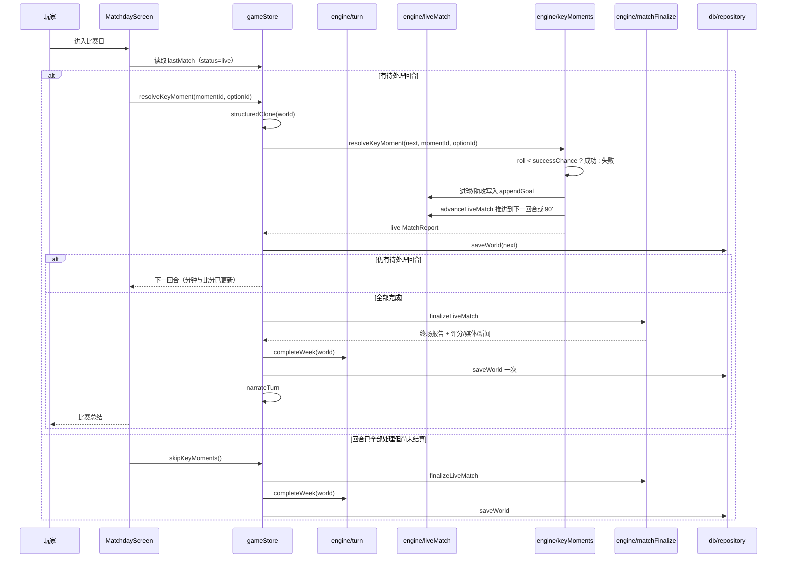

# 比赛日与关键回合

## 业务目标

一场用户比赛从第 1 分钟逐分钟实时模拟，关键回合在比赛进行到对应分钟时暂停，玩家的选择立即改写比分、时间线与随后 10 分钟的势头，而不是在已经“预定”的终场比分上补充进球。玩家的选择必须真正决定比赛走向。

## 用户流程

1. 玩家推进一周，`startWeek` 完成赛前准备并开始比赛；比分从 `0-0` 开始逐分钟推进。
2. 比赛在第一个关键回合分钟暂停，store 保存 live 存档并引导玩家进入 `/match`，此时不增加周次。
3. 玩家按顺序处理每个回合：阅读场景、选择选项，立即看到比分/时间线变化，然后比赛继续推进到下一个回合或 90 分钟。
4. 每个回合结算后立即持久化；刷新页面可回到同一分钟、同一待处理回合。
5. 全部回合处理完后，玩家点击“完成比赛”或在最后一回合自动进入终场结算：评分、MOTM、媒体反应、新闻与赛季数据一次性生成。
6. store 随后调用 `completeWeek`：结算背景比赛、财务、周事件与身价，周次 +1，再触发可选 AI 叙事。
7. 玩家也可以“自动处理”，系统为每个回合选择默认（成功率最高）选项，并自动完成整周。

## 关键时序

失败分支：

- 回合 ID 不是下一条待处理 → `resolveKeyMoment` 返回 `null`，store 提示“已经结束或选项无效”。
- 存档写入失败 → 内存状态保留，顶部提示“保存失败：<原因>”；再次点击不会重复结算或推进周次。
- AI 叙事失败 → 比赛结果、媒体反应与新闻保留，只显示错误提示。
- 旧版存档（无 `pendingWeekPlan`）→ 完成回合后只结算比赛，不调用 `completeWeek`，不会多推一周。

## 规则与边界

### 出场判定

`determineUserSelection`：

- 受伤或体能 <26：不出场。
- 综合评分：
  `(能力 - 队友阵容能力) × 2.2 + (教练信任 - 50) × 0.22 + (体能 - 70) × 0.2 + (状态 - 50) × 0.12 + (锐度 - 50) × 0.08`
- 体能 ≥38 且（评分 ≥−3.5，或评分 ≥−9 且 55% 概率）→ 首发 90 分钟。
- 体能 ≥45 且评分 ≥−18 且 45% 概率 → 替补 15–30 分钟。
- 其余不出场。

### 逐分钟实时模拟

- 赛前用 `expectedGoals` + 俱乐部风格修正计算 `homeXg/awayXg`（与旧版一致）。
- 每分钟主客各一次伯努利判定：`p = clamp(xG / 90 × 势头系数, 0, 0.5)`。
- 每分钟使用独立随机流：`createRng(seed, 'live', fixtureId, minute)`；同一 seed 下暂停、读档、重放结果一致。
- 关键回合所在分钟跳过自动进球判定，只由该回合结果决定是否进球。
- 进球统一经 `appendGoal` 写入 `report.goals`、`report.homeGoals/awayGoals`、`fixture.homeGoals/awayGoals` 与时间线；禁止从事件反推比分。
- 第一次跨过第 45 分钟时冻结半场比分并补一条半场事件，之后不再变化。
- 90 分钟只推进 `currentMinute`，不自动结算；终场由 `finalizeLiveMatch` 负责。
- 替补球员在登场前不会成为进球者或助攻者：用户可选窗口为 `90 - userMinutes` 到 90，未出场权重为 0。

### 势头

不落盘，完全由已结算回合推导：

- 取最近一个已结算且距当前分钟 ≤10 分钟的回合，`decay = 1 - (minute - momentMinute) / 10`。
- 成功：用户方 ×`(1 + 0.15 × decay)`，对手 ×`(1 - 0.10 × decay)`。
- 失败：用户方 ×`(1 - 0.10 × decay)`，对手 ×`(1 + 0.12 × decay)`。
- 没有已结算回合或超出 10 分钟：双方 ×1。

读档后只需 `outcome` 与分钟即可重建同一势头，无新增持久字段。

### 关键回合生成

- 仅当用户出场且分钟数 >0 时生成。
- 数量：`min(rng.int(2, 4), 出场 ≥70 ? 4 : ≥40 ? 3 : 2)`。
- 位置池：
  - 门将：扑救、扑救、解围
  - 后卫：对抗、解围、对抗、机会
  - 中场：直塞、机会、对抗、点球
  - 前锋：机会、机会、点球、直塞
- 分钟在出场窗口内均匀分布并加 ±3 扰动，保证递增且不重复。
- `roll` 在生成时固定为 0–1 的四位小数；后续只比较 `roll < successChance`。
- 每个选项含成功率、成功/失败评分、士气、教练信任、进球/助攻标记。

### 回合结算

- `success = moment.roll < option.successChance`。
- 实时比赛（`status === 'live'`）：
  - 成功且 `goalOnSuccess`：立即为用户方追加进球，`userGoals + 1`。
  - 成功且 `assistOnSuccess`：为球队生成一粒队友进球，用户 `userAssists + 1`。
  - 失败：不增加进球。
  - 士气、信心、教练/媒体/球迷关系立即结算。
  - **不**在回合中写赛季进球/助攻/评分/form；`ratingDelta` 存入 outcome，终场统一加总。
  - 结算后调用 `advanceLiveMatch`，推进到下一个关键回合分钟或 90 分钟。
- 旧版 `final` 报告（v1 存档遗留的未完成回合）保留旧路径：立即写赛季统计、评分、form、新闻与时间线，避免旧档行为漂移。

### 终场结算

`finalizeLiveMatch` 幂等（`status === 'final'` 直接返回）：

- 由 `report.goals` 统计 AI 射手/助攻赛季数据；用户数据经 `updateUserAfterMatch` 一次写入。
- 最终评分 = `computeUserRating(...)` 基础分 + 所有 `outcome.ratingDelta` 之和，clamp 4.3–9.9。
- MOTM 依据 `report.goals` 的射手与最终评分；用户评分 ≥8.3 归用户。
- 生成黄牌/伤病/机会事件并并入时间线，追加 `fulltime` 事件与 `mediaReaction`。
- `fixture.status = 'played'`，写报告与比赛新闻；`report.status = 'final'`、`currentMinute = 90`。

### 自动处理

- 对每个待处理回合选择 `defaultOptionId`（成功率最高的稳妥选项）。
- 仍逐条走 `resolveKeyMoment`，结果与玩家选择同一路径。
- `advanceWeek` / `advanceWeeks` / `simulateUserFixture` 兼容入口会 start → autoResolve → finalize → complete，保持“一次推进一周”的旧语义。

### 交互状态

- 存在待处理回合时隐藏“下一场”入口与「返回主页」按钮，避免跳过后面的关键回合。
- live 且无待处理回合时显示“第 X 分钟，比赛等待结算”与「完成比赛」按钮。
- 只有 `final` 报告才渲染结果页；结果页末尾提供整宽「返回主页」主按钮。
- 提交回合或自动处理期间按钮锁定；即使动作抛错也会在 `finally` 解锁。

### 不可变条件

- 比赛不得预先确定终场比分；比分只能是“截至当前分钟”的累计。
- `roll` 不得重抽、不得在结算时重新计算成功率。
- 关键回合顺序不可交换。
- 比分只能由 `appendGoal` 写入；同一进球不得重复计数。
- 未完成全部回合时不得生成媒体反应、评分或推进下一周。
- 赛季统计、form、MOTM、新闻只在终场结算一次。

## 数据与接口

读写：

- `world.lastMatch`：`MatchReport`，live 阶段 `userRating = null`、`motmName = ''`、`motmRating = 0`、无 `mediaReaction`。
- `world.pendingWeekPlan`：live 期间保存本周计划与 `fixtureId`，用于完成后继续结算。
- `world.fixtures[fixtureId]`：`status` 为 `scheduled / live / played`，比分实时同步。
- 用户球员：`seasonStats`、`form`、`morale`、`confidence`、`reputation`、`injury`。
- `world.relationships`：教练、媒体、球迷。
- `world.news`：比赛新闻与惊险比赛新闻（终场生成）。

调用：

- `engine.startWeek(world, plan)` / `engine.completeWeek(world)`
- `engine.startUserMatch(world, fixture)`
- `engine.advanceLiveMatch(world)`
- `engine.generateKeyMoments(player, rng, minutes, isHome, startMinute)`
- `engine.resolveKeyMoment(world, momentId, optionId)`
- `engine.autoResolveKeyMoments(world)`
- `engine.finalizeMatchday(world)` / `engine.finalizeLiveMatch(world)`
- `domain.computeLeagueTable(world, leagueId, season)`

## 失败与降级

| 场景 | 行为 |
|---|---|
| 用户未出场/无关键回合 | `startWeek` 内完整模拟 90 分钟并结算整周，不进入回合流程 |
| 无效回合或选项 | 返回 `null`，store 提示，不修改状态 |
| 重复提交同一回合 | 第二次返回 `null` |
| 存档失败 | 内存结果保留，持久化失败不阻塞；再次操作不会重复结算或推进周次 |
| 页面刷新 | live 报告与 `pendingWeekPlan` 一起落盘，回到同一分钟、同一待处理回合 |
| 旧版存档未完成回合 | 保留旧结算路径，完成回合后不多推周 |
| AI 叙事失败 | 比赛报告、媒体反应与新闻保留 |

## 平台差异

无差异。比赛与关键回合完全本地计算；UI 只负责展示与收集选择。

宽屏布局：`≥640px` 起页面以 720px 专注宽度居中（`--focus-max`），保持单列关键回合流程，不拆两栏。

## 验收与测试映射

| 规则/场景 | 测试 |
|---|---|
| 首个回合前比分不是终场比分 | `tests/engine/liveMatch.test.ts` |
| 实时比分等于截至当前分钟的进球和 | `tests/engine/liveMatch.test.ts` |
| 半场比分冻结、替补登场前不进球 | `tests/engine/liveMatch.test.ts` |
| 关键回合成功/失败立即改写比分 | `tests/engine/liveMatch.test.ts` |
| 暂停/读档/重放一致、终场幂等 | `tests/engine/liveMatch.test.ts` |
| 关键回合生成数量、顺序、选项 | `tests/engine/keyMoments.test.ts` |
| 终场评分、form、赛季统计、新闻 | `tests/engine/keyMoments.test.ts`、`tests/engine/motm.test.ts` |
| 比赛模拟、出场判定、赛季统计 | `tests/engine/season.test.ts`、`tests/engine/match.test.ts` |
| startWeek/completeWeek 两阶段 | `tests/engine/turn.test.ts` |
| store 保存、完成与失败恢复 | `tests/store/matchdayStore.test.ts` |
| 比赛页渲染与实时比分 | `tests/ui/matchday.test.tsx`、`tests/ui/matchdayLive.test.tsx` |
| 主页/赛程 live 展示 | `tests/ui/matchdayLive.test.tsx` |

手动验收：

1. 推进一周，确认第一个关键回合的比分不是最终比分，且分钟等于该回合分钟。
2. 选择一个回合，确认比分/时间线/分钟按选择变化，随后比赛继续。
3. 刷新页面，确认分钟、比分与待处理回合一致。
4. 处理最后一个回合或点击“完成比赛”，确认进入结果页并显示最终比分、MOTM 与媒体反应。
5. 在 360–390px 宽度确认选项按钮可点击、不溢出；桌面宽度确认 720px 居中。

## 变更记录

| 日期 | 变更 | 关联 |
|---|---|---|
| 2026-10-26 | 初版：出场、比分、关键回合、结算、最终化与失败降级 | ADR 0001 |
| 2026-10-28 | 积分榜计算 `computeLeagueTable` 下沉至 `src/domain/leagueTable.ts`，斩断 engine→world 与 llm/ui→engine 深引 | 全量重构提交 3 |
| 2026-10-29 | 关键回合选项构建外迁 `src/engine/data/keyMomentOptions.ts`、叙事与媒体反应外迁 `src/engine/keyMomentNarrative.ts`，keyMoments.ts 只保留编排；golden 哈希不变 | 全量重构提交 7 |
| 2026-10-30 | 宽屏下比赛日以 720px 专注宽度居中；比赛规则与结算不变 | 响应式改造 |
| 2026-10-29 | 比赛模拟拆为 `matchGoals.ts`（期望进球/射手/助攻/伤种）与 `matchUser.ts`（选人/评分/赛后结算），match.ts 只保留比赛编排；RNG 顺序不变，golden 哈希一致 | 全量重构提交 8 |
| 2026-10-29 | 比赛日动作迁入 `store/matchSlice.ts`，Dashboard/Schedule 的待处理回合与赛程派生改走 `store/selectors.ts`，消除 ui→engine/world 直接依赖 | 全量重构提交 10 |
| 2026-10-29 | `MatchdayScreen` 拆为 `ui/screens/matchday/*`：比分卡、关键时刻选择、赛后回顾、文字直播与回合工具，主组件只做编排；新增页面状态测试，视觉与交互不变 | 全量重构提交 11 |
| 2026-10-29 | 全场最佳在用户为射手王但评分 <8.3 时改用用户实际评分，消除姓名与评分矛盾；golden 哈希不变 | 缺陷修复 P4 |
| 2026-10-29 | 待处理回合时隐藏“下一场”入口；回合动作用 try/finally 解锁按钮 | 缺陷修复 P5 |
| 2026-10-31 | 结果页末尾新增整宽「返回主页」主按钮，下一场信息合并为按钮上方说明；比赛结算规则不变 | 交互修复：结果页出口 |
| 2026-10-31 | 重做逐分钟实时模拟：取消预生成终场比分，关键回合插入实时进程并立即改写比分/势头；终场统一结算评分与赛季数据；存档升 v2；engine 0.2.0，golden 哈希更新 | 缺陷修复：比赛日比分穿越 |
