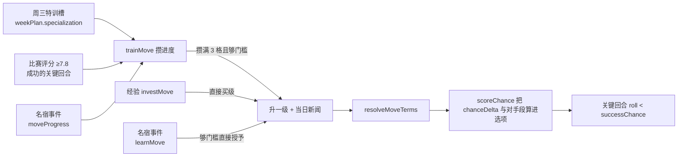
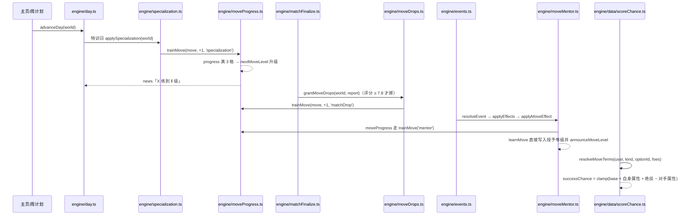

# 绝技（Player Moves）

## 业务目标

关键回合的选项以前是「所有人都能选、概率写死」，玩家看不出自己练的东西有什么差别。绝技层要解决三件事：

1. **招牌动作成为可拥有的东西**：64 条绝技分四档稀有度、三个级数（Ⅰ/Ⅱ/Ⅲ），每条都写清「谁能用、在哪个关键时刻生效、加多少成功率、凭什么加」。
2. **四条获取路径都要真的通**：经验解锁升级、名宿通过事件传授、周三特训槽攒进度、高评分比赛掉落进度。玩家练什么由自己的日程与机遇决定。
3. **概率变化必须可解释**：绝技加成写进选项的 `successBasisZh`（例：`彩虹过人 Ⅲ +10%`），并且和对手属性一起在同一公式里算完，开球时锁进战报，结算时不重算。

## 用户流程

## 关键时序

## 规则与边界

| 规则 | 口径 | 出处 |
|---|---|---|
| 级数上限 | `MOVE_MAX_LEVEL = 3`，每条模板固定 3 档，缺档在加载期就报错 | `src/domain/moves.ts` |
| 进度格 | `MOVE_PROGRESS_PER_LEVEL = 3`：特训/掉落/点拨每次 +1，攒满才允许升级 | `src/domain/moves.ts` |
| 0 级语义 | `level: 0` 的记录是「还没学会但在练」；攒满 3 格且够 Ⅰ 级门槛才第一次入门 | `nextMoveLevel` |
| 门槛 | 每级 `minOverall` 单调递增，综合分不够就不升级，进度继续攒着 | `src/domain/moveQueries.ts` |
| 位置闸门 | `moveFitsPosition`：`positions` 与 `positionGroup(position)` 对不上则不涨进度、不给学 | 三条获取路径共用 |
| 获取路径 | `unlock.via` 声明 `exp / mentor / specialization / matchDrop`；没开门的路径走不进去 | 内容门禁 + 引擎闸门 |
| 成功率预算 | `RARITY_CHANCE_BUDGET`：常见 4.5%、罕见 6.5%、招牌 8.5%、传奇 11%（取满级 `chanceDelta`），超预算在 `npm run validate:data` 阶段拒绝 | `src/domain/moves.ts` |
| 概率冻结 | 选项 `roll` 生成时预抽、`successChance` 生成时算死；结算只做 `roll < successChance`，绝技与对手段都必须在生成时就位 | `src/engine/keyMomentGen.ts` |
| 比赛中禁止改 | `investMove` 与属性投资共用 `matchInProgress` 刹车（`pendingDayPlan` 或 live 报告） | `src/engine/growth.ts` |
| 经验价 | `investMoveCost` 取下一级 `costExp`，满级返回 `null`，界面据此换成「已练到尽头」 | `src/domain/moveQueries.ts` |
| 拒绝码 | `noUser / unknownMove / maxed / matchLive / wrongPosition / overLevel / notEnoughExp`，整笔拒绝不部分成交 | `src/engine/growth.ts` |
| 掉落候选 | `movesTargeting(kind, optionId)` ∩ `unlock.via` 含 `matchDrop` ∩ 位置对得上，`createRng(seed,'moveDrop',fixtureId,momentId).pick` | `src/engine/moveDrops.ts` |
| 名宿授予上限 | `grantedLevel` 逐级回退到综合分够得到的那一级，且 `target ≤ current` 时只补进度、不降级 | `src/engine/moveMentor.ts` |
| 播报口径 | 三条路径共用 `announceMoveLevel`，标题只有 `学会X` 或 `X 练到 Ⅱ 级`，界面按标题认级数 | `src/engine/moveProgress.ts` |
| 老存档 | v9 补 `player.moves = []` 与 `weekPlan.specialization = null`；v10 补名宿关系，否则 `learnMove / legendTrust` 在老档上静默失效 | `src/db/migrateSteps.ts` |

## 数据与接口

- 内容：`data/moves/{dribbling,shooting,passing,tempo,aerial,defending,goalkeeping,setpiece}.json`，每个家族 8 条、共 64 条；稀有度分布 common 17 / rare 27 / signature 13 / legendary 7；开了名宿路径的 12 条、开了特训槽的 48 条。
- 结构：`MoveDefinition = { id, nameZh, family, rarity, positions, targets, levels[3], counter?, unlock:{via,...}, textZh }`，`level = { level, minOverall, costExp, chanceDelta, riskDelta, basisZh }`。
- 球员侧：`Player.moves: PlayerMove[]`，`PlayerMove = { moveId, level, progress }`；周计划侧：`world.weekPlan.specialization: string | null`。
- 事件侧：`EffectOp` 的 `learnMove / moveProgress` 带可选 `moveId`，加载期由 `moveEffectIssues`（`src/domain/eventSchema.ts`）校验：必须点名绝技、绝技必须存在且把 `mentor` 列为获取路径、`learnMove` 的 `delta` 落在 `1..levels.length`、`moveProgress` 的 `delta ≥ 1`。
- 引擎写入口（除 `trainMove` 外都不允许直接改 `player.moves`）：`investMove`（经验）、`applySpecialization`（特训日，附带 `SPECIALIZATION_EXP = 1` 经验）、`grantMoveDrops`（比赛结算）、`applyMoveEffect`（事件结算，转 `teachMoveByMentor` / `advanceMoveByMentor`）。
- 只读口：`moveById` / `allMoves` / `MOVES` / `moveLevelOf` / `movesTargeting` / `resolveMoveTerms` / `MOVE_LEVEL_MARKS`。

## 失败与降级

| 情况 | 行为 |
|---|---|
| 绝技 JSON 少一档、`chanceDelta` 越预算、`targets` 指向未知关键时刻 | `npm run validate:data` 直接失败并给中文原因（`check:fast` 的一环），坏内容进不了运行时 |
| 事件点名了不存在的绝技 / 那条绝技没开名宿路径 | 加载期 `moveEffectIssues` 抛中文原因，整包拒绝加载 |
| 玩家在比赛进行中点「解锁绝技」 | `investMove` 回 `matchLive`，不改世界、不扣经验 |
| 名宿教的位置不符（门将学彩虹过人） | 闸门返回 `false`，档案与新闻都不动 |
| 综合分够不到 Ⅰ 级门槛 | 退化成攒 1 格进度，等身体追上那天由 `nextMoveLevel` 自动入门 |
| 绝技已满级还被特训/点拨 | `trainMove` 返回 `false`，调用方据此不再发经验 |
| 存档缺 `moves`（v8 及更早） | 迁移补空账本，界面按「一条不会」渲染，不报错 |
| LLM 想虚构绝技 | LLM 只能改写事件标题/正文，`Effect` 与 `moveId` 全部来自数据包，无法注入 |

## 平台差异

纯计算与数据，不触碰平台能力：Web 与 Capacitor 走同一条 `advanceDay` 路径，绝技进度、掉落与传授全部落在存档里。移动端只需注意 `/moves` 页在 360px 单列可读（界面尚未落地，见「变更记录」的未完成项）。

## 验收与测试映射

| 验收点 | 测试 |
|---|---|
| 64 条绝技、四档稀有度、八大家族的结构与唯一 id | `tests/domain/moves.test.ts` |
| 内容门禁：缺档、越预算、`targets` 指向未知关键时刻、中文文本为空 | `tests/domain/movesContentGate.test.ts` |
| 事件效果必须点名绝技且绝技必须开名宿路径 | `tests/domain/eventMoveEffects.test.ts` |
| 经验解锁：门槛、位置、满级、买不起四种拒绝码 | `tests/engine/growthMoves.test.ts` |
| 周三特训槽：进度累积、没排槽不发生、受伤当天不练、位置不符不涨、只有特训日推进、满级与未知 id 不给进度 | `tests/engine/specialization.test.ts` |
| 比赛掉落：评分门槛、只发给成功回合、同种子重放同一掉落 | `tests/engine/moveDrops.test.ts` |
| 名宿传授：授予等级、不降级、点拨攒进度、`legendTrust` 落进关系、resolveEvent 全链路 | `tests/engine/moveMentor.test.ts` |
| 绝技加成进入关键回合概率与 `successBasisZh` | `tests/engine/keyMomentMoves.test.ts` |
| v8→v9 补绝技账本与特训槽、live 档迁移后踢完 | `tests/db/migrationV9.test.ts` |
| v9→v10 补名宿关系，`learnMove / legendTrust` 在老档不再静默失效 | `tests/db/migrationV10.test.ts` |
| 绝技效果在界面上读成中文（`学会 彩虹过人` / `彩虹过人 进度 +2`） | `tests/ui/effectLabels.test.tsx` |

## 变更记录

| 日期 | 变化 | 来源 |
|---|---|---|
| 2026-11-02 | 绝技层落地：`data/moves/*.json` 64 条 + 加载期门禁 + `resolveMoveTerms` 进 `scoreChance`，`Player.moves` 与 `weekPlan.specialization` 进存档（v9） | M1.10b |
| 2026-11-02 | 路径一：`investMove` 用经验解锁/升级，七类拒绝码整笔拒绝；比赛中禁止改 | M1.10b |
| 2026-11-02 | 路径二：`applySpecialization` 落在周三特训日，`day.ts` 的晨间步骤调用；`trainMove` 统一攒进度与升级 | M1.11 |
| 2026-11-02 | 路径三：`grantMoveDrops` 让评分 ≥7.8 的成功关键回合掉修炼进度，抽签域 `(fixtureId, momentId)` 保证可重放 | M1.11 |
| 2026-11-02 | 路径四：名宿事件包 `data/events/mentor.json`（9 条模板、覆盖 12 条绝技）+ `applyMoveEffect` 的 `learnMove / moveProgress` 闸门；`RelationshipRole` 加 `legend`，存档升 v10（`ENGINE_VERSION` 0.12.0，回放基准 `82fe56a7e245ea77` → `a53d784da26c391d`） | M1.11 |
| 2026-11-02 | 未完成：`/moves` 与 `/moves/:moveId` 页面、周计划里的特训选择器、`KeyMomentCard` 的绝技徽标与对手段展示、`tests/engine/movesBalance.test.ts` 的整季成功率预算带 | 下一步 |
