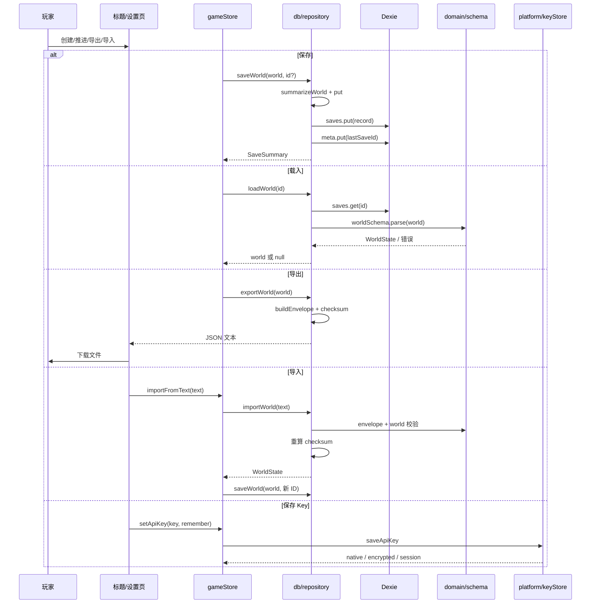

# 存档、导入与导出

## 业务目标

玩家的生涯必须在本地可靠保存：刷新、关闭浏览器、切换设备（通过导出文件）都不能无故丢失进度。导入必须拒绝损坏、被篡改或来自更高版本的文件；API Key 必须与存档分离，避免随导出文件泄露。

## 用户流程

1. 创建生涯后自动保存；每次推进、处理关键回合、生成叙事、修改设置、发送 AI 对话后自动保存。
2. 打开游戏时读取 `lastSaveId`，自动载入上次存档；失败则回到标题页。
3. 玩家在标题页/设置页查看存档列表，可载入或删除。
4. 玩家可导出当前生涯为 JSON 文件；文件名包含球员名、赛季与周次。
5. 玩家可导入 JSON 文件；校验通过后作为新存档写入，不覆盖现有存档。
6. API Key 单独保存在平台安全存储；清除 Key 不影响存档。

## 关键时序

## 规则与边界

### 自动保存时机

- 创建生涯成功。
- 每次 `advance` 完成。
- 每处理一条关键回合。
- 自动处理关键回合。
- 每周 AI 叙事写入后。
- 处理事件选项。
- 修改设置。
- 发送 AI 对话并收到回复。
- 手动“保存”。

保存是“整世界覆盖”，没有增量 patch。写入失败不阻塞内存推进，但会导致进度无法恢复；这是当前已知风险，后续应增加显式失败提示。

### 存档 ID 与摘要

- ID：`save:<seed>:<Date.now 的 base36>:<4 位随机>`。
- 摘要：球员名、俱乐部名、赛季、周次、年龄、综合能力、更新时间。
- 列表按 `updatedAt` 倒序；时间相同时按 ID 字典序。
- `meta.lastSaveId` 指向最近保存的存档；删除该存档时清除。

### 导出

- 文件名：`pitch-life-<球员名>-<season>-W<week>.json`，非法字符替换为下划线。
- Envelope 字段：`format`、`saveVersion`、`engineVersion`、`exportedAt`、`checksum`、`world`。
- `checksum = hashString(canonicalStringify(world))`。
- 导出不包含 API Key、`secrets` 表或任何平台密钥材料。

### 导入

顺序：

1. `JSON.parse`，失败 → “不是有效的 JSON 文件”。
2. `saveEnvelopeSchema.safeParse`，失败 → 带字段路径的中文错误。
3. `saveVersion > CURRENT_SAVE_VERSION` → 拒绝“来自更新版本”。
4. `worldSchema.parse`，检查玩家、俱乐部、周次等不变量。
5. 重新计算 checksum 并比对，失败 → “存档校验失败，文件可能已损坏”。
6. 生成新存档 ID 并写入，不覆盖原存档。

当前 `CURRENT_SAVE_VERSION = 1`，没有旧版本迁移逻辑；升级版本时必须补迁移、fixture 与往返测试。

### IndexedDB

- 数据库 `pitch-life-db`，表 `saves`、`meta`、`secrets`。
- 版本 1 建 `saves`、`meta`；版本 2 增加 `secrets`。
- `saves` 存整世界；`meta` 存 `lastSaveId`；`secrets` 仅 Web 密钥方案使用。

### API Key

- Android：Capacitor SecureStorage。
- Web：AES-GCM 加密后存 `secrets`，包装密钥为不可导出 `CryptoKey`。
- 无法加密时只保留会话内存，并提示“刷新后需要重新填写”。
- Key 不写入 `WorldState`，不进入导出文件，不出现在日志/错误中。
- `world.settings.rememberKey` 只记录玩家选择，不代表 Key 本身。

### 不可变条件

- 持久化前必须通过 `worldSchema`；不得写入未校验的导入数据。
- checksum 必须覆盖完整 world；导入必须重算。
- 导入不得覆盖已有存档。
- 删除存档不可恢复；UI 应提供确认。
- Key 与存档必须分离。

## 数据与接口

读取/写入：

- `SaveRecord`：`{ id, summary, world }`
- `SaveSummary`
- `SaveEnvelope`
- `CURRENT_SAVE_VERSION`、`SAVE_FORMAT`
- `WorldState`

调用：

- `saveWorld`、`loadWorld`、`listSaves`、`deleteSave`
- `getLastSaveId`、`setLastSaveId`、`clearLastSaveId`
- `buildEnvelope`、`exportWorld`、`importWorld`（`db/repository`）
- `downloadWorld`（`store/exportSave`，经 `platform/fileExport.downloadTextFile` 触发下载）
- `loadApiKey`、`saveApiKey`、`clearApiKey`、`getLoadedApiKey`（`platform/keyStore`，持久化经注入的 `SecretStore` 端口）

## 失败与降级

| 场景 | 行为 |
|---|---|
| IndexedDB 不可用/配额满 | 保存失败；内存继续，提示能力有限 |
| 读取上次存档失败 | 记录错误，回到标题页，不覆盖存档 |
| JSON 损坏 | 拒绝导入，不写入 |
| 字段缺失/非法 | 拒绝导入，提示字段路径 |
| checksum 不匹配 | 拒绝导入，提示文件损坏 |
| 存档版本更高 | 拒绝导入，提示更新游戏 |
| 删除当前存档 | 清空内存世界与 `lastSaveId`，回到标题页 |
| Android 安全存储失败 | Key 只保留会话，提示用户 |
| Web 无法加密 | Key 只保留会话，提示用户 |
| 导出时无世界 | 不执行下载，提示先创建/载入生涯 |

## 平台差异

| 平台 | 存档 | 导出 | Key |
|---|---|---|---|
| Web/PWA | IndexedDB | DOM 下载 | AES-GCM + IndexedDB，失败则会话 |
| Android | IndexedDB（WebView） | 浏览器下载/分享（视实现） | SecureStorage |
| iOS | IndexedDB（规划） | 分享面板（规划） | Keychain（规划） |
| 微信小程序 | 需适配 storage（规划） | 文件/剪贴板（规划） | 小程序 storage（需评估） |

核心存档格式跨平台一致；差异只在存储与导出适配器。

## 验收与测试映射

| 规则/场景 | 测试 |
|---|---|
| 保存/读取/列表/删除 | `tests/db/save.test.ts` |
| 导出/导入 round-trip | `tests/db/save.test.ts` |
| checksum 篡改 | `tests/db/save.test.ts` |
| 更高版本拒绝 | `tests/db/save.test.ts` |
| Zod 校验失败 | `tests/db/save.test.ts` |
| store 自动保存与载入 | `tests/store/store.test.ts` |
| Key 不进入存档 | `tests/db/save.test.ts`、`tests/store/store.test.ts` |

手动验收：

1. 创建生涯 → 刷新 → 自动恢复。
2. 推进数周 → 导出 → 删除存档 → 导入 → 状态一致。
3. 手动改 JSON 的一个比分 → 导入必须失败。
4. 清除 Key → 存档仍可载入，AI 功能提示重新配置。
5. Android 上确认 Key 保存在安全存储，导出文件不含 Key。

## 变更记录

| 日期 | 变更 | 关联 |
|---|---|---|
| 2026-10-26 | 初版：自动保存、envelope、导入校验、IndexedDB 与 Key 分离 | ADR 0001 |
| 2026-10-28 | hashString 下沉 `src/lib/rng.ts`，repository 校验和 import 路径调整，checksum 输出与导入校验行为不变 | 全量重构 P1 |
