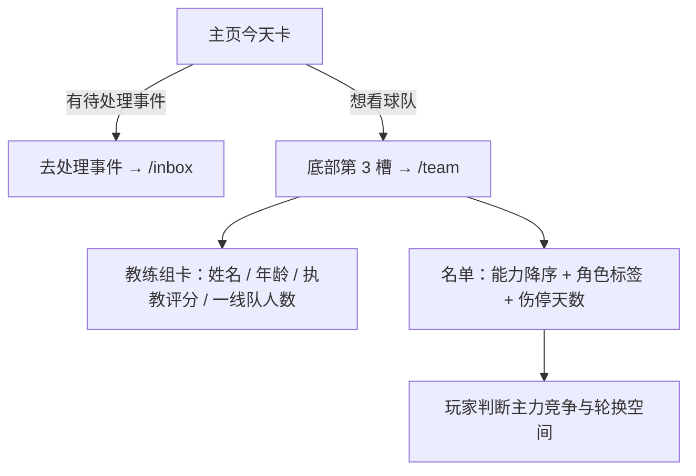
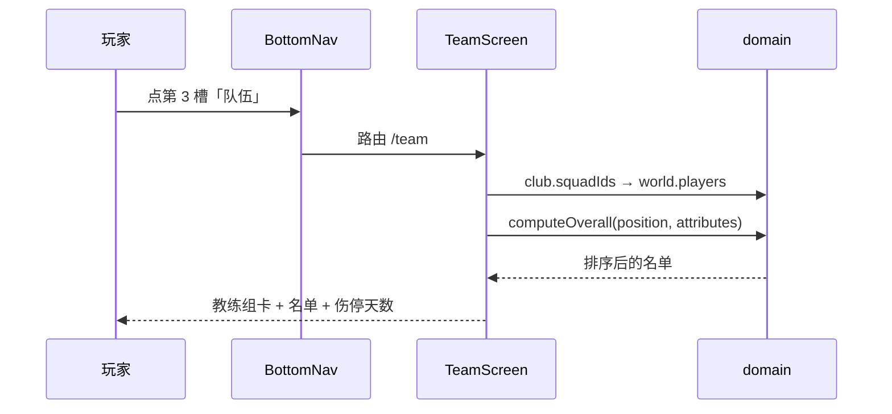

# 队伍页与主页今天区

## 业务目标

让玩家看见自己身处一支球队：谁是队友、能力几何、谁在伤停、主教练是谁，以及「今天到底发生了什么、要处理什么」。

本功能交付三件事：

1. **/team 队伍页**：一线队名单按能力排序，逐行给出位置、年龄、状态与队内角色，伤停队友直接写明缺阵天数；页首是教练组卡。
2. **主页「今天」卡**：把今天的身份（训练日 / 比赛日 / 休整日）、本周训练重点、额外安排与待处理事件集中在一处。
3. **导航改槽**：底部第 3 槽由收件箱改为队伍，事件处理入口收敛到「今天」卡，未读徽标改挂主页槽。

## 用户流程

## 关键时序

## 规则与边界

- 名单是 `world` 的**只读派生**：页面不写任何事实，不改时钟，不影响存档与赛季回放基准。
- 能力用 `computeOverall(position, attributes)` 现算，与引擎选人和直播使用同一函数，避免出现两套分数。
- 排序稳定：能力降序；同能力时保持 `squadIds` 原顺序。
- 角色标签取自 `squadRole`，映射青训 / 轮换 / 主力 / 核心，颜色按 `ROLE_TONE` 分级。
- 伤停一律按**天**表述：`{伤处} · 预计缺阵 {n} 天`，与主页头、生涯页同口径，不再出现「周」。
- 「今天」卡的身份判定复用 `weekDayRoles` + `fixtureDayOf`：比赛日只显示对手与主客，训练日显示 `TRAINING_LABELS` 的重点，额外安排只在本周活动日且不为「不加安排」时出现。
- 事件条只投影 `status === 'open' && week === world.week`，最多展示 2 条；引擎尚未按天生成事件（属于每日事件批次），因此这里不承诺「今天必有事件」。
- 收件箱仍是独立路由 `/inbox`，只是不再是顶级导航；新闻卡的「查看全部」同样能进。

## 数据与接口

| 接口 | 输入 | 输出 | 说明 |
| --- | --- | --- | --- |
| `TeamScreen()` | 无（读 `useGameStore.world`） | JSX | world 为空时返回 null |
| `SquadList({ squad, userId })` | `Player[]`、`Id` | JSX | 能力已降序 |
| `SquadRow({ player, isUser })` | `Player`、`boolean` | JSX | 伤停行条件渲染 |
| `CoachCard({ club })` | `Club` | JSX | 读 `club.coach` 与 `club.squadIds.length` |
| `TodaySection({ world, events })` | `WorldState`、`GameEvent[]` | JSX | 块属性 `data-dashboard-block="today"` |
| `SQUAD_ROLE_LABELS` | `squadRole` | 中文标签 | 位于 `src/ui/labels.ts` |

## 失败与降级

- `world` 缺失（未载入存档）：整页返回 null，由布局层显示标题页。
- 名单里出现缺失球员 id：`world.players[id]` 为空会让排序抛错，因此 squadIds 由世界生成器与迁移保证一致；损坏存档在读取层已被 `assertWorld` 拒绝。
- 教练字段缺失：不可能为空，`Club.coach` 是必填结构，老存档由迁移补齐。
- 无待处理事件：今天卡显示平静日文案，不显示按钮，避免死链。

## 平台差异

- 移动端：底部导航 5 槽不变，`/team` 用 `page-pad pb-6 sm:mx-auto sm:max-w-[760px]` 单列，触控目标 ≥44px（导航槽 `min-h-14`）。
- 桌面（≥1024px）：左侧栏取代底部导航，`/team` 居中收窄到 760px 阅读宽度。
- 未读徽标在两种布局下都挂在主页槽，数字 >9 显示 `9+`。

## 验收与测试映射

| 用例 | 断言 |
| --- | --- |
| `tests/ui/teamScreen.test.tsx` 按能力排序列出本队球员并标注位置与角色 | 页头「队伍」+ 俱乐部中文名 + 能力最高者 + 角色标签出现 |
| `tests/ui/teamScreen.test.tsx` 伤停的队友给出预计缺阵天数 | `预计缺阵 14 天` |
| `tests/ui/teamScreen.test.tsx` 教练卡显示教练与执教评分 | 教练姓名与 `quality` 数字 |
| `tests/ui/teamScreen.test.tsx` 换成队伍入口，不再直接暴露收件箱 | `/team` 链接存在，收件箱链接不存在 |
| `tests/ui/teamScreen.test.tsx` 有未处理事件时徽标挂在主页槽 | 主页槽内出现徽标数字 |
| `tests/ui/todaySection.test.tsx` 训练日 / 比赛日 / 平静日 / 事件四条用例 | 今天卡身份与跳转 |
| `tests/ui/dashboardLayout.test.tsx` keeps the mobile block order… | 块顺序含 `today`、侧栏不再有 `inbox` |

## 变更记录

| 日期 | 变更 |
| --- | --- |
| 2026-11-02 | 首版：/team 队伍页、主页今天区、底部第 3 槽改队伍、未读徽标挪到主页槽。 |
