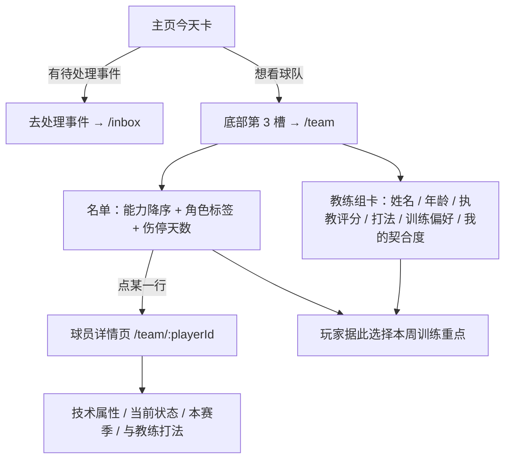
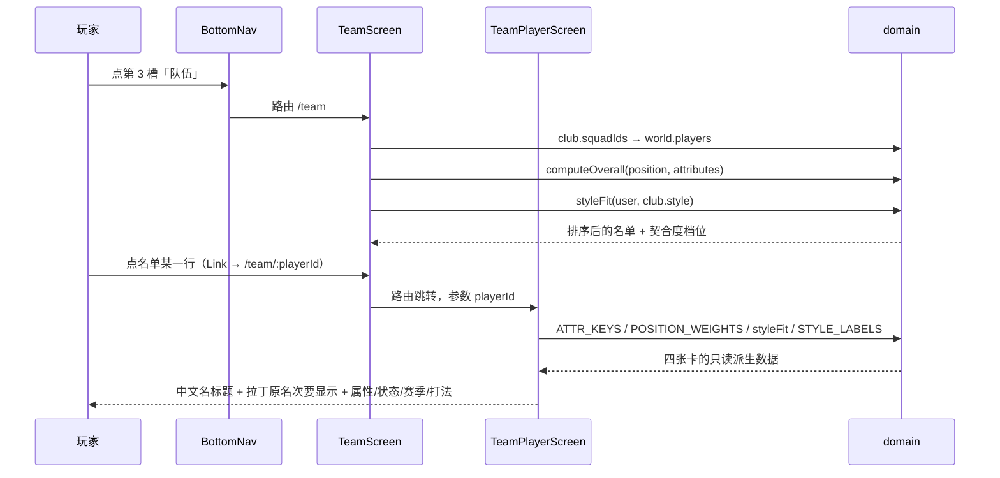

# 队伍页、球员详情页与主页今天区

## 业务目标

让玩家看见自己身处一支球队：谁是队友、能力几何、谁在伤停、主教练踢什么打法、自己在这套打法里值多少出场顺位，以及「今天到底发生了什么、要处理什么」。

本功能交付四件事：

1. **/team 队伍页**：一线队名单按能力排序，逐行给出位置、年龄、状态与队内角色，伤停队友直接写明缺阵天数；页首是教练组卡，写清打法、训练偏好与本人契合度。
2. **/team/:playerId 球员详情页**：把一名球员拆成技术属性（含位置权重占比）、当前状态、本赛季数据、与教练打法的匹配四张卡，让「竞争从哪来」可查证。
3. **主页「今天」卡**：把今天的身份（训练日 / 比赛日 / 休整日）、本周训练重点、额外安排与待处理事件集中在一处。
4. **导航改槽**：底部第 3 槽由收件箱改为队伍，事件处理入口收敛到「今天」卡，未读徽标改挂主页槽。

边界：本页只放**俱乐部发的人**——队友与教练组属于球队，玩家不能雇也不能解。主角自己掏钱雇的私人班底（队医、心理咨询师、私人教练）在 `/staff`，读写口与价格规则见 [个人团队](private-staff.md)。

## 用户流程

## 关键时序

## 规则与边界

- 名单与详情页是 `world` 的**只读派生**：页面不写任何事实，不改时钟，不影响存档与赛季回放基准。
- 标题与一切正文名字取 `displayName(entity)`（中文名），拉丁原名只作为副标题出现，且仅在两者不同时渲染。
- 能力用 `computeOverall(position, attributes)` 现算，与引擎选人和直播使用同一函数，避免出现两套分数。
- 排序稳定：能力降序；同能力时保持 `squadIds` 原顺序。
- 角色标签取自 `squadRole`，映射青训 / 轮换 / 主力 / 核心，颜色按 `ROLE_TONE` 分级。
- 伤停一律按**天**表述：`{伤处} · 预计缺阵 {n} 天`，与主页头、生涯页同口径，不再出现「周」。
- 详情页把 `fitness` 显示为「体能储备」，与属性表里 `stamina` 的「体能」区分开，避免同页两个「体能」指向两个不同数值。
- 打法模型是 `src/domain/coachStyle.ts` 的纯函数：`styleFit` 按 `STYLE_ATTRS` 加权求和后夹到 0–1，阈值 0.62 / 0.45 切「风格契合 / 风格中性 / 风格不合」三档；`styleSynergy` 只在训练重点命中 `STYLE_TRAINING_BONUS` 时给 1.12。
- 教练卡必须把规则说明白：不契合时同等状态下更难首发——这是 `engine/matchUser.selectionScore` 里 `(styleFit − 0.5) × 4` 项的玩家可见口径，不允许退化成隐藏系数。
- 「今天」卡的身份判定复用 `weekDayRoles` + `fixtureDayOf`：比赛日只显示对手与主客，训练日显示 `TRAINING_LABELS` 的重点，额外安排只在本周活动日且不为「不加安排」时出现。
- 事件条只投影 `status === 'open' && week === world.week`，最多展示 2 条；引擎尚未按天生成事件（属于每日事件批次），因此这里不承诺「今天必有事件」。
- 收件箱仍是独立路由 `/inbox`，只是不再是顶级导航；新闻卡的「查看全部」同样能进。

## 数据与接口

| 接口 | 输入 | 输出 | 说明 |
| --- | --- | --- | --- |
| `TeamScreen()` | 无（读 `useGameStore.world`） | JSX | world 为空时返回 null |
| `TeamPlayerScreen()` | 路由参数 `playerId` | JSX | 未知 id 显示空态 |
| `SquadList({ squad, userId })` | `Player[]`、`Id` | JSX | 能力已降序 |
| `SquadRow({ player, isUser })` | `Player`、`boolean` | JSX | `<Link to="/team/:id">`，伤停行条件渲染 |
| `CoachCard({ club, user })` | `Club`、`Player` | JSX | 打法、训练偏好、契合度档位 |
| `PlayerAttributes` / `PlayerCondition` / `PlayerSeasonCard` / `PlayerStyleCard` | `Player`（打法卡另需 `Club`、`Relationship`） | JSX | 详情页四张卡 |
| `styleFit(player, style)` | `Player`、`ClubStyle` | 0–1 | 纯函数，不消耗 RNG |
| `styleFitLabel(fit)` / `styleAdvice(style, fit)` / `styleTopAttrs(style)` | 契合度 / 打法 | 中文档位 / 一句话 / 属性键 | 文案唯一来源 |
| `STYLE_LABELS` / `STYLE_ATTRS` / `STYLE_TRAINING_BONUS` | `ClubStyle` | 中文标签 / 权重表 / 训练重点 | 位于 `src/domain/coachStyle.ts` |
| `TodaySection({ world, events })` | `WorldState`、`GameEvent[]` | JSX | 块属性 `data-dashboard-block="today"` |
| `SQUAD_ROLE_LABELS` | `squadRole` | 中文标签 | 位于 `src/ui/labels.ts` |

## 失败与降级

- `world` 缺失（未载入存档）：整页返回 null，由布局层显示标题页。
- `playerId` 不在 `world.players`（转会离队、损坏 id）：详情页显示「找不到这名球员」空态加返回名单，不抛异常；`club` 缺失走同一分支。
- 名单里出现缺失球员 id：`world.players[id]` 为空会让排序抛错，因此 squadIds 由世界生成器与迁移保证一致；损坏存档在读取层已被 `assertWorld` 拒绝。
- 教练字段缺失：不可能为空，`Club.coach` 是必填结构，老存档由迁移补齐。
- 队友关系缺失（新加入的队友尚无 `rel:teammate:*`）：打法卡只渲染教练与契合度，关系区块整体不渲染。
- 无待处理事件：今天卡显示平静日文案，不显示按钮，避免死链。

## 平台差异

- 移动端：底部导航 5 槽不变，`/team` 与 `/team/:playerId` 用 `page-pad pb-6 sm:mx-auto sm:max-w-[760px]` 单列，触控目标 ≥44px（导航槽 `min-h-14`、名单行 `min-h-[44px]`、返回链接 `min-h-[44px]`）。同源 iframe 在 360/390px 实测：两页 `scrollWidth === clientWidth`（可用宽度 345/375px），无越界元素，最小触控高度 44px。
- 详情页属性网格为 2 列（360px 下每列约 150px，标签 + 数值 + 权重占比不折行溢出），赛季数据为 3 列小卡。
- 桌面（≥1024px）：左侧栏取代底部导航，两页居中收窄到 760px 阅读宽度。
- 未读徽标在两种布局下都挂在主页槽，数字 >9 显示 `9+`。

## 验收与测试映射

| 用例 | 断言 |
| --- | --- |
| `tests/ui/teamScreen.test.tsx` 按能力排序列出本队球员并标注位置与角色 | 页头「队伍」+ 俱乐部中文名 + 能力最高者 + 角色标签出现 |
| `tests/ui/teamScreen.test.tsx` 伤停的队友给出预计缺阵天数 | `预计缺阵 14 天` |
| `tests/ui/teamScreen.test.tsx` 教练卡显示教练与执教评分 | 教练中文名与 `quality` 数字 |
| `tests/ui/teamScreen.test.tsx` 教练卡把打法、训练偏好与我的契合度写成一句人话 | `STYLE_LABELS` + `训练偏好「…」` + 契合度档位 + `更难首发` |
| `tests/ui/teamScreen.test.tsx` 名单里的每一行都是指向详情页的链接 | 行链接 `href` 含 `/team/{playerId}` |
| `tests/ui/teamScreen.test.tsx` 换成队伍入口，不再直接暴露收件箱 | `/team` 链接存在，收件箱链接不存在 |
| `tests/ui/teamScreen.test.tsx` 有未处理事件时徽标挂在主页槽 | 主页槽内出现徽标数字 |
| `tests/ui/teamPlayerDetail.test.tsx` 用中文名做标题，拉丁原名只作为次要信息出现 | h1 严格等于 `nameZh` |
| `tests/ui/teamPlayerDetail.test.tsx` 十项属性、状态条与赛季数据一并列出 | `ATTR_KEYS` 全标签 + 能力/潜力 + 位置中文标签 |
| `tests/ui/teamPlayerDetail.test.tsx` 写清这名球员与主教练打法的契合度 | 契合度档位 + 打法说明 + 主教练中文名 |
| `tests/ui/teamPlayerDetail.test.tsx` 陌生 id 给出可读的空态而不是崩溃 | 「找不到」空态文案 |
| `tests/domain/coachStyle.test.ts` 5 条 | 四种打法标签与训练重点合法、契合度区间与可复现、组织型/长传型单调性、三档边界、1.12 加成 |
| `tests/engine/coachStyle.test.ts` 3 条 | 选型公式含风格项、训练成长含风格协同、40 种子下换打法会改变首发数 |
| `tests/ui/layoutContract.test.tsx` 两页根节点与名单行的布局契约 | `page-pad` + `sm:max-w-[760px]`、无 >340px 固定宽度、每个 `a` 都是 44px 触控目标 |
| `tests/ui/todaySection.test.tsx` 训练日 / 比赛日 / 平静日 / 事件四条用例 | 今天卡身份与跳转 |
| `tests/ui/dashboardLayout.test.tsx` keeps the mobile block order… | 块顺序含 `today`、侧栏不再有 `inbox` |

## 变更记录

| 日期 | 变更 |
| --- | --- |
| 2026-11-02 | M1.5：新增 `/team/:playerId` 球员详情页（技术属性 / 状态 / 赛季 / 打法四卡，中文名标题）；教练卡补打法、训练偏好与契合度，并把「不契合更难首发」写成明面规则；名单行改为可点链接、队伍页测试在路由器下渲染；`src/domain/coachStyle.ts` 成为打法模型唯一来源，引擎选型与训练成长接入（见 docs/features/matchday.md、docs/features/daily-turn.md）。 |
| 2026-11-02 | 首版：/team 队伍页、主页今天区、底部第 3 槽改队伍、未读徽标挪到主页槽。 |
