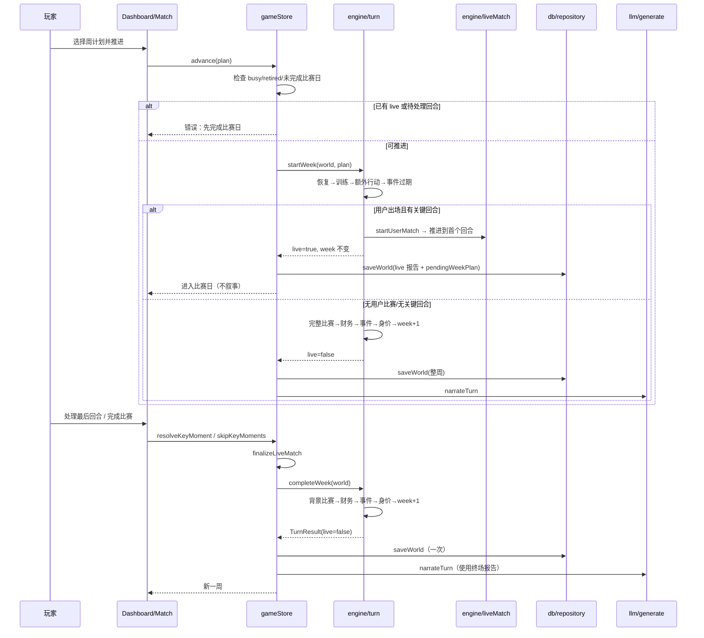

# 每周回合

## 业务目标

玩家每周做一次训练与额外行动选择，系统按确定性规则结算成长、伤病、比赛、财务与事件，并推进到下一周。比赛日需要玩家参与时，周推进会拆成“开始本周”和“完成本周”两段，保证关键回合真正发生在比赛进程里，同时回合仍然原子、可回放、可持久化。

## 用户流程

1. 玩家在 `/game` 选择训练重点（身体/技术/战术/恢复）与额外行动（媒体/经纪人/社交/休息/家庭/无）。
2. 点击“推进一周”，store 检查忙碌、退役、是否有未完成的比赛日。
3. `startWeek` 依次执行恢复、训练、额外行动、事件过期，然后开始用户比赛：
   - 无用户比赛：直接结算比赛、财务、事件、身价并推进周次。
   - 用户出场且有关键回合：停在第一个关键回合，写入 `pendingWeekPlan`，周次不变。
   - 用户不出场或无关键回合：完整模拟 90 分钟并结算整周。
4. live 阶段进入 `/match`；每个关键回合处理一条立即持久化，比赛在本周内推进。
5. 最后一回合或“完成比赛”后，store 调用 `finalizeLiveMatch` 与 `completeWeek`：结算背景比赛、财务、周事件、身价，周次 +1，再触发可选 LLM 叙事。
6. 第 38 周结束后自动进入下赛季，展示赛季总结、奖项、升降级与退役提示。

## 关键时序

## 规则与边界

### 两阶段推进

`TurnResult = { world, match, event, seasonTransition, weekPlayed, seasonPlayed, live }`。

- `startWeek(input, plan)`：
  1. 克隆输入；退役时直接返回 `live: false`。
  2. 已存在 live 报告或未完成关键回合时原样返回 `live: true`，不重复训练/恢复（幂等）。
  3. 执行 `recomputeAllStrengths → recoverInjuries → applyTraining → applyExtraAction → expireEvents`。
  4. 取本周用户 fixture：
     - 没有用户比赛：直接进入完成阶段。
     - 用户不出场 / 没有关键回合：完整模拟 90 分钟并结算，然后进入完成阶段。
     - 用户出场且有关键回合：创建 live 报告，推进到第一个回合分钟，写 `world.pendingWeekPlan = { ...plan, fixtureId }`，`week` 不变，返回 `live: true`。
- `completeWeek(input)`：
  1. 无 `pendingWeekPlan` 时 no-op（兼容旧档，避免多推一周）。
  2. live 报告仍有待处理回合时拒绝；否则推进到 90 分钟并 `finalizeLiveMatch`。
  3. 执行 `simulateWeekFixtures`（当前周 `scheduled` 且非用户场次）→ `settleWeekFinance` → `generateWeeklyEvent` → 每 3 周 `updatePlayerValue` → `week += 1` → 超过 `totalWeeks` 时 `endSeason` → 清空 `pendingWeekPlan`。
- `advanceWeek(input, plan)`：兼容入口 = `startWeek` → 若 live 则按默认选项 `autoResolveKeyMoments` → `finalizeMatchday` → `completeWeek`。测试、golden、非交互调用保持“一次推进一周”的旧语义。
- `advanceWeeks`：循环调用 `advanceWeek`，遇到退役或赛季切换提前停止。

### 顺序（不可交换）

赛前准备：`recomputeAllStrengths → recoverInjuries → applyTraining → applyExtraAction → expireEvents`。

完成后结算：`simulateWeekFixtures → settleWeekFinance → generateWeeklyEvent → updatePlayerValue（每 3 周）→ week+1 → endSeason（必要时）→ 清空 pendingWeekPlan`。

顺序变化会改变体能、伤病、比赛结果与随机流，属于引擎行为变更。

### 训练

- 受伤时：体能 +3、锐度 −1，不再成长。
- 成长空间 `headroom = max(0, potential - overall)`；为 0 时不加属性。
- 年龄系数：≤20 为 1.25，≤24 为 1，≤28 为 0.72，其余 0.35。
- 设施系数：`0.78 + facilities / 40`。
- 教练系数：`0.88 + coach.quality / 60`。
- 强度：恢复 0.35，其余 1。
- 体能低于 40 时成长 ×0.6。
- 基础成长：`(0.014 + headroom × 0.0022) × 年龄 × 设施 × 教练 × 强度 × 体能`，每个属性再乘 0.6–1.4 的随机系数。
- 体能变化：身体 −9、技术 −6、战术 −5、恢复 +15，再统一 +3。
- 锐度变化：身体 +3、技术 +4、战术 +4、恢复 −2。
- 士气：恢复 +1，战术 +0.5。
- 受伤概率：`0.012 × (1 + (100 - fitness) / 100 × 1.2) × 训练风险 × 年龄风险`；身体 1.5、技术 0.8、战术 0.7、恢复 0.25；30 岁及以上 ×1.3。伤停 1–5 周。

### 额外行动

| 行动 | 效果 | 新闻 |
|---|---|---|
| `media` | 媒体声望 +1.5，球迷声望 +1 | 接受本地媒体采访 |
| `agent` | 经纪人信任 +2，金钱 +200 | 商业活动 |
| `social` | 队友信任 +2，士气 +2，体能 −2 | 队友聚餐 |
| `rest` | 体能 +8，锐度 −2，士气 +1 | 恢复 |
| `family` | 家人信任 +3，士气 +3，体能 +2 | 回家 |
| `none` | 无 | 无 |

### 事件

- 每周 72% 概率生成事件；已有同类伤病事件时不再生成。
- 事件上下文：伤病、未出场、评分 ≥7.3、评分 <6.2、额外行动为媒体、普通周。
- 模板文案与结果文案集中在 `src/engine/data/eventTemplates.ts`，`events.ts` 只做上下文插值与流程编排；未知模板回退到简化版队友聚餐。
- 有效期 2 周；`expiresWeek < week` 时标记 `expired`。
- 事件选项效果由 `applyEffects` 统一结算；特殊事件（伤病、消费）有额外逻辑。
- 新闻上限：事件生成时截断到 80 条。

### 财务

- 周收入 = 周薪 + 未到期赞助。
- 周支出 = 周薪 × 18% + 15,000。
- 余额为负时士气 −1；每 4 周生成一次余额告急新闻。
- 财务流水保留最近 120 条。

### 赛季切换

- 第 38 周推进后 `week = 39`，触发 `endSeason`。
- 赛季最后一轮必须先完成比赛与终场结算，再触发赛季结算；`lastMatch` 不会因完成比赛而丢失。
- 结算联赛排名、冠军、金靴、最佳年轻球员、奖金、声望。
- 顶级联赛后 3 名降级，次级联赛前 3 名升级；俱乐部 `leagueId` / `tier` 同步调整。
- 所有球员年龄 +1；30 岁后属性下降，22 岁及以下 AI 球员按潜力成长。
- 合同到期自动续约；用户周薪 ×1.14，33 岁及以上只续 1 年。
- 满足条件时退役：`retired = true`，写入生涯记录与新闻。
- 重置赛季统计、生成新赛季赛程、关闭所有开放事件、写入赛季新闻。
- 新赛季 `week = 1`，`lastMatch = null`。

### 不可变条件

- `startWeek` / `completeWeek` / `advanceWeek` 不得修改入参；内部必须 `structuredClone`。
- 所有随机数必须来自 `createRng`，且域标签与顺序稳定。
- live 期间 `week` 不变；有未完成回合时不得推进下一周。
- 重复调用 `startWeek` 不得重复训练、恢复或生成比赛。
- `completeWeek` 只处理存在 `pendingWeekPlan` 的周。
- 退役后不得再推进。
- 周次只能递增；赛季切换时由 `endSeason` 重置为 1。

## 数据与接口

读写：

- `world.week` / `season` / `players` / `clubs` / `fixtures` / `events` / `finance` / `news` / `lastMatch` / `seasonSummaries`
- `world.pendingWeekPlan`：`WeeklyPlan & { fixtureId: Id | null }`，live 期间存在，完成周后清空。
- `WeeklyPlan`：`{ training, extra }`
- `TurnResult`：`{ world, match, event, seasonTransition, weekPlayed, seasonPlayed, live }`

调用：

- `store.advance(plan)` → `engine.startWeek`
- `store.resolveKeyMoment` / `skipKeyMoments` → `engine.resolveKeyMoment` / `autoResolveKeyMoments` → `engine.finalizeLiveMatch` → `engine.completeWeek`
- `store.narrateTurn` → `llm.narrateWeek`

持久化：

- live 开始、每个关键回合处理完、终场完成周各保存一次。
- 叙事生成后再次持久化。

## 失败与降级

| 场景 | 行为 |
|---|---|
| 无世界 / 忙碌 / 已退役 | 直接返回 `null`，不推进 |
| 已有 live 或未完成关键回合 | 拒绝 `advance`，提示先完成比赛日 |
| 重复 `startWeek` | 原样返回 live 状态，不重复训练/恢复 |
| live 未完成时 `completeWeek` | 拒绝推进，返回当前 live 状态 |
| 无 `pendingWeekPlan` 的旧档 | `completeWeek` no-op，不多推一周 |
| 存档写入失败 | 内存状态保留，提示“保存失败：<原因>”；不会重复结算或推进 |
| LLM 未配置/失败 | 保留本地模板叙事，显示错误提示 |
| LLM 返回时周次已变化 | 通过 `saveId + season + week` 校验丢弃过期结果 |
| 叙事校验失败 | 重试 2 次后降级；比赛结果不受影响 |

## 平台差异

| 平台 | 差异 |
|---|---|
| Web/PWA | 无差异 |
| Android | 无差异；LLM 可走原生 HTTP |
| iOS | 无差异（未实现） |
| 微信小程序 | 无差异（未实现） |

核心回合完全本地计算，不依赖网络。

宽屏布局：

- 主页 `≥1024px` 为主次两栏：左列最近比赛/本周状态/下一场/推进，右列球员状态/迷你积分表/收件箱预览/新闻；`<640px` 顺序不变。
- 赛程页 `≥1024px` 隐藏 tab，赛程与积分榜并排常驻；积分表外层 `overflow-x-auto`，窄屏不出横向滚动。
- 区块顺序由 `data-dashboard-block` 标记保护，测试逐项比对。

## 验收与测试映射

| 规则/场景 | 测试 |
|---|---|
| startWeek 停在首个回合、week 不变 | `tests/engine/turn.test.ts` |
| 重复 startWeek 不重复训练/恢复 | `tests/engine/turn.test.ts` |
| completeWeek 拒绝未完成 live | `tests/engine/turn.test.ts` |
| completeWeek 结算背景比赛/财务/事件/week+1 | `tests/engine/turn.test.ts` |
| advanceWeek 兼容入口自动完成整周 | `tests/engine/turn.test.ts` |
| 赛季最后一周先完成比赛再结算 | `tests/engine/turn.test.ts` |
| 回合顺序与周次推进 | `tests/engine/season.test.ts` |
| 训练成长、体能、伤病 | `tests/engine/season.test.ts` |
| 同 seed 回放一致 | `tests/engine/determinism.test.ts` |
| store 守卫、持久化、叙事降级 | `tests/store/store.test.ts` |
| live/完成的单次保存与失败恢复 | `tests/store/matchdayStore.test.ts` |
| 主页区块顺序与两栏归属 | `tests/ui/dashboardLayout.test.tsx` |
| 赛程双面板常驻与表格溢出容器 | `tests/ui/schedule.test.tsx` |

手动验收：

1. 连续推进 3 周，确认训练、体能、财务与新闻变化。
2. 制造伤病，确认恢复与训练分支。
3. live 期间刷新，确认周次不变且回到同一回合。
4. 推进到第 38 周，确认比赛完成后才触发赛季总结、升降级与合同变化。
5. 1024px 宽度下确认主页两栏、赛程并排，360px 下区块顺序与并排前一致。

## 变更记录

| 日期 | 变更 | 关联 |
|---|---|---|
| 2026-10-26 | 初版：回合顺序、训练/事件/财务规则、赛季切换与失败降级 | ADR 0001 |
| 2026-10-28 | createRng 下沉 `src/lib/rng.ts`，engine（match/turn/events/training/keyMoments）import 路径调整，回合行为与 golden 哈希不变 | 全量重构 P1 |
| 2026-10-28 | engine/match、engine/turn 改从 `src/domain/strength`、`src/domain/fixtures` 引入 computeClubStrength/generateFixtures，消除 engine→world 违规；回合与赛季切换行为不变 | 全量重构 P1 |
| 2026-10-28 | engine/turn 改从 `src/domain/leagueTable` 引入 computeLeagueTable；赛季结算排名逻辑与 golden 哈希不变 | 全量重构 P1 |
| 2026-10-29 | 事件模板与结果文案外迁 `src/engine/data/eventTemplates.ts`，events.ts 降为插值与编排，golden 哈希不变 | 全量重构提交 6 |
| 2026-10-29 | 赛季结算拆为 `season.ts`（评价 + 转季步骤）与 `seasonAwards.ts`（奖项/历史/新闻），turn.ts 只保留编排；赛季切换行为与 golden 哈希不变 | 全量重构提交 8 |
| 2026-10-30 | 主页与赛程页落地宽屏布局（`lg:` 两栏/并排、表格溢出容器）；回合规则不变 | 响应式改造 |
| 2026-10-29 | gameStore 拆为 career/match/ai/ui 四个切片 + helpers，动作体抽为独立 handler 压复杂度；状态与行为保持不变 | 全量重构提交 10 |
| 2026-10-29 | 主页拆为 `ui/screens/dashboard/*`，派生状态集中到 `dashboardData.ts`，AI 叙事/待处理回合/联赛迷你表/新闻各自独立，主组件只编排 | 全量重构提交 11 |
| 2026-10-29 | 收件箱拆为 `ui/screens/inbox/*`，待处理事件卡片与已处理列表独立，事件展示与选择行为保持不变 | 全量重构提交 12 |
| 2026-10-31 | 周推进拆为 `startWeek` / `completeWeek`：关键回合在比赛进程中暂停，`pendingWeekPlan` 支持中途存档；`advanceWeek` 保留兼容语义；engine 0.2.0，golden 哈希更新 | 缺陷修复：比赛日比分穿越 |
