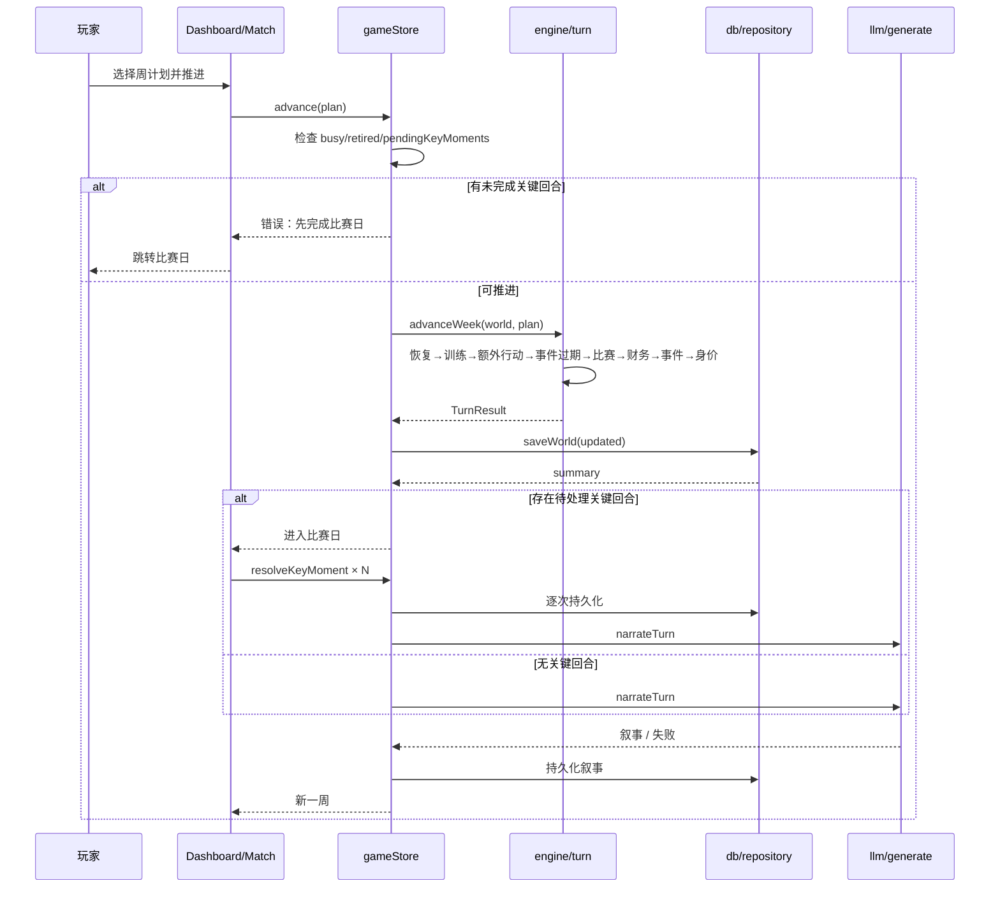

# 每周回合

## 业务目标

玩家每周做一次训练与额外行动选择，系统按确定性规则结算成长、伤病、比赛、财务与事件，并推进到下一周。回合必须原子、可回放、可持久化；失败不能留下半结算状态。

## 用户流程

1. 玩家在 `/game` 选择训练重点（身体/技术/战术/恢复）与额外行动（媒体/经纪人/社交/休息/家庭/无）。
2. 点击“推进一周”，store 检查是否忙碌、是否退役、是否有未完成的关键回合。
3. 引擎依次结算恢复、训练、额外行动、事件过期、比赛、财务、新事件、身价，并推进周次。
4. store 持久化新世界；如果本周有用户比赛且存在关键回合，进入 `/match` 逐条处理。
5. 所有关键回合完成后，store 触发可选的 LLM 叙事；失败则保留本地模板。
6. 第 38 周结束后自动进入下赛季，展示赛季总结、奖项、升降级与退役提示。

## 关键时序

## 规则与边界

### 回合顺序（不可交换）

1. `recomputeAllStrengths`
2. `recoverInjuries`
3. `applyTraining(focus)`
4. `applyExtraAction(extra)`
5. `expireEvents`
6. `simulateWeekFixtures`
7. `settleWeekFinance`
8. `generateWeeklyEvent`
9. 每 3 周 `updatePlayerValue`
10. `week += 1`；超过 38 时 `endSeason`

顺序变化会改变体能、伤病、比赛结果与随机流，属于引擎行为变更。

### 训练

- 受伤时：体能 +3、锐度 −1，不再成长。
- 成长空间 `headroom = max(0, potential - overall)`；为 0 时不加属性。
- 年龄系数：≤20 为 1.25，≤24 为 1，≤28 为 0.72，其余 0.35。
- 设施系数：`0.78 + facilities / 40`。
- 教练系数：`0.88 + coach.quality / 60`。
- 强度：恢复 0.35，其余 1。
- 体能低于 40 时成长 ×0.6。
- 基础成长：`(0.014 + headroom × 0.0022) × 年龄 × 设施 × 教练 × 强度 × 体能`，每个属性再乘 0.6–1.4 的随机系数。
- 体能变化：身体 −9、技术 −6、战术 −5、恢复 +15，再统一 +3。
- 锐度变化：身体 +3、技术 +4、战术 +4、恢复 −2。
- 士气：恢复 +1，战术 +0.5。
- 受伤概率：`0.012 × (1 + (100 - fitness) / 100 × 1.2) × 训练风险 × 年龄风险`；身体 1.5、技术 0.8、战术 0.7、恢复 0.25；30 岁及以上 ×1.3。伤停 1–5 周。

### 额外行动

| 行动 | 效果 | 新闻 |
|---|---|---|
| `media` | 媒体声望 +1.5，球迷声望 +1 | 接受本地媒体采访 |
| `agent` | 经纪人信任 +2，金钱 +200 | 商业活动 |
| `social` | 队友信任 +2，士气 +2，体能 −2 | 队友聚餐 |
| `rest` | 体能 +8，锐度 −2，士气 +1 | 恢复 |
| `family` | 家人信任 +3，士气 +3，体能 +2 | 回家 |
| `none` | 无 | 无 |

### 事件

- 每周 72% 概率生成事件；已有同类伤病事件时不再生成。
- 事件上下文：伤病、未出场、评分 ≥7.3、评分 <6.2、额外行动为媒体、普通周。
- 模板文案与结果文案集中在 `src/engine/data/eventTemplates.ts`，`events.ts` 只做上下文插值与流程编排；未知模板回退到简化版队友聚餐。
- 有效期 2 周；`expiresWeek < week` 时标记 `expired`。
- 事件选项效果由 `applyEffects` 统一结算；特殊事件（伤病、消费）有额外逻辑。
- 新闻上限：事件生成时截断到 80 条。

### 财务

- 周收入 = 周薪 + 未到期赞助。
- 周支出 = 周薪 × 18% + 15,000。
- 余额为负时士气 −1；每 4 周生成一次余额告急新闻。
- 财务流水保留最近 120 条。

### 赛季切换

- 第 38 周推进后 `week = 39`，触发 `endSeason`。
- 结算联赛排名、冠军、金靴、最佳年轻球员、奖金、声望。
- 顶级联赛后 3 名降级，次级联赛前 3 名升级；俱乐部 `leagueId` / `tier` 同步调整。
- 所有球员年龄 +1；30 岁后属性下降，22 岁及以下 AI 球员按潜力成长。
- 合同到期自动续约；用户周薪 ×1.14，33 岁及以上只续 1 年。
- 满足条件时退役：`retired = true`，写入生涯记录与新闻。
- 重置赛季统计、生成新赛季赛程、关闭所有开放事件、写入赛季新闻。
- 新赛季 `week = 1`，`lastMatch = null`。

### 不可变条件

- `advanceWeek` 不得修改入参；内部必须 `structuredClone`。
- 所有随机数必须来自 `createRng`，且域标签与顺序稳定。
- 有未完成关键回合时不得推进下一周。
- 退役后不得再推进。
- 周次只能递增；赛季切换时由 `endSeason` 重置为 1。

## 数据与接口

读写：

- `world.week` / `season` / `players` / `clubs` / `fixtures` / `events` / `finance` / `news` / `lastMatch` / `seasonSummaries`
- `WeeklyPlan`：`{ training, extra }`
- `TurnResult`：`{ world, match, event, seasonTransition, weekPlayed, seasonPlayed }`

调用：

- `store.advance(plan)` → `engine.advanceWeek`
- `store.resolveKeyMoment` / `skipKeyMoments` → `engine.resolveKeyMoment` / `autoResolveKeyMoments`
- `store.narrateTurn` → `llm.narrateWeek`

持久化：

- 每次推进后立即 `saveWorld`。
- 比赛日关键回合每处理一条立即持久化，避免中途退出丢结果。
- 叙事生成后再次持久化。

## 失败与降级

| 场景 | 行为 |
|---|---|
| 无世界 / 忙碌 / 已退役 | 直接返回 `null`，不推进 |
| 有未完成关键回合 | 显示“请先在比赛日完成本周的关键回合” |
| 存档写入失败 | `persist` 捕获并返回 `null`，内存状态仍更新；不会阻塞回合，但列表不会刷新（当前行为，修改需评估） |
| LLM 未配置/失败 | 保留本地模板叙事，显示错误提示 |
| LLM 返回时周次已变化 | 通过 `saveId + season + week` 校验丢弃过期结果 |
| 叙事校验失败 | 重试 2 次后降级；比赛结果不受影响 |

## 平台差异

| 平台 | 差异 |
|---|---|
| Web/PWA | 无差异 |
| Android | 无差异；LLM 可走原生 HTTP |
| iOS | 无差异（未实现） |
| 微信小程序 | 无差异（未实现） |

核心回合完全本地计算，不依赖网络。

## 验收与测试映射

| 规则/场景 | 测试 |
|---|---|
| 回合顺序与周次推进 | `tests/engine/season.test.ts` |
| 训练成长、体能、伤病 | `tests/engine/season.test.ts` |
| 同 seed 回放一致 | `tests/engine/determinism.test.ts` |
| store 守卫、持久化、叙事降级 | `tests/store/store.test.ts` |
| 关键回合阻塞下一周 | `tests/engine/keyMoments.test.ts`、`tests/store/store.test.ts` |

手动验收：

1. 连续推进 3 周，确认训练、体能、财务与新闻变化。
2. 制造伤病，确认恢复与训练分支。
3. 推进到第 38 周，确认赛季总结、升降级与合同变化。
4. 有未完成关键回合时尝试推进，确认被拒绝。

## 变更记录

| 日期 | 变更 | 关联 |
|---|---|---|
| 2026-10-26 | 初版：回合顺序、训练/事件/财务规则、赛季切换与失败降级 | ADR 0001 |
| 2026-10-28 | createRng 下沉 `src/lib/rng.ts`，engine（match/turn/events/training/keyMoments）import 路径调整，回合行为与 golden 哈希不变 | 全量重构 P1 |
| 2026-10-28 | engine/match、engine/turn 改从 `src/domain/strength`、`src/domain/fixtures` 引入 computeClubStrength/generateFixtures，消除 engine→world 违规；回合与赛季切换行为不变 | 全量重构 P1 |
| 2026-10-28 | engine/turn 改从 `src/domain/leagueTable` 引入 computeLeagueTable；赛季结算排名逻辑与 golden 哈希不变 | 全量重构 P1 |
