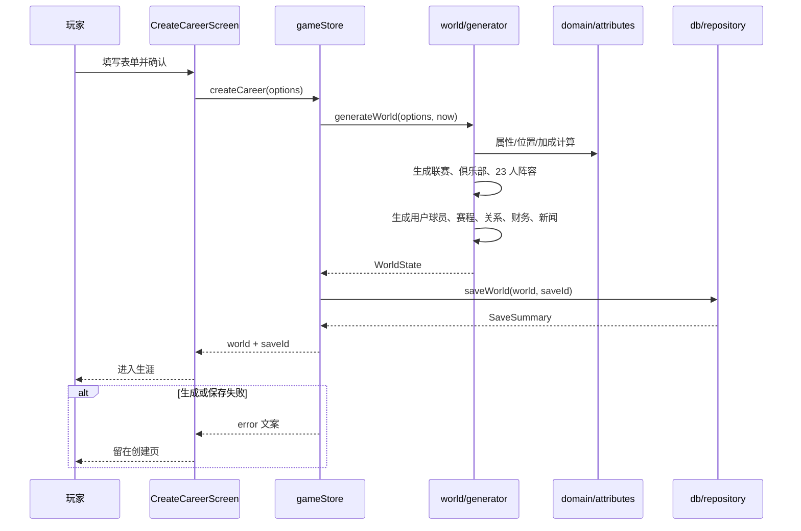

# 世界生成

## 业务目标

玩家创建生涯时，系统需要在一秒内生成一个可信、可复现的足球世界：两级联赛、完整阵容、赛程、合同、财务、关系与初始新闻。世界必须由 seed 决定，确保同一 seed 得到同一结果，便于回放、调试与防回归。

## 用户流程

1. 玩家在 `/create` 选择姓名、国籍、年龄、位置、出身、初始俱乐部与 seed（未填则随机）。
2. 点击创建后，store 调用 `generateWorld` 生成完整 `WorldState`。
3. 生成成功后立即写入 IndexedDB，并刷新存档列表。
4. 玩家进入 `/game`，看到俱乐部、教练、初始新闻与第一周对手。
5. 生成失败时停留在创建页，显示中文错误，不写入半成品存档。

## 关键时序

## 规则与边界

### 世界规模

- 国家数据包：英格兰，两级联赛（`league:ENG:1`、`league:ENG:2`）。
- 每级 20 家俱乐部，共 40 家；每家 23 名 AI 球员（2 GK / 8 DEF / 7 MID / 6 FWD 的固定位置模板）。
- 用户球员加入所选俱乐部，阵容变为 24 人。
- 每级 38 周双循环赛程：20 队 × 19 轮 × 2 = 380 场/级，每周 10 场。
- 总周数固定 `TOTAL_WEEKS = 38`，赛季起始 `START_SEASON = 2026`。

### 用户球员

- 年龄 `clamp(options.age, 16, 21)`。
- 基础能力：`46 + (age - 16) * 2 + rng.normal(0, 2.5)`。
- 潜力：`clamp(baseAbility + 24 + rng.int(0, 10) - (age - 16) * 2, 60, 92)`。
- 出身与原型通过 `backgroundBonus` / `archetypeBonus` 加属性，最后统一 clamp 到 10–96。
- 初始状态：体能 88、士气 70、信心 58、状态 55、锐度 52、伤病为空。
- 合同：周薪按能力/层级/年龄计算；18 岁及以下 3 年，否则 2 年；含 4 周薪水的签约奖金。
- 初始声望较低（本地 18、国家 8、媒体 15），随表现成长。

### 俱乐部与教练

- 俱乐部声望、预算、工资预算、设施、球场、配色、教练均来自数据包或按声望派生。
- `computeClubStrength` 按 GK 1 人、DEF 4 人、MID 4 人、FWD 2 人选出最强 11 人：
  - 进攻 = 前锋均分 × 0.58 + 中场均分 × 0.42
  - 中场 = 中场均分
  - 防守 = 后卫均分 × 0.64 + 门将均分 × 0.36
  - 综合 = 门将 × 0.1 + 后卫 × 0.28 + 中场 × 0.3 + 前锋 × 0.32
- 教练风格与俱乐部风格一致，质量 10–18。

### 赛程

- 使用 Berger 轮转 + 主客场惩罚，尽量避免连续三场同主客。
- 后半程主客对调，保证双循环。
- 赛程 ID 含联赛、赛季、周次、场次，重生成同一 seed/赛季必须完全一致。

### 关系与财务

- 初始关系：教练、3 名最强队友、经纪人、家人、媒体、球迷。
- 教练初始信任受年龄与随机影响（约 45–61）。
- 初始财务：10 周薪水 + 签约奖金 + 30 万个人积蓄；周支出 = 周薪 × 18% + 15,000。
- 初始新闻：欢迎加入俱乐部、主教练的第一句话。

### 设置与版本

- 默认 LLM：`openai` / `gpt-4.1-mini` / `standard` / `template`，温度 0.85，`max_tokens`。
- `world.version = 1`，`engineVersion = ENGINE_VERSION`。
- 同一 seed、同一数据包、同一选项必须生成逐字节等价的世界（时间字段除外）。

### 不可变条件

- 生成过程不得读取系统时间以外的全局状态；时间只用于 `createdAt` / `updatedAt`。
- 不得使用 `Math.random`；所有随机数走 `createRng(seed, domain, ...)`。
- 不得在生成后重新洗牌赛程或重算球员，除非升 `ENGINE_VERSION` 并更新回放。

## 数据与接口

读取：

- `CareerCreateOptions`：姓名、国籍、年龄、位置、原型、出身、俱乐部、seed。
- 数据包：`src/world/datapack.ts`、`src/world/data/england.ts`、`data/countries/england.json`、姓名/国籍权重。

写入 `WorldState`：

- `players` / `clubs` / `leagues` / `fixtures` / `relationships` / `finance` / `news`
- `playerId` / `clubId` / `seed` / `season` / `week` / `totalWeeks`
- `settings`、`engineVersion`、`createdAt`、`updatedAt`

调用：

- `generateWorld(options, now)`（`src/world/generator.ts`）
- `getPlayerWorldClub` / `getUserPlayer` / `getLeague` / `getClubFixtures` / `getWeekFixtures` / `ageGroupWeight`（`src/world/queries.ts`）
- `generateFixtures(leagues, seed, season)`（`src/domain/fixtures.ts`）
- `computeClubStrength(club, players, options?)`（`src/domain/strength.ts`）
- `db.saveWorld`（由 store 调用）

持久化影响：创建后立即写入 `saves` 表，并更新 `meta.lastSaveId`。

## 失败与降级

| 场景 | 行为 |
|---|---|
| 找不到所选俱乐部 | 回退到 `club:ENG:2:04`；仍找不到则抛错 |
| 数据包字段缺失/非法 | `npm run validate:data` 失败；运行时 Zod 解析失败则创建失败 |
| 姓名池缺少国籍 | 回退英格兰姓名池 |
| 俱乐部数量不足 20 | 按实际数量生成，赛程轮空处理；数据包应提前校验 |
| IndexedDB 写入失败 | store 显示“创建生涯失败”，不进入游戏 |
| 重复 seed 创建 | 生成相同世界，但存档 ID 不同；允许并存 |

## 平台差异

无差异。世界生成是纯 TypeScript，不依赖 DOM、Capacitor、网络或存储；所有平台使用同一份数据包与算法。

## 验收与测试映射

| 规则/场景 | 测试 |
|---|---|
| 生成两级联赛、40 俱乐部、完整阵容 | `tests/engine/world.test.ts` |
| 用户球员属性、合同、关系、财务 | `tests/engine/world.test.ts`、`tests/world/generation.test.ts` |
| 38 周双循环赛程、每队主客均衡 | `tests/engine/world.test.ts`、`tests/engine/season.test.ts` |
| 只读查询：俱乐部/球员/联赛/赛程/年龄权重 | `tests/world/queries.test.ts` |
| 未知俱乐部回退默认球队 | `tests/world/generation.test.ts` |
| 同 seed 输出一致 | `tests/engine/determinism.test.ts` |
| 生成结果可存档并读回 | `tests/db/save.test.ts` |

手动验收：

1. 新建生涯，确认创建耗时与首屏可用。
2. 同一 seed 创建两次，对比关键字段（球员、赛程、关系）。
3. 在 360–390px 宽度确认创建表单可操作。

## 变更记录

| 日期 | 变更 | 关联 |
|---|---|---|
| 2026-10-26 | 初版：世界规模、用户球员、赛程、关系、财务与确定性约束 | ADR 0001 |
| 2026-10-28 | rng 工具下沉 `src/lib/rng.ts`，generator 的 createRng import 路径调整，生成行为与 golden 哈希不变 | 全量重构 P1 |
| 2026-10-28 | `computeClubStrength` 下沉 `src/domain/strength.ts`、`generateFixtures`/`makeRoundRobin` 下沉 `src/domain/fixtures.ts`，斩断 engine→world 依赖并清洁超标函数；生成行为与 golden 哈希不变 | 全量重构 P1 |
| 2026-10-29 | generator 拆分为 `constants`/`playerFactory`/`clubFactory`/`initialState`/`queries`，`makeAttributes` 按门将/外场拆分降低复杂度，关系组装按角色拆分；新增回退与合同年龄测试，生成行为与 golden 哈希不变 | 全量重构 P2 |
