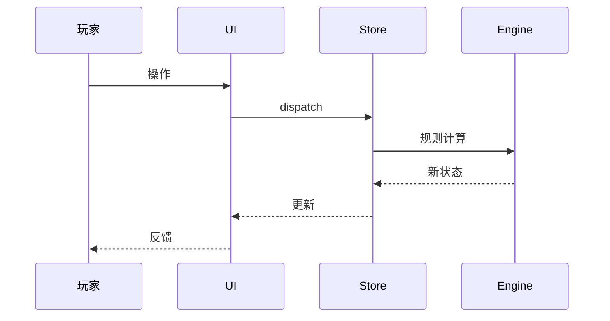

# <功能名>

## 业务目标

这个功能解决什么问题？对玩家/系统有什么价值？不写实现细节。

## 用户流程

1. 玩家...
2. 系统...
3. 失败时...

## 关键时序

补充失败/降级分支。

## 规则与边界

- 公式：
- 阈值：
- 状态转换：
- 不可变条件：
- 与其它功能的边界：

## 数据与接口

- 读写的 `WorldState` 字段：
- 调用的 engine/store/llm 接口：
- 存档/持久化影响：
- 平台能力：

## 失败与降级

| 场景 | 行为 |
|---|---|
| 无网络 | |
| 无 Key | |
| 超时/校验失败 | |
| 存档损坏 | |
| 平台能力缺失 | |

## 平台差异

| 平台 | 差异 |
|---|---|
| Web/PWA | |
| Android | |
| iOS | |
| 微信小程序 | |

没有差异时写“无差异”。

## 验收与测试映射

| 规则/场景 | 测试 |
|---|---|
| 主流程 | `tests/...` |
| 边界 | `tests/...` |
| 确定性/回放 | `tests/...` |
| 存档往返 | `tests/...` |

手动验收步骤与视口：

## 变更记录

| 日期 | 变更 | 关联 |
|---|---|---|
| 2026-10-26 | 初版 | |
